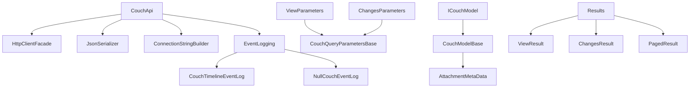

# Edge10.CouchDb.Client

**Navigation**: [Documentation Index](DocumentationIndex.md)

## Project Overview

Edge10.CouchDb.Client is a .NET library that provides a comprehensive HTTP API wrapper for CouchDB database operations. This legacy library, currently targeting .NET Framework 4.5.2, offers a complete client implementation for interacting with CouchDB instances through HTTP REST API calls.

## Key Characteristics

- **Project Type**: Class Library (.NET Framework 4.5.2)
- **Priority**: Low (Legacy but still used)
- **Primary Purpose**: CouchDB HTTP API client wrapper
- **Architecture Pattern**: Repository/API Client pattern with async/await support

## Technology Stack

- **.NET Framework**: 4.5.2
- **HTTP Client**: System.Net.Http
- **JSON Serialization**: Newtonsoft.Json 9.0.1
- **Authentication**: Basic HTTP Authentication
- **Logging**: log4net 2.0.17 (legacy, replaced by Application Insights)
- **Testing**: NUnit framework for unit tests, Selenium integration tests for CouchDB functionality

## Core Functionality

### Document Operations
- Full CRUD operations (Create, Read, Update, Delete)
- Bulk document operations
- Document existence checking
- Revision management and conflict handling

### View Queries
- CouchDB view execution with comprehensive parameter support
- Result pagination and filtering
- Custom key-based queries
- Both document and row-based result retrieval

### Attachment Management
- Complete attachment lifecycle management
- Stream-based attachment handling
- Attachment existence verification
- Metadata extraction and management

### Changes Feed Integration
- Real-time change monitoring via CouchDB changes feed
- Configurable change parameters and filters
- Both typed and untyped change result support

### Replication Support
- Active replication task monitoring
- Replication status tracking

## Architecture Components

## Key Interfaces and Classes

### Core API
- **ICouchApi**: Main API interface defining all CouchDB operations
- **CouchApi**: Primary implementation of the CouchDB client
- **ICouchDbConnectionStringBuilder**: Connection configuration management

### Document Modeling
- **ICouchModel**: Interface for CouchDB documents
- **CouchModelBase**: Base class providing standard CouchDB document properties

### Parameter Objects
- **IViewParameters**: View query configuration
- **IChangesParameters**: Changes feed configuration
- **ViewParameters**: Complete view parameter implementation

### Utility Components
- **HttpClientFacade**: HTTP client abstraction layer
- **SerializationStrategy**: Customizable JSON serialization
- **AttachmentsConverter**: JSON converter for attachment metadata

## Integration Patterns

### Authentication
- Basic HTTP authentication using Base64 encoded credentials
- Authorization header management through HttpClientFacade

### Error Handling
- Custom exceptions for CouchDB-specific errors (ConflictException, CouchTimeoutException)
- HTTP status code mapping to appropriate exceptions
- Comprehensive error response parsing

### Serialization
- Camel case property naming convention
- Type name handling for polymorphic scenarios  
- Custom converter support for complex data types

## Usage Scenarios

This library is designed for applications requiring:
- Direct CouchDB integration without higher-level ORMs
- High-performance document operations with minimal overhead
- Real-time change monitoring and synchronization
- File attachment management alongside document storage
- Custom view queries and data aggregation

## Dependencies and External Integrations

- **CouchDB Server**: Requires CouchDB 1.x/2.x compatible instance
- **HTTP Infrastructure**: Built on System.Net.Http stack
- **JSON Processing**: Leverages Newtonsoft.Json for serialization
- **Logging Framework**: Originally integrated with log4net (now replaced by Application Insights for operational logging)

## Current Status

This is a **complete and stable library** currently in production use. While representing older .NET patterns, it requires no further development work and continues to serve active production systems effectively. Modernization to .NET Standard would provide broader compatibility but is not essential for current operations.

---

*This documentation provides a comprehensive overview of the Edge10.CouchDb.Client library. For detailed implementation information, refer to the specialized documentation sections.*