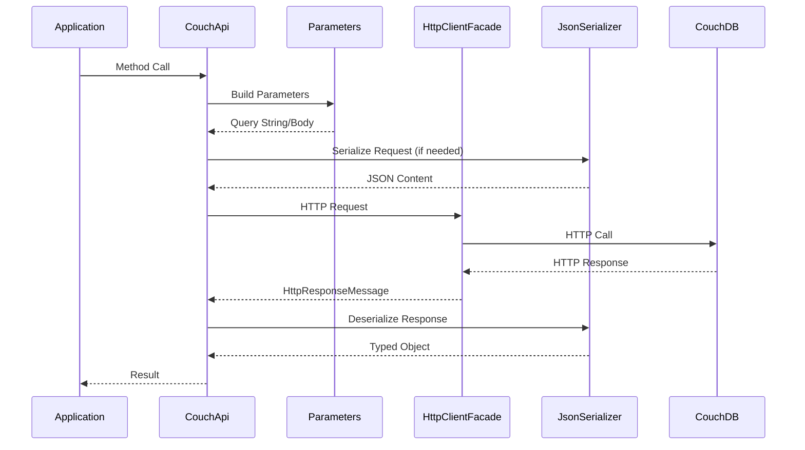
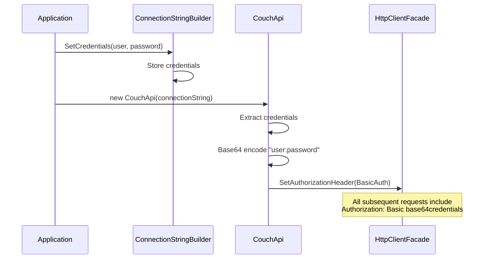
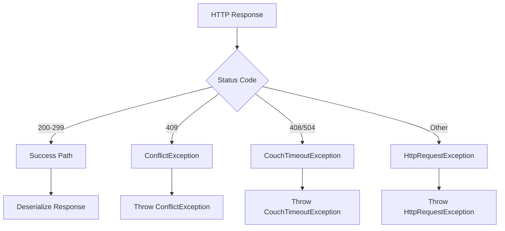
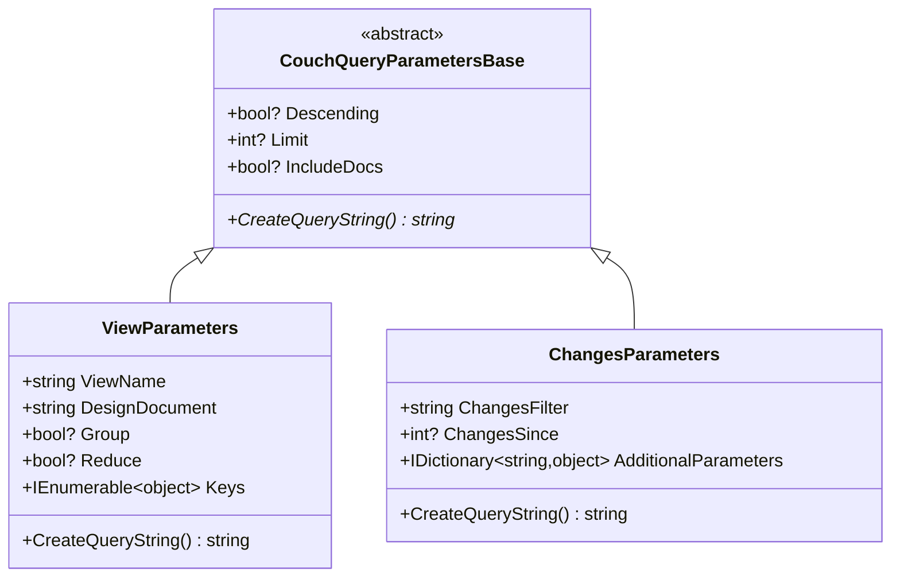

# API Architecture

**Navigation**: [Documentation Index](../DocumentationIndex.md) | [Architecture Overview](architecture-overview.md)

## API Design Philosophy

Edge10.CouchDb.Client implements a RESTful HTTP API client architecture that closely mirrors CouchDB's native HTTP API while providing .NET-specific conveniences and type safety.

## HTTP API Mapping

### URL Construction Pattern

```mermaid
graph LR
    subgraph "CouchDB HTTP API"
        SERVER[http://server:port]
        DB[/database]
        DOC[/document_id]
        ATTACH[/attachment_name]
        VIEW[/_design/design_doc/_view/view_name]
        CHANGES[/_changes]
    end
    
    subgraph "Client Library"
        BASE[Base URL]
        DBNAME[Database Name]
        DOCID[Document ID]
        ATTACHNAME[Attachment Name]
        PARAMS[Query Parameters]
    end
    
    BASE --> SERVER
    DBNAME --> DB
    DOCID --> DOC
    ATTACHNAME --> ATTACH
    PARAMS --> VIEW
    PARAMS --> CHANGES
```

### URL Construction Implementation

```csharp
public class CouchApi
{
    private readonly string _url;           // http://server:port
    private readonly string _databaseName;  // database name
    
    private string GetDocumentUrl(string documentId)
    {
        return $"{_url}/{_databaseName}/{documentId}";
    }
    
    private string GetAttachmentUrl(string documentId, string attachmentName)
    {
        return $"{_url}/{_databaseName}/{documentId}/{attachmentName}";
    }
    
    private string GetViewUrl(IViewParameters viewParameters)
    {
        var viewName = string.IsNullOrEmpty(viewParameters.ListName) 
            ? $"_view/{viewParameters.ViewName}" 
            : $"_list/{viewParameters.ListName}/{viewParameters.ViewName}";
            
        return $"{_url}/{_databaseName}/_design/{viewParameters.DesignDocument}/{viewName}{viewParameters.CreateQueryString()}";
    }
}
```

## HTTP Method Mapping

### Document Operations

| Operation | HTTP Method | URL Pattern | Request Body |
|-----------|-------------|-------------|--------------|
| **Get Document** | GET | `/db/doc_id` | None |
| **Create Document** | PUT | `/db/doc_id` | Document JSON |
| **Update Document** | PUT | `/db/doc_id?rev=...` | Document JSON |
| **Delete Document** | DELETE | `/db/doc_id?rev=...` | None |
| **Check Existence** | HEAD | `/db/doc_id` | None |
| **Bulk Operations** | POST | `/db/_bulk_docs` | `{"docs": [...]}` |

### View Operations

| Operation | HTTP Method | URL Pattern | Request Body |
|-----------|-------------|-------------|--------------|
| **Simple Query** | GET | `/db/_design/doc/_view/name?params` | None |
| **Key-based Query** | POST | `/db/_design/doc/_view/name?params` | `{"keys": [...]}` |
| **List Function** | GET/POST | `/db/_design/doc/_list/list/view?params` | Keys (if POST) |

### Attachment Operations

| Operation | HTTP Method | URL Pattern | Request Body |
|-----------|-------------|-------------|--------------|
| **Get Attachment** | GET | `/db/doc_id/attachment_name` | None |
| **Put Attachment** | PUT | `/db/doc_id/attachment_name?rev=...` | Binary Data |
| **Delete Attachment** | DELETE | `/db/doc_id/attachment_name?rev=...` | None |
| **Check Existence** | GET | `/db/doc_id/attachment_name` | None (Headers only) |

### Changes Feed Operations

| Operation | HTTP Method | URL Pattern | Request Body |
|-----------|-------------|-------------|--------------|
| **Get Changes** | GET | `/db/_changes?params` | None |
| **Filtered Changes** | GET | `/db/_changes?filter=...&params` | None |

## Request/Response Architecture

### Request Processing Flow



### Response Processing Architecture

```csharp
private async Task<TData> GetSerializedResultContent<TData>(HttpResponseMessage result)
{
    await result.ThrowErrorIfNotSuccess();
    
    var content = await result.Content.ReadAsStreamAsync();
    return GetSerializedContent<TData>(content);
}

private TData GetSerializedContent<TData>(Stream content)
{
    using (var sr = _serializationStrategy?.ReaderFactory(content) ?? new StreamReader(content))
    using (var jsonTextReader = new JsonTextReader(sr))
    {
        var serializer = CreateSerializer();
        return serializer.Deserialize<TData>(jsonTextReader);
    }
}
```

## Authentication Architecture

### Basic Authentication Implementation



### Authentication Implementation

```csharp
public CouchApi(ICouchDbConnectionStringBuilder connectionString, ...)
{
    // ... initialization code
    
    _client.SetAuthorizationHeader(
        new AuthenticationHeaderValue("Basic", 
            Convert.ToBase64String(
                Encoding.UTF8.GetBytes($"{connectionString.User}:{connectionString.Password}")
            )
        )
    );
}
```

## Error Handling API Architecture

### HTTP Status Code Mapping



### Error Response Processing

```csharp
public static async Task ThrowErrorIfNotSuccess(this HttpResponseMessage response, 
    Func<HttpResponseMessage, string, Exception> exceptionFactory = null)
{
    if (response.IsSuccessStatusCode) return;
    
    var content = await response.Content.ReadAsStringAsync();
    
    if (exceptionFactory != null)
    {
        throw exceptionFactory(response, content);
    }
    
    throw new HttpRequestException($"{(int)response.StatusCode} {response.ReasonPhrase} {content}");
}
```

### CouchDB-Specific Error Factory

```csharp
private static Exception CouchExceptionFactory(HttpResponseMessage message, string content)
{
    if (content?.ToLowerInvariant().IndexOf("timeout") != -1)
        return new CouchTimeoutException();
    
    return new HttpRequestException($"{(int)message.StatusCode} {message.ReasonPhrase} {content}");
}
```

## Async API Architecture

### Async Pattern Implementation

All API methods follow consistent async patterns:

```csharp
// Async method signature pattern
public async Task<TResult> OperationAsync<TParameters>(TParameters parameters)

// Implementation pattern
public async Task<TDocument> GetDocumentAsync<TDocument>(string documentId)
{
    documentId.ThrowIfNullOrEmpty(nameof(documentId));
    
    var url = GetDocumentUrl(documentId);
    
    using (_eventLog.LogDocumentEvent(documentId, "get"))
    using (var result = await _client.GetAsync(url))
        return await GetSerializedResultContent<TDocument>(result);
}
```

### Async Operation Categories

1. **Simple Operations**: Single HTTP request/response
2. **Bulk Operations**: Single request with multiple document processing
3. **Stream Operations**: Streaming response handling for large data
4. **Paged Operations**: Multiple requests for pagination support

## Parameter Object Architecture

### Parameter Inheritance Hierarchy



### Query String Generation Architecture

```csharp
public abstract class CouchQueryParametersBase : ICouchQueryParameters
{
    public bool? Descending { get; set; }
    public int? Limit { get; set; }
    public bool? IncludeDocs { get; set; }
    
    public abstract string CreateQueryString();
}
```

Each parameter class implements custom query string generation:

```csharp
public override string CreateQueryString()
{
    var parameters = new Dictionary<string, string>();
    
    // Add base parameters
    if (Descending.HasValue)
        parameters.Add("descending", Descending.Value.ToString().ToLower());
    
    // Add specific parameters
    if (Group.HasValue)
        parameters.Add("group", Group.Value.ToString().ToLower());
    
    // Build query string
    return BuildQueryString(parameters);
}
```

## Content Type Architecture

### Request Content Types

| Operation Type | Content-Type | Usage |
|---------------|--------------|-------|
| **Document Operations** | `application/json` | JSON document data |
| **Attachment Upload** | `*/*` | Binary attachment data |
| **Bulk Operations** | `application/json` | JSON array of documents |
| **Key-based Queries** | `application/json` | Key array for POST requests |

### Response Content Handling

```csharp
// JSON Response Processing
private async Task<T> GetSerializedResultContent<T>(HttpResponseMessage result)
{
    await result.ThrowErrorIfNotSuccess();
    var content = await result.Content.ReadAsStreamAsync();
    return GetSerializedContent<T>(content);
}

// Stream Response Processing (for attachments)
public async Task<Stream> GetAttachmentStreamAsync(string documentId, string attachmentName)
{
    var content = await GetAttachment(documentId, attachmentName, throwOnError: true);
    return await content.ReadAsStreamAsync();
}
```

## Batch Operation Architecture

### Bulk Update Implementation

```csharp
public async Task BulkUpdateAsync<TDocument>(IEnumerable<TDocument> documents) 
    where TDocument : ICouchModel
{
    var docsArray = documents.ToArray();
    
    // Set document types
    foreach (TDocument document in docsArray)
        document.Type = typeof(TDocument).Name;
    
    // Prepare bulk request
    var url = $"{_url}/{_databaseName}/_bulk_docs";
    var content = SerializeDocument(new { Docs = docsArray });
    var response = await _client.PostAsync(url, content);
    
    // Process bulk response
    var responseContent = await response.Content.ReadAsStringAsync();
    var updateResults = JsonConvert.DeserializeObject<CouchBulkUpdateResponseItem[]>(responseContent);
    
    // Handle conflicts and errors
    var conflictIds = updateResults.Where(x => x.Error == "conflict").Select(x => x.Id.ToString()).ToArray();
    if (conflictIds.Any())
        throw new ConflictException(string.Join(", ", conflictIds));
    
    // Update document revisions
    var revisionsById = updateResults.ToDictionary(x => x.Id, x => x.Rev);
    foreach (var document in docsArray)
        document.Rev = revisionsById[document.Id];
}
```

## Performance Architecture Considerations

### Connection Management
- Single HttpClient instance with connection pooling
- Configurable timeouts (default: 20 minutes)
- Proper disposal patterns

### Memory Management
- Stream-based operations for large responses
- Configurable batch sizes for bulk operations
- IDisposable implementation throughout

### Concurrency Support
- Thread-safe HttpClient usage
- Async/await throughout for non-blocking operations
- No internal synchronization (stateless operations)

---

*This API architecture documentation details how the library maps .NET patterns to CouchDB's HTTP API, providing both type safety and performance optimizations.*