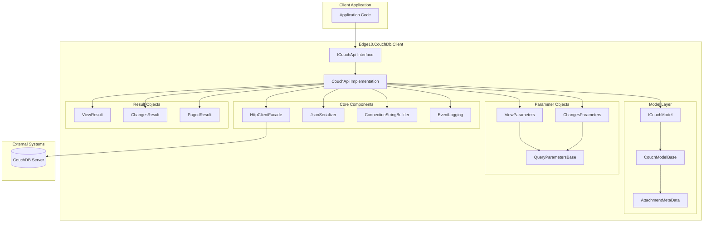
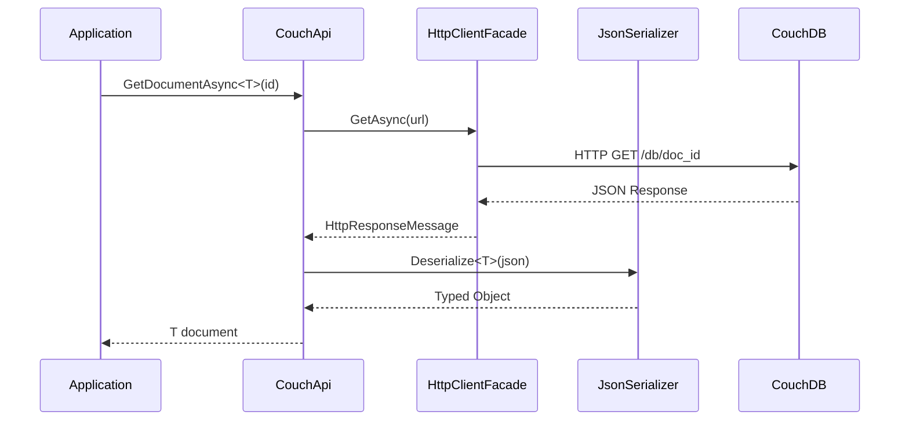
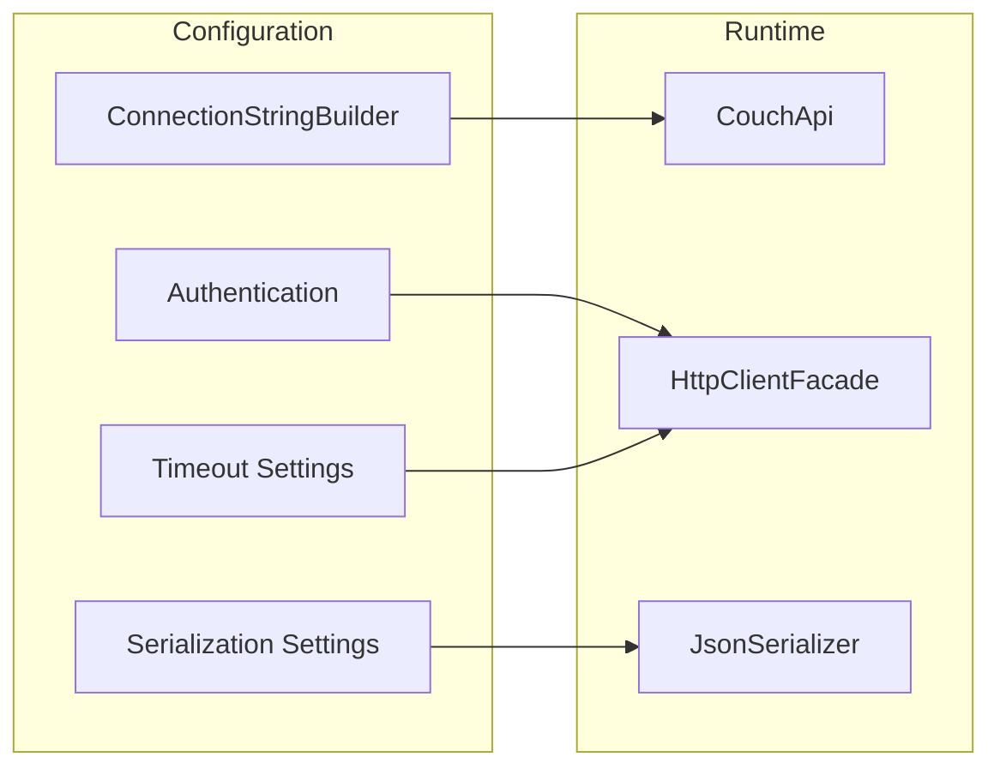
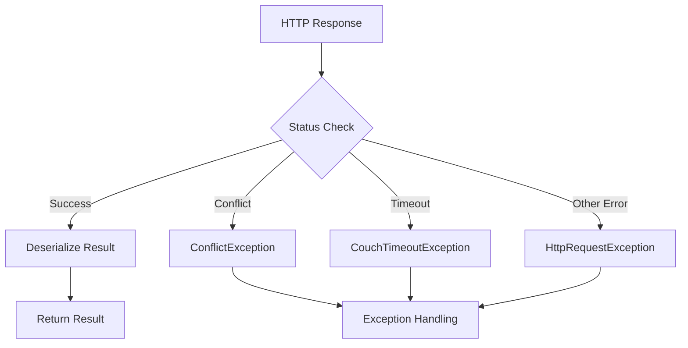
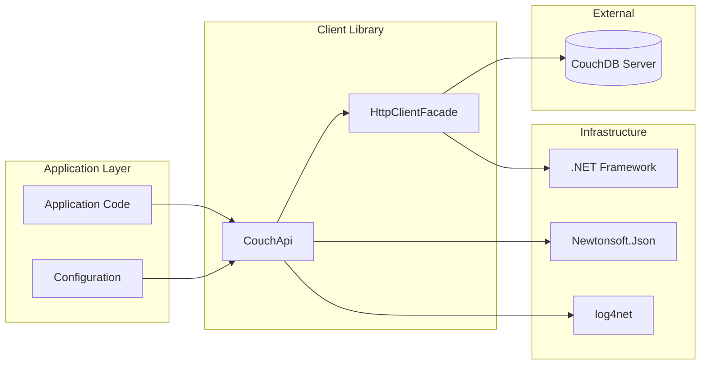
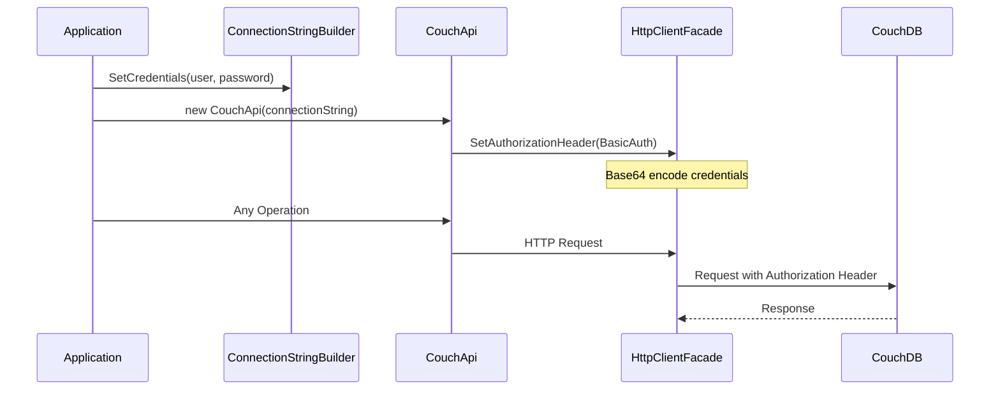

# Architecture Overview

**Navigation**: [Documentation Index](../DocumentationIndex.md) | [Main Documentation](../Edge10.CouchDb.Client.md)

## System Architecture Overview

Edge10.CouchDb.Client implements a layered architecture that provides a clean abstraction over CouchDB's HTTP REST API. The library follows established .NET patterns with a focus on async operations and type safety.

## High-Level Architecture

## Architectural Layers

### 1. API Layer
The topmost layer provides a clean, strongly-typed interface for all CouchDB operations.

**Key Components:**
- `ICouchApi`: Primary interface defining all operations
- `CouchApi`: Concrete implementation with full functionality
- Async/await patterns throughout for non-blocking operations

### 2. HTTP Abstraction Layer
Provides a testable abstraction over HTTP client operations.

**Key Components:**
- `IHttpClientFacade`: HTTP client interface
- `HttpClientFacade`: Concrete HTTP client implementation
- Built-in authentication and timeout management

### 3. Serialization Layer
Handles JSON serialization/deserialization with CouchDB-specific requirements.

**Key Components:**
- `JsonSerializer` with custom settings
- `AttachmentsConverter` for complex attachment metadata
- `SerializationStrategy` for customizable serialization approaches

### 4. Model Layer
Provides base classes and interfaces for CouchDB document modeling.

**Key Components:**
- `ICouchModel`: Core document interface
- `CouchModelBase`: Base implementation with standard CouchDB properties
- `IAttachmentMetaData`: Attachment metadata interface

## Component Interactions

## Design Patterns Implemented

### 1. Facade Pattern (Testability-Focused)
- `HttpClientFacade` provides a simplified interface over `HttpClient` **specifically implemented for testability**
- **Design Purpose**: Enables comprehensive unit testing by allowing HTTP client behavior to be mocked
- `CouchApi` facades the complexity of CouchDB HTTP API
- **Testability Benefit**: The facade pattern allows the entire CouchDB client to be tested without requiring actual HTTP network calls

### 2. Repository Pattern (Intentional Design Choice)
- `ICouchApi` **intentionally implements the Repository pattern** to provide a clean abstraction over CouchDB data access
- Encapsulates all CouchDB-specific data access logic and provides a consistent, database-agnostic API
- Enables business logic to work with domain objects without direct knowledge of CouchDB's HTTP REST API
- **Design Rationale**: The Repository pattern was chosen to separate business concerns from data persistence concerns, making the codebase more maintainable and testable

### 3. Strategy Pattern
- `SerializationStrategy` allows for different serialization approaches
- Configurable error handling strategies

### 4. Factory Pattern
- Connection string builder creates properly configured connections
- Implicit factory patterns for creating HTTP clients

## Configuration Architecture

### Configuration Components
- **Connection Management**: Server URL, port, database name
- **Authentication**: Basic HTTP authentication with Base64 encoding
- **Timeout Configuration**: Generous 20-minute timeout specifically designed for background operations (consumers can override for shorter timeouts)
- **Serialization Options**: Custom JSON settings and converters

## Error Handling Architecture

### Exception Hierarchy
- **ConflictException**: CouchDB revision conflicts
- **CouchTimeoutException**: Request timeout scenarios
- **HttpRequestException**: General HTTP-level errors

## Scalability Considerations

### Connection Management
- **Single `HttpClient` instance with sufficient connection pooling**: The built-in HttpClient connection pooling is adequate for typical CouchDB workloads
- **20-minute default timeout strategy**: Set high to accommodate background operations like bulk uploads, large view queries, and replication tasks
- **Consumer Override Capability**: Applications can configure shorter timeouts for interactive operations if needed
- **Connection Reuse**: Automatically reuses connections for improved performance
- Proper disposal patterns to prevent resource leaks

### Performance Optimizations
- Async/await throughout for non-blocking operations
- Optimized bulk operation batch sizes (default: 500 documents, balanced for timeout risk vs performance)
- Stream-based operations for large attachments

### Memory Management
- `IDisposable` implementation for proper resource cleanup
- Stream-based reading for large responses
- Configurable serialization strategies to optimize memory usage

## Integration Architecture

## Security Architecture

### Authentication Flow

## Thread Safety Considerations

- **HttpClient**: Thread-safe, single instance shared across operations
- **JsonSerializer**: Thread-safe when configured properly
- **CouchApi**: Designed with proper async patterns, though concurrent operations are unadvised due to CouchDB's MVCC conflict potential
- **Connection String**: Immutable after initialization

## Architecture Benefits

1. **Separation of Concerns**: Clear layer separation with distinct responsibilities
2. **Testability**: HTTP abstraction enables comprehensive unit testing
3. **Extensibility**: Interface-based design allows for easy customization
4. **Type Safety**: Strong typing throughout with generic type support
5. **Async Support**: Full async/await support for scalable applications
6. **Resource Management**: Proper disposal patterns and connection management

## Architecture Limitations

1. **Framework Dependency**: **Required .NET Framework 4.5.2** for legacy application compatibility - no migration to .NET Core/.NET 5+ planned
2. **Single Authentication**: Only Basic HTTP authentication supported
3. **Single Document Operations**: Documents are updated individually; no batch API transactions needed due to CouchDB's MVCC model
4. **Synchronous Fallbacks**: Some operations may block despite async interface

---

*This architecture overview provides the foundation for understanding the library's design and implementation patterns. For specific component details, refer to the detailed architecture documentation.*