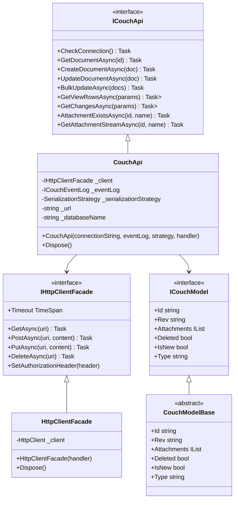
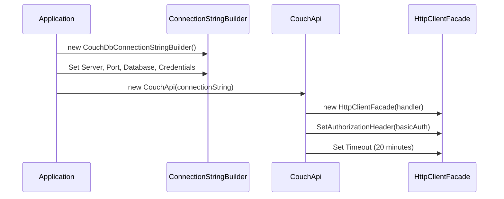
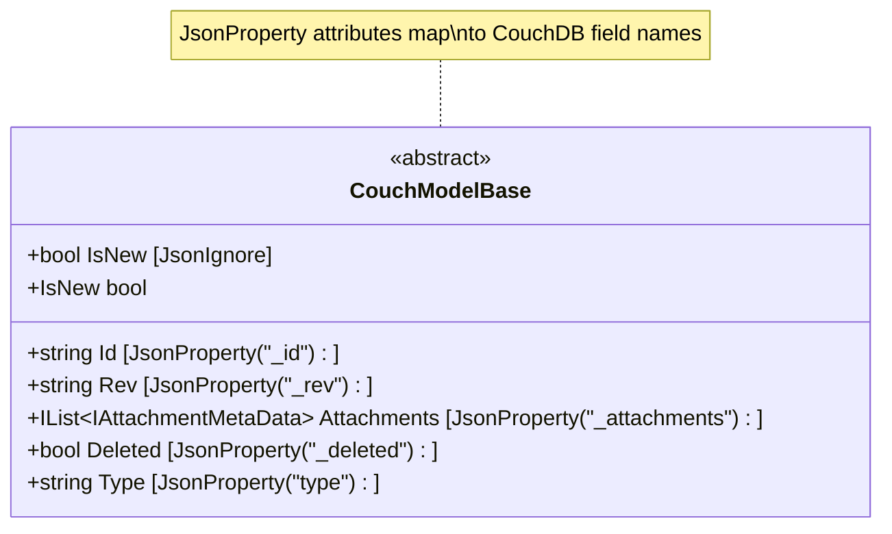
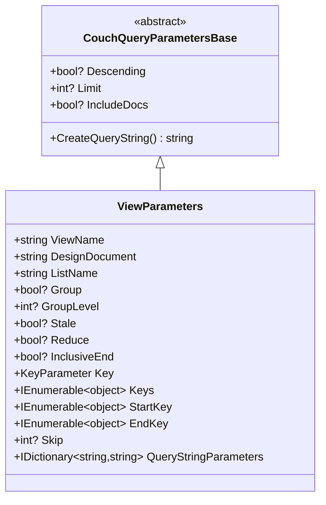
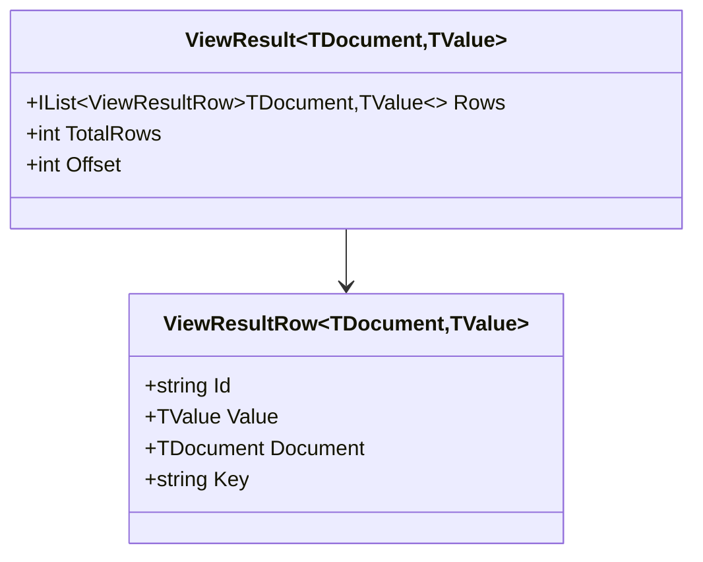
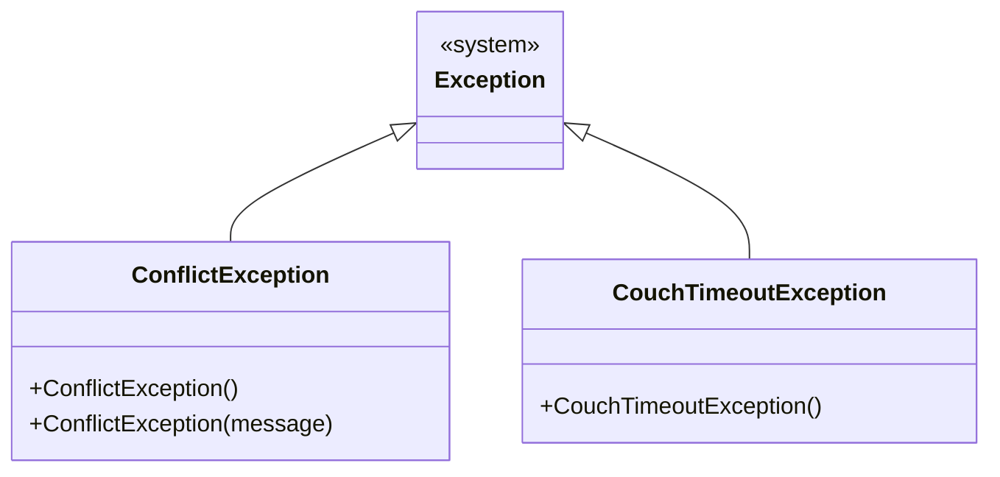
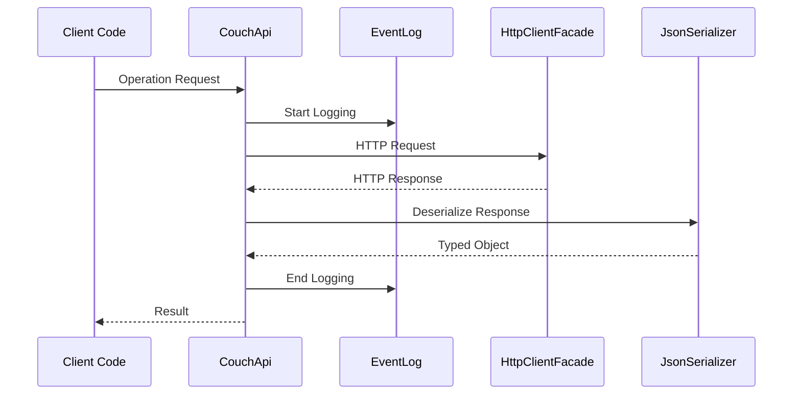

# Component Architecture

**Navigation**: [Documentation Index](../DocumentationIndex.md) | [Architecture Overview](architecture-overview.md)

## Component Overview

This document details the internal architecture of key components within Edge10.CouchDb.Client, their responsibilities, and interaction patterns.

## Core Components Diagram



## CouchApi Component

### Responsibilities
- Primary entry point for all CouchDB operations
- HTTP request orchestration and response handling
- JSON serialization/deserialization coordination
- Error handling and exception translation
- Event logging and performance monitoring

### Key Methods Analysis

#### Document Operations
```csharp
public async Task<TDocument> GetDocumentAsync<TDocument>(string documentId)
{
    var url = GetDocumentUrl(documentId);
    using (_eventLog.LogDocumentEvent(documentId, "get"))
    using (var result = await _client.GetAsync(url))
        return await GetSerializedResultContent<TDocument>(result);
}
```

**Flow:**
1. Construct document URL
2. Log operation start
3. Execute HTTP GET request
4. Deserialize response to typed object
5. Return result with automatic logging cleanup

#### Bulk Operations
```csharp
public async Task BulkUpdateAsync<TDocument>(IEnumerable<TDocument> documents) 
    where TDocument : ICouchModel
{
    var docsArray = documents.ToArray();
    foreach (TDocument document in docsArray)
        document.Type = typeof(TDocument).Name;
    
    var url = $"{_url}/{_databaseName}/_bulk_docs";
    var content = SerializeDocument(new { Docs = docsArray });
    var response = await _client.PostAsync(url, content);
    // ... error handling and revision updates
}
```

**Key Features:**
- Automatic type assignment
- Bulk error handling with conflict detection
- Revision update for successfully processed documents

### Configuration and Initialization



## HttpClientFacade Component

### Design Purpose
The HttpClientFacade serves as an abstraction layer over System.Net.Http.HttpClient, providing:
- Testability through interface abstraction
- Consistent error handling patterns
- Authentication management
- Resource lifecycle management

### Implementation Details

```csharp
internal sealed class HttpClientFacade : IHttpClientFacade
{
    private HttpClient _client;
    
    public HttpClientFacade(HttpClientHandler clientHandler)
    {
        _client = new HttpClient(clientHandler, false);
    }
    
    public void SetAuthorizationHeader(AuthenticationHeaderValue header)
    {
        DefaultRequestHeaders.Authorization = header;
    }
    
    // Implements all HttpClient methods with direct delegation
}
```

**Key Characteristics:**
- Direct delegation to HttpClient methods
- No ownership of HttpClientHandler (disposeHandler: false)
- Thread-safe operations through HttpClient
- Timeout and header management

## Model Layer Architecture

### ICouchModel Interface
Defines the contract for all CouchDB documents:

```csharp
public interface ICouchModel
{
    string Id { get; set; }           // CouchDB _id field
    string Rev { get; set; }          // CouchDB _rev field  
    IList<IAttachmentMetaData> Attachments { get; }  // _attachments
    bool Deleted { get; set; }        // _deleted field
    bool IsNew { get; }              // Computed property
    string Type { get; set; }         // type field for polymorphism
}
```

### CouchModelBase Implementation



**Key Features:**
- JSON property name mapping to CouchDB conventions
- Computed `IsNew` property based on revision presence
- Automatic attachment collection initialization
- Type field for document polymorphism

## Parameter Objects Architecture

### ViewParameters Component



**Query String Generation:**
```csharp
public override string CreateQueryString()
{
    var parameters = new Dictionary<string, string>();
    
    if (Descending.HasValue)
        parameters.Add("descending", Descending.Value.ToString().ToLower());
    if (Limit.HasValue)
        parameters.Add("limit", Limit.Value.ToString());
    // ... additional parameter processing
    
    return BuildQueryString(parameters);
}
```

### ChangesParameters Component

```csharp
public class ChangesParameters : CouchQueryParametersBase, IChangesParameters
{
    public string ChangesFilter { get; set; }
    public int? ChangesSince { get; set; }
    public IDictionary<string, object> AdditionalParameters { get; }
    
    public override string CreateQueryString()
    {
        var builder = new StringBuilder();
        AppendQueryStringElement(builder, "filter", ChangesFilter);
        AppendQueryStringElement(builder, "since", ChangesSince);
        // ... parameter building
        return builder.ToString();
    }
}
```

## Result Objects Architecture

### ViewResult Structure



### ChangesResult Structure

```csharp
public class ChangesResult<TDocument>
{
    public List<Change<TDocument>> Results { get; private set; }
    public string LastSequence { get; set; }
    
    public ChangesResult()
    {
        Results = new List<Change<TDocument>>();
    }
}
```

## Serialization Architecture

### JsonSerializer Configuration

```csharp
private JsonSerializer CreateSerializer()
{
    var settings = new JsonSerializerSettings
    {
        TypeNameHandling = TypeNameHandling.Objects,
        ContractResolver = new CamelCasePropertyNamesContractResolver()
    };
    
    foreach (var converter in Converters)
        settings.Converters.Add(converter);
    
    _settingsChanges?.Invoke(settings);
    
    return JsonSerializer.Create(settings);
}
```

**Key Configuration:**
- Camel case property naming for JSON compatibility
- Type name handling for polymorphic scenarios
- Custom converter support
- Runtime settings modification support

### AttachmentsConverter

```csharp
public class AttachmentsConverter : JsonConverter
{
    public override void WriteJson(JsonWriter writer, object value, JsonSerializer serializer)
    {
        // Converts IList<IAttachmentMetaData> to CouchDB _attachments format
    }
    
    public override object ReadJson(JsonReader reader, Type objectType, object existingValue, JsonSerializer serializer)
    {
        // Converts CouchDB _attachments JSON to IList<IAttachmentMetaData>
    }
}
```

## Error Handling Components

### Custom Exceptions



### Error Processing Flow

```csharp
private static Exception CouchExceptionFactory(HttpResponseMessage message, string content)
{
    if (content?.ToLowerInvariant().IndexOf("timeout") != -1)
        return new CouchTimeoutException();
    
    return new HttpRequestException($"{(int)message.StatusCode} {message.ReasonPhrase} {content}");
}
```

## Event Logging Architecture

### ICouchEventLog Interface
```csharp
public interface ICouchEventLog
{
    IDisposable LogDocumentEvent(string documentId, string operation);
    IDisposable LogViewEvent(IViewParameters viewParameters);
}
```

### Implementation Options
- **CouchTimelineEventLog**: Performance timeline logging
- **NullCouchEventLog**: No-op implementation for production

## Component Interaction Patterns

### Request/Response Flow


## Resource Management

### Disposal Pattern
```csharp
public void Dispose()
{
    _client?.Dispose();
    _client = null;
}
```

### Resource Lifecycle
- HttpClient: Created once, disposed with CouchApi
- Stream responses: Properly disposed after processing
- Event logging: Automatic cleanup through IDisposable

---

*This component architecture documentation provides detailed insight into the internal structure and interaction patterns of the library's core components.*