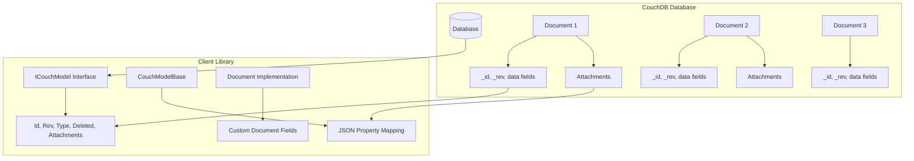
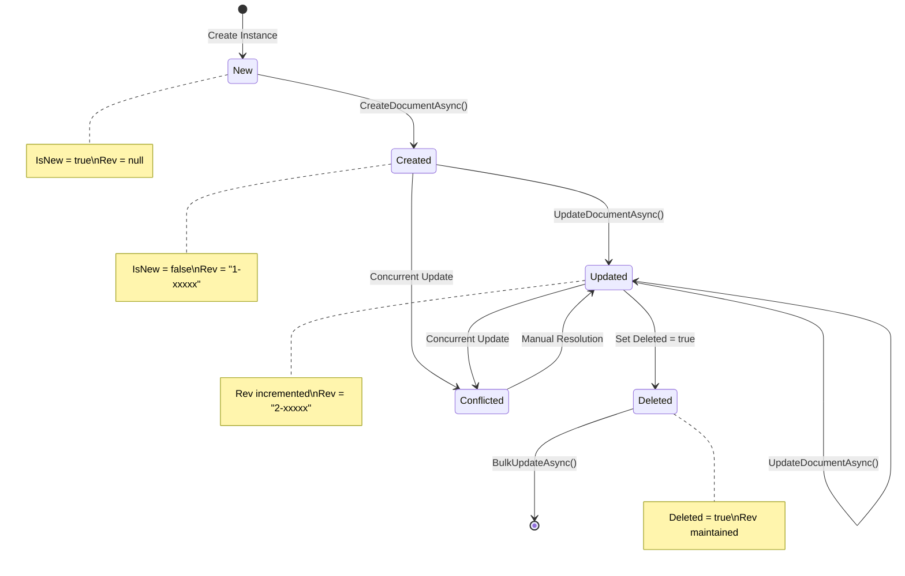
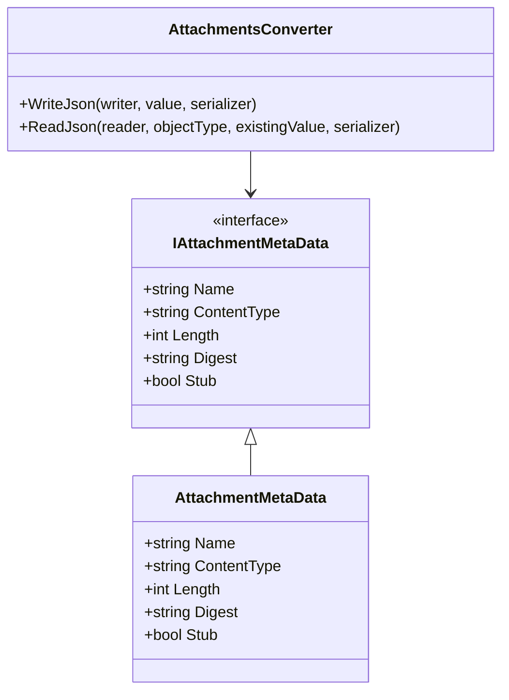
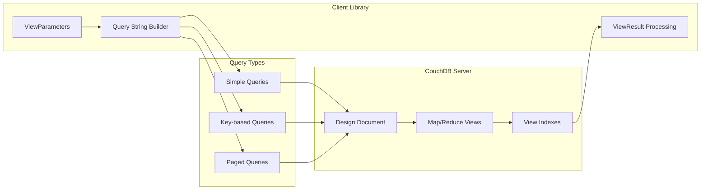
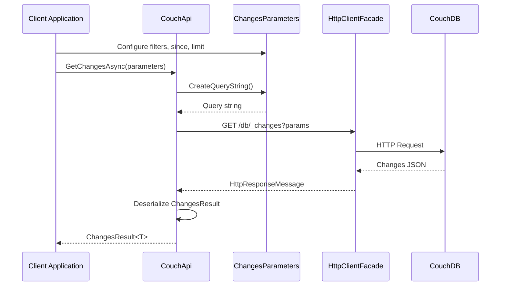
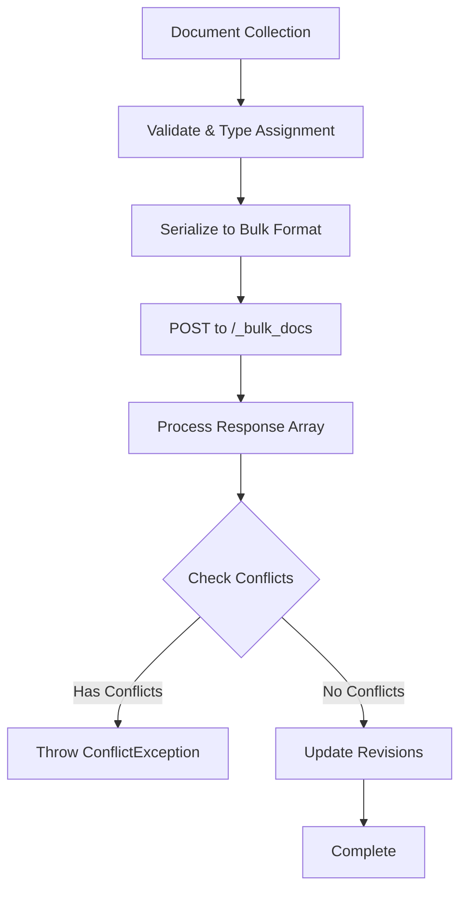

# Database Overview

**Navigation**: [Documentation Index](../DocumentationIndex.md) | [Main Documentation](../Edge10.CouchDb.Client.md)

## CouchDB Integration Overview

Edge10.CouchDb.Client provides comprehensive integration with CouchDB, a NoSQL document database that stores data as JSON documents. This integration follows CouchDB's document-oriented architecture while providing .NET-specific conveniences.

## CouchDB Concepts and Client Library Mapping

### Document Storage Model



### Core CouchDB Properties

Every CouchDB document has standard system properties that the client library manages:

| CouchDB Field | .NET Property | Purpose | Managed By |
|---------------|---------------|---------|------------|
| `_id` | `Id` | Unique document identifier | Client/Server |
| `_rev` | `Rev` | Document revision for optimistic locking | Server |
| `_deleted` | `Deleted` | Soft deletion flag | Client |
| `_attachments` | `Attachments` | File attachment metadata | Client/Server |
| `type` | `Type` | Document type discrimination | Client |

## Document Modeling Architecture

### ICouchModel Interface

```csharp
public interface ICouchModel
{
    string Id { get; set; }                           // CouchDB _id
    string Rev { get; set; }                          // CouchDB _rev
    IList<IAttachmentMetaData> Attachments { get; }   // CouchDB _attachments
    bool Deleted { get; set; }                        // CouchDB _deleted
    bool IsNew { get; }                              // Computed: no revision
    string Type { get; set; }                         // Document type field
}
```

### CouchModelBase Implementation

```csharp
public abstract class CouchModelBase : ICouchModel
{
    [JsonProperty(PropertyName = "_id")]
    public string Id { get; set; }

    [JsonProperty(PropertyName = "_rev", NullValueHandling = NullValueHandling.Ignore)]
    public string Rev { get; set; }

    [JsonProperty(PropertyName = "_attachments")]
    [JsonConverter(typeof(AttachmentsConverter))]
    public IList<IAttachmentMetaData> Attachments { get; } = new List<IAttachmentMetaData>();

    [JsonProperty(PropertyName = "_deleted")]
    public bool Deleted { get; set; }

    [JsonIgnore]
    public bool IsNew => string.IsNullOrWhiteSpace(Rev);

    [JsonProperty("type")]
    public string Type { get; set; }
}
```

## Document Lifecycle Management

### Document State Transitions



### Revision Management

CouchDB uses Multi-Version Concurrency Control (MVCC) through document revisions:

```csharp
// Automatic revision handling in updates
private async Task UpdateOrCreateDocumentAsync<TDocument>(TDocument document, bool isNew)
    where TDocument : ICouchModel
{
    var documentUri = GetDocumentUrl(document.Id);
    
    // Resolve current revision for updates
    if (!isNew && string.IsNullOrWhiteSpace(document.Rev))
    {
        var revision = await GetDocumentRevision(documentUri);
        document.Rev = revision;
    }

    document.Type = typeof(TDocument).Name;

    var content = SerializeDocument(document);
    var response = await _client.PutAsync(documentUri, content);

    // Handle revision conflicts
    if (response.StatusCode == HttpStatusCode.Conflict)
        throw new ConflictException();

    await response.ThrowErrorIfNotSuccess();
    await UpdateDocumentRevision(document, response);
}
```

## Attachment Management

### Attachment Metadata Structure



### Attachment Operations

```csharp
// Attachment existence check
public async Task<bool> AttachmentExistsAsync(string documentId, string attachmentName)
{
    var result = await _client.GetAsync(
        GetAttachmentUrl(documentId, attachmentName),
        HttpCompletionOption.ResponseHeadersRead);

    using (result)
        return result.IsSuccessStatusCode;
}

// Stream-based attachment retrieval
public async Task<Stream> GetAttachmentStreamAsync(string documentId, string attachmentName)
{
    var content = await GetAttachment(documentId, attachmentName, throwOnError: true);
    return await content.ReadAsStreamAsync();
}

// Attachment upload with revision management
public async Task PutAsync(string documentId, string attachmentName, HttpContent httpContent)
{
    var requestUri = await GetAttachmentUrlWithRevision(documentId, attachmentName);
    var response = await _client.PutAsync(requestUri, httpContent);
    await response.ThrowErrorIfNotSuccess();
}
```

## View Query Architecture

### CouchDB Views Integration



### View Parameter Construction

```csharp
public class ViewParameters : CouchQueryParametersBase, IViewParameters
{
    public string ViewName { get; set; }              // View name in design document
    public string DesignDocument { get; set; }        // Design document name
    public string ListName { get; set; }              // Optional list function
    
    // Query parameters
    public bool? Group { get; set; }                  // Group results
    public int? GroupLevel { get; set; }              // Group level for complex keys
    public bool? Reduce { get; set; }                 // Enable/disable reduce
    public KeyParameter Key { get; set; }             // Single key query
    public IEnumerable<object> Keys { get; set; }     // Multiple keys (POST)
    public IEnumerable<object> StartKey { get; set; } // Range start
    public IEnumerable<object> EndKey { get; set; }   // Range end
    public int? Skip { get; set; }                    // Pagination offset
}
```

### View Result Processing

```csharp
// View result structure mapping
public class ViewResult<TDocument, TValue>
{
    [JsonProperty("rows")]
    public IList<ViewResultRow<TDocument, TValue>> Rows { get; set; }
    
    [JsonProperty("total_rows")]
    public int TotalRows { get; set; }
    
    [JsonProperty("offset")]
    public int Offset { get; set; }
}

// Paged result wrapper
public async Task<IPagedResult<TDocument>> GetPagedViewDocumentsAsync<TDocument>(IViewParameters viewParameters)
{
    // Get documents with reduce disabled
    viewParameters.Reduce = false;
    var viewResult = await GetListResult<ViewResult<TDocument, object>>(viewParameters);
    
    // Get count with reduce enabled
    viewParameters.Reduce = true;
    viewParameters.Skip = null;
    viewParameters.Limit = null;
    viewParameters.IncludeDocs = false;
    var countResult = await GetListResult<ViewResult<object, long>>(viewParameters);
    
    var count = countResult.Rows.FirstOrDefault()?.Value ?? 0;
    return new PagedResult<TDocument>(viewResult.Rows.Select(r => r.Document).ToArray(), count);
}
```

## Changes Feed Integration

### Changes Feed Architecture



### Changes Parameters

```csharp
public class ChangesParameters : CouchQueryParametersBase, IChangesParameters
{
    public string ChangesFilter { get; set; }                      // Server-side filter
    public int? ChangesSince { get; set; }                        // Sequence number to start from
    public IDictionary<string, object> AdditionalParameters { get; } // Filter parameters
}
```

### Changes Result Processing

```csharp
public class ChangesResult<TDocument>
{
    [JsonProperty("results")]
    public List<Change<TDocument>> Results { get; private set; }
    
    [JsonProperty("last_seq")]
    public string LastSequence { get; set; }
}

public class Change<TDocument>
{
    [JsonProperty("id")]
    public string Id { get; set; }
    
    [JsonProperty("changes")]
    public List<ChangeRevision> Changes { get; set; }
    
    [JsonProperty("doc")]
    public TDocument Document { get; set; }
    
    [JsonProperty("deleted")]
    public bool? Deleted { get; set; }
}
```

## Bulk Operations Architecture

### Bulk Update Implementation



### Bulk Request/Response Format

```csharp
// Bulk request format
var bulkRequest = new { Docs = documents };

// Bulk response processing
var updateResults = JsonConvert.DeserializeObject<CouchBulkUpdateResponseItem[]>(responseContent);

// Conflict detection
var conflictIds = updateResults.Where(x => x.Error == "conflict").Select(x => x.Id.ToString()).ToArray();
if (conflictIds.Any())
    throw new ConflictException(string.Join(", ", conflictIds));

// Revision updates
var revisionsById = updateResults.ToDictionary(x => x.Id, x => x.Rev);
foreach (var document in docsArray)
    document.Rev = revisionsById[document.Id];
```

## Connection Management

### Connection String Architecture

```csharp
public interface ICouchDbConnectionStringBuilder
{
    string Server { get; set; }        // Server hostname/IP
    int Port { get; set; }             // Server port (default: 5984)
    string DatabaseName { get; set; }  // Target database name
    string User { get; set; }          // Authentication username
    string Password { get; set; }      // Authentication password
}
```

### URL Construction

```csharp
private static string GetServerUrl(ICouchDbConnectionStringBuilder connectionString)
{
    return $"{((connectionString.Server.StartsWith("http://") || connectionString.Server.StartsWith("https://")) ? string.Empty : "http://")}{connectionString.Server}:{connectionString.Port}";
}
```

## Database Performance Considerations

### Batch Size Management
```csharp
public int MaxDocumentsPerRequest { get; set; } = 500;

private IEnumerable<IEnumerable<T>> SplitToBlocks<T>(IEnumerable<T> sequence, int size)
{
    var partition = new List<T>(size);
    foreach (var item in sequence)
    {
        partition.Add(item);
        if (partition.Count == size)
        {
            yield return partition;
            partition = new List<T>(size);
        }
    }
    
    if (partition.Count > 0)
        yield return partition;
}
```

### Memory Management
- Stream-based operations for large attachments
- Configurable batch sizes for bulk operations
- Proper disposal of HTTP resources

### Concurrency Considerations
- No document-level locking (CouchDB MVCC)
- Conflict detection and handling
- Thread-safe HTTP client usage

---

*This database overview provides comprehensive coverage of how the client library integrates with CouchDB's document-oriented architecture while providing .NET-specific conveniences and type safety.*