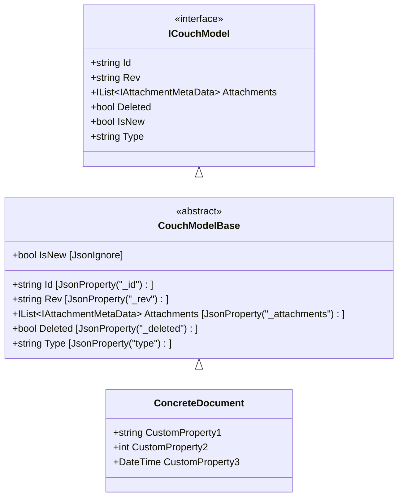

# Document Modeling

**Navigation**: [Documentation Index](../DocumentationIndex.md) | [Database Overview](database-overview.md)

## Document Modeling Patterns

Edge10.CouchDb.Client provides a structured approach to modeling CouchDB documents in .NET, emphasizing type safety, JSON serialization compatibility, and CouchDB-specific features.

## Base Document Model Architecture

### ICouchModel Interface Contract

The `ICouchModel` interface defines the essential contract for all CouchDB documents:

```csharp
public interface ICouchModel
{
    string Id { get; set; }                           // Document unique identifier
    string Rev { get; set; }                          // Document revision
    IList<IAttachmentMetaData> Attachments { get; }   // Attached files metadata
    bool Deleted { get; set; }                        // Soft deletion flag
    bool IsNew { get; }                              // Computed property
    string Type { get; set; }                         // Document type discriminator
}
```

### CouchModelBase Implementation



### JSON Property Mapping

The base implementation maps .NET properties to CouchDB JSON fields:

```csharp
public abstract class CouchModelBase : ICouchModel
{
    [JsonProperty(PropertyName = "_id")]
    public string Id { get; set; }

    [JsonProperty(PropertyName = "_rev", NullValueHandling = NullValueHandling.Ignore)]
    public string Rev { get; set; }

    [JsonProperty(PropertyName = "_attachments")]
    [JsonConverter(typeof(AttachmentsConverter))]
    public IList<IAttachmentMetaData> Attachments { get; } = new List<IAttachmentMetaData>();

    [JsonProperty(PropertyName = "_deleted")]
    public bool Deleted { get; set; }

    [JsonIgnore]
    public bool IsNew => string.IsNullOrWhiteSpace(Rev);

    [JsonProperty("type")]
    public string Type { get; set; }
}
```

## Document State Management

### Document Lifecycle States

```mermaid
stateDiagram-v2
    [*] --> NewDocument : new ConcreteDocument()
    NewDocument --> PersistentDocument : CreateDocumentAsync()
    PersistentDocument --> UpdatedDocument : UpdateDocumentAsync()
    UpdatedDocument --> UpdatedDocument : UpdateDocumentAsync()
    UpdatedDocument --> MarkedDeleted : Deleted = true
    MarkedDeleted --> [*] : BulkUpdateAsync()
    
    PersistentDocument --> ConflictState : Concurrent modification
    UpdatedDocument --> ConflictState : Concurrent modification
    ConflictState --> UpdatedDocument : Conflict resolution
    
    state NewDocument {
        IsNew --> true
        Rev --> null
        Id --> null_or_assigned
    }
    
    state PersistentDocument {
        IsNew --> false
        Rev --> "1-hash"
        Id --> assigned
    }
    
    state UpdatedDocument {
        IsNew --> false
        Rev --> "n-hash"
        Id --> unchanged
    }
```

### State Validation

```csharp
public bool IsNew => string.IsNullOrWhiteSpace(Rev);

// Usage in document operations
if (document.IsNew)
{
    // Create new document
    document.Id = string.IsNullOrWhiteSpace(document.Id) ? Guid.NewGuid().ToString() : document.Id;
    await CreateDocumentAsync(document);
}
else
{
    // Update existing document
    await UpdateDocumentAsync(document);
}
```

## Type Discrimination Pattern

### Automatic Type Assignment

The library automatically assigns document types for polymorphic scenarios:

```csharp
private async Task UpdateOrCreateDocumentAsync<TDocument>(TDocument document, bool isNew)
    where TDocument : ICouchModel
{
    // Automatic type assignment based on .NET type
    document.Type = typeof(TDocument).Name;
    
    var content = SerializeDocument(document);
    var response = await _client.PutAsync(documentUri, content);
    // ... response handling
}
```

### Type-based Document Retrieval

```csharp
// Type information preserved in JSON
{
    "_id": "doc123",
    "_rev": "1-abc123",
    "type": "CustomerDocument",
    "name": "John Doe",
    "email": "john@example.com"
}

// Retrieval with type safety
var customer = await couchApi.GetDocumentAsync<CustomerDocument>("doc123");
```

## Custom Document Implementation Patterns

### Simple Document Model

```csharp
public class CustomerDocument : CouchModelBase
{
    [JsonProperty("name")]
    public string Name { get; set; }
    
    [JsonProperty("email")]
    public string Email { get; set; }
    
    [JsonProperty("created_date")]
    public DateTime CreatedDate { get; set; }
    
    [JsonProperty("is_active")]
    public bool IsActive { get; set; }
}
```

### Complex Document Model with Nested Objects

```csharp
public class OrderDocument : CouchModelBase
{
    [JsonProperty("order_number")]
    public string OrderNumber { get; set; }
    
    [JsonProperty("customer")]
    public CustomerInfo Customer { get; set; }
    
    [JsonProperty("items")]
    public List<OrderItem> Items { get; set; } = new List<OrderItem>();
    
    [JsonProperty("total_amount")]
    public decimal TotalAmount { get; set; }
    
    [JsonProperty("order_date")]
    public DateTime OrderDate { get; set; }
}

public class CustomerInfo
{
    [JsonProperty("name")]
    public string Name { get; set; }
    
    [JsonProperty("email")]
    public string Email { get; set; }
}

public class OrderItem
{
    [JsonProperty("sku")]
    public string Sku { get; set; }
    
    [JsonProperty("quantity")]
    public int Quantity { get; set; }
    
    [JsonProperty("price")]
    public decimal Price { get; set; }
}
```

## Attachment Modeling

### Attachment Metadata Interface

```csharp
public interface IAttachmentMetaData
{
    string Name { get; set; }           // Attachment filename
    string ContentType { get; set; }    // MIME type
    int Length { get; set; }            // File size in bytes
    string Digest { get; set; }         // MD5 digest
    bool Stub { get; set; }             // Indicates metadata only
}
```

### Attachment Implementation

```csharp
public class AttachmentMetaData : IAttachmentMetaData
{
    [JsonProperty("content_type")]
    public string ContentType { get; set; }
    
    [JsonProperty("length")]
    public int Length { get; set; }
    
    [JsonProperty("digest")]
    public string Digest { get; set; }
    
    [JsonProperty("stub")]
    public bool Stub { get; set; }
    
    [JsonIgnore]
    public string Name { get; set; }
}
```

### Document with Attachments

```csharp
public class DocumentWithAttachments : CouchModelBase
{
    [JsonProperty("title")]
    public string Title { get; set; }
    
    [JsonProperty("description")]
    public string Description { get; set; }
    
    // Attachments are automatically managed by base class
    // Access via Attachments property from CouchModelBase
}

// Usage example
var document = new DocumentWithAttachments
{
    Id = "doc-with-files",
    Title = "Document with Files",
    Description = "This document has attached files"
};

await couchApi.CreateDocumentAsync(document);

// Add attachment
var fileContent = new ByteArrayContent(fileBytes);
fileContent.Headers.ContentType = new MediaTypeHeaderValue("image/jpeg");
await couchApi.PutAsync(document.Id, "profile.jpg", fileContent);
```

## Serialization Customization

### Custom JsonConverter Example

```csharp
public class DateTimeConverter : JsonConverter<DateTime>
{
    public override void WriteJson(JsonWriter writer, DateTime value, JsonSerializer serializer)
    {
        writer.WriteValue(value.ToString("yyyy-MM-ddTHH:mm:ssZ"));
    }
    
    public override DateTime ReadJson(JsonReader reader, Type objectType, DateTime existingValue, 
        bool hasExistingValue, JsonSerializer serializer)
    {
        return DateTime.Parse(reader.Value.ToString());
    }
}

// Usage in document model
public class EventDocument : CouchModelBase
{
    [JsonProperty("title")]
    public string Title { get; set; }
    
    [JsonProperty("event_date")]
    [JsonConverter(typeof(DateTimeConverter))]
    public DateTime EventDate { get; set; }
}
```

### Global Serialization Settings

```csharp
// Applied automatically by CouchApi
private JsonSerializer CreateSerializer()
{
    var settings = new JsonSerializerSettings
    {
        TypeNameHandling = TypeNameHandling.Objects,
        ContractResolver = new CamelCasePropertyNamesContractResolver()
    };
    
    foreach (var converter in Converters)
        settings.Converters.Add(converter);
    
    _settingsChanges?.Invoke(settings);
    
    return JsonSerializer.Create(settings);
}

// Custom settings usage
using (couchApi.CustomSettings(settings => 
{
    settings.NullValueHandling = NullValueHandling.Ignore;
    settings.DateFormatHandling = DateFormatHandling.IsoDateFormat;
}))
{
    await couchApi.CreateDocumentAsync(document);
}
```

## Validation Patterns

### Basic Validation

```csharp
public class ValidatedDocument : CouchModelBase
{
    private string _email;
    
    [JsonProperty("email")]
    public string Email 
    { 
        get => _email;
        set
        {
            if (string.IsNullOrWhiteSpace(value))
                throw new ArgumentException("Email is required");
            if (!IsValidEmail(value))
                throw new ArgumentException("Invalid email format");
            _email = value;
        }
    }
    
    private bool IsValidEmail(string email)
    {
        try
        {
            var addr = new System.Net.Mail.MailAddress(email);
            return addr.Address == email;
        }
        catch
        {
            return false;
        }
    }
}
```

### Validation Before Save

```csharp
public class CustomerDocument : CouchModelBase
{
    [JsonProperty("name")]
    public string Name { get; set; }
    
    [JsonProperty("email")]
    public string Email { get; set; }
    
    public void ValidateForSave()
    {
        if (string.IsNullOrWhiteSpace(Name))
            throw new InvalidOperationException("Name is required");
        if (string.IsNullOrWhiteSpace(Email))
            throw new InvalidOperationException("Email is required");
    }
}

// Usage
var customer = new CustomerDocument { Name = "John", Email = "john@example.com" };
customer.ValidateForSave();
await couchApi.CreateDocumentAsync(customer);
```

## Polymorphic Document Modeling

### Base Document Types

```csharp
public abstract class BaseEventDocument : CouchModelBase
{
    [JsonProperty("event_type")]
    public abstract string EventType { get; }
    
    [JsonProperty("timestamp")]
    public DateTime Timestamp { get; set; } = DateTime.UtcNow;
}

public class UserLoginEvent : BaseEventDocument
{
    public override string EventType => "user_login";
    
    [JsonProperty("user_id")]
    public string UserId { get; set; }
    
    [JsonProperty("ip_address")]
    public string IpAddress { get; set; }
}

public class OrderCreatedEvent : BaseEventDocument
{
    public override string EventType => "order_created";
    
    [JsonProperty("order_id")]
    public string OrderId { get; set; }
    
    [JsonProperty("customer_id")]
    public string CustomerId { get; set; }
    
    [JsonProperty("amount")]
    public decimal Amount { get; set; }
}
```

### Type Resolution

```csharp
// The Type property is automatically set to the .NET class name
// This enables type-based queries and deserialization

// CouchDB view for type-based queries
{
    "views": {
        "by_type": {
            "map": "function(doc) { if(doc.type) { emit(doc.type, doc); } }"
        }
    }
}

// Query by document type
var viewParams = new ViewParameters("by_type", "events")
{
    Key = new KeyParameter("UserLoginEvent"),
    IncludeDocs = true
};

var loginEvents = await couchApi.GetViewDocumentsAsync<UserLoginEvent>(viewParams);
```

## Document Modeling Best Practices

### 1. Property Naming Conventions
- Use JsonProperty attributes for CouchDB field mapping
- Follow camel_case for JSON properties (automatic with CamelCasePropertyNamesContractResolver)
- Use descriptive property names in .NET (PascalCase)

### 2. Inheritance Patterns
- Inherit from CouchModelBase for standard CouchDB features
- Use abstract base classes for document families
- Implement interfaces for cross-cutting concerns

### 3. Type Safety
- Use strongly typed properties
- Implement validation in property setters or validation methods
- Use nullable types appropriately

### 4. Performance Considerations
- Keep document size reasonable for CouchDB performance
- Use appropriate JsonIgnore for computed properties
- Consider lazy loading for large nested objects

### 5. Versioning Strategy
- Include version fields for schema evolution
- Handle missing properties gracefully
- Use default values for new properties

---

*This document modeling guide provides comprehensive patterns for creating robust, type-safe CouchDB documents in .NET while maintaining compatibility with CouchDB's JSON-based storage model.*