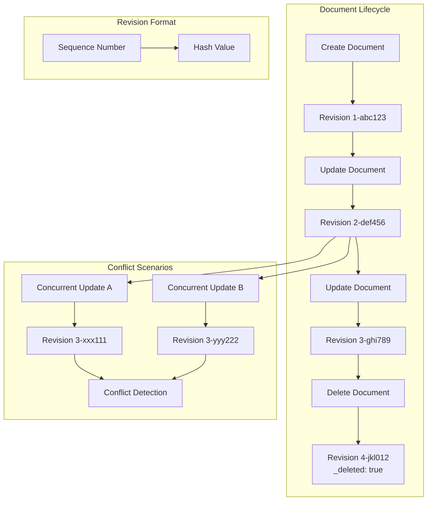
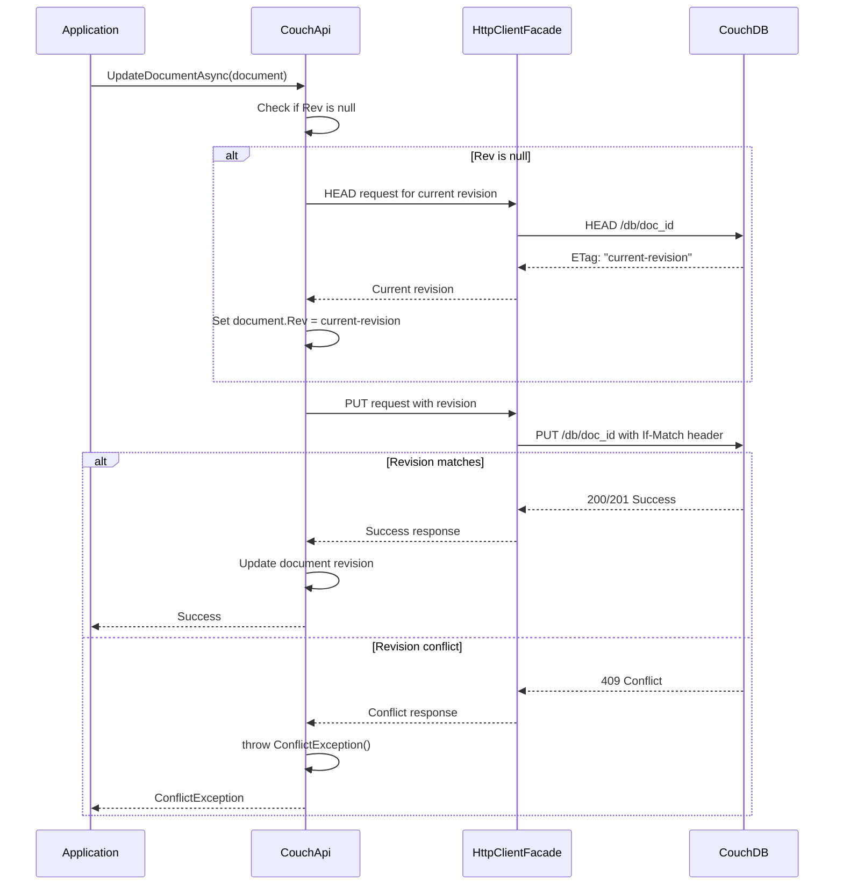

# Revision Management

**Navigation**: [Documentation Index](../DocumentationIndex.md) | [Database Overview](database-overview.md)

## CouchDB Revision System Overview

CouchDB uses Multi-Version Concurrency Control (MVCC) through document revisions to manage concurrent access and maintain data consistency. Edge10.CouchDb.Client provides comprehensive support for CouchDB's revision system with automatic conflict detection and resolution patterns.

## Revision Architecture

### Revision Structure



### Revision Properties in ICouchModel

```csharp
public interface ICouchModel
{
    string Rev { get; set; }    // Current document revision
    bool IsNew { get; }         // Computed: true when Rev is null/empty
    // ... other properties
}

public abstract class CouchModelBase : ICouchModel
{
    [JsonProperty(PropertyName = "_rev", NullValueHandling = NullValueHandling.Ignore)]
    public string Rev { get; set; }

    [JsonIgnore]
    public bool IsNew => string.IsNullOrWhiteSpace(Rev);
}
```

## Automatic Revision Management

### Create Operations

```csharp
public Task CreateDocumentAsync<TDocument>(TDocument document)
    where TDocument : ICouchModel
{
    document.ThrowIfNull(nameof(document));

    // Generate ID if not provided
    document.Id = string.IsNullOrWhiteSpace(document.Id) ? Guid.NewGuid().ToString() : document.Id;

    using (_eventLog.LogDocumentEvent(document.Id, "create"))
        return UpdateOrCreateDocumentAsync(document, true);
}
```

### Update Operations with Revision Resolution

```csharp
private async Task UpdateOrCreateDocumentAsync<TDocument>(TDocument document, bool isNew)
    where TDocument : ICouchModel
{
    document.ThrowIfNull(nameof(document));
    var documentUri = GetDocumentUrl(document.Id);
    
    // Automatic revision resolution for updates
    if (!isNew && string.IsNullOrWhiteSpace(document.Rev))
    {
        var revision = await GetDocumentRevision(documentUri);
        document.Rev = revision;
    }

    document.Type = typeof(TDocument).Name;

    var content = SerializeDocument(document);
    var response = await _client.PutAsync(documentUri, content);

    // Conflict detection
    if (response.StatusCode == HttpStatusCode.Conflict)
        throw new ConflictException();

    await response.ThrowErrorIfNotSuccess();

    // Update document with new revision
    await UpdateDocumentRevision(document, response);
}
```

### Revision Retrieval

```csharp
private async Task<string> GetDocumentRevision(string documentUri)
{
    // Use HEAD request for efficient revision retrieval
    var httpResponse = await _client.SendAsync(new HttpRequestMessage(HttpMethod.Head, documentUri));
    await httpResponse.ThrowErrorIfNotSuccess();

    // Extract revision from ETag header
    return httpResponse.Headers.ETag.Tag.Replace('\"', ' ').Trim();
}
```

## Conflict Detection and Handling

### Conflict Detection Flow



### ConflictException Implementation

**Conflict Resolution Strategy:**
The Edge10.CouchDb.Client **intentionally throws ConflictException to delegate conflict resolution to consumers**. This design choice ensures:
- **Consumer Control**: Applications can implement business-specific conflict resolution logic
- **Transparency**: All conflicts are explicitly surfaced rather than being silently resolved
- **Flexibility**: Different applications can use different conflict resolution strategies
- **Replication Conflicts**: Multi-database replication conflicts require user-level resolution and cannot be automatically resolved

```csharp
public class ConflictException : Exception
{
    public ConflictException() : base("Document revision conflict occurred")
    {
    }

    public ConflictException(string message) : base(message)
    {
    }

    public ConflictException(string message, Exception innerException) : base(message, innerException)
    {
    }
}
```

**Design Rationale:**
- **No Automatic Resolution**: The library does not automatically resolve conflicts to prevent data loss
- **Explicit Handling Required**: Consumers must explicitly handle ConflictException
- **Business Logic Driven**: Conflict resolution depends on business requirements, not technical defaults

### Conflict Resolution Patterns

#### 1. Optimistic Retry Pattern

```csharp
public async Task<bool> TryUpdateWithRetry<TDocument>(TDocument document, int maxRetries = 3)
    where TDocument : ICouchModel
{
    for (int attempt = 0; attempt < maxRetries; attempt++)
    {
        try
        {
            await couchApi.UpdateDocumentAsync(document);
            return true;
        }
        catch (ConflictException)
        {
            if (attempt == maxRetries - 1)
                return false;
            
            // Refresh document with latest revision
            var latest = await couchApi.GetDocumentAsync<TDocument>(document.Id);
            
            // Apply business logic to merge changes
            MergeChanges(document, latest);
            
            // Continue with updated revision
            document.Rev = latest.Rev;
        }
    }
    
    return false;
}

private void MergeChanges<TDocument>(TDocument local, TDocument remote)
    where TDocument : ICouchModel
{
    // Implementation depends on business logic
    // Example: timestamp-based field merging
    // Example: user-prompted conflict resolution
    // Example: field-level merge strategies
}
```

#### 2. Latest-Wins Strategy

```csharp
public async Task UpdateDocumentLatestWins<TDocument>(TDocument document)
    where TDocument : ICouchModel
{
    bool updated = false;
    int maxAttempts = 5;
    int attempt = 0;
    
    while (!updated && attempt < maxAttempts)
    {
        try
        {
            await couchApi.UpdateDocumentAsync(document);
            updated = true;
        }
        catch (ConflictException)
        {
            // Get the latest revision and retry
            var latestRevision = await couchApi.GetLatestDocumentRevision(document.Id);
            document.Rev = latestRevision?.Rev;
            attempt++;
        }
    }
    
    if (!updated)
        throw new InvalidOperationException($"Failed to update document after {maxAttempts} attempts");
}
```

#### 3. Manual Conflict Resolution

```csharp
public class ConflictResolutionResult<TDocument>
{
    public TDocument ResolvedDocument { get; set; }
    public bool RequiresUserIntervention { get; set; }
    public string ConflictDescription { get; set; }
}

public async Task<ConflictResolutionResult<TDocument>> ResolveConflict<TDocument>(
    TDocument localDocument, 
    Func<TDocument, TDocument, ConflictResolutionResult<TDocument>> resolutionStrategy)
    where TDocument : ICouchModel
{
    try
    {
        await couchApi.UpdateDocumentAsync(localDocument);
        return new ConflictResolutionResult<TDocument> 
        { 
            ResolvedDocument = localDocument,
            RequiresUserIntervention = false
        };
    }
    catch (ConflictException)
    {
        var remoteDocument = await couchApi.GetDocumentAsync<TDocument>(localDocument.Id);
        return resolutionStrategy(localDocument, remoteDocument);
    }
}
```

## Bulk Operation Revision Handling

### Bulk Update with Conflict Management

```csharp
public async Task BulkUpdateAsync<TDocument>(IEnumerable<TDocument> documents) 
    where TDocument : ICouchModel
{
    var docsArray = documents.ToArray();
    
    // Set document types
    foreach (TDocument document in docsArray)
        document.Type = typeof(TDocument).Name;

    using (_eventLog.LogDocumentEvent(string.Join(", ", docsArray.Select(x => x.Id.ToString())), "bulk"))
    {
        var url = $"{_url}/{_databaseName}/_bulk_docs";
        var content = SerializeDocument(new { Docs = docsArray });
        var response = await _client.PostAsync(url, content);

        await response.ThrowErrorIfNotSuccess();

        var responseContent = await response.Content.ReadAsStringAsync();
        var updateResults = JsonConvert.DeserializeObject<CouchBulkUpdateResponseItem[]>(responseContent);

        // Handle conflicts in bulk operations
        var conflictIds = updateResults.Where(x => x.Error == "conflict").Select(x => x.Id.ToString()).ToArray();
        if (conflictIds.Any())
            throw new ConflictException(string.Join(", ", conflictIds));

        var errorResults = updateResults.Where(x => !x.Ok && !string.IsNullOrWhiteSpace(x.Error)).ToArray();
        if (errorResults.Any())
        {
            var messages = errorResults.Select(x => $"id: {x.Id}, error: {x.Error}, reason: {x.Reason}");
            throw new HttpRequestException(string.Join("; ", messages));
        }

        // Update revisions for successful documents
        var revisionsById = updateResults.ToDictionary(x => x.Id, x => x.Rev);
        foreach (var document in docsArray)
            document.Rev = revisionsById[document.Id];
    }
}
```

### Bulk Response Processing

```csharp
public class CouchBulkUpdateResponseItem
{
    [JsonProperty("id")]
    public string Id { get; set; }
    
    [JsonProperty("rev")]
    public string Rev { get; set; }
    
    [JsonProperty("ok")]
    public bool Ok { get; set; }
    
    [JsonProperty("error")]
    public string Error { get; set; }
    
    [JsonProperty("reason")]
    public string Reason { get; set; }
}
```

## Revision-Based Queries

### Getting Latest Document Revisions

```csharp
public async Task<ChangeRevision> GetLatestDocumentRevision(string documentId)
{
    documentId.ThrowIfNullOrEmpty("documentId");

    var url = $"{_url}/{_databaseName}/_all_docs?keys=[%22{documentId}%22]";

    using (_eventLog.LogDocumentEvent(documentId, "get"))
    using (var response = await _client.GetAsync(url))
    {
        var viewResult = await GetSerializedResultContent<ViewResult<object, ChangeRevision>>(response);
        return viewResult.Rows.Select(r => r.Value).FirstOrDefault();
    }
}

public async Task<IDictionary<string, ChangeRevision>> GetLatestDocumentRevisions(IEnumerable<string> documentIds)
{
    documentIds.ThrowIfNull(nameof(documentIds));

    var distinctIds = documentIds.Distinct().ToArray();
    if (!distinctIds.Any()) return new Dictionary<string, ChangeRevision>();

    var url = $"{_url}/{_databaseName}/_all_docs";

    if (distinctIds.Count() <= MaxDocumentsPerRequest)
    {
        var parameters = new { keys = distinctIds };

        using (var keysContent = new ObjectContent<dynamic>(parameters, new JsonMediaTypeFormatter()))
        using (var response = await _client.PostAsync(url, keysContent))
        {
            await response.ThrowErrorIfNotSuccess();

            var viewResult = await GetSerializedResultContent<ViewResult<object, ChangeRevision>>(response);
            var revisionsById = viewResult.Rows.ToDictionary(r => r.Id, r => r.Value);

            return distinctIds.ToDictionary(id => id, id => revisionsById.ContainsKey(id) ? revisionsById[id] : null);
        }
    }

    // Handle large batches with splitting
    var idBlocks = SplitToBlocks(distinctIds, MaxDocumentsPerRequest);
    var results = new Dictionary<string, ChangeRevision>();

    foreach (var idBlock in idBlocks)
    {
        var blockResults = await GetLatestDocumentRevisions(idBlock);
        foreach (var result in blockResults)
            results.Add(result.Key, result.Value);
    }

    return results;
}
```

## Attachment Revision Management

### Attachment Operations with Revision Handling

```csharp
public async Task PutAsync(string documentId, string attachmentName, HttpContent httpContent)
{
    documentId.ThrowIfNullOrEmpty(nameof(documentId));
    attachmentName.ThrowIfNullOrEmpty(nameof(attachmentName));
    httpContent.ThrowIfNull(nameof(httpContent));

    // Get current document revision for attachment operation
    var requestUri = await GetAttachmentUrlWithRevision(documentId, attachmentName);
    var httpResponse = await _client.PutAsync(requestUri, httpContent);

    await httpResponse.ThrowErrorIfNotSuccess();
}

private async Task<string> GetAttachmentUrlWithRevision(string documentId, string attachmentName)
{
    var documentUri = GetDocumentUrl(documentId);
    var revision = await GetDocumentRevision(documentUri);

    return $"{documentUri}/{attachmentName}?rev={revision}";
}

public async Task DeleteAttachmentAsync(string documentId, string attachmentName)
{
    documentId.ThrowIfNullOrEmpty(nameof(documentId));
    attachmentName.ThrowIfNullOrEmpty(nameof(attachmentName));

    var requestUri = await GetAttachmentUrlWithRevision(documentId, attachmentName);
    var response = await _client.DeleteAsync(requestUri);

    await response.ThrowErrorIfNotSuccess();
}
```

## Best Practices for Revision Management

### 1. Always Handle Conflicts

```csharp
try
{
    await couchApi.UpdateDocumentAsync(document);
}
catch (ConflictException)
{
    // Implement appropriate conflict resolution strategy
    // - Retry with latest revision
    // - Merge changes
    // - Present conflict to user
    // - Apply business-specific resolution rules
}
```

### 2. Use Appropriate Retry Strategies

```csharp
// For automated systems: optimistic retry
// For user interfaces: present conflict resolution UI
// For background processes: latest-wins or timestamp-based resolution
```

### 3. Minimize Revision Staleness

```csharp
// Keep documents fresh by refreshing revisions before updates
if (!document.IsNew && IsRevisionStale(document))
{
    var fresh = await couchApi.GetDocumentAsync<DocumentType>(document.Id);
    document.Rev = fresh.Rev;
}
```

### 4. Efficient Bulk Operations

```csharp
// Process bulk operation conflicts systematically
try
{
    await couchApi.BulkUpdateAsync(documents);
}
catch (ConflictException ex)
{
    // Parse conflicted document IDs from exception message
    // Refresh conflicted documents and retry
}
```

### 5. Monitoring Revision Conflicts

```csharp
// Log revision conflicts for monitoring and optimization
catch (ConflictException ex)
{
    logger.LogWarning("Document revision conflict: {DocumentId}, {Message}", 
        document.Id, ex.Message);
    
    // Track conflict frequency for optimization
    conflictMetrics.IncrementConflictCounter(document.Type);
}
```

---

*This revision management documentation provides comprehensive guidance for handling CouchDB's MVCC system through the client library, including conflict resolution patterns and best practices for maintaining data consistency.*