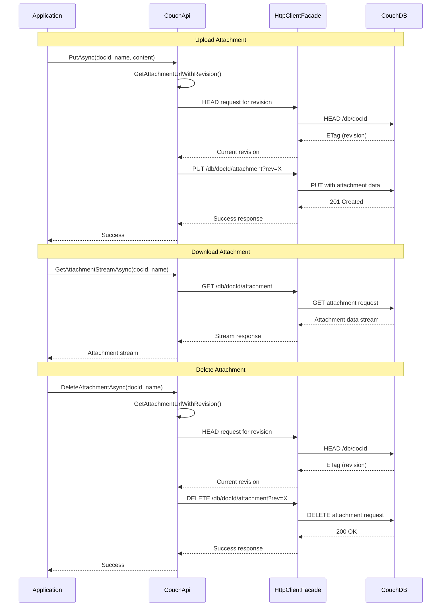

# Attachment Operations

**Navigation**: [Documentation Index](../../DocumentationIndex.md) | [Attachments Overview](attachments-overview.md)

## Attachment Operations Overview

The Edge10.CouchDb.Client provides comprehensive attachment management capabilities, allowing you to store, retrieve, and manage file attachments associated with CouchDB documents. Attachments are binary data that can be stored alongside documents with proper metadata handling and efficient streaming support.

## Attachment Methods

### 1. Attachment Existence Check

Verifies if an attachment exists on a document without downloading it:

```csharp
Task<bool> AttachmentExistsAsync(string documentId, string attachmentName)
```

### 2. Attachment Retrieval

#### Get Attachment as HttpContent
```csharp
Task<HttpContent> GetAttachmentAsync(string documentId, string attachmentName)
Task<HttpContent> TryGetAttachmentAsync(string documentId, string attachmentName)
```

#### Get Attachment as Stream
```csharp
Task<Stream> GetAttachmentStreamAsync(string documentId, string attachmentName)
Task<Stream> TryGetAttachmentStreamAsync(string documentId, string attachmentName)
```

### 3. Attachment Upload

Uploads or updates an attachment on a document:

```csharp
Task PutAsync(string documentId, string attachmentName, HttpContent httpContent)
```

### 4. Attachment Deletion

Removes an attachment from a document:

```csharp
Task DeleteAttachmentAsync(string documentId, string attachmentName)
```

## Attachment Operations Flow



## Core Implementation

### Attachment Existence Check

```csharp
public async Task<bool> AttachmentExistsAsync(string documentId, string attachmentName)
{
    documentId.ThrowIfNullOrEmpty(nameof(documentId));
    attachmentName.ThrowIfNullOrEmpty(nameof(attachmentName));

    var result = await _client.GetAsync(
        GetAttachmentUrl(documentId, attachmentName),
        HttpCompletionOption.ResponseHeadersRead);

    using (result)
        return result.IsSuccessStatusCode;
}
```

### Attachment Retrieval

#### HttpContent Retrieval
```csharp
public async Task<HttpContent> GetAttachmentAsync(string documentId, string attachmentName)
{
    return await GetAttachment(documentId, attachmentName, throwOnError: true);
}

public async Task<HttpContent> TryGetAttachmentAsync(string documentId, string attachmentName)
{
    return await GetAttachment(documentId, attachmentName, throwOnError: false);
}

private async Task<HttpContent> GetAttachment(string documentId, string attachmentName, bool throwOnError)
{
    documentId.ThrowIfNullOrEmpty("documentId");
    attachmentName.ThrowIfNullOrEmpty("attachmentName");

    var result = await _client.GetAsync(GetAttachmentUrl(documentId, attachmentName));

    if (throwOnError)
        await result.ThrowErrorIfNotSuccess();
    else if (!result.IsSuccessStatusCode)
        return null;

    return result.Content;
}
```

#### Stream Retrieval
```csharp
public async Task<Stream> GetAttachmentStreamAsync(string documentId, string attachmentName)
{
    return await GetAttachmentStream(documentId, attachmentName, throwOnError: true);
}

public async Task<Stream> TryGetAttachmentStreamAsync(string documentId, string attachmentName)
{
    return await GetAttachmentStream(documentId, attachmentName, throwOnError: false);
}

private async Task<Stream> GetAttachmentStream(string documentId, string attachmentName, bool throwOnError)
{
    var content = await GetAttachment(documentId, attachmentName, throwOnError);
    if (content == null) return null;

    return await content.ReadAsStreamAsync();
}
```

### Attachment Upload

```csharp
public async Task PutAsync(string documentId, string attachmentName, HttpContent httpContent)
{
    documentId.ThrowIfNullOrEmpty(nameof(documentId));
    attachmentName.ThrowIfNullOrEmpty(nameof(attachmentName));
    httpContent.ThrowIfNull(nameof(httpContent));

    var requestUriPutAsync = await GetAttachmentUrlWithRevision(documentId, attachmentName);
    var httpResponsePutAsync = await _client.PutAsync(requestUriPutAsync, httpContent);

    await httpResponsePutAsync.ThrowErrorIfNotSuccess();
}
```

### Attachment Deletion

```csharp
public async Task DeleteAttachmentAsync(string documentId, string attachmentName)
{
    documentId.ThrowIfNullOrEmpty(nameof(documentId));
    attachmentName.ThrowIfNullOrEmpty(nameof(attachmentName));

    var requestUri = await GetAttachmentUrlWithRevision(documentId, attachmentName);
    var response = await _client.DeleteAsync(requestUri);

    await response.ThrowErrorIfNotSuccess();
}
```

### URL and Revision Management

```csharp
private string GetAttachmentUrl(string documentId, string attachmentName)
{
    return $"{_url}/{_databaseName}/{documentId}/{attachmentName}";
}

private async Task<string> GetAttachmentUrlWithRevision(string documentId, string attachmentName)
{
    var documentUri = GetDocumentUrl(documentId);
    var revision = await GetDocumentRevision(documentUri);

    var requestUriPutAsync = $"{documentUri}/{attachmentName}?rev={revision}";
    return requestUriPutAsync;
}

private async Task<string> GetDocumentRevision(string documentUri)
{
    // Use HEAD request to get revision without document content
    var httpResponseSendAsync = await _client.SendAsync(new HttpRequestMessage(HttpMethod.Head, documentUri));
    await httpResponseSendAsync.ThrowErrorIfNotSuccess();

    return httpResponseSendAsync.Headers.ETag.Tag.Replace('\"', ' ').Trim();
}
```

## Attachment Metadata

### IAttachmentMetaData Interface

```csharp
public interface IAttachmentMetaData
{
    string ContentType { get; set; }
    string Filename { get; set; }
    bool Stub { get; }
}
```

### AttachmentMetaData Implementation

```csharp
public class AttachmentMetaData : IAttachmentMetaData
{
    [JsonProperty(PropertyName = "content_type")]
    public string ContentType { get; set; }

    [JsonIgnore]
    public string Filename { get; set; }

    [JsonProperty("stub")]
    public bool Stub { get; private set; } = true;
}
```

### Document Integration

Attachments are automatically tracked in document metadata:

```csharp
public abstract class CouchModelBase : ICouchModel
{
    [JsonProperty(PropertyName = "_attachments")]
    [JsonConverter(typeof(AttachmentsConverter))]
    public IList<IAttachmentMetaData> Attachments { get; } = new List<IAttachmentMetaData>();
}
```

### AttachmentsConverter

Custom JSON converter handles CouchDB's attachment format:

```csharp
public class AttachmentsConverter : JsonConverter
{
    public override object ReadJson(JsonReader reader, Type objectType, object existingValue, JsonSerializer serializer)
    {
        var attachments = existingValue as IList<IAttachmentMetaData> ?? new List<IAttachmentMetaData>();
        var parsedJson = JObject.Load(reader);

        foreach (var item in parsedJson)
        {
            var attachment = new AttachmentMetaData { Filename = item.Key };
            serializer.Populate(item.Value.CreateReader(), attachment);
            attachments.Add(attachment);
        }

        return attachments;
    }

    public override void WriteJson(JsonWriter writer, object value, JsonSerializer serializer)
    {
        writer.WriteStartObject();

        var attachments = value as IList<IAttachmentMetaData>;
        if (attachments != null)
        {
            foreach (var attachment in attachments)
            {
                writer.WritePropertyName(attachment.Filename);
                var typeNameHandling = serializer.TypeNameHandling;
                serializer.TypeNameHandling = TypeNameHandling.None;
                serializer.Serialize(writer, attachment);
                serializer.TypeNameHandling = typeNameHandling;
            }
        }

        writer.WriteEndObject();
    }
}
```

## Usage Examples

### Basic Attachment Upload

```csharp
public async Task UploadImageAttachment(string documentId, string imagePath)
{
    var imageBytes = File.ReadAllBytes(imagePath);
    var content = new ByteArrayContent(imageBytes);
    content.Headers.ContentType = new MediaTypeHeaderValue("image/jpeg");

    var attachmentName = Path.GetFileName(imagePath);
    await couchApi.PutAsync(documentId, attachmentName, content);
    
    Console.WriteLine($"Uploaded {attachmentName} to document {documentId}");
}
```

### Stream-Based Upload

```csharp
public async Task UploadLargeFile(string documentId, string filePath)
{
    using var fileStream = File.OpenRead(filePath);
    using var content = new StreamContent(fileStream);
    
    // Set appropriate content type
    var mimeType = GetMimeType(filePath);
    content.Headers.ContentType = new MediaTypeHeaderValue(mimeType);
    
    var attachmentName = Path.GetFileName(filePath);
    await couchApi.PutAsync(documentId, attachmentName, content);
}

private string GetMimeType(string filePath)
{
    var extension = Path.GetExtension(filePath).ToLowerInvariant();
    return extension switch
    {
        ".jpg" or ".jpeg" => "image/jpeg",
        ".png" => "image/png",
        ".pdf" => "application/pdf",
        ".txt" => "text/plain",
        ".json" => "application/json",
        ".xml" => "application/xml",
        _ => "application/octet-stream"
    };
}
```

### Attachment Download

```csharp
public async Task DownloadAttachment(string documentId, string attachmentName, string downloadPath)
{
    try
    {
        using var attachmentStream = await couchApi.GetAttachmentStreamAsync(documentId, attachmentName);
        using var fileStream = File.Create(downloadPath);
        
        await attachmentStream.CopyToAsync(fileStream);
        Console.WriteLine($"Downloaded {attachmentName} to {downloadPath}");
    }
    catch (HttpRequestException ex) when (ex.Message.Contains("404"))
    {
        Console.WriteLine($"Attachment {attachmentName} not found on document {documentId}");
    }
}
```

### Safe Attachment Operations

```csharp
public async Task<bool> TryDownloadAttachment(string documentId, string attachmentName, string downloadPath)
{
    using var attachmentStream = await couchApi.TryGetAttachmentStreamAsync(documentId, attachmentName);
    
    if (attachmentStream == null)
    {
        Console.WriteLine($"Attachment {attachmentName} not found");
        return false;
    }
    
    using var fileStream = File.Create(downloadPath);
    await attachmentStream.CopyToAsync(fileStream);
    
    Console.WriteLine($"Successfully downloaded {attachmentName}");
    return true;
}
```

### Attachment Existence Check

```csharp
public async Task ProcessDocumentAttachments(string documentId)
{
    var attachmentNames = new[] { "image.jpg", "document.pdf", "data.json" };
    
    foreach (var attachmentName in attachmentNames)
    {
        if (await couchApi.AttachmentExistsAsync(documentId, attachmentName))
        {
            Console.WriteLine($"Processing {attachmentName}...");
            await ProcessAttachment(documentId, attachmentName);
        }
        else
        {
            Console.WriteLine($"Attachment {attachmentName} not found, skipping");
        }
    }
}
```

### Multiple Attachment Management

```csharp
public async Task UploadMultipleAttachments(string documentId, string[] filePaths)
{
    var uploadTasks = filePaths.Select(async filePath =>
    {
        try
        {
            using var fileStream = File.OpenRead(filePath);
            using var content = new StreamContent(fileStream);
            
            var mimeType = GetMimeType(filePath);
            content.Headers.ContentType = new MediaTypeHeaderValue(mimeType);
            
            var attachmentName = Path.GetFileName(filePath);
            await couchApi.PutAsync(documentId, attachmentName, content);
            
            return new UploadResult { AttachmentName = attachmentName, Success = true };
        }
        catch (Exception ex)
        {
            return new UploadResult 
            { 
                AttachmentName = Path.GetFileName(filePath), 
                Success = false, 
                Error = ex.Message 
            };
        }
    });
    
    var results = await Task.WhenAll(uploadTasks);
    
    foreach (var result in results)
    {
        if (result.Success)
            Console.WriteLine($"Successfully uploaded {result.AttachmentName}");
        else
            Console.WriteLine($"Failed to upload {result.AttachmentName}: {result.Error}");
    }
}

public class UploadResult
{
    public string AttachmentName { get; set; }
    public bool Success { get; set; }
    public string Error { get; set; }
}
```

## Advanced Attachment Patterns

### Attachment Versioning

```csharp
public async Task UploadVersionedAttachment(string documentId, string baseAttachmentName, Stream content, string contentType)
{
    var timestamp = DateTime.UtcNow.ToString("yyyyMMddHHmmss");
    var versionedName = $"{baseAttachmentName}_{timestamp}";
    
    using var httpContent = new StreamContent(content);
    httpContent.Headers.ContentType = new MediaTypeHeaderValue(contentType);
    
    await couchApi.PutAsync(documentId, versionedName, httpContent);
    
    // Optionally maintain a "latest" version
    content.Position = 0; // Reset stream position
    using var latestContent = new StreamContent(content);
    latestContent.Headers.ContentType = new MediaTypeHeaderValue(contentType);
    
    await couchApi.PutAsync(documentId, $"{baseAttachmentName}_latest", latestContent);
}
```

### Attachment Backup and Restoration

```csharp
public async Task BackupDocumentAttachments(string documentId, string backupDirectory)
{
    // Get document to access attachment metadata
    var document = await couchApi.GetDocumentAsync<CouchModelBase>(documentId);
    
    if (!document.Attachments.Any())
    {
        Console.WriteLine("No attachments to backup");
        return;
    }
    
    Directory.CreateDirectory(backupDirectory);
    
    foreach (var attachment in document.Attachments)
    {
        var backupPath = Path.Combine(backupDirectory, attachment.Filename);
        
        try
        {
            using var attachmentStream = await couchApi.GetAttachmentStreamAsync(documentId, attachment.Filename);
            using var fileStream = File.Create(backupPath);
            
            await attachmentStream.CopyToAsync(fileStream);
            Console.WriteLine($"Backed up {attachment.Filename}");
        }
        catch (Exception ex)
        {
            Console.WriteLine($"Failed to backup {attachment.Filename}: {ex.Message}");
        }
    }
}

public async Task RestoreDocumentAttachments(string documentId, string backupDirectory)
{
    if (!Directory.Exists(backupDirectory))
    {
        throw new DirectoryNotFoundException($"Backup directory not found: {backupDirectory}");
    }
    
    var files = Directory.GetFiles(backupDirectory);
    
    foreach (var filePath in files)
    {
        try
        {
            using var fileStream = File.OpenRead(filePath);
            using var content = new StreamContent(fileStream);
            
            var mimeType = GetMimeType(filePath);
            content.Headers.ContentType = new MediaTypeHeaderValue(mimeType);
            
            var attachmentName = Path.GetFileName(filePath);
            await couchApi.PutAsync(documentId, attachmentName, content);
            
            Console.WriteLine($"Restored {attachmentName}");
        }
        catch (Exception ex)
        {
            Console.WriteLine($"Failed to restore {Path.GetFileName(filePath)}: {ex.Message}");
        }
    }
}
```

### Attachment Transformation

```csharp
public async Task ProcessAndUploadImage(string documentId, string originalImagePath)
{
    using var originalImage = Image.Load(originalImagePath);
    
    // Create thumbnail
    var thumbnail = originalImage.Clone(x => x.Resize(150, 150));
    using var thumbnailStream = new MemoryStream();
    await thumbnail.SaveAsJpegAsync(thumbnailStream);
    thumbnailStream.Position = 0;
    
    using var thumbnailContent = new StreamContent(thumbnailStream);
    thumbnailContent.Headers.ContentType = new MediaTypeHeaderValue("image/jpeg");
    
    await couchApi.PutAsync(documentId, "thumbnail.jpg", thumbnailContent);
    
    // Create web-optimized version
    var webOptimized = originalImage.Clone(x => x.Resize(800, 600));
    using var webStream = new MemoryStream();
    await webOptimized.SaveAsJpegAsync(webStream);
    webStream.Position = 0;
    
    using var webContent = new StreamContent(webStream);
    webContent.Headers.ContentType = new MediaTypeHeaderValue("image/jpeg");
    
    await couchApi.PutAsync(documentId, "web_optimized.jpg", webContent);
    
    Console.WriteLine("Uploaded original, thumbnail, and web-optimized versions");
}
```

## Error Handling

### Comprehensive Attachment Error Handling

```csharp
public async Task<AttachmentOperationResult> SafeAttachmentOperation(
    Func<Task> operation, 
    string operationName)
{
    try
    {
        await operation();
        return AttachmentOperationResult.Success();
    }
    catch (HttpRequestException ex) when (ex.Message.Contains("404"))
    {
        return AttachmentOperationResult.NotFound($"{operationName}: Document or attachment not found");
    }
    catch (HttpRequestException ex) when (ex.Message.Contains("409"))
    {
        return AttachmentOperationResult.Conflict($"{operationName}: Document revision conflict");
    }
    catch (HttpRequestException ex) when (ex.Message.Contains("413"))
    {
        return AttachmentOperationResult.PayloadTooLarge($"{operationName}: Attachment too large");
    }
    catch (UnauthorizedAccessException)
    {
        return AttachmentOperationResult.Unauthorized($"{operationName}: Access denied");
    }
    catch (IOException ex)
    {
        return AttachmentOperationResult.IOError($"{operationName}: File system error - {ex.Message}");
    }
    catch (Exception ex)
    {
        return AttachmentOperationResult.UnknownError($"{operationName}: {ex.Message}");
    }
}

public class AttachmentOperationResult
{
    public bool IsSuccess { get; private set; }
    public AttachmentErrorType ErrorType { get; private set; }
    public string ErrorMessage { get; private set; }
    
    public static AttachmentOperationResult Success() => 
        new AttachmentOperationResult { IsSuccess = true };
        
    public static AttachmentOperationResult NotFound(string message) => 
        new AttachmentOperationResult { ErrorType = AttachmentErrorType.NotFound, ErrorMessage = message };
        
    public static AttachmentOperationResult Conflict(string message) => 
        new AttachmentOperationResult { ErrorType = AttachmentErrorType.Conflict, ErrorMessage = message };
        
    public static AttachmentOperationResult PayloadTooLarge(string message) => 
        new AttachmentOperationResult { ErrorType = AttachmentErrorType.PayloadTooLarge, ErrorMessage = message };
        
    public static AttachmentOperationResult Unauthorized(string message) => 
        new AttachmentOperationResult { ErrorType = AttachmentErrorType.Unauthorized, ErrorMessage = message };
        
    public static AttachmentOperationResult IOError(string message) => 
        new AttachmentOperationResult { ErrorType = AttachmentErrorType.IOError, ErrorMessage = message };
        
    public static AttachmentOperationResult UnknownError(string message) => 
        new AttachmentOperationResult { ErrorType = AttachmentErrorType.UnknownError, ErrorMessage = message };
}

public enum AttachmentErrorType
{
    None,
    NotFound,
    Conflict,
    PayloadTooLarge,
    Unauthorized,
    IOError,
    UnknownError
}
```

## Testing Attachment Operations

### Unit Testing

```csharp
[Test]
public async Task PutAsync_Should_UploadAttachment()
{
    // Arrange
    var documentId = "test-doc";
    var attachmentName = "test.txt";
    var content = new StringContent("test content");
    
    var mockHttpClient = new Mock<IHttpClientFacade>();
    
    // Mock HEAD request for revision
    mockHttpClient.Setup(x => x.SendAsync(It.Is<HttpRequestMessage>(req => req.Method == HttpMethod.Head)))
              .ReturnsAsync(new HttpResponseMessage(HttpStatusCode.OK)
              {
                  Headers = { ETag = new EntityTagHeaderValue("\"1-abc123\"") }
              });
    
    // Mock PUT request for attachment
    mockHttpClient.Setup(x => x.PutAsync(It.IsAny<string>(), It.IsAny<HttpContent>()))
              .ReturnsAsync(new HttpResponseMessage(HttpStatusCode.Created));

    var couchApi = new CouchApi(connectionString, mockHttpClient.Object, mockEventLog.Object, null);

    // Act
    await couchApi.PutAsync(documentId, attachmentName, content);

    // Assert
    mockHttpClient.Verify(x => x.SendAsync(It.Is<HttpRequestMessage>(req => req.Method == HttpMethod.Head)), Times.Once);
    mockHttpClient.Verify(x => x.PutAsync(It.IsAny<string>(), content), Times.Once);
}

[Test]
public async Task AttachmentExistsAsync_Should_ReturnTrue_WhenAttachmentExists()
{
    // Arrange
    var mockHttpClient = new Mock<IHttpClientFacade>();
    mockHttpClient.Setup(x => x.GetAsync(It.IsAny<string>(), HttpCompletionOption.ResponseHeadersRead))
              .ReturnsAsync(new HttpResponseMessage(HttpStatusCode.OK));

    var couchApi = new CouchApi(connectionString, mockHttpClient.Object, mockEventLog.Object, null);

    // Act
    var exists = await couchApi.AttachmentExistsAsync("doc-id", "attachment.txt");

    // Assert
    Assert.That(exists, Is.True);
}
```

### Integration Testing

```csharp
[Test]
public async Task AttachmentOperations_Integration_Should_WorkEndToEnd()
{
    using var couchApi = new CouchApi(GetTestConnectionString());
    
    // Create test document
    var document = new TestDocument { Name = "Test Document" };
    await couchApi.CreateDocumentAsync(document);
    
    // Upload attachment
    var attachmentContent = "This is test attachment content";
    var content = new StringContent(attachmentContent);
    content.Headers.ContentType = new MediaTypeHeaderValue("text/plain");
    
    await couchApi.PutAsync(document.Id, "test.txt", content);
    
    // Verify attachment exists
    var exists = await couchApi.AttachmentExistsAsync(document.Id, "test.txt");
    Assert.That(exists, Is.True);
    
    // Download attachment
    using var downloadedStream = await couchApi.GetAttachmentStreamAsync(document.Id, "test.txt");
    using var reader = new StreamReader(downloadedStream);
    var downloadedContent = await reader.ReadToEndAsync();
    
    Assert.That(downloadedContent, Is.EqualTo(attachmentContent));
    
    // Delete attachment
    await couchApi.DeleteAttachmentAsync(document.Id, "test.txt");
    
    // Verify attachment no longer exists
    exists = await couchApi.AttachmentExistsAsync(document.Id, "test.txt");
    Assert.That(exists, Is.False);
}
```

## Best Practices

1. **Use appropriate content types**: Set correct MIME types for attachments
2. **Handle large files efficiently**: Use streaming for large attachments
3. **Implement proper error handling**: Account for network, permission, and size limit errors
4. **Check attachment existence**: Use `AttachmentExistsAsync` before operations
5. **Use try methods for optional operations**: Avoid exceptions with `TryGet` methods
6. **Dispose resources properly**: Always dispose streams and HttpContent
7. **Consider attachment size limits**: Be aware of CouchDB and network limits
8. **Implement retry logic**: Handle transient failures gracefully
9. **Use meaningful attachment names**: Choose descriptive filenames
10. **Monitor attachment operations**: Track upload/download performance and errors

---

*For more information about attachment operations, see [Attachments Overview](attachments-overview.md) and [Attachment Streaming](attachment-streaming.md).*