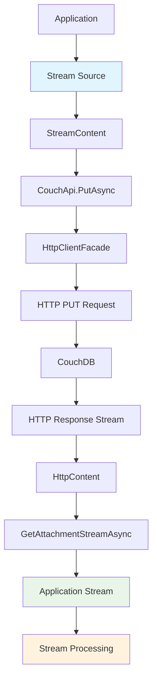

# Attachment Streaming

**Navigation**: [Documentation Index](../../DocumentationIndex.md) | [Attachments Overview](attachments-overview.md)

## Attachment Streaming Overview

The Edge10.CouchDb.Client provides efficient streaming capabilities for attachment operations, enabling memory-efficient handling of large files. The streaming approach minimizes memory usage by processing data as it flows rather than loading entire files into memory.

**File Size Limits:**
- **No specific file size limits enforced at client level** - the library supports streaming of arbitrarily large files
- **Memory-efficient processing**: Stream-based operations prevent memory exhaustion regardless of file size
- **Size limits determined by**: CouchDB server configuration, network timeouts, and available disk space
- **Recommended approach**: Use streaming for all file operations to maintain consistent memory usage

## Streaming Methods

### Stream-Based Retrieval

#### GetAttachmentStreamAsync
Returns a stream for reading attachment data:

```csharp
Task<Stream> GetAttachmentStreamAsync(string documentId, string attachmentName)
```

#### TryGetAttachmentStreamAsync
Safe stream retrieval that returns null if attachment doesn't exist:

```csharp  
Task<Stream> TryGetAttachmentStreamAsync(string documentId, string attachmentName)
```

### Stream-Based Upload

#### PutAsync with StreamContent
Uploads attachments using streams:

```csharp
Task PutAsync(string documentId, string attachmentName, HttpContent httpContent)
```

## Streaming Architecture



## Core Streaming Implementation

### Stream Retrieval Implementation

```csharp
public async Task<Stream> GetAttachmentStreamAsync(string documentId, string attachmentName)
{
    return await GetAttachmentStream(documentId, attachmentName, throwOnError: true);
}

public async Task<Stream> TryGetAttachmentStreamAsync(string documentId, string attachmentName)
{
    return await GetAttachmentStream(documentId, attachmentName, throwOnError: false);
}

private async Task<Stream> GetAttachmentStream(string documentId, string attachmentName, bool throwOnError)
{
    var content = await GetAttachment(documentId, attachmentName, throwOnError);
    if (content == null) return null;

    return await content.ReadAsStreamAsync();
}

private async Task<HttpContent> GetAttachment(string documentId, string attachmentName, bool throwOnError)
{
    documentId.ThrowIfNullOrEmpty("documentId");
    attachmentName.ThrowIfNullOrEmpty("attachmentName");

    var result = await _client.GetAsync(GetAttachmentUrl(documentId, attachmentName));

    if (throwOnError)
        await result.ThrowErrorIfNotSuccess();
    else if (!result.IsSuccessStatusCode)
        return null;

    return result.Content;
}
```

### HTTP Client Streaming Support

The `HttpClientFacade` provides streaming methods:

```csharp
public Task<Stream> GetStreamAsync(string requestUri)
{
    return _client.GetStreamAsync(requestUri);
}

public Task<Stream> GetStreamAsync(Uri requestUri)
{
    return _client.GetStreamAsync(requestUri);
}
```

## Streaming Patterns

### Large File Upload with Progress Tracking

```csharp
public async Task UploadLargeFileWithProgress(
    string documentId, 
    string attachmentName, 
    string filePath,
    IProgress<UploadProgress> progress = null)
{
    var fileInfo = new FileInfo(filePath);
    var totalBytes = fileInfo.Length;
    var uploadedBytes = 0L;

    using var fileStream = File.OpenRead(filePath);
    using var progressStream = new ProgressStream(fileStream, (bytesRead) =>
    {
        uploadedBytes += bytesRead;
        var progressPercentage = (double)uploadedBytes / totalBytes * 100;
        progress?.Report(new UploadProgress
        {
            BytesUploaded = uploadedBytes,
            TotalBytes = totalBytes,
            PercentageComplete = progressPercentage
        });
    });

    using var content = new StreamContent(progressStream);
    content.Headers.ContentType = new MediaTypeHeaderValue(GetMimeType(filePath));

    await couchApi.PutAsync(documentId, attachmentName, content);
}

public class UploadProgress
{
    public long BytesUploaded { get; set; }
    public long TotalBytes { get; set; }
    public double PercentageComplete { get; set; }
}

public class ProgressStream : Stream
{
    private readonly Stream _baseStream;
    private readonly Action<int> _onBytesRead;

    public ProgressStream(Stream baseStream, Action<int> onBytesRead)
    {
        _baseStream = baseStream;
        _onBytesRead = onBytesRead;
    }

    public override int Read(byte[] buffer, int offset, int count)
    {
        var bytesRead = _baseStream.Read(buffer, offset, count);
        _onBytesRead?.Invoke(bytesRead);
        return bytesRead;
    }

    public override async Task<int> ReadAsync(byte[] buffer, int offset, int count, CancellationToken cancellationToken)
    {
        var bytesRead = await _baseStream.ReadAsync(buffer, offset, count, cancellationToken);
        _onBytesRead?.Invoke(bytesRead);
        return bytesRead;
    }

    // Delegate other Stream members to _baseStream
    public override bool CanRead => _baseStream.CanRead;
    public override bool CanSeek => _baseStream.CanSeek;
    public override bool CanWrite => _baseStream.CanWrite;
    public override long Length => _baseStream.Length;
    public override long Position 
    { 
        get => _baseStream.Position; 
        set => _baseStream.Position = value; 
    }

    public override void Flush() => _baseStream.Flush();
    public override long Seek(long offset, SeekOrigin origin) => _baseStream.Seek(offset, origin);
    public override void SetLength(long value) => _baseStream.SetLength(value);
    public override void Write(byte[] buffer, int offset, int count) => _baseStream.Write(buffer, offset, count);

    protected override void Dispose(bool disposing)
    {
        if (disposing)
            _baseStream?.Dispose();
        base.Dispose(disposing);
    }
}
```

### Memory-Efficient Download with Processing

```csharp
public async Task ProcessAttachmentStreamAsync<T>(
    string documentId,
    string attachmentName,
    Func<Stream, Task<T>> processor)
{
    using var attachmentStream = await couchApi.GetAttachmentStreamAsync(documentId, attachmentName);
    
    if (attachmentStream == null)
        throw new FileNotFoundException($"Attachment {attachmentName} not found on document {documentId}");

    var result = await processor(attachmentStream);
    return result;
}

// Usage examples
public async Task<string> ExtractTextFromAttachment(string documentId, string attachmentName)
{
    return await ProcessAttachmentStreamAsync(documentId, attachmentName, async stream =>
    {
        using var reader = new StreamReader(stream);
        return await reader.ReadToEndAsync();
    });
}

public async Task<byte[]> ComputeAttachmentHash(string documentId, string attachmentName)
{
    return await ProcessAttachmentStreamAsync(documentId, attachmentName, async stream =>
    {
        using var sha256 = SHA256.Create();
        return await sha256.ComputeHashAsync(stream);
    });
}
```

### Chunked Processing for Large Files

```csharp
public async Task ProcessAttachmentInChunks(
    string documentId,
    string attachmentName,
    Func<byte[], int, Task> chunkProcessor,
    int chunkSize = 8192)
{
    using var attachmentStream = await couchApi.GetAttachmentStreamAsync(documentId, attachmentName);
    
    if (attachmentStream == null)
        return;

    var buffer = new byte[chunkSize];
    int bytesRead;

    while ((bytesRead = await attachmentStream.ReadAsync(buffer, 0, buffer.Length)) > 0)
    {
        await chunkProcessor(buffer, bytesRead);
    }
}

// Example: Calculate file statistics
public async Task<FileStatistics> AnalyzeAttachment(string documentId, string attachmentName)
{
    var stats = new FileStatistics();

    await ProcessAttachmentInChunks(documentId, attachmentName, async (buffer, bytesRead) =>
    {
        stats.TotalBytes += bytesRead;
        stats.ChunkCount++;

        // Count line breaks
        for (int i = 0; i < bytesRead; i++)
        {
            if (buffer[i] == '\n')
                stats.LineCount++;
        }

        // You could add more analysis here
        await Task.CompletedTask;
    });

    return stats;
}

public class FileStatistics
{
    public long TotalBytes { get; set; }
    public int ChunkCount { get; set; }
    public int LineCount { get; set; }
}
```

### Stream Copying and Transformation

```csharp
public async Task CopyAttachmentBetweenDocuments(
    string sourceDocumentId,
    string targetDocumentId,
    string attachmentName)
{
    using var sourceStream = await couchApi.GetAttachmentStreamAsync(sourceDocumentId, attachmentName);
    
    if (sourceStream == null)
        throw new FileNotFoundException($"Source attachment {attachmentName} not found");

    // Get content type from source document
    var sourceDocument = await couchApi.GetDocumentAsync<CouchModelBase>(sourceDocumentId);
    var attachmentMeta = sourceDocument.Attachments.FirstOrDefault(a => a.Filename == attachmentName);
    var contentType = attachmentMeta?.ContentType ?? "application/octet-stream";

    using var content = new StreamContent(sourceStream);
    content.Headers.ContentType = new MediaTypeHeaderValue(contentType);

    await couchApi.PutAsync(targetDocumentId, attachmentName, content);
}

public async Task TransformAndUploadAttachment(
    string documentId,
    string attachmentName,
    Stream sourceStream,
    Func<Stream, Stream> transformer,
    string contentType)
{
    using var transformedStream = transformer(sourceStream);
    using var content = new StreamContent(transformedStream);
    content.Headers.ContentType = new MediaTypeHeaderValue(contentType);

    await couchApi.PutAsync(documentId, attachmentName, content);
}

// Example transformation: Compress stream
public async Task UploadCompressedAttachment(
    string documentId,
    string attachmentName,
    Stream sourceStream)
{
    await TransformAndUploadAttachment(
        documentId,
        $"{attachmentName}.gz",
        sourceStream,
        source => new GZipStream(source, CompressionMode.Compress),
        "application/gzip"
    );
}
```

## Advanced Streaming Scenarios

### Concurrent Attachment Processing

```csharp
public async Task ProcessMultipleAttachmentsConcurrently(
    string documentId,
    string[] attachmentNames,
    Func<string, Stream, Task> processor,
    int maxConcurrency = 3)
{
    using var semaphore = new SemaphoreSlim(maxConcurrency, maxConcurrency);

    var tasks = attachmentNames.Select(async attachmentName =>
    {
        await semaphore.WaitAsync();
        try
        {
            using var stream = await couchApi.TryGetAttachmentStreamAsync(documentId, attachmentName);
            if (stream != null)
            {
                await processor(attachmentName, stream);
            }
        }
        finally
        {
            semaphore.Release();
        }
    });

    await Task.WhenAll(tasks);
}

// Usage example
public async Task AnalyzeAllDocumentAttachments(string documentId)
{
    // Get document to find all attachment names
    var document = await couchApi.GetDocumentAsync<CouchModelBase>(documentId);
    var attachmentNames = document.Attachments.Select(a => a.Filename).ToArray();

    await ProcessMultipleAttachmentsConcurrently(
        documentId,
        attachmentNames,
        async (name, stream) =>
        {
            var size = await CalculateStreamSize(stream);
            Console.WriteLine($"Attachment {name}: {size} bytes");
        }
    );
}

private async Task<long> CalculateStreamSize(Stream stream)
{
    var buffer = new byte[8192];
    long totalSize = 0;
    int bytesRead;

    while ((bytesRead = await stream.ReadAsync(buffer, 0, buffer.Length)) > 0)
    {
        totalSize += bytesRead;
    }

    return totalSize;
}
```

### Stream Validation and Integrity Checking

```csharp
public async Task<AttachmentValidationResult> ValidateAttachmentIntegrity(
    string documentId,
    string attachmentName,
    string expectedHash = null)
{
    try
    {
        using var stream = await couchApi.GetAttachmentStreamAsync(documentId, attachmentName);
        using var sha256 = SHA256.Create();
        
        var computedHash = await sha256.ComputeHashAsync(stream);
        var hashString = Convert.ToBase64String(computedHash);

        var result = new AttachmentValidationResult
        {
            IsValid = expectedHash == null || hashString == expectedHash,
            ComputedHash = hashString,
            ExpectedHash = expectedHash,
            Size = stream.Position // Position after reading
        };

        return result;
    }
    catch (Exception ex)
    {
        return new AttachmentValidationResult
        {
            IsValid = false,
            ErrorMessage = ex.Message
        };
    }
}

public class AttachmentValidationResult
{
    public bool IsValid { get; set; }
    public string ComputedHash { get; set; }
    public string ExpectedHash { get; set; }
    public long Size { get; set; }
    public string ErrorMessage { get; set; }
}
```

### Memory-Efficient Attachment Migration

```csharp
public async Task MigrateAttachmentsBetweenDatabases(
    ICouchApi sourceApi,
    ICouchApi targetApi,
    string documentId,
    string[] attachmentNames = null)
{
    // Get source document
    var sourceDocument = await sourceApi.GetDocumentAsync<CouchModelBase>(documentId);
    
    // Create target document if it doesn't exist
    try
    {
        await targetApi.GetDocumentAsync<CouchModelBase>(documentId);
    }
    catch (HttpRequestException ex) when (ex.Message.Contains("404"))
    {
        // Document doesn't exist in target, create it
        sourceDocument.Rev = null; // Clear revision for new document
        await targetApi.CreateDocumentAsync(sourceDocument);
    }

    var attachmentsToMigrate = attachmentNames ?? 
                               sourceDocument.Attachments.Select(a => a.Filename).ToArray();

    foreach (var attachmentName in attachmentsToMigrate)
    {
        try
        {
            await MigrateSingleAttachment(sourceApi, targetApi, documentId, attachmentName);
            Console.WriteLine($"Successfully migrated {attachmentName}");
        }
        catch (Exception ex)
        {
            Console.WriteLine($"Failed to migrate {attachmentName}: {ex.Message}");
        }
    }
}

private async Task MigrateSingleAttachment(
    ICouchApi sourceApi,
    ICouchApi targetApi,
    string documentId,
    string attachmentName)
{
    using var sourceStream = await sourceApi.GetAttachmentStreamAsync(documentId, attachmentName);
    
    // Get content type from source
    var sourceDocument = await sourceApi.GetDocumentAsync<CouchModelBase>(documentId);
    var attachmentMeta = sourceDocument.Attachments.FirstOrDefault(a => a.Filename == attachmentName);
    var contentType = attachmentMeta?.ContentType ?? "application/octet-stream";

    using var content = new StreamContent(sourceStream);
    content.Headers.ContentType = new MediaTypeHeaderValue(contentType);

    await targetApi.PutAsync(documentId, attachmentName, content);
}
```

## Performance Optimization

### Buffered Stream Processing

```csharp
public class BufferedAttachmentProcessor
{
    private readonly int _bufferSize;

    public BufferedAttachmentProcessor(int bufferSize = 64 * 1024) // 64KB default
    {
        _bufferSize = bufferSize;
    }

    public async Task<T> ProcessAttachmentBuffered<T>(
        string documentId,
        string attachmentName,
        ICouchApi couchApi,
        Func<Stream, Task<T>> processor)
    {
        using var attachmentStream = await couchApi.GetAttachmentStreamAsync(documentId, attachmentName);
        using var bufferedStream = new BufferedStream(attachmentStream, _bufferSize);
        
        return await processor(bufferedStream);
    }
}
```

### Parallel Stream Processing

```csharp
public async Task ProcessAttachmentInParallel(
    string documentId,
    string attachmentName,
    Func<byte[], int, int, Task> chunkProcessor,
    int chunkSize = 8192,
    int maxDegreeOfParallelism = Environment.ProcessorCount)
{
    using var attachmentStream = await couchApi.GetAttachmentStreamAsync(documentId, attachmentName);
    using var semaphore = new SemaphoreSlim(maxDegreeOfParallelism);

    var tasks = new List<Task>();
    var buffer = new byte[chunkSize];
    int bytesRead;
    int chunkIndex = 0;

    while ((bytesRead = await attachmentStream.ReadAsync(buffer, 0, buffer.Length)) > 0)
    {
        var chunkData = new byte[bytesRead];
        Array.Copy(buffer, chunkData, bytesRead);
        var currentChunkIndex = chunkIndex++;

        await semaphore.WaitAsync();
        
        var task = Task.Run(async () =>
        {
            try
            {
                await chunkProcessor(chunkData, currentChunkIndex, bytesRead);
            }
            finally
            {
                semaphore.Release();
            }
        });
        
        tasks.Add(task);
    }

    await Task.WhenAll(tasks);
}
```

## Error Handling and Resilience

### Retry Pattern for Stream Operations

```csharp
public async Task<T> ExecuteStreamOperationWithRetry<T>(
    Func<Task<T>> streamOperation,
    int maxRetries = 3,
    TimeSpan? delay = null)
{
    var retryDelay = delay ?? TimeSpan.FromSeconds(1);
    
    for (int attempt = 1; attempt <= maxRetries; attempt++)
    {
        try
        {
            return await streamOperation();
        }
        catch (Exception ex) when (attempt < maxRetries && IsRetriableException(ex))
        {
            Console.WriteLine($"Stream operation failed on attempt {attempt}: {ex.Message}");
            await Task.Delay(TimeSpan.FromMilliseconds(retryDelay.TotalMilliseconds * Math.Pow(2, attempt - 1)));
        }
    }
    
    // Final attempt without catching exceptions
    return await streamOperation();
}

private bool IsRetriableException(Exception ex)
{
    return ex is HttpRequestException ||
           ex is TaskCanceledException ||
           ex is IOException;
}

// Usage
public async Task<Stream> GetAttachmentStreamWithRetry(string documentId, string attachmentName)
{
    return await ExecuteStreamOperationWithRetry(
        () => couchApi.GetAttachmentStreamAsync(documentId, attachmentName)
    );
}
```

### Stream Disposal and Resource Management

```csharp
public class AttachmentStreamManager : IDisposable
{
    private readonly List<Stream> _activeStreams = new List<Stream>();
    private readonly object _lock = new object();
    private bool _disposed = false;

    public async Task<Stream> GetManagedAttachmentStream(
        ICouchApi couchApi,
        string documentId,
        string attachmentName)
    {
        if (_disposed)
            throw new ObjectDisposedException(nameof(AttachmentStreamManager));

        var stream = await couchApi.GetAttachmentStreamAsync(documentId, attachmentName);
        
        lock (_lock)
        {
            _activeStreams.Add(stream);
        }

        return stream;
    }

    public void ReleaseStream(Stream stream)
    {
        if (stream == null) return;

        lock (_lock)
        {
            if (_activeStreams.Remove(stream))
            {
                stream.Dispose();
            }
        }
    }

    public void Dispose()
    {
        if (_disposed) return;

        lock (_lock)
        {
            foreach (var stream in _activeStreams)
            {
                stream?.Dispose();
            }
            _activeStreams.Clear();
        }

        _disposed = true;
    }
}
```

## Testing Stream Operations

### Unit Testing Stream Methods

```csharp
[Test]
public async Task GetAttachmentStreamAsync_Should_ReturnStream()
{
    // Arrange
    var testContent = "Test attachment content";
    var contentStream = new MemoryStream(Encoding.UTF8.GetBytes(testContent));
    
    var mockHttpClient = new Mock<IHttpClientFacade>();
    mockHttpClient.Setup(x => x.GetAsync(It.IsAny<string>()))
              .ReturnsAsync(new HttpResponseMessage(HttpStatusCode.OK)
              {
                  Content = new StreamContent(contentStream)
              });

    var couchApi = new CouchApi(connectionString, mockHttpClient.Object, mockEventLog.Object, null);

    // Act
    using var resultStream = await couchApi.GetAttachmentStreamAsync("doc-id", "attachment.txt");
    using var reader = new StreamReader(resultStream);
    var content = await reader.ReadToEndAsync();

    // Assert
    Assert.That(content, Is.EqualTo(testContent));
}
```

### Integration Testing

```csharp
[Test]
public async Task StreamOperations_Integration_Should_HandleLargeFiles()
{
    using var couchApi = new CouchApi(GetTestConnectionString());
    
    // Create test document
    var document = new TestDocument { Name = "Stream Test Document" };
    await couchApi.CreateDocumentAsync(document);
    
    // Create large test data (1MB)
    var largeData = new byte[1024 * 1024];
    new Random().NextBytes(largeData);
    
    // Upload using stream
    using var uploadStream = new MemoryStream(largeData);
    using var content = new StreamContent(uploadStream);
    content.Headers.ContentType = new MediaTypeHeaderValue("application/octet-stream");
    
    await couchApi.PutAsync(document.Id, "large-file.bin", content);
    
    // Download using stream
    using var downloadStream = await couchApi.GetAttachmentStreamAsync(document.Id, "large-file.bin");
    using var memoryStream = new MemoryStream();
    await downloadStream.CopyToAsync(memoryStream);
    
    var downloadedData = memoryStream.ToArray();
    
    // Verify data integrity
    Assert.That(downloadedData, Is.EqualTo(largeData));
}
```

## Best Practices

1. **Always dispose streams**: Use `using` statements or proper disposal patterns
2. **Use buffered streams**: For small reads/writes, use BufferedStream wrapper
3. **Implement progress tracking**: For large files, provide user feedback
4. **Handle stream exceptions**: Network interruptions can break streams
5. **Consider memory usage**: Don't load large streams entirely into memory
6. **Use async methods**: Leverage async/await for non-blocking operations
7. **Validate stream integrity**: Implement checksum validation for critical data
8. **Implement retry logic**: Handle transient network failures
9. **Monitor stream performance**: Track transfer rates and completion times
10. **Plan for cancellation**: Support cancellation tokens for long-running operations

---

*For more information about attachment streaming, see [Attachments Overview](attachments-overview.md) and [Attachment Operations](attachment-operations.md).*