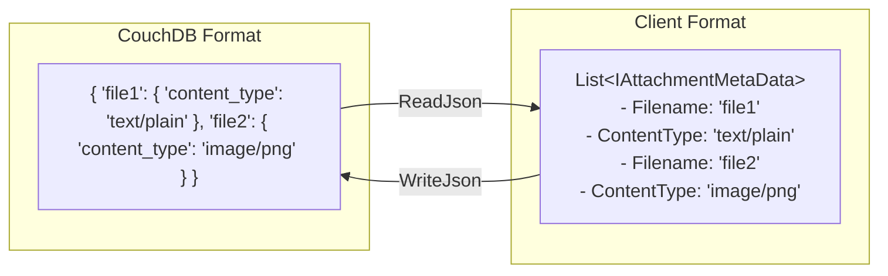
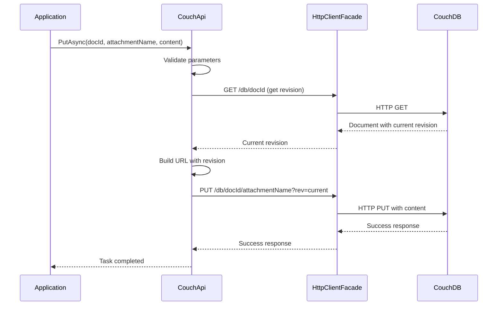
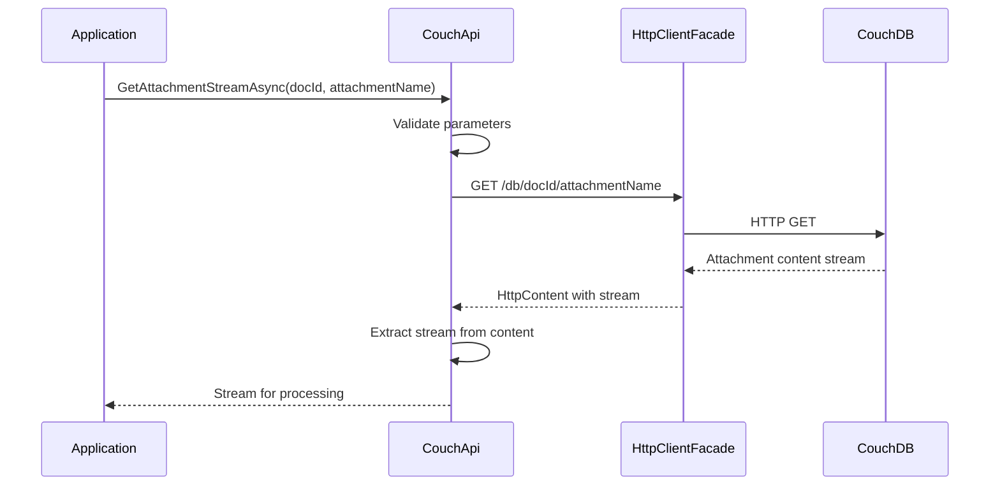

# Attachments Overview

**Navigation**: [Documentation Index](../../DocumentationIndex.md) | [General Functionality](../general-functionality.md)

## Attachment System Architecture

Edge10.CouchDb.Client provides comprehensive support for CouchDB document attachments, enabling efficient handling of binary data and file content through stream-based operations. The attachment system is designed to handle files of various sizes while maintaining memory efficiency and proper resource management.

## Core Components

### 1. Attachment Metadata Management

The attachment system centers around two key components for managing attachment metadata:

#### IAttachmentMetaData Interface
```csharp
public interface IAttachmentMetaData
{
    /// <summary>
    /// Gets or sets the content mime type.
    /// </summary>
    string ContentType { get; set; }
    
    /// <summary>
    /// Gets or sets the filename of the attachment.
    /// </summary>
    string Filename { get; set; }
    
    /// <summary>
    /// Gets a value indicating whether this attachment metadata is a stub.
    /// </summary>
    bool Stub { get; }
}
```

#### AttachmentMetaData Implementation
```csharp
public class AttachmentMetaData : IAttachmentMetaData
{
    [JsonProperty(PropertyName = "content_type")]
    public string ContentType { get; set; }
    
    [JsonIgnore]
    public string Filename { get; set; }
    
    [JsonProperty("stub")]
    public bool Stub { get; private set; } = true;
}
```

**Key Design Features:**
- **ContentType**: Preserves MIME type information for proper file handling
- **Filename**: Stores the attachment name (excluded from JSON serialization)
- **Stub Flag**: Always `true` to indicate metadata-only representation (following CouchDB convention)

### 2. JSON Serialization Handling

#### AttachmentsConverter
The `AttachmentsConverter` class provides custom JSON serialization logic to convert between CouchDB's attachment object format and the client's `IList<IAttachmentMetaData>` representation.

**Conversion Process:**



**Serialization Features:**
- **Bidirectional Conversion**: Handles both reading from and writing to CouchDB format
- **Filename Extraction**: Extracts attachment names from JSON property keys
- **Metadata Preservation**: Maintains all attachment properties during conversion
- **Type Safety**: Ensures proper handling of TypeNameHandling during serialization

## Attachment Operations API

### 1. Existence Checking

```csharp
/// <summary>
/// Checks whether an attachment exists on a document.
/// </summary>
Task<bool> AttachmentExistsAsync(string documentId, string attachmentName);
```

**Implementation Details:**
- Uses HTTP HEAD request optimization (`HttpCompletionOption.ResponseHeadersRead`)
- Returns boolean result without downloading attachment content
- Efficient for large file existence checking

### 2. Stream-Based Retrieval

```csharp
/// <summary>
/// Gets attachment content as a stream for memory-efficient processing.
/// </summary>
Task<Stream> GetAttachmentStreamAsync(string documentId, string attachmentName);

/// <summary>
/// Tries to get attachment stream, returns null if not found.
/// </summary>
Task<Stream> TryGetAttachmentStreamAsync(string documentId, string attachmentName);
```

**Stream Benefits:**
- **Memory Efficiency**: Enables processing of large files without loading entire content into memory
- **Streaming Operations**: Supports direct file-to-file operations
- **Resource Management**: Proper disposal patterns for connection handling

### 3. HttpContent Retrieval

```csharp
/// <summary>
/// Gets attachment as HttpContent for direct HTTP operations.
/// </summary>
Task<HttpContent> GetAttachmentAsync(string documentId, string attachmentName);

/// <summary>
/// Tries to get attachment content, returns null if not found.
/// </summary>
Task<HttpContent> TryGetAttachmentAsync(string documentId, string attachmentName);
```

**HttpContent Advantages:**
- **Header Access**: Provides access to HTTP headers including Content-Type
- **Direct Processing**: Enables direct integration with HTTP client operations
- **Content Inspection**: Allows examination of response metadata

### 4. Attachment Upload

```csharp
/// <summary>
/// Uploads attachment content to a document.
/// </summary>
Task PutAsync(string documentId, string attachmentName, HttpContent httpContent);
```

**Upload Features:**
- **Automatic Revision Management**: Retrieves current document revision before upload
- **Content-Type Preservation**: Maintains MIME type information from HttpContent
- **Stream Support**: Accepts various HttpContent types including StreamContent

### 5. Attachment Deletion

```csharp
/// <summary>
/// Deletes an attachment from a document.
/// </summary>
Task DeleteAttachmentAsync(string documentId, string attachmentName);
```

**Deletion Process:**
- **Revision Resolution**: Automatically retrieves current document revision
- **URL Construction**: Builds proper deletion URL with revision parameter
- **Error Handling**: Provides clear feedback on deletion failures

## Attachment Operation Flow

### Upload Process



### Download Process



## Implementation Details

### URL Construction

```csharp
private string GetAttachmentUrl(string documentId, string attachmentName)
{
    return $"{_url}/{_databaseName}/{documentId}/{attachmentName}";
}

private async Task<string> GetAttachmentUrlWithRevision(string documentId, string attachmentName)
{
    var documentUri = GetDocumentUrl(documentId);
    var revision = await GetDocumentRevision(documentUri);
    return $"{documentUri}/{attachmentName}?rev={revision}";
}
```

### Error Handling Patterns

```csharp
private async Task<HttpContent> GetAttachment(string documentId, string attachmentName, bool throwOnError)
{
    documentId.ThrowIfNullOrEmpty("documentId");
    attachmentName.ThrowIfNullOrEmpty("attachmentName");

    var result = await _client.GetAsync(GetAttachmentUrl(documentId, attachmentName));

    if (throwOnError)
        await result.ThrowErrorIfNotSuccess();
    else if (!result.IsSuccessStatusCode)
        return null;

    return result.Content;
}
```

## Usage Examples

### Basic Attachment Operations

```csharp
using var couchApi = new CouchApi(connectionString);

// Check if attachment exists
bool hasLogo = await couchApi.AttachmentExistsAsync("company-123", "logo.png");

// Upload new attachment
var imageBytes = File.ReadAllBytes("logo.png");
var imageContent = new ByteArrayContent(imageBytes);
imageContent.Headers.ContentType = new MediaTypeHeaderValue("image/png");

await couchApi.PutAsync("company-123", "logo.png", imageContent);

// Download attachment
using var logoStream = await couchApi.GetAttachmentStreamAsync("company-123", "logo.png");
using var fileStream = File.Create("downloaded-logo.png");
await logoStream.CopyToAsync(fileStream);

Console.WriteLine($"Logo downloaded, size: {fileStream.Length} bytes");
```

### Stream-Based File Processing

```csharp
// Upload large file using stream
using var fileStream = File.OpenRead("large-document.pdf");
var streamContent = new StreamContent(fileStream);
streamContent.Headers.ContentType = new MediaTypeHeaderValue("application/pdf");

await couchApi.PutAsync("document-456", "content.pdf", streamContent);

// Process attachment without loading into memory
using var attachmentStream = await couchApi.GetAttachmentStreamAsync("document-456", "content.pdf");
using var compressionStream = new GZipStream(attachmentStream, CompressionMode.Compress);
using var outputStream = File.Create("compressed-content.pdf.gz");

await compressionStream.CopyToAsync(outputStream);
```

### Attachment Metadata Processing

```csharp
// Custom document type with attachment metadata
public class DocumentWithAttachments : CouchModelBase
{
    [JsonProperty("_attachments")]
    [JsonConverter(typeof(AttachmentsConverter))]
    public IList<IAttachmentMetaData> Attachments { get; set; } = new List<IAttachmentMetaData>();
}

// Retrieve document with attachment metadata
var document = await couchApi.GetDocumentAsync<DocumentWithAttachments>("doc-with-files");

foreach (var attachment in document.Attachments)
{
    Console.WriteLine($"Attachment: {attachment.Filename} ({attachment.ContentType})");
    
    // Download each attachment
    using var stream = await couchApi.GetAttachmentStreamAsync(document.Id, attachment.Filename);
    // Process attachment stream...
}
```

### Batch Attachment Operations

```csharp
// Upload multiple attachments
var attachments = new[]
{
    ("report.pdf", "application/pdf", File.ReadAllBytes("report.pdf")),
    ("chart.png", "image/png", File.ReadAllBytes("chart.png")),
    ("data.csv", "text/csv", File.ReadAllBytes("data.csv"))
};

foreach (var (filename, contentType, content) in attachments)
{
    var httpContent = new ByteArrayContent(content);
    httpContent.Headers.ContentType = new MediaTypeHeaderValue(contentType);
    
    await couchApi.PutAsync("project-789", filename, httpContent);
    Console.WriteLine($"Uploaded: {filename}");
}

// Verify all attachments exist
foreach (var (filename, _, _) in attachments)
{
    bool exists = await couchApi.AttachmentExistsAsync("project-789", filename);
    Console.WriteLine($"{filename}: {(exists ? "Present" : "Missing")}");
}
```

## Error Handling Strategies

### Attachment Not Found

```csharp
// Safe attachment retrieval
using var stream = await couchApi.TryGetAttachmentStreamAsync(documentId, attachmentName);
if (stream == null)
{
    logger.LogWarning("Attachment {AttachmentName} not found on document {DocumentId}", 
        attachmentName, documentId);
    return null;
}

// Process stream...
```

### Revision Conflicts During Upload

```csharp
try
{
    await couchApi.PutAsync(documentId, attachmentName, content);
}
catch (ConflictException)
{
    logger.LogWarning("Document revision conflict during attachment upload");
    
    // The API automatically handles revision resolution, but conflict indicates
    // the document was modified during the revision lookup
    await Task.Delay(100); // Brief pause
    await couchApi.PutAsync(documentId, attachmentName, content); // Retry
}
```

### Large File Handling

```csharp
// Memory-efficient large file upload
try
{
    using var fileStream = File.OpenRead(largeFilePath);
    var streamContent = new StreamContent(fileStream);
    streamContent.Headers.ContentType = new MediaTypeHeaderValue(mimeType);
    
    await couchApi.PutAsync(documentId, attachmentName, streamContent);
}
catch (HttpRequestException ex) when (ex.Message.Contains("timeout"))
{
    logger.LogError("Upload timeout for large file: {FilePath}", largeFilePath);
    // Consider chunking or alternative upload strategy
}
```

## Performance Considerations

### Memory Management

```csharp
// ✅ Efficient: Stream-based processing
using var attachmentStream = await couchApi.GetAttachmentStreamAsync(docId, attachmentName);
using var fileStream = File.Create(localPath);
await attachmentStream.CopyToAsync(fileStream);

// ❌ Inefficient: Loading entire content into memory
var content = await couchApi.GetAttachmentAsync(docId, attachmentName);
var bytes = await content.ReadAsByteArrayAsync();
File.WriteAllBytes(localPath, bytes);
```

### Connection Resource Management

```csharp
// ✅ Proper disposal pattern
using var couchApi = new CouchApi(connectionString);
using var stream = await couchApi.GetAttachmentStreamAsync(docId, attachmentName);
// Process stream within using block

// ✅ Multiple attachments with single client
using var couchApi = new CouchApi(connectionString);
foreach (var attachmentName in attachmentNames)
{
    using var stream = await couchApi.GetAttachmentStreamAsync(docId, attachmentName);
    // Process each attachment
}
```

### Attachment Size Considerations

```csharp
// Check attachment metadata before download
var httpContent = await couchApi.TryGetAttachmentAsync(docId, attachmentName);
if (httpContent != null)
{
    var contentLength = httpContent.Headers.ContentLength;
    if (contentLength > MaxAttachmentSize)
    {
        logger.LogWarning("Attachment {AttachmentName} too large: {Size} bytes", 
            attachmentName, contentLength);
        return;
    }
    
    // Proceed with download
    using var stream = await httpContent.ReadAsStreamAsync();
    // Process stream...
}
```

## Integration Patterns

### Document Lifecycle Integration

```csharp
public class DocumentService
{
    private readonly ICouchApi _couchApi;
    
    public async Task<string> CreateDocumentWithAttachments(
        DocumentModel document, 
        IEnumerable<AttachmentData> attachments)
    {
        // Create document first
        await _couchApi.CreateDocumentAsync(document);
        
        // Upload attachments
        foreach (var attachment in attachments)
        {
            var content = new ByteArrayContent(attachment.Data);
            content.Headers.ContentType = new MediaTypeHeaderValue(attachment.ContentType);
            
            await _couchApi.PutAsync(document.Id, attachment.Filename, content);
        }
        
        return document.Id;
    }
}
```

### Caching Strategy

```csharp
public class CachedAttachmentService
{
    private readonly ICouchApi _couchApi;
    private readonly IMemoryCache _cache;
    
    public async Task<Stream> GetCachedAttachmentAsync(string docId, string attachmentName)
    {
        var cacheKey = $"attachment:{docId}:{attachmentName}";
        
        if (_cache.TryGetValue(cacheKey, out byte[] cachedData))
        {
            return new MemoryStream(cachedData);
        }
        
        // Download and cache small attachments
        using var stream = await _couchApi.GetAttachmentStreamAsync(docId, attachmentName);
        using var memoryStream = new MemoryStream();
        await stream.CopyToAsync(memoryStream);
        
        var data = memoryStream.ToArray();
        if (data.Length <= MaxCacheSize)
        {
            _cache.Set(cacheKey, data, TimeSpan.FromMinutes(30));
        }
        
        return new MemoryStream(data);
    }
}
```

## Testing Patterns

### Unit Testing Attachment Operations

```csharp
[Test]
public async Task PutAsync_Should_Upload_Attachment_Successfully()
{
    // Arrange
    var mockHttpClient = new Mock<IHttpClientFacade>();
    var testContent = new ByteArrayContent(Encoding.UTF8.GetBytes("test content"));
    
    mockHttpClient.Setup(x => x.GetAsync(It.IsAny<string>()))
              .ReturnsAsync(new HttpResponseMessage(HttpStatusCode.OK)
              {
                  Content = new StringContent("{\"_rev\":\"1-abc\"}")
              });
              
    mockHttpClient.Setup(x => x.PutAsync(It.IsAny<string>(), It.IsAny<HttpContent>()))
              .ReturnsAsync(new HttpResponseMessage(HttpStatusCode.Created));

    var couchApi = new CouchApi(connectionString, mockHttpClient.Object, null, null);

    // Act
    await couchApi.PutAsync("test-doc", "test.txt", testContent);

    // Assert
    mockHttpClient.Verify(x => x.PutAsync(
        It.Is<string>(url => url.Contains("test-doc/test.txt?rev=1-abc")),
        testContent), Times.Once);
}
```

### Integration Testing

```csharp
[Test]
public async Task AttachmentRoundTrip_Should_Preserve_Content()
{
    var testData = Encoding.UTF8.GetBytes("Test attachment content");
    var originalContent = new ByteArrayContent(testData);
    originalContent.Headers.ContentType = new MediaTypeHeaderValue("text/plain");

    // Upload
    await _couchApi.PutAsync(_testDocumentId, "test.txt", originalContent);

    // Verify existence
    var exists = await _couchApi.AttachmentExistsAsync(_testDocumentId, "test.txt");
    Assert.IsTrue(exists);

    // Download and verify
    using var downloadedStream = await _couchApi.GetAttachmentStreamAsync(_testDocumentId, "test.txt");
    using var memoryStream = new MemoryStream();
    await downloadedStream.CopyToAsync(memoryStream);
    
    var downloadedData = memoryStream.ToArray();
    CollectionAssert.AreEqual(testData, downloadedData);
}
```

## Security Considerations

### Content Type Validation

```csharp
private readonly HashSet<string> AllowedContentTypes = new HashSet<string>
{
    "image/jpeg", "image/png", "image/gif",
    "application/pdf", "text/plain", "text/csv"
};

public async Task UploadSecureAttachment(string docId, string filename, HttpContent content)
{
    var contentType = content.Headers.ContentType?.MediaType;
    if (!AllowedContentTypes.Contains(contentType))
    {
        throw new InvalidOperationException($"Content type {contentType} not allowed");
    }
    
    await _couchApi.PutAsync(docId, filename, content);
}
```

### Filename Sanitization

```csharp
private string SanitizeFilename(string filename)
{
    // Remove potentially dangerous characters
    var invalidChars = Path.GetInvalidFileNameChars().Concat(new[] { '/', '\\', '..' });
    
    foreach (var invalidChar in invalidChars)
    {
        filename = filename.Replace(invalidChar.ToString(), "");
    }
    
    return filename.Trim();
}
```

---

*This attachments overview provides comprehensive coverage of the attachment handling capabilities within Edge10.CouchDb.Client. The system provides efficient, stream-based operations with proper resource management and flexible integration patterns for various use cases.*