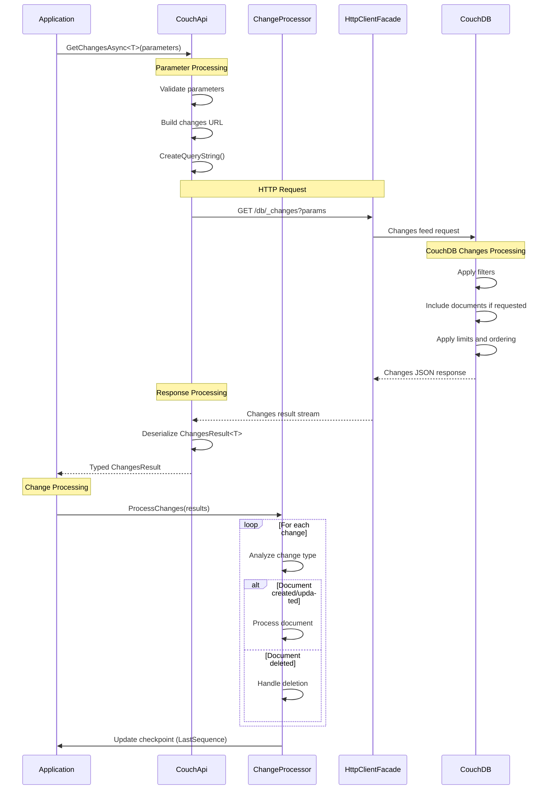

# Change Event Processing

**Navigation**: [Documentation Index](../../DocumentationIndex.md) | [Changes Feed Overview](changes-feed-overview.md)

## Change Processing Overview

The Edge10.CouchDb.Client provides comprehensive change event processing capabilities through structured change objects and result collections. The system enables real-time monitoring and processing of database changes with full support for document inclusion, deletion tracking, and sequence management.

## Changes API Methods

### 1. Typed Changes Retrieval

Retrieves changes with strongly-typed document inclusion:

```csharp
Task<ChangesResult<TDocument>> GetChangesAsync<TDocument>(IChangesParameters parameters)
```

### 2. Dynamic Changes Retrieval

Retrieves changes without specific document typing:

```csharp
Task<ChangesResult> GetChangesAsync(IChangesParameters parameters)
```

## Change Data Structures

### ChangesResult<TDocument> Structure

```csharp
public class ChangesResult<TDocument>
{
    [JsonProperty("results")]
    public List<Change<TDocument>> Results { get; private set; }

    [JsonProperty("last_seq")]
    public string LastSequence { get; set; }
}
```

### Change<TDocument> Structure

```csharp
public class Change<TDocument>
{
    [JsonProperty("id")]
    public string Id { get; set; }

    [JsonProperty("changes")]
    public List<ChangeRevision> Changes { get; private set; }

    [JsonProperty("deleted")]
    public bool Deleted { get; set; }

    [JsonProperty("seq")]
    public string Sequence { get; set; }

    [JsonProperty("doc")]
    public TDocument Document { get; set; }

    // Convenience property for first revision
    public string Revision => Changes.Select(c => c.Revision).FirstOrDefault();
}
```

### ChangeRevision Structure

```csharp
public class ChangeRevision
{
    [JsonProperty("rev")]
    public string Revision { get; set; }
}
```

## Change Processing Flow



## Core Implementation

### Changes Retrieval Implementation

```csharp
public async Task<ChangesResult<TDocument>> GetChangesAsync<TDocument>(IChangesParameters parameters)
{
    var response = await GetChangesResponse(parameters);
    return await GetSerializedResultContent<ChangesResult<TDocument>>(response);
}

public async Task<ChangesResult> GetChangesAsync(IChangesParameters parameters)
{
    var response = await GetChangesResponse(parameters);
    return await GetSerializedResultContent<ChangesResult>(response);
}

private async Task<HttpResponseMessage> GetChangesResponse(IChangesParameters parameters)
{
    parameters.ThrowIfNull("parameters");

    var url = $"{_url}/{_databaseName}/_changes{parameters.CreateQueryString()}";

    var response = await _client.GetAsync(url);
    await response.ThrowErrorIfNotSuccess();
    return response;
}
```

## Change Processing Patterns

### Basic Change Processing

```csharp
public class BasicChangeProcessor
{
    private readonly ICouchApi _couchApi;
    
    public BasicChangeProcessor(ICouchApi couchApi)
    {
        _couchApi = couchApi;
    }
    
    public async Task ProcessChanges<TDocument>(IChangesParameters parameters)
    {
        var result = await _couchApi.GetChangesAsync<TDocument>(parameters);
        
        foreach (var change in result.Results)
        {
            await ProcessSingleChange(change);
        }
        
        // Store checkpoint for next processing cycle
        await StoreCheckpoint(result.LastSequence);
    }
    
    private async Task ProcessSingleChange<TDocument>(Change<TDocument> change)
    {
        Console.WriteLine($"Processing change for document {change.Id} (seq: {change.Sequence})");
        
        if (change.Deleted)
        {
            await HandleDocumentDeleted(change.Id, change.Revision);
        }
        else
        {
            await HandleDocumentChanged(change.Id, change.Revision, change.Document);
        }
    }
    
    private async Task HandleDocumentDeleted(string documentId, string revision)
    {
        Console.WriteLine($"Document {documentId} was deleted (revision: {revision})");
        // Implement deletion handling logic
        await Task.CompletedTask;
    }
    
    private async Task HandleDocumentChanged<TDocument>(string documentId, string revision, TDocument document)
    {
        Console.WriteLine($"Document {documentId} was modified (revision: {revision})");
        
        if (document != null)
        {
            // Process the document content
            await ProcessDocumentContent(document);
        }
        else
        {
            // Document not included, fetch if needed
            var fullDocument = await _couchApi.GetDocumentAsync<TDocument>(documentId);
            await ProcessDocumentContent(fullDocument);
        }
    }
}
```

### Incremental Change Processing

```csharp
public class IncrementalChangeProcessor
{
    private readonly ICouchApi _couchApi;
    private readonly ICheckpointStore _checkpointStore;
    private readonly string _checkpointKey;
    
    public IncrementalChangeProcessor(
        ICouchApi couchApi, 
        ICheckpointStore checkpointStore,
        string checkpointKey = "default")
    {
        _couchApi = couchApi;
        _checkpointStore = checkpointStore;
        _checkpointKey = checkpointKey;
    }
    
    public async Task ProcessIncrementalChanges<TDocument>(
        string filterName = null,
        int batchSize = 100,
        Func<Change<TDocument>, Task> changeHandler = null)
    {
        var lastSequence = await _checkpointStore.GetLastSequence(_checkpointKey);
        
        var parameters = new ChangesParameters
        {
            ChangesSince = lastSequence,
            Limit = batchSize,
            IncludeDocs = true,
            ChangesFilter = filterName
        };
        
        var result = await _couchApi.GetChangesAsync<TDocument>(parameters);
        
        if (result.Results.Any())
        {
            foreach (var change in result.Results)
            {
                try
                {
                    if (changeHandler != null)
                    {
                        await changeHandler(change);
                    }
                    else
                    {
                        await ProcessChange(change);
                    }
                }
                catch (Exception ex)
                {
                    await HandleChangeProcessingError(change, ex);
                }
            }
            
            // Update checkpoint after successful processing
            if (int.TryParse(result.LastSequence, out var newSequence))
            {
                await _checkpointStore.SetLastSequence(_checkpointKey, newSequence);
            }
        }
    }
    
    private async Task ProcessChange<TDocument>(Change<TDocument> change)
    {
        // Default change processing logic
        if (change.Deleted)
        {
            await OnDocumentDeleted(change);
        }
        else
        {
            await OnDocumentModified(change);
        }
    }
}

public interface ICheckpointStore
{
    Task<int?> GetLastSequence(string key);
    Task SetLastSequence(string key, int sequence);
}
```

### Batch Change Processing

```csharp
public class BatchChangeProcessor
{
    private readonly ICouchApi _couchApi;
    private readonly int _maxBatchSize;
    
    public BatchChangeProcessor(ICouchApi couchApi, int maxBatchSize = 1000)
    {
        _couchApi = couchApi;
        _maxBatchSize = maxBatchSize;
    }
    
    public async Task ProcessAllChanges<TDocument>(
        Func<List<Change<TDocument>>, Task> batchProcessor,
        IChangesParameters baseParameters = null)
    {
        var parameters = baseParameters ?? new ChangesParameters();
        parameters.Limit = _maxBatchSize;
        parameters.IncludeDocs = true;
        
        bool hasMoreChanges = true;
        int processedTotal = 0;
        
        while (hasMoreChanges)
        {
            var result = await _couchApi.GetChangesAsync<TDocument>(parameters);
            
            if (result.Results.Any())
            {
                await batchProcessor(result.Results);
                processedTotal += result.Results.Count;
                
                Console.WriteLine($"Processed batch of {result.Results.Count} changes. Total: {processedTotal}");
                
                // Update parameters for next batch
                if (int.TryParse(result.LastSequence, out var lastSeq))
                {
                    parameters.ChangesSince = lastSeq;
                }
                
                hasMoreChanges = result.Results.Count == _maxBatchSize;
            }
            else
            {
                hasMoreChanges = false;
            }
        }
        
        Console.WriteLine($"Finished processing. Total changes processed: {processedTotal}");
    }
}
```

### Event-Driven Change Processing

```csharp
public class EventDrivenChangeProcessor
{
    public event EventHandler<DocumentChangedEventArgs> DocumentChanged;
    public event EventHandler<DocumentDeletedEventArgs> DocumentDeleted;
    public event EventHandler<ProcessingErrorEventArgs> ProcessingError;
    
    private readonly ICouchApi _couchApi;
    
    public EventDrivenChangeProcessor(ICouchApi couchApi)
    {
        _couchApi = couchApi;
    }
    
    public async Task StartProcessing<TDocument>(
        IChangesParameters parameters,
        CancellationToken cancellationToken = default)
    {
        while (!cancellationToken.IsCancellationRequested)
        {
            try
            {
                var result = await _couchApi.GetChangesAsync<TDocument>(parameters);
                
                foreach (var change in result.Results)
                {
                    if (cancellationToken.IsCancellationRequested)
                        break;
                        
                    await ProcessChangeWithEvents(change);
                }
                
                // Update parameters for next iteration
                if (result.Results.Any() && int.TryParse(result.LastSequence, out var lastSeq))
                {
                    parameters.ChangesSince = lastSeq;
                }
                
                // Wait before next poll if no changes
                if (!result.Results.Any())
                {
                    await Task.Delay(TimeSpan.FromSeconds(5), cancellationToken);
                }
            }
            catch (Exception ex) when (!cancellationToken.IsCancellationRequested)
            {
                OnProcessingError(new ProcessingErrorEventArgs { Exception = ex });
                await Task.Delay(TimeSpan.FromSeconds(10), cancellationToken);
            }
        }
    }
    
    private async Task ProcessChangeWithEvents<TDocument>(Change<TDocument> change)
    {
        if (change.Deleted)
        {
            OnDocumentDeleted(new DocumentDeletedEventArgs
            {
                DocumentId = change.Id,
                Revision = change.Revision,
                Sequence = change.Sequence
            });
        }
        else
        {
            OnDocumentChanged(new DocumentChangedEventArgs<TDocument>
            {
                DocumentId = change.Id,
                Revision = change.Revision,
                Sequence = change.Sequence,
                Document = change.Document,
                Change = change
            });
        }
        
        await Task.CompletedTask;
    }
    
    protected virtual void OnDocumentChanged<TDocument>(DocumentChangedEventArgs<TDocument> e)
    {
        DocumentChanged?.Invoke(this, e);
    }
    
    protected virtual void OnDocumentDeleted(DocumentDeletedEventArgs e)
    {
        DocumentDeleted?.Invoke(this, e);
    }
    
    protected virtual void OnProcessingError(ProcessingErrorEventArgs e)
    {
        ProcessingError?.Invoke(this, e);
    }
}

public class DocumentChangedEventArgs<TDocument> : EventArgs
{
    public string DocumentId { get; set; }
    public string Revision { get; set; }
    public string Sequence { get; set; }
    public TDocument Document { get; set; }
    public Change<TDocument> Change { get; set; }
}

public class DocumentDeletedEventArgs : EventArgs
{
    public string DocumentId { get; set; }
    public string Revision { get; set; }
    public string Sequence { get; set; }
}

public class ProcessingErrorEventArgs : EventArgs
{
    public Exception Exception { get; set; }
}
```

## Advanced Processing Patterns

### Multi-Type Change Processing

```csharp
public class MultiTypeChangeProcessor
{
    private readonly ICouchApi _couchApi;
    private readonly Dictionary<string, Func<dynamic, Task>> _typeHandlers;
    
    public MultiTypeChangeProcessor(ICouchApi couchApi)
    {
        _couchApi = couchApi;
        _typeHandlers = new Dictionary<string, Func<dynamic, Task>>();
    }
    
    public void RegisterHandler<TDocument>(string documentType, Func<TDocument, Task> handler)
    {
        _typeHandlers[documentType] = async doc => await handler((TDocument)doc);
    }
    
    public async Task ProcessMixedChanges(IChangesParameters parameters)
    {
        var result = await _couchApi.GetChangesAsync(parameters); // Use non-generic version
        
        foreach (var change in result.Results)
        {
            if (change.Deleted)
            {
                await HandleDeletion(change.Id, change.Revision);
                continue;
            }
            
            if (change.Document != null)
            {
                var documentType = GetDocumentType(change.Document);
                
                if (_typeHandlers.ContainsKey(documentType))
                {
                    await _typeHandlers[documentType](change.Document);
                }
                else
                {
                    await HandleUnknownType(change.Id, documentType, change.Document);
                }
            }
        }
    }
    
    private string GetDocumentType(dynamic document)
    {
        // Assume documents have a 'type' field
        return document?.type?.ToString() ?? "unknown";
    }
    
    private async Task HandleDeletion(string documentId, string revision)
    {
        Console.WriteLine($"Document {documentId} was deleted (revision: {revision})");
        await Task.CompletedTask;
    }
    
    private async Task HandleUnknownType(string documentId, string type, dynamic document)
    {
        Console.WriteLine($"Unknown document type '{type}' for document {documentId}");
        await Task.CompletedTask;
    }
}

// Usage example
var processor = new MultiTypeChangeProcessor(couchApi);

processor.RegisterHandler<CustomerDocument>("customer", async customer =>
{
    Console.WriteLine($"Processing customer: {customer.Name}");
    await UpdateCustomerIndex(customer);
});

processor.RegisterHandler<OrderDocument>("order", async order =>
{
    Console.WriteLine($"Processing order: {order.OrderNumber}");
    await UpdateOrderAnalytics(order);
});

await processor.ProcessMixedChanges(parameters);
```

### Change Aggregation and Batching

```csharp
public class ChangeAggregator
{
    private readonly Dictionary<string, Change<dynamic>> _pendingChanges;
    private readonly Timer _flushTimer;
    private readonly Func<Dictionary<string, Change<dynamic>>, Task> _batchProcessor;
    private readonly TimeSpan _flushInterval;
    
    public ChangeAggregator(
        Func<Dictionary<string, Change<dynamic>>, Task> batchProcessor,
        TimeSpan flushInterval)
    {
        _pendingChanges = new Dictionary<string, Change<dynamic>>();
        _batchProcessor = batchProcessor;
        _flushInterval = flushInterval;
        _flushTimer = new Timer(FlushPendingChanges, null, flushInterval, flushInterval);
    }
    
    public async Task ProcessChange(Change<dynamic> change)
    {
        lock (_pendingChanges)
        {
            // Keep only the latest change for each document
            _pendingChanges[change.Id] = change;
        }
        
        // Optionally flush immediately if batch size is reached
        if (_pendingChanges.Count >= 100)
        {
            await FlushChanges();
        }
    }
    
    private async void FlushPendingChanges(object state)
    {
        await FlushChanges();
    }
    
    private async Task FlushChanges()
    {
        Dictionary<string, Change<dynamic>> toProcess;
        
        lock (_pendingChanges)
        {
            if (!_pendingChanges.Any())
                return;
                
            toProcess = new Dictionary<string, Change<dynamic>>(_pendingChanges);
            _pendingChanges.Clear();
        }
        
        try
        {
            await _batchProcessor(toProcess);
        }
        catch (Exception ex)
        {
            Console.WriteLine($"Error processing change batch: {ex.Message}");
            // Could implement retry logic here
        }
    }
    
    public void Dispose()
    {
        _flushTimer?.Dispose();
        FlushChanges().Wait(TimeSpan.FromSeconds(30)); // Final flush with timeout
    }
}
```

### Parallel Change Processing

```csharp
public class ParallelChangeProcessor
{
    private readonly ICouchApi _couchApi;
    private readonly SemaphoreSlim _semaphore;
    private readonly int _maxConcurrency;
    
    public ParallelChangeProcessor(ICouchApi couchApi, int maxConcurrency = Environment.ProcessorCount * 2)
    {
        _couchApi = couchApi;
        _maxConcurrency = maxConcurrency;
        _semaphore = new SemaphoreSlim(maxConcurrency, maxConcurrency);
    }
    
    public async Task ProcessChangesInParallel<TDocument>(
        IChangesParameters parameters,
        Func<Change<TDocument>, Task> changeProcessor)
    {
        var result = await _couchApi.GetChangesAsync<TDocument>(parameters);
        
        var processingTasks = result.Results.Select(async change =>
        {
            await _semaphore.WaitAsync();
            try
            {
                await changeProcessor(change);
            }
            finally
            {
                _semaphore.Release();
            }
        });
        
        await Task.WhenAll(processingTasks);
    }
    
    public void Dispose()
    {
        _semaphore?.Dispose();
    }
}
```

## Error Handling and Resilience

### Comprehensive Error Handling

```csharp
public class ResilientChangeProcessor
{
    private readonly ICouchApi _couchApi;
    private readonly ILogger _logger;
    
    public ResilientChangeProcessor(ICouchApi couchApi, ILogger logger)
    {
        _couchApi = couchApi;
        _logger = logger;
    }
    
    public async Task<ChangeProcessingResult> ProcessChangesWithErrorHandling<TDocument>(
        IChangesParameters parameters,
        Func<Change<TDocument>, Task> changeProcessor)
    {
        var result = new ChangeProcessingResult();
        
        try
        {
            var changesResult = await _couchApi.GetChangesAsync<TDocument>(parameters);
            result.TotalChanges = changesResult.Results.Count;
            result.LastSequence = changesResult.LastSequence;
            
            foreach (var change in changesResult.Results)
            {
                try
                {
                    await changeProcessor(change);
                    result.SuccessfulChanges++;
                }
                catch (Exception ex)
                {
                    result.FailedChanges++;
                    result.Errors.Add(new ChangeProcessingError
                    {
                        DocumentId = change.Id,
                        Sequence = change.Sequence,
                        Error = ex.Message,
                        Exception = ex
                    });
                    
                    _logger.LogError(ex, "Failed to process change for document {DocumentId}", change.Id);
                }
            }
        }
        catch (Exception ex)
        {
            result.HasFatalError = true;
            result.FatalError = ex;
            _logger.LogError(ex, "Fatal error occurred while retrieving changes");
        }
        
        return result;
    }
}

public class ChangeProcessingResult
{
    public int TotalChanges { get; set; }
    public int SuccessfulChanges { get; set; }
    public int FailedChanges { get; set; }
    public string LastSequence { get; set; }
    public bool HasFatalError { get; set; }
    public Exception FatalError { get; set; }
    public List<ChangeProcessingError> Errors { get; set; } = new List<ChangeProcessingError>();
    
    public bool IsSuccessful => !HasFatalError && FailedChanges == 0;
    public double SuccessRate => TotalChanges > 0 ? (double)SuccessfulChanges / TotalChanges : 0;
}

public class ChangeProcessingError
{
    public string DocumentId { get; set; }
    public string Sequence { get; set; }
    public string Error { get; set; }
    public Exception Exception { get; set; }
}
```

## Usage Examples

### Real-Time Notification System

```csharp
public class NotificationProcessor
{
    private readonly ICouchApi _couchApi;
    private readonly INotificationService _notificationService;
    
    public NotificationProcessor(ICouchApi couchApi, INotificationService notificationService)
    {
        _couchApi = couchApi;
        _notificationService = notificationService;
    }
    
    public async Task StartNotificationProcessing(CancellationToken cancellationToken)
    {
        var parameters = new ChangesParameters
        {
            ChangesFilter = "notifications/pending",
            IncludeDocs = true,
            Limit = 50
        };
        
        int? lastSequence = await LoadCheckpoint();
        parameters.ChangesSince = lastSequence;
        
        while (!cancellationToken.IsCancellationRequested)
        {
            try
            {
                var result = await _couchApi.GetChangesAsync<NotificationDocument>(parameters);
                
                foreach (var change in result.Results)
                {
                    if (!change.Deleted && change.Document != null)
                    {
                        await ProcessNotification(change.Document);
                        await MarkNotificationSent(change.Document);
                    }
                }
                
                if (result.Results.Any())
                {
                    if (int.TryParse(result.LastSequence, out var seq))
                    {
                        parameters.ChangesSince = seq;
                        await SaveCheckpoint(seq);
                    }
                }
                else
                {
                    await Task.Delay(TimeSpan.FromSeconds(5), cancellationToken);
                }
            }
            catch (Exception ex)
            {
                Console.WriteLine($"Error processing notifications: {ex.Message}");
                await Task.Delay(TimeSpan.FromSeconds(30), cancellationToken);
            }
        }
    }
    
    private async Task ProcessNotification(NotificationDocument notification)
    {
        await _notificationService.SendNotification(
            notification.RecipientId,
            notification.Message,
            notification.Type
        );
    }
    
    private async Task MarkNotificationSent(NotificationDocument notification)
    {
        notification.Status = "sent";
        notification.SentAt = DateTime.UtcNow;
        await _couchApi.UpdateDocumentAsync(notification);
    }
}
```

### Data Synchronization

```csharp
public class DataSynchronizer
{
    private readonly ICouchApi _sourceCouchApi;
    private readonly IExternalService _targetService;
    
    public DataSynchronizer(ICouchApi sourceCouchApi, IExternalService targetService)
    {
        _sourceCouchApi = sourceCouchApi;
        _targetService = targetService;
    }
    
    public async Task SynchronizeData<TDocument>(
        string documentType,
        int? startFromSequence = null)
    {
        var parameters = new ChangesParameters  
        {
            ChangesFilter = "sync/by_type",
            IncludeDocs = true,
            Limit = 100,
            ChangesSince = startFromSequence
        };
        
        parameters.AdditionalParameters["doc_type"] = documentType;
        
        var result = await _sourceCouchApi.GetChangesAsync<TDocument>(parameters);
        
        var syncTasks = result.Results.Select(async change =>
        {
            if (change.Deleted)
            {
                await _targetService.DeleteDocument(change.Id);
            }
            else if (change.Document != null)
            {
                await _targetService.UpsertDocument(change.Id, change.Document);
            }
        });
        
        await Task.WhenAll(syncTasks);
        
        Console.WriteLine($"Synchronized {result.Results.Count} changes for {documentType}");
    }
}
```

## Testing Change Processing

### Unit Testing Change Processing

```csharp
[Test]
public async Task ProcessChanges_Should_HandleMixedChangeTypes()
{
    // Arrange
    var mockChanges = new ChangesResult<TestDocument>
    {
        Results = new List<Change<TestDocument>>
        {
            new Change<TestDocument>
            {
                Id = "doc1",
                Deleted = false,
                Sequence = "1",
                Document = new TestDocument { Id = "doc1", Name = "Test 1" }
            },
            new Change<TestDocument>
            {
                Id = "doc2", 
                Deleted = true,
                Sequence = "2"
            }
        },
        LastSequence = "2"
    };
    
    var mockCouchApi = new Mock<ICouchApi>();
    mockCouchApi.Setup(x => x.GetChangesAsync<TestDocument>(It.IsAny<IChangesParameters>()))
               .ReturnsAsync(mockChanges);
    
    var processor = new BasicChangeProcessor(mockCouchApi.Object);
    
    // Act
    await processor.ProcessChanges<TestDocument>(new ChangesParameters());
    
    // Assert
    // Verify appropriate handlers were called
    mockCouchApi.Verify(x => x.GetChangesAsync<TestDocument>(It.IsAny<IChangesParameters>()), Times.Once);
}
```

## Best Practices

1. **Implement checkpoint management**: Always track and persist processing progress
2. **Handle deletions properly**: Check the `Deleted` flag for each change
3. **Use appropriate batch sizes**: Balance memory usage with processing efficiency
4. **Implement error handling**: Process changes can fail for various reasons
5. **Consider ordering implications**: Changes are ordered by sequence number
6. **Monitor processing lag**: Track the difference between latest and processed sequences
7. **Use filters effectively**: Reduce network traffic with database-level filtering
8. **Plan for resumability**: Design processing to handle restarts gracefully
9. **Implement idempotent processing**: Changes may be processed multiple times
10. **Test with realistic change volumes**: Validate performance under load

---

*For more information about change processing, see [Changes Feed Overview](changes-feed-overview.md) and [Changes Parameters](changes-parameters.md).*