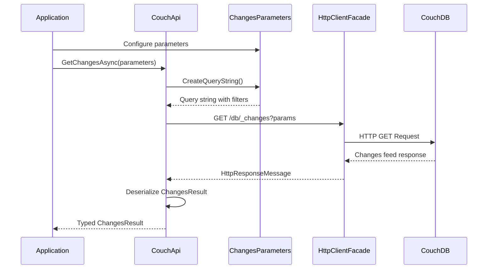
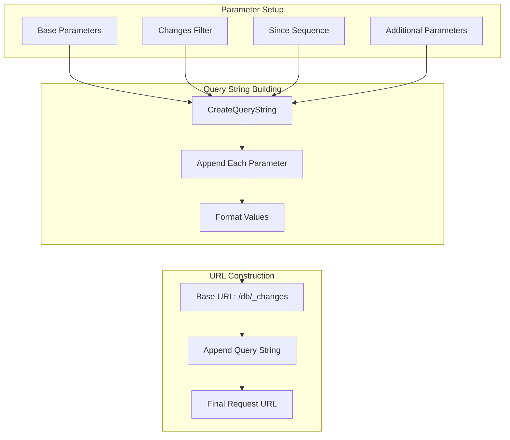

# Changes Feed Overview

**Navigation**: [Documentation Index](../../DocumentationIndex.md) | [General Functionality](../general-functionality.md)

## Changes Feed System Architecture

Edge10.CouchDb.Client provides comprehensive support for CouchDB's changes feed functionality, enabling real-time monitoring of document changes within a database. The changes feed system is designed to support various filtering options, document inclusion, and efficient change tracking with resumable operations.

## Core Components

### 1. Change Data Models

#### Change<TDocument> Class
The primary container for individual change records from the CouchDB `_changes` feed:

```csharp
public class Change<TDocument>
{
    /// <summary>
    /// The unique identifier of the changed document.
    /// </summary>
    [JsonProperty("id")]
    public string Id { get; set; }

    /// <summary>
    /// List of changed revisions.
    /// </summary>
    [JsonProperty("changes")]
    public List<ChangeRevision> Changes { get; private set; }

    /// <summary>
    /// Indicates whether the document was deleted.
    /// </summary>
    [JsonProperty("deleted")]
    public bool Deleted { get; set; }

    /// <summary>
    /// The sequence number associated with this change.
    /// </summary>
    [JsonProperty("seq")]
    public string Sequence { get; set; }

    /// <summary>
    /// The first revision from the Changes collection.
    /// </summary>
    public string Revision { get; }

    /// <summary>
    /// The changed document, if retrieved with include_docs=true.
    /// </summary>
    [JsonProperty("doc")]
    public TDocument Document { get; set; }
}
```

#### ChangeRevision Class
Represents individual revision information within a change:

```csharp
public class ChangeRevision
{
    /// <summary>
    /// The new revision of the changed document.
    /// </summary>
    [JsonProperty("rev")]
    public string Revision { get; set; }

    /// <summary>
    /// Indicates whether the document was deleted.
    /// </summary>
    [JsonProperty("deleted")]
    public bool Deleted { get; set; }
}
```

#### ChangesResult<TDocument> Class
Container for the complete changes feed response:

```csharp
public class ChangesResult<TDocument>
{
    /// <summary>
    /// The list of changes returned by the query.
    /// </summary>
    [JsonProperty("results")]
    public List<Change<TDocument>> Results { get; private set; }

    /// <summary>
    /// The last sequence number in the database.
    /// </summary>
    [JsonProperty("last_seq")]
    public string LastSequence { get; set; }
}
```

### 2. Parameter Management

#### IChangesParameters Interface
Defines the contract for changes feed query parameters:

```csharp
public interface IChangesParameters : ICouchQueryParameters
{
    /// <summary>
    /// The name of the filter to be used.
    /// </summary>
    string ChangesFilter { get; set; }

    /// <summary>
    /// The sequence number from which to get changes.
    /// </summary>
    int? ChangesSince { get; set; }

    /// <summary>
    /// Additional request parameters for filter functions.
    /// </summary>
    IDictionary<string, object> AdditionalParameters { get; }
}
```

#### ChangesParameters Implementation
Full implementation of changes feed parameters with query string generation:

```csharp
public class ChangesParameters : CouchQueryParametersBase, IChangesParameters
{
    public string ChangesFilter { get; set; }
    public int? ChangesSince { get; set; }
    public IDictionary<string, object> AdditionalParameters { get; } = new Dictionary<string, object>();

    public override string CreateQueryString()
    {
        // Generates query string including:
        // - filter: Filter function name
        // - since: Starting sequence number
        // - limit: Maximum number of changes
        // - descending: Result ordering
        // - include_docs: Whether to include document content
        // - Additional parameters for filter functions
    }
}
```

## Changes Feed Operations API

### 1. Typed Changes Retrieval

```csharp
/// <summary>
/// Gets changes feed data with strongly typed document results.
/// </summary>
Task<ChangesResult<TDocument>> GetChangesAsync<TDocument>(IChangesParameters parameters);
```

**Features:**
- **Type Safety**: Returns strongly typed document objects
- **Document Inclusion**: Supports `include_docs` parameter for full document retrieval
- **Generic Flexibility**: Works with any document type implementing `ICouchModel`

### 2. Dynamic Changes Retrieval

```csharp
/// <summary>
/// Gets changes feed data with dynamic document results.
/// </summary>
Task<ChangesResult> GetChangesAsync(IChangesParameters parameters);
```

**Use Cases:**
- **Schema-Free Processing**: Handles documents with unknown or varying structures
- **Multi-Type Databases**: Processes changes across different document types
- **Metadata Analysis**: Focuses on change metadata rather than document content

## Changes Feed Architecture Flow

### Change Monitoring Process



### Parameter Processing Flow



## Implementation Details

### Query String Generation

```csharp
public override string CreateQueryString()
{
    var builder = new StringBuilder();

    AppendQueryStringElement(builder, "filter", ChangesFilter);
    AppendQueryStringElement(builder, "since", ChangesSince);
    AppendQueryStringElement(builder, "limit", Limit);
    AppendQueryStringElement(builder, "descending", Descending);
    AppendQueryStringElement(builder, "include_docs", IncludeDocs);

    foreach (var item in AdditionalParameters)
        AppendQueryStringElement(builder, item.Key, item.Value);

    return builder.ToString();
}

private static void AppendQueryStringElement<T>(StringBuilder builder, string name, T value)
{
    if (value != null)
    {
        builder.Append(builder.Length == 0 ? "?" : "&");
        builder.AppendFormat(CultureInfo.InvariantCulture, "{0}={1}", 
            name, value.ToString().ToLowerInvariant());
    }
}
```

### HTTP Request Processing

```csharp
private async Task<HttpResponseMessage> GetChangesResponse(IChangesParameters parameters)
{
    parameters.ThrowIfNull("parameters");

    var url = $"{_url}/{_databaseName}/_changes{parameters.CreateQueryString()}";
    
    var response = await _client.GetAsync(url);
    await response.ThrowErrorIfNotSuccess();
    
    return response;
}
```

## Usage Examples

### Basic Change Monitoring

```csharp
using var couchApi = new CouchApi(connectionString);

// Monitor all recent changes
var basicParams = new ChangesParameters
{
    Limit = 100,
    IncludeDocs = true,
    Descending = true
};

var changes = await couchApi.GetChangesAsync<CustomerDocument>(basicParams);

Console.WriteLine($"Found {changes.Results.Count} changes");
Console.WriteLine($"Last sequence: {changes.LastSequence}");

foreach (var change in changes.Results)
{
    if (change.Deleted)
    {
        Console.WriteLine($"Document {change.Id} was deleted");
    }
    else
    {
        Console.WriteLine($"Document {change.Id} changed (rev: {change.Revision})");
        if (change.Document != null)
        {
            Console.WriteLine($"  Customer: {change.Document.Name}");
        }
    }
}
```

### Resumable Change Monitoring

```csharp
// Implement resumable change monitoring
int? lastProcessedSequence = LoadLastProcessedSequence();

var resumableParams = new ChangesParameters
{
    ChangesSince = lastProcessedSequence,
    IncludeDocs = true,
    Limit = 50
};

var changes = await couchApi.GetChangesAsync<OrderDocument>(resumableParams);

foreach (var change in changes.Results)
{
    await ProcessOrderChange(change);
    
    // Update checkpoint after successful processing
    lastProcessedSequence = int.Parse(change.Sequence);
    SaveLastProcessedSequence(lastProcessedSequence.Value);
}

// Save the final sequence for next run
if (changes.Results.Any())
{
    var finalSequence = int.Parse(changes.LastSequence);
    SaveLastProcessedSequence(finalSequence);
}
```

### Filtered Change Monitoring

```csharp
// Monitor changes with server-side filtering
var filteredParams = new ChangesParameters
{
    ChangesFilter = "orders/high_priority",
    IncludeDocs = true,
    Limit = 25
};

// Add custom parameters for the filter function
filteredParams.AdditionalParameters.Add("min_amount", 1000);
filteredParams.AdditionalParameters.Add("status", "pending");

var priorityChanges = await couchApi.GetChangesAsync<OrderDocument>(filteredParams);

foreach (var change in priorityChanges.Results)
{
    if (change.Document?.Amount >= 1000)
    {
        await NotifyHighPriorityOrder(change.Document);
    }
}
```

### Multi-Type Change Processing

```csharp
// Process changes for documents of different types
var allChangesParams = new ChangesParameters
{
    IncludeDocs = true,
    Limit = 100
};

var dynamicChanges = await couchApi.GetChangesAsync(allChangesParams);

foreach (var change in dynamicChanges.Results)
{
    // Use dynamic document to inspect type
    var docType = change.Document?.Type as string;
    
    switch (docType)
    {
        case "CustomerDocument":
            await ProcessCustomerChange(change);
            break;
        case "OrderDocument":
            await ProcessOrderChange(change);
            break;
        case "ProductDocument":
            await ProcessProductChange(change);
            break;
        default:
            logger.LogWarning("Unknown document type: {DocumentType} for document {DocumentId}", 
                docType, change.Id);
            break;
    }
}
```

### Continuous Change Monitoring

```csharp
public class ChangeMonitorService
{
    private readonly ICouchApi _couchApi;
    private readonly ILogger<ChangeMonitorService> _logger;
    private int? _lastSequence;
    private readonly CancellationTokenSource _cancellationTokenSource = new();

    public async Task StartMonitoring()
    {
        var monitoringTask = Task.Run(async () =>
        {
            while (!_cancellationTokenSource.Token.IsCancellationRequested)
            {
                try
                {
                    await ProcessChanges();
                    await Task.Delay(TimeSpan.FromSeconds(5), _cancellationTokenSource.Token);
                }
                catch (OperationCanceledException)
                {
                    break;
                }
                catch (Exception ex)
                {
                    _logger.LogError(ex, "Error during change monitoring");
                    await Task.Delay(TimeSpan.FromSeconds(30), _cancellationTokenSource.Token);
                }
            }
        }, _cancellationTokenSource.Token);

        await monitoringTask;
    }

    private async Task ProcessChanges()
    {
        var parameters = new ChangesParameters
        {
            ChangesSince = _lastSequence,
            IncludeDocs = true,
            Limit = 50
        };

        var changes = await _couchApi.GetChangesAsync<DocumentBase>(parameters);

        if (changes.Results.Any())
        {
            foreach (var change in changes.Results)
            {
                await ProcessSingleChange(change);
            }

            // Update last processed sequence
            _lastSequence = int.Parse(changes.LastSequence);
            _logger.LogInformation("Processed {ChangeCount} changes, last sequence: {LastSequence}",
                changes.Results.Count, _lastSequence);
        }
    }

    public void Stop()
    {
        _cancellationTokenSource.Cancel();
    }
}
```

## Advanced Usage Patterns

### Change Batching and Processing

```csharp
public class BatchChangeProcessor
{
    private readonly ICouchApi _couchApi;
    private readonly int _batchSize;

    public async Task ProcessAllChanges(int? startSequence = null)
    {
        int? currentSequence = startSequence;
        bool hasMoreChanges = true;

        while (hasMoreChanges)
        {
            var parameters = new ChangesParameters
            {
                ChangesSince = currentSequence,
                IncludeDocs = true,
                Limit = _batchSize
            };

            var changes = await _couchApi.GetChangesAsync<DocumentBase>(parameters);
            
            if (changes.Results.Count == 0)
            {
                hasMoreChanges = false;
                break;
            }

            // Process batch
            await ProcessChangeBatch(changes.Results);

            // Update sequence for next batch
            currentSequence = int.Parse(changes.LastSequence);
            
            // Check if we got fewer results than requested (end of changes)
            hasMoreChanges = changes.Results.Count == _batchSize;
        }
    }

    private async Task ProcessChangeBatch(List<Change<DocumentBase>> changes)
    {
        var tasks = changes.Select(ProcessSingleChange);
        await Task.WhenAll(tasks);
    }
}
```

### Change Filtering and Routing

```csharp
public class ChangeRouter
{
    private readonly Dictionary<string, Func<Change<dynamic>, Task>> _handlers = new();

    public void RegisterHandler(string documentType, Func<Change<dynamic>, Task> handler)
    {
        _handlers[documentType] = handler;
    }

    public async Task RouteChange(Change<dynamic> change)
    {
        var docType = change.Document?.Type as string;
        
        if (docType != null && _handlers.TryGetValue(docType, out var handler))
        {
            await handler(change);
        }
        else
        {
            await HandleUnknownDocumentType(change);
        }
    }

    private async Task HandleUnknownDocumentType(Change<dynamic> change)
    {
        // Log unknown document types or handle generically
        Console.WriteLine($"Unknown document type for change {change.Id}");
    }
}

// Usage
var router = new ChangeRouter();
router.RegisterHandler("CustomerDocument", change => ProcessCustomerChange(change));
router.RegisterHandler("OrderDocument", change => ProcessOrderChange(change));

var changes = await couchApi.GetChangesAsync(parameters);
foreach (var change in changes.Results)
{
    await router.RouteChange(change);
}
```

### Error Handling and Retry Logic

```csharp
public class ResilientChangeMonitor
{
    private readonly ICouchApi _couchApi;
    private readonly ILogger _logger;
    
    public async Task<ChangesResult<T>> GetChangesWithRetry<T>(
        IChangesParameters parameters, 
        int maxRetries = 3)
    {
        for (int attempt = 0; attempt < maxRetries; attempt++)
        {
            try
            {
                return await _couchApi.GetChangesAsync<T>(parameters);
            }
            catch (HttpRequestException ex) when (attempt < maxRetries - 1)
            {
                _logger.LogWarning("Changes request failed (attempt {Attempt}): {Error}", 
                    attempt + 1, ex.Message);
                
                var delay = TimeSpan.FromSeconds(Math.Pow(2, attempt)); // Exponential backoff
                await Task.Delay(delay);
            }
        }
        
        // Final attempt without catch
        return await _couchApi.GetChangesAsync<T>(parameters);
    }
}
```

## Performance Considerations

### Efficient Parameter Configuration

```csharp
// ✅ Efficient: Use appropriate limits
var efficientParams = new ChangesParameters
{
    Limit = 50,                    // Reasonable batch size
    IncludeDocs = false,          // Only include docs when needed
    ChangesSince = lastSequence   // Resume from last processed
};

// ❌ Inefficient: Requesting too much data
var inefficientParams = new ChangesParameters
{
    Limit = 10000,               // Very large batch
    IncludeDocs = true,          // Always including full documents
    ChangesSince = null          // Starting from beginning every time
};
```

### Memory Management

```csharp
// Process changes in batches to manage memory
public async Task ProcessAllChangesEfficiently()
{
    const int batchSize = 100;
    int? lastSequence = null;
    
    while (true)
    {
        var parameters = new ChangesParameters
        {
            ChangesSince = lastSequence,
            Limit = batchSize,
            IncludeDocs = true
        };

        var changes = await _couchApi.GetChangesAsync<DocumentBase>(parameters);
        
        if (changes.Results.Count == 0)
            break;

        // Process batch and release references
        await ProcessBatch(changes.Results);
        changes = null; // Help GC

        lastSequence = int.Parse(changes.LastSequence);
        
        // Brief pause to allow other operations
        await Task.Delay(10);
    }
}
```

### Sequence Number Management

```csharp
public class SequenceTracker
{
    private readonly string _sequenceFilePath;
    
    public int? LoadLastSequence()
    {
        if (File.Exists(_sequenceFilePath))
        {
            var content = File.ReadAllText(_sequenceFilePath);
            if (int.TryParse(content, out var sequence))
                return sequence;
        }
        return null;
    }
    
    public void SaveLastSequence(int sequence)
    {
        File.WriteAllText(_sequenceFilePath, sequence.ToString());
    }
    
    public async Task<bool> ProcessChangesWithCheckpoint<T>(
        Func<Change<T>, Task> processor,
        IChangesParameters parameters)
    {
        var changes = await _couchApi.GetChangesAsync<T>(parameters);
        
        foreach (var change in changes.Results)
        {
            await processor(change);
            
            // Save checkpoint after each successful processing
            var sequence = int.Parse(change.Sequence);
            SaveLastSequence(sequence);
        }
        
        return changes.Results.Any();
    }
}
```

## Testing Patterns

### Unit Testing Changes Processing

```csharp
[Test]
public async Task GetChangesAsync_Should_Return_Typed_Results()
{
    // Arrange
    var mockHttpClient = new Mock<IHttpClientFacade>();
    var changesJson = @"{
        ""results"": [
            {
                ""id"": ""doc1"",
                ""seq"": ""1-abc"",
                ""changes"": [{""rev"": ""1-abc""}],
                ""doc"": {""_id"": ""doc1"", ""name"": ""Test"", ""type"": ""TestDocument""}
            }
        ],
        ""last_seq"": ""1-abc""
    }";
    
    mockHttpClient.Setup(x => x.GetAsync(It.IsAny<string>()))
              .ReturnsAsync(new HttpResponseMessage(HttpStatusCode.OK)
              {
                  Content = new StringContent(changesJson)
              });

    var couchApi = new CouchApi(connectionString, mockHttpClient.Object, null, null);
    var parameters = new ChangesParameters { Limit = 10 };

    // Act
    var result = await couchApi.GetChangesAsync<TestDocument>(parameters);

    // Assert
    Assert.That(result.Results.Count, Is.EqualTo(1));
    Assert.That(result.Results[0].Id, Is.EqualTo("doc1"));
    Assert.That(result.Results[0].Document.Name, Is.EqualTo("Test"));
    Assert.That(result.LastSequence, Is.EqualTo("1-abc"));
}
```

### Integration Testing

```csharp
[Test]
public async Task ChangesIntegrationTest()
{
    // Create test document
    var testDoc = new TestDocument { Name = "Original" };
    await _couchApi.CreateDocumentAsync(testDoc);

    // Get initial sequence
    var initialParams = new ChangesParameters { Limit = 1, Descending = true };
    var initialChanges = await _couchApi.GetChangesAsync<TestDocument>(initialParams);
    var initialSequence = int.Parse(initialChanges.LastSequence);

    // Update document
    testDoc.Name = "Updated";
    await _couchApi.UpdateDocumentAsync(testDoc);

    // Check for changes since initial sequence
    var changeParams = new ChangesParameters 
    { 
        ChangesSince = initialSequence,
        IncludeDocs = true 
    };
    
    var changes = await _couchApi.GetChangesAsync<TestDocument>(changeParams);

    // Verify change detected
    Assert.That(changes.Results.Count, Is.GreaterThan(0));
    var change = changes.Results.FirstOrDefault(c => c.Id == testDoc.Id);
    Assert.That(change, Is.Not.Null);
    Assert.That(change.Document.Name, Is.EqualTo("Updated"));
}
```

## Integration Patterns

### Event-Driven Architecture

```csharp
public class ChangeEventService
{
    public event EventHandler<DocumentChangedEventArgs> DocumentChanged;
    public event EventHandler<DocumentDeletedEventArgs> DocumentDeleted;
    
    private readonly ICouchApi _couchApi;
    
    public async Task MonitorChanges(CancellationToken cancellationToken)
    {
        int? lastSequence = null;
        
        while (!cancellationToken.IsCancellationRequested)
        {
            var parameters = new ChangesParameters
            {
                ChangesSince = lastSequence,
                IncludeDocs = true,
                Limit = 25
            };

            var changes = await _couchApi.GetChangesAsync<dynamic>(parameters);

            foreach (var change in changes.Results)
            {
                if (change.Deleted)
                {
                    DocumentDeleted?.Invoke(this, new DocumentDeletedEventArgs(change.Id));
                }
                else
                {
                    DocumentChanged?.Invoke(this, new DocumentChangedEventArgs(change));
                }
            }

            if (changes.Results.Any())
            {
                lastSequence = int.Parse(changes.LastSequence);
            }

            await Task.Delay(TimeSpan.FromSeconds(2), cancellationToken);
        }
    }
}
```

### Message Queue Integration

```csharp
public class ChangeQueuePublisher
{
    private readonly ICouchApi _couchApi;
    private readonly IMessageQueue _messageQueue;
    
    public async Task PublishChanges()
    {
        var parameters = new ChangesParameters
        {
            IncludeDocs = false, // Only publish change metadata
            Limit = 100
        };

        var changes = await _couchApi.GetChangesAsync(parameters);

        foreach (var change in changes.Results)
        {
            var message = new ChangeMessage
            {
                DocumentId = change.Id,
                Revision = change.Revision,
                Sequence = change.Sequence,
                IsDeleted = change.Deleted,
                Timestamp = DateTime.UtcNow
            };

            await _messageQueue.PublishAsync("document-changes", message);
        }
    }
}
```

---

*This changes feed overview provides comprehensive coverage of the real-time change monitoring capabilities within Edge10.CouchDb.Client. The system provides flexible, efficient change processing with support for filtering, resumable operations, and various integration patterns for building responsive applications.*