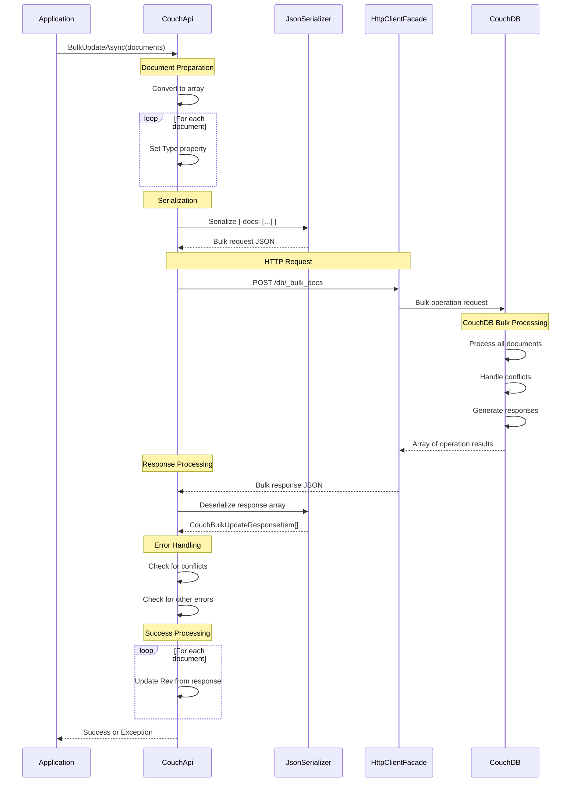

# Bulk Document Operations

**Navigation**: [Documentation Index](../../DocumentationIndex.md) | [Document Operations Overview](document-operations-overview.md)

## Bulk Operations Overview

The Edge10.CouchDb.Client provides efficient bulk document processing through the `BulkUpdateAsync` method, which leverages CouchDB's `_bulk_docs` endpoint. This approach significantly improves performance when working with multiple documents by reducing HTTP requests and network round-trips.

## Bulk Update Method

### Primary Bulk Operation

```csharp
Task BulkUpdateAsync<TDocument>(IEnumerable<TDocument> documents) where TDocument : ICouchModel
```

**Key Features:**
- Single HTTP request for multiple documents
- Automatic type setting for all documents
- Comprehensive error handling and conflict detection
- Revision updates for all successfully processed documents
- Support for creates, updates, and deletions in a single operation

## Bulk Operation Flow



## Core Implementation

### Bulk Update Logic

```csharp
public async Task BulkUpdateAsync<TDocument>(IEnumerable<TDocument> documents) 
    where TDocument : ICouchModel
{
    documents.ThrowIfNull(nameof(documents));

    var docsArray = documents.ToArray();
    
    // Set type for all documents
    foreach (TDocument document in docsArray)
    {
        document.Type = typeof(TDocument).Name;
    }

    using (_eventLog.LogDocumentEvent(string.Join(", ", docsArray.Select(x => x.Id.ToString())), "bulk"))
    {
        var url = $"{_url}/{_databaseName}/_bulk_docs";
        var content = SerializeDocument(new { Docs = docsArray });
        var response = await _client.PostAsync(url, content);

        await response.ThrowErrorIfNotSuccess();

        var responseContent = await response.Content.ReadAsStringAsync();
        var updateResults = JsonConvert.DeserializeObject<CouchBulkUpdateResponseItem[]>(responseContent);

        // Handle conflicts
        var conflictIds = updateResults.Where(x => x.Error == "conflict").Select(x => x.Id.ToString()).ToArray();
        if (conflictIds.Any())
            throw new ConflictException(string.Join(", ", conflictIds));

        // Handle other errors
        var errorResults = updateResults.Where(x => !x.Ok && !string.IsNullOrWhiteSpace(x.Error)).ToArray();
        if (errorResults.Any())
        {
            var messages = errorResults.Select(x => $"id: {x.Id}, error: {x.Error}, reason: {x.Reason}");
            throw new HttpRequestException(string.Join("; ", messages));
        }

        // Update revisions for successful operations
        var revisionsById = updateResults.ToDictionary(x => x.Id, x => x.Rev);
        foreach (var document in docsArray)
        {
            document.Rev = revisionsById[document.Id];
        }
    }
}
```

### Bulk Response Processing

```csharp
// CouchBulkUpdateResponseItem structure
public class CouchBulkUpdateResponseItem
{
    [JsonProperty("id")]
    public string Id { get; set; }

    [JsonProperty("rev")]
    public string Rev { get; set; }

    [JsonProperty("ok")]
    public bool Ok { get; set; }

    [JsonProperty("error")]
    public string Error { get; set; }

    [JsonProperty("reason")]
    public string Reason { get; set; }
}
```

## Bulk Operation Types

### 1. Bulk Document Creation

```csharp
public async Task CreateMultipleDocuments<TDocument>(IEnumerable<TDocument> documents)
    where TDocument : ICouchModel
{
    var documentsList = documents.ToList();
    
    // Ensure all documents are new (no revisions)
    foreach (var doc in documentsList)
    {
        if (!doc.IsNew)
            throw new InvalidOperationException($"Document {doc.Id} already exists");
        
        // Generate IDs for documents that don't have them
        if (string.IsNullOrWhiteSpace(doc.Id))
            doc.Id = Guid.NewGuid().ToString();
    }
    
    await couchApi.BulkUpdateAsync(documentsList);
}
```

### 2. Bulk Document Updates

```csharp
public async Task UpdateMultipleDocuments<TDocument>(IEnumerable<TDocument> documents)
    where TDocument : ICouchModel
{
    var documentsList = documents.ToList();
    
    // Validate all documents have revisions
    foreach (var doc in documentsList)
    {
        if (doc.IsNew)
            throw new InvalidOperationException($"Document {doc.Id} has no revision for update");
    }
    
    await couchApi.BulkUpdateAsync(documentsList);
}
```

### 3. Bulk Document Deletion

```csharp
public async Task DeleteMultipleDocuments<TDocument>(IEnumerable<TDocument> documents)
    where TDocument : ICouchModel
{
    var documentsList = documents.ToList();
    
    // Mark all documents as deleted
    foreach (var doc in documentsList)
    {
        doc.Deleted = true;
    }
    
    await couchApi.BulkUpdateAsync(documentsList);
}
```

### 4. Mixed Bulk Operations

```csharp
public async Task PerformMixedBulkOperations()
{
    var mixedDocuments = new List<ICouchModel>();
    
    // Add new documents (no revision)
    mixedDocuments.Add(new CustomerDocument { Name = "New Customer 1" });
    mixedDocuments.Add(new CustomerDocument { Name = "New Customer 2" });
    
    // Add documents to update (with revisions)
    var existingCustomer = await couchApi.GetDocumentAsync<CustomerDocument>("customer-123");
    existingCustomer.Name = "Updated Name";
    mixedDocuments.Add(existingCustomer);
    
    // Add documents to delete (with revisions, marked as deleted)
    var customerToDelete = await couchApi.GetDocumentAsync<CustomerDocument>("customer-456");
    customerToDelete.Deleted = true;
    mixedDocuments.Add(customerToDelete);
    
    // Single bulk operation handles all types
    await couchApi.BulkUpdateAsync(mixedDocuments);
}
```

## Advanced Bulk Patterns

### Batch Size Management

```csharp
public async Task ProcessLargeDocumentCollection<TDocument>(IEnumerable<TDocument> documents, int batchSize = 500)
    where TDocument : ICouchModel
{
    var documentsList = documents.ToList();
    var batches = documentsList
        .Select((doc, index) => new { doc, index })
        .GroupBy(x => x.index / batchSize)
        .Select(g => g.Select(x => x.doc).ToList());
    
    foreach (var batch in batches)
    {
        try
        {
            await couchApi.BulkUpdateAsync(batch);
            Console.WriteLine($"Successfully processed batch of {batch.Count} documents");
        }
        catch (ConflictException ex)
        {
            Console.WriteLine($"Conflicts in batch: {ex.Message}");
            // Handle conflicts...
        }
        catch (Exception ex)
        {
            Console.WriteLine($"Error in batch: {ex.Message}");
            // Handle other errors...
        }
    }
}
```

### Bulk Operation with Conflict Resolution

```csharp
public async Task BulkUpdateWithConflictResolution<TDocument>(IEnumerable<TDocument> documents)
    where TDocument : ICouchModel
{
    var documentsList = documents.ToList();
    var remainingDocuments = documentsList;
    int maxRetries = 3;
    
    for (int attempt = 1; attempt <= maxRetries; attempt++)
    {
        try
        {
            await couchApi.BulkUpdateAsync(remainingDocuments);
            return; // Success
        }
        catch (ConflictException ex)
        {
            if (attempt == maxRetries)
                throw;
                
            Console.WriteLine($"Attempt {attempt}: Conflicts detected, resolving...");
            
            // Get conflicted document IDs
            var conflictedIds = ex.Message.Split(", ");
            var conflictedDocs = remainingDocuments.Where(d => conflictedIds.Contains(d.Id)).ToList();
            
            // Refresh conflicted documents with latest revisions
            foreach (var conflictedDoc in conflictedDocs)
            {
                var latest = await couchApi.GetDocumentAsync<TDocument>(conflictedDoc.Id);
                conflictedDoc.Rev = latest.Rev;
                // Apply merge logic if needed
            }
            
            // Retry with updated revisions
            remainingDocuments = conflictedDocs;
        }
    }
}
```

### Transactional Bulk Operations

```csharp
public async Task<BulkOperationResult<TDocument>> BulkUpdateWithResults<TDocument>(IEnumerable<TDocument> documents)
    where TDocument : ICouchModel
{
    var documentsList = documents.ToList();
    var result = new BulkOperationResult<TDocument>();
    
    try
    {
        await couchApi.BulkUpdateAsync(documentsList);
        result.SuccessfulDocuments = documentsList;
        result.IsSuccess = true;
    }
    catch (ConflictException ex)
    {
        // Parse conflict information
        var conflictIds = ex.Message.Split(", ");
        result.ConflictedDocuments = documentsList.Where(d => conflictIds.Contains(d.Id)).ToList();
        result.SuccessfulDocuments = documentsList.Where(d => !conflictIds.Contains(d.Id)).ToList();
        result.HasConflicts = true;
    }
    catch (HttpRequestException ex)
    {
        result.ErrorMessage = ex.Message;
        result.FailedDocuments = documentsList;
    }
    
    return result;
}

public class BulkOperationResult<TDocument>
{
    public bool IsSuccess { get; set; }
    public bool HasConflicts { get; set; }
    public string ErrorMessage { get; set; }
    public List<TDocument> SuccessfulDocuments { get; set; } = new List<TDocument>();
    public List<TDocument> ConflictedDocuments { get; set; } = new List<TDocument>();
    public List<TDocument> FailedDocuments { get; set; } = new List<TDocument>();
}
```

## Performance Optimization

### Optimal Batch Sizing

**500-Document Default Rationale:**
The default batch size of 500 documents was chosen to balance timeout risk versus performance:
- **Timeout Risk Mitigation**: Larger batches increase the risk of 20-minute timeout on complex operations
- **Performance Optimization**: 500 documents provides significant performance gains over individual operations
- **Memory Management**: Keeps memory usage manageable while processing large collections
- **CouchDB Compatibility**: Well within CouchDB 1.7's bulk operation limits
- **Error Handling**: Small enough batches to make conflict resolution manageable

```csharp
public class BulkOperationOptimizer
{
    private const int DEFAULT_BATCH_SIZE = 500;  // Balanced for timeout vs performance
    private const int MAX_BATCH_SIZE = 1000;
    private const int MIN_BATCH_SIZE = 100;
    
    public int CalculateOptimalBatchSize(int documentCount, int averageDocumentSize)
    {
        // Adjust batch size based on document size
        if (averageDocumentSize > 10000) // Large documents
            return Math.Max(MIN_BATCH_SIZE, DEFAULT_BATCH_SIZE / 2);
        else if (averageDocumentSize < 1000) // Small documents  
            return Math.Min(MAX_BATCH_SIZE, DEFAULT_BATCH_SIZE * 2);
        else
            return DEFAULT_BATCH_SIZE;
    }
    
    public async Task OptimizedBulkUpdate<TDocument>(IEnumerable<TDocument> documents)
        where TDocument : ICouchModel
    {
        var documentsList = documents.ToList();
        var avgSize = EstimateAverageDocumentSize(documentsList);
        var batchSize = CalculateOptimalBatchSize(documentsList.Count, avgSize);
        
        await ProcessLargeDocumentCollection(documentsList, batchSize);
    }
}
```

### Memory-Efficient Processing

```csharp
public async Task ProcessDocumentsInBatches<TDocument>(
    IAsyncEnumerable<TDocument> documentStream, 
    int batchSize = 500)
    where TDocument : ICouchModel
{
    var batch = new List<TDocument>(batchSize);
    
    await foreach (var document in documentStream)
    {
        batch.Add(document);
        
        if (batch.Count >= batchSize)
        {
            await couchApi.BulkUpdateAsync(batch);
            batch.Clear();
        }
    }
    
    // Process remaining documents
    if (batch.Count > 0)
    {
        await couchApi.BulkUpdateAsync(batch);
    }
}
```

## Error Handling Strategies

### Comprehensive Error Handling

```csharp
public async Task<DetailedBulkResult> BulkUpdateWithDetailedErrorHandling<TDocument>(
    IEnumerable<TDocument> documents)
    where TDocument : ICouchModel
{
    var result = new DetailedBulkResult();
    var documentsList = documents.ToList();
    
    try
    {
        await couchApi.BulkUpdateAsync(documentsList);
        result.ProcessedCount = documentsList.Count;
        result.IsSuccess = true;
    }
    catch (ConflictException ex)
    {
        result.ConflictCount = ex.Message.Split(", ").Length;
        result.ErrorType = BulkErrorType.Conflicts;
        result.ErrorMessage = ex.Message;
    }
    catch (HttpRequestException ex) when (ex.Message.Contains("413"))
    {
        result.ErrorType = BulkErrorType.PayloadTooLarge;
        result.ErrorMessage = "Batch size too large, reduce batch size and retry";
    }
    catch (HttpRequestException ex) when (ex.Message.Contains("timeout"))
    {
        result.ErrorType = BulkErrorType.Timeout;
        result.ErrorMessage = "Operation timed out, consider smaller batches";
    }
    catch (JsonException ex)
    {
        result.ErrorType = BulkErrorType.SerializationError;
        result.ErrorMessage = $"Serialization failed: {ex.Message}";
    }
    catch (Exception ex)
    {
        result.ErrorType = BulkErrorType.UnknownError;
        result.ErrorMessage = ex.Message;
    }
    
    return result;
}

public class DetailedBulkResult
{
    public bool IsSuccess { get; set; }
    public int ProcessedCount { get; set; }
    public int ConflictCount { get; set; }
    public BulkErrorType ErrorType { get; set; }
    public string ErrorMessage { get; set; }
}

public enum BulkErrorType
{
    None,
    Conflicts,
    PayloadTooLarge,
    Timeout,
    SerializationError,
    UnknownError
}
```

## Usage Examples

### Basic Bulk Creation

```csharp
// Create multiple customers in one operation
var customers = new List<CustomerDocument>
{
    new CustomerDocument { Name = "Alice Johnson", Email = "alice@example.com" },
    new CustomerDocument { Name = "Bob Smith", Email = "bob@example.com" },
    new CustomerDocument { Name = "Charlie Brown", Email = "charlie@example.com" }
};

try
{
    await couchApi.BulkUpdateAsync(customers);
    Console.WriteLine($"Created {customers.Count} customers");
    
    foreach (var customer in customers)
    {
        Console.WriteLine($"Customer {customer.Name}: ID={customer.Id}, Rev={customer.Rev}");
    }
}
catch (ConflictException ex)
{
    Console.WriteLine($"Some documents conflicted: {ex.Message}");
}
```

### Bulk Update with Data Transformation

```csharp
// Update multiple customers with a status change
var customerIds = new[] { "customer-1", "customer-2", "customer-3", "customer-4" };
var customers = await couchApi.GetDocumentsAsync<CustomerDocument>(customerIds);

// Apply transformation to all customers
foreach (var customer in customers)
{
    customer.Status = "Premium";
    customer.UpgradeDate = DateTime.UtcNow;
    customer.LastModified = DateTime.UtcNow;
}

await couchApi.BulkUpdateAsync(customers);
Console.WriteLine($"Upgraded {customers.Count()} customers to Premium status");
```

### Bulk Deletion

```csharp
// Delete multiple inactive customers
var inactiveCustomers = await GetInactiveCustomers();

foreach (var customer in inactiveCustomers)
{
    customer.Deleted = true;
    customer.DeletedDate = DateTime.UtcNow;
    customer.DeletedReason = "Inactive for over 2 years";
}

await couchApi.BulkUpdateAsync(inactiveCustomers);
Console.WriteLine($"Deleted {inactiveCustomers.Count()} inactive customers");
```

## Testing Bulk Operations

### Unit Testing

```csharp
[Test]
public async Task BulkUpdateAsync_Should_UpdateAllDocumentRevisions()
{
    // Arrange
    var documents = new[]
    {
        new TestDocument { Id = "doc1", Name = "Test 1" },
        new TestDocument { Id = "doc2", Name = "Test 2" }
    };
    
    var mockResponse = new[]
    {
        new CouchBulkUpdateResponseItem { Id = "doc1", Rev = "1-abc", Ok = true },
        new CouchBulkUpdateResponseItem { Id = "doc2", Rev = "1-def", Ok = true }
    };
    
    var mockHttpClient = new Mock<IHttpClientFacade>();
    mockHttpClient.Setup(x => x.PostAsync(It.IsAny<string>(), It.IsAny<HttpContent>()))
              .ReturnsAsync(new HttpResponseMessage(HttpStatusCode.OK)
              {
                  Content = new StringContent(JsonConvert.SerializeObject(mockResponse))
              });

    var couchApi = new CouchApi(connectionString, mockHttpClient.Object, mockEventLog.Object, null);

    // Act
    await couchApi.BulkUpdateAsync(documents);

    // Assert
    Assert.That(documents[0].Rev, Is.EqualTo("1-abc"));
    Assert.That(documents[1].Rev, Is.EqualTo("1-def"));
    Assert.That(documents[0].Type, Is.EqualTo("TestDocument"));
    Assert.That(documents[1].Type, Is.EqualTo("TestDocument"));
}

[Test]
public async Task BulkUpdateAsync_Should_ThrowConflictException_OnConflicts()
{
    // Arrange
    var documents = new[] { new TestDocument { Id = "doc1", Name = "Test" } };
    
    var mockResponse = new[]
    {
        new CouchBulkUpdateResponseItem { Id = "doc1", Error = "conflict", Ok = false }
    };
    
    var mockHttpClient = new Mock<IHttpClientFacade>();
    mockHttpClient.Setup(x => x.PostAsync(It.IsAny<string>(), It.IsAny<HttpContent>()))
              .ReturnsAsync(new HttpResponseMessage(HttpStatusCode.OK)
              {
                  Content = new StringContent(JsonConvert.SerializeObject(mockResponse))
              });

    var couchApi = new CouchApi(connectionString, mockHttpClient.Object, mockEventLog.Object, null);

    // Act & Assert
    var ex = Assert.ThrowsAsync<ConflictException>(() => couchApi.BulkUpdateAsync(documents));
    Assert.That(ex.Message, Contains.Substring("doc1"));
}
```

### Performance Testing

```csharp
[Test]
public async Task BulkUpdateAsync_Should_OutperformIndividualUpdates()
{
    var documents = GenerateTestDocuments(1000);
    
    // Measure bulk operation
    var bulkStopwatch = Stopwatch.StartNew();
    await couchApi.BulkUpdateAsync(documents);
    bulkStopwatch.Stop();
    
    // Measure individual operations (with fresh documents)
    var individualDocuments = GenerateTestDocuments(100); // Smaller set for comparison
    var individualStopwatch = Stopwatch.StartNew();
    
    foreach (var doc in individualDocuments)
    {
        await couchApi.CreateDocumentAsync(doc);
    }
    individualStopwatch.Stop();
    
    // Bulk should be significantly faster per document
    var bulkTimePerDoc = bulkStopwatch.ElapsedMilliseconds / 1000.0;
    var individualTimePerDoc = individualStopwatch.ElapsedMilliseconds / 100.0;
    
    Assert.That(bulkTimePerDoc, Is.LessThan(individualTimePerDoc / 2), 
        "Bulk operations should be at least 2x faster per document");
}
```

## Best Practices

1. **Use appropriate batch sizes**: Balance between performance and memory usage (500-1000 documents)
2. **Handle conflicts gracefully**: Implement retry logic with fresh revisions
3. **Validate document states**: Ensure consistency before bulk operations
4. **Monitor batch performance**: Track timing and adjust batch sizes accordingly
5. **Implement proper error handling**: Handle conflicts, timeouts, and payload size limits
6. **Use bulk for all multi-document operations**: Avoid individual operations when possible
7. **Consider memory usage**: Process large collections in batches to avoid memory issues
8. **Test with realistic data sizes**: Ensure performance under production conditions
9. **Log bulk operations**: Maintain audit trails for batch processing
10. **Plan for partial failures**: Design recovery strategies for failed batches

## Common Pitfalls

1. **Batch size too large**: Can cause timeouts or payload size errors
2. **Mixed operation types without consideration**: Creating and updating different document types
3. **Not handling partial failures**: Assuming all documents succeed or fail together
4. **Ignoring conflict resolution**: Not refreshing document revisions after conflicts
5. **Inefficient serialization**: Not optimizing JSON serialization for large batches
6. **Memory leaks with large collections**: Not disposing of large document collections properly
7. **Poor error granularity**: Not providing detailed error information for debugging
8. **Not considering CouchDB limits**: Exceeding database-specific bulk operation limits

---

*For more information about bulk operations, see [Document Operations Overview](document-operations-overview.md) and other document operation documentation.*