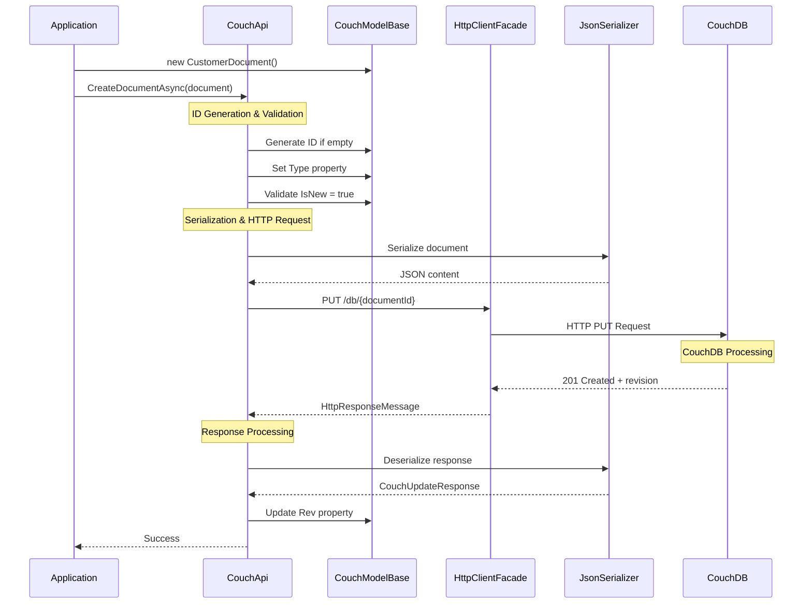

# Document Creation Operations

**Navigation**: [Documentation Index](../../DocumentationIndex.md) | [Document Operations Overview](document-operations-overview.md)

## Document Creation Overview

The Edge10.CouchDb.Client provides comprehensive document creation functionality with automatic ID generation, type safety, and proper revision management. All creation operations are implemented through the `ICouchApi` interface.

## Creation Methods

### 1. Create Empty Document

Creates a basic document with just an ID and no content:

```csharp
Task CreateDocumentAsync(string documentId)
```

**Implementation Details:**
- Creates a document with minimal JSON structure `{}`
- Document ID must be provided and cannot be null/empty
- No automatic ID generation for this method
- Document will have revision "1-{hash}" after creation

**Usage Example:**
```csharp
await couchApi.CreateDocumentAsync("my-document-id");
```

### 2. Create Typed Document

Creates a document from a strongly-typed object implementing `ICouchModel`:

```csharp
Task CreateDocumentAsync<TDocument>(TDocument document) where TDocument : ICouchModel
```

**Implementation Details:**
- Automatic GUID generation if `document.Id` is null/empty
- Sets `document.Type` to `typeof(TDocument).Name`
- Validates document state (must be new, i.e., no revision)
- Updates document revision after successful creation
- Full serialization of document properties

## Document Creation Flow



## Core Implementation

### Document ID Generation

```csharp
public Task CreateDocumentAsync<TDocument>(TDocument document)
    where TDocument : ICouchModel
{
    document.ThrowIfNull(nameof(document));

    // Generate GUID if ID not provided
    document.Id = string.IsNullOrWhiteSpace(document.Id) 
        ? Guid.NewGuid().ToString() 
        : document.Id;

    using (_eventLog.LogDocumentEvent(document.Id, "create"))
        return UpdateOrCreateDocumentAsync(document, true);
}
```

### Unified Create/Update Logic

```csharp
private async Task UpdateOrCreateDocumentAsync<TDocument>(TDocument document, bool isNew)
    where TDocument : ICouchModel
{
    document.ThrowIfNull(nameof(document));
    var documentUri = GetDocumentUrl(document.Id);
    
    // For updates (not new), ensure revision is available
    if (!isNew && string.IsNullOrWhiteSpace(document.Rev))
    {
        var revision = await GetDocumentRevision(documentUri);
        document.Rev = revision;
    }

    // Set document type for polymorphic serialization
    document.Type = typeof(TDocument).Name;

    var content = SerializeDocument(document);
    var response = await _client.PutAsync(documentUri, content);

    // Handle conflicts
    if (response.StatusCode == HttpStatusCode.Conflict)
        throw new ConflictException();

    await response.ThrowErrorIfNotSuccess();
    await UpdateDocumentRevision(document, response);
}
```

### Document Serialization

The client uses Newtonsoft.Json with specific configuration:

```csharp
private JsonSerializer CreateSerializer()
{
    var settings = new JsonSerializerSettings
    {
        TypeNameHandling = TypeNameHandling.Objects,
        ContractResolver = new CamelCasePropertyNamesContractResolver()
    };

    foreach (var converter in Converters)
        settings.Converters.Add(converter);

    _settingsChanges?.Invoke(settings);
    return JsonSerializer.Create(settings);
}
```

**Serialization Features:**
- Camel case property names (e.g., `FirstName` → `firstName`)
- Type information included for polymorphic deserialization
- Custom converters support
- Configurable serialization settings

## Document Model Requirements

### ICouchModel Interface

All documents must implement the `ICouchModel` interface:

```csharp
public interface ICouchModel
{
    string Id { get; set; }
    string Rev { get; set; }
    string Type { get; set; }
    bool Deleted { get; set; }
    bool IsNew { get; }
    IList<IAttachmentMetaData> Attachments { get; }
}
```

### CouchModelBase Implementation

The recommended approach is to inherit from `CouchModelBase`:

```csharp
public abstract class CouchModelBase : ICouchModel
{
    [JsonProperty(PropertyName = "_id")]
    public string Id { get; set; }

    [JsonProperty(PropertyName = "_rev", NullValueHandling = NullValueHandling.Ignore)]
    public string Rev { get; set; }

    [JsonProperty(PropertyName = "_deleted")]
    public bool Deleted { get; set; }

    [JsonProperty("type")]
    public string Type { get; set; }

    [JsonIgnore]
    public bool IsNew => string.IsNullOrWhiteSpace(Rev);

    [JsonProperty(PropertyName = "_attachments")]
    [JsonConverter(typeof(AttachmentsConverter))]
    public IList<IAttachmentMetaData> Attachments { get; } = new List<IAttachmentMetaData>();
}
```

## Usage Examples

### Basic Document Creation

```csharp
public class CustomerDocument : CouchModelBase
{
    public string Name { get; set; }
    public string Email { get; set; }
    public DateTime CreatedDate { get; set; }
    public List<string> Tags { get; set; } = new List<string>();
}

// Create with automatic ID generation
var customer = new CustomerDocument
{
    Name = "John Doe",
    Email = "john@example.com",
    CreatedDate = DateTime.UtcNow,
    Tags = { "customer", "active" }
};

await couchApi.CreateDocumentAsync(customer);
Console.WriteLine($"Created customer: {customer.Id} (Rev: {customer.Rev})");
```

### Create with Specific ID

```csharp
var product = new ProductDocument
{
    Id = "product-12345",  // Specific ID
    Name = "Widget Pro",
    Price = 29.99m,
    Category = "Electronics"
};

try
{
    await couchApi.CreateDocumentAsync(product);
    Console.WriteLine($"Created product: {product.Id}");
}
catch (ConflictException)
{
    Console.WriteLine("Document with this ID already exists");
}
```

### Create with Validation

```csharp
public class ValidatedDocument : CouchModelBase
{
    public string Title { get; set; }
    
    public void ValidateForCreation()
    {
        if (string.IsNullOrWhiteSpace(Title))
            throw new ArgumentException("Title is required");
        
        if (!IsNew)
            throw new InvalidOperationException("Document already exists");
    }
}

var doc = new ValidatedDocument { Title = "Important Document" };
doc.ValidateForCreation();

await couchApi.CreateDocumentAsync(doc);
```

## Error Handling

### Common Creation Errors

1. **ConflictException**: Document with same ID already exists
2. **ArgumentNullException**: Document parameter is null
3. **InvalidOperationException**: Document already has revision (not new)
4. **HttpRequestException**: Network or server errors

### Error Handling Pattern

```csharp
try
{
    await couchApi.CreateDocumentAsync(document);
    logger.LogInformation("Document created successfully: {DocumentId}", document.Id);
}
catch (ConflictException)
{
    logger.LogWarning("Document already exists: {DocumentId}", document.Id);
    // Handle duplicate - maybe update instead?
}
catch (HttpRequestException ex)
{
    logger.LogError(ex, "Failed to create document: {DocumentId}", document.Id);
    // Handle network/server errors
}
```

## Performance Considerations

### Batch Creation

For creating multiple documents, use bulk operations instead:

```csharp
// Instead of multiple CreateDocumentAsync calls
var documents = new List<CustomerDocument>
{
    new CustomerDocument { Name = "Alice", Email = "alice@example.com" },
    new CustomerDocument { Name = "Bob", Email = "bob@example.com" },
    new CustomerDocument { Name = "Charlie", Email = "charlie@example.com" }
};

// Use bulk operation (more efficient)
await couchApi.BulkUpdateAsync(documents);
```

### ID Generation Strategy

Choose appropriate ID generation strategy:

- **GUID (default)**: Guaranteed unique, good distribution
- **Sequential**: Predictable, but potential hotspots
- **Business keys**: Meaningful, but require uniqueness validation
- **Timestamps**: Time-based ordering, but potential conflicts

## Testing Patterns

### Unit Testing Document Creation

```csharp
[Test]
public async Task CreateDocumentAsync_Should_GenerateIdAndSetRevision()
{
    // Arrange
    var mockHttpClient = new Mock<IHttpClientFacade>();
    var document = new TestDocument { Name = "Test" };
    
    mockHttpClient.Setup(x => x.PutAsync(It.IsAny<string>(), It.IsAny<HttpContent>()))
              .ReturnsAsync(new HttpResponseMessage(HttpStatusCode.Created)
              {
                  Content = new StringContent("{\"ok\":true,\"id\":\"generated-id\",\"rev\":\"1-abc123\"}")
              });

    var couchApi = new CouchApi(connectionString, mockHttpClient.Object, mockEventLog.Object, null);

    // Act
    await couchApi.CreateDocumentAsync(document);

    // Assert
    Assert.That(document.Id, Is.Not.Null.And.Not.Empty);
    Assert.That(document.Rev, Is.EqualTo("1-abc123"));
    Assert.That(document.IsNew, Is.False);
    Assert.That(document.Type, Is.EqualTo("TestDocument"));
}
```

### Integration Testing

```csharp
[Test]
public async Task CreateDocumentAsync_Integration_Should_PersistDocument()
{
    using var couchApi = new CouchApi(GetTestConnectionString());
    
    var document = new CustomerDocument
    {
        Name = "Integration Test Customer",
        Email = "test@example.com"
    };

    // Act - Create
    await couchApi.CreateDocumentAsync(document);
    
    // Assert - Verify creation
    Assert.That(document.Id, Is.Not.Null);
    Assert.That(document.Rev, Is.Not.Null);
    
    // Verify persistence
    var retrieved = await couchApi.GetDocumentAsync<CustomerDocument>(document.Id);
    Assert.That(retrieved.Name, Is.EqualTo(document.Name));
    Assert.That(retrieved.Email, Is.EqualTo(document.Email));
}
```

## Best Practices

1. **Always check IsNew**: Verify document state before creation
2. **Handle conflicts gracefully**: Use try-catch for ConflictException
3. **Use meaningful IDs**: When possible, use business-meaningful identifiers
4. **Validate before creation**: Implement validation in document classes
5. **Log operations**: Use event logging for audit trails
6. **Batch operations**: Use bulk operations for multiple documents
7. **Type safety**: Always use strongly-typed documents
8. **Test thoroughly**: Write both unit and integration tests

---

*For more information about document operations, see [Document Operations Overview](document-operations-overview.md) and related operation documentation.*