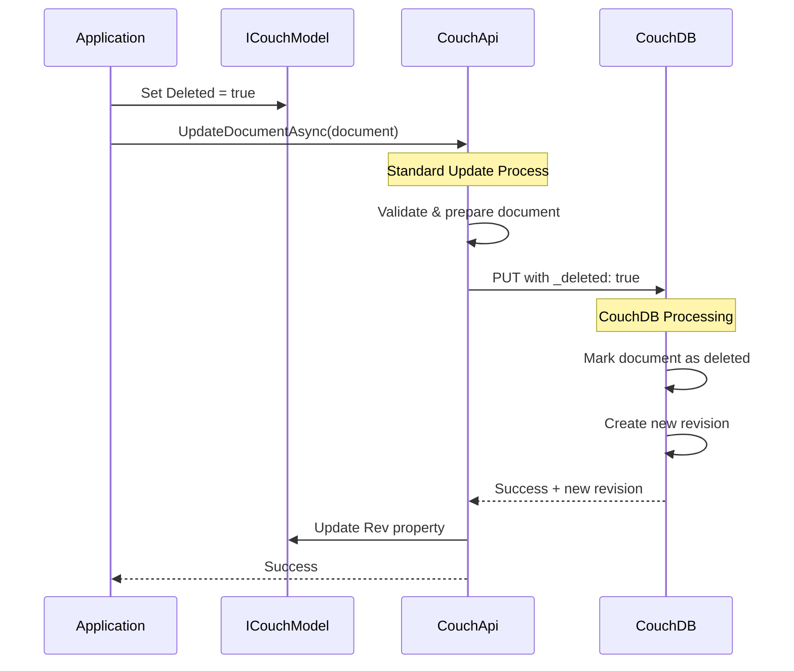

# Document Delete Operations

**Navigation**: [Documentation Index](../../DocumentationIndex.md) | [Document Operations Overview](document-operations-overview.md)

## Document Deletion Overview

The Edge10.CouchDb.Client implements CouchDB's soft deletion pattern using the `_deleted` flag. Unlike traditional databases, CouchDB doesn't permanently remove documents but marks them as deleted while preserving the document structure for replication and conflict resolution purposes.

## CouchDB Deletion Model

### Soft Deletion Approach

CouchDB uses a soft deletion model where:
- Documents are marked with `_deleted: true`
- The document structure remains in the database
- Deleted documents have new revisions like regular updates
- Deleted documents don't appear in normal queries
- Replication includes deletion information

### No Direct Delete Method

The Edge10.CouchDb.Client doesn't provide a dedicated `DeleteDocumentAsync` method. Instead, deletion is handled through the standard update mechanism by setting the `Deleted` property to `true`.

## Deletion Implementation Pattern

### Basic Deletion Process



### Core Deletion Logic

```csharp
// Deletion is implemented as a standard update with Deleted = true
public async Task DeleteDocument<TDocument>(TDocument document) 
    where TDocument : ICouchModel
{
    // Mark document as deleted
    document.Deleted = true;
    
    // Use standard update mechanism
    await couchApi.UpdateDocumentAsync(document);
}
```

## Document Model Support

### ICouchModel Deleted Property

The `ICouchModel` interface includes the `Deleted` property:

```csharp
public interface ICouchModel
{
    string Id { get; set; }
    string Rev { get; set; }
    string Type { get; set; }
    bool Deleted { get; set; }  // Deletion flag
    bool IsNew { get; }
    IList<IAttachmentMetaData> Attachments { get; }
}
```

### CouchModelBase Implementation

```csharp
public abstract class CouchModelBase : ICouchModel
{
    [JsonProperty(PropertyName = "_deleted")]
    public bool Deleted { get; set; }  // Maps to CouchDB's _deleted field
    
    // Other properties...
}
```

## Deletion Patterns

### 1. Simple Document Deletion

```csharp
public async Task DeleteCustomer(string customerId)
{
    // Retrieve the document first
    var customer = await couchApi.GetDocumentAsync<CustomerDocument>(customerId);
    
    // Mark as deleted
    customer.Deleted = true;
    
    // Update (which marks it as deleted in CouchDB)
    await couchApi.UpdateDocumentAsync(customer);
}
```

### 2. Safe Deletion with Existence Check

```csharp
public async Task<bool> TryDeleteDocument<TDocument>(string documentId)
    where TDocument : ICouchModel
{
    try
    {
        var document = await couchApi.GetDocumentAsync<TDocument>(documentId);
        
        if (document.Deleted)
        {
            // Already deleted
            return false;
        }
        
        document.Deleted = true;
        await couchApi.UpdateDocumentAsync(document);
        return true;
    }
    catch (HttpRequestException ex) when (ex.Message.Contains("404"))
    {
        // Document doesn't exist
        return false;
    }
}
```

### 3. Conditional Deletion

```csharp
public async Task DeleteCustomerIfInactive(string customerId)
{
    var customer = await couchApi.GetDocumentAsync<CustomerDocument>(customerId);
    
    if (customer.Status != "Active")
    {
        customer.Deleted = true;
        customer.DeletedDate = DateTime.UtcNow;
        customer.DeletedReason = "Inactive account";
        
        await couchApi.UpdateDocumentAsync(customer);
    }
    else
    {
        throw new InvalidOperationException("Cannot delete active customer");
    }
}
```

### 4. Bulk Deletion

```csharp
public async Task DeleteMultipleDocuments<TDocument>(IEnumerable<TDocument> documents)
    where TDocument : ICouchModel
{
    var documentsList = documents.ToList();
    
    // Mark all as deleted
    foreach (var document in documentsList)
    {
        document.Deleted = true;
    }
    
    // Use bulk update for efficiency
    await couchApi.BulkUpdateAsync(documentsList);
}
```

## Advanced Deletion Patterns

### Soft Delete with Audit Trail

```csharp
public class AuditableDocument : CouchModelBase
{
    public DateTime? DeletedDate { get; set; }
    public string DeletedBy { get; set; }
    public string DeletedReason { get; set; }
    
    public void MarkDeleted(string deletedBy, string reason = null)
    {
        Deleted = true;
        DeletedDate = DateTime.UtcNow;
        DeletedBy = deletedBy;
        DeletedReason = reason;
    }
}

// Usage
public async Task DeleteDocumentWithAudit(AuditableDocument document, string userId, string reason)
{
    document.MarkDeleted(userId, reason);
    await couchApi.UpdateDocumentAsync(document);
}
```

### Logical vs Physical Deletion

```csharp
public class DocumentWithLogicalDelete : CouchModelBase
{
    // Logical deletion (application-level)
    public bool IsActive { get; set; } = true;
    public DateTime? DeactivatedDate { get; set; }
    
    // Physical deletion (CouchDB-level) - inherited Deleted property
    
    public void Deactivate()
    {
        IsActive = false;
        DeactivatedDate = DateTime.UtcNow;
        // Don't set Deleted = true for logical deletion
    }
    
    public void PhysicallyDelete()
    {
        Deleted = true;  // This triggers CouchDB soft deletion
    }
}
```

### Cascading Deletion

```csharp
public async Task DeleteCustomerAndRelatedDocuments(string customerId)
{
    // Get all related documents
    var customer = await couchApi.GetDocumentAsync<CustomerDocument>(customerId);
    var orders = await GetCustomerOrders(customerId);
    var preferences = await GetCustomerPreferences(customerId);
    
    // Mark all as deleted
    var allDocuments = new List<ICouchModel> { customer };
    allDocuments.AddRange(orders);
    allDocuments.AddRange(preferences);
    
    foreach (var doc in allDocuments)
    {
        doc.Deleted = true;
    }
    
    // Bulk delete all related documents
    await couchApi.BulkUpdateAsync(allDocuments);
}
```

## Deletion with Conflict Handling

### Retry Pattern for Deletion

```csharp
public async Task DeleteDocumentWithRetry<TDocument>(string documentId, int maxRetries = 3)
    where TDocument : ICouchModel
{
    for (int attempt = 1; attempt <= maxRetries; attempt++)
    {
        try
        {
            var document = await couchApi.GetDocumentAsync<TDocument>(documentId);
            
            if (document.Deleted)
            {
                // Already deleted
                return;
            }
            
            document.Deleted = true;
            await couchApi.UpdateDocumentAsync(document);
            return;
        }
        catch (ConflictException) when (attempt < maxRetries)
        {
            // Wait and retry with fresh revision
            await Task.Delay(TimeSpan.FromMilliseconds(100 * attempt));
        }
    }
    
    throw new InvalidOperationException($"Failed to delete document after {maxRetries} attempts");
}
```

### Safe Deletion with Latest Revision

```csharp
public async Task SafeDeleteDocument<TDocument>(string documentId)
    where TDocument : ICouchModel
{
    while (true)
    {
        try
        {
            var document = await couchApi.GetDocumentAsync<TDocument>(documentId);
            
            if (document.Deleted)
            {
                return; // Already deleted
            }
            
            document.Deleted = true;
            await couchApi.UpdateDocumentAsync(document);
            return;
        }
        catch (ConflictException)
        {
            // Retry with fresh data
            await Task.Delay(TimeSpan.FromMilliseconds(50));
        }
        catch (HttpRequestException ex) when (ex.Message.Contains("404"))
        {
            // Document doesn't exist (already deleted or never existed)
            return;
        }
    }
}
```

## Querying Deleted Documents

### Exclude Deleted Documents (Default Behavior)

Most CouchDB queries automatically exclude deleted documents:

```csharp
// This will not return deleted documents
var activeCustomers = await couchApi.GetViewDocumentsAsync<CustomerDocument>(viewParameters);
```

### Include Deleted Documents in Queries

To include deleted documents, you need special view handling:

```csharp
// Custom view that includes deleted documents would need to explicitly check
// Design document view function:
// function(doc) {
//   if (doc.type === "CustomerDocument") {
//     emit(doc._id, {
//       name: doc.name,
//       deleted: doc._deleted || false
//     });
//   }
// }
```

## Recovery and Undelete

### Document Recovery

Since CouchDB uses soft deletion, documents can be "undeleted":

```csharp
public async Task UndeleteDocument<TDocument>(string documentId)
    where TDocument : ICouchModel
{
    try
    {
        // Try to get the deleted document
        var document = await couchApi.GetDocumentAsync<TDocument>(documentId);
        
        if (!document.Deleted)
        {
            throw new InvalidOperationException("Document is not deleted");
        }
        
        // Undelete by setting Deleted to false
        document.Deleted = false;
        
        // Clear deletion audit fields if they exist
        if (document is AuditableDocument auditableDoc)
        {
            auditableDoc.DeletedDate = null;
            auditableDoc.DeletedBy = null;
            auditableDoc.DeletedReason = null;
        }
        
        await couchApi.UpdateDocumentAsync(document);
    }
    catch (HttpRequestException ex) when (ex.Message.Contains("404"))
    {
        throw new InvalidOperationException("Cannot undelete: document not found");
    }
}
```

## Error Handling in Deletion

### Comprehensive Deletion Error Handling

```csharp
public async Task<DeletionResult> SafeDeleteDocumentWithResult<TDocument>(string documentId)
    where TDocument : ICouchModel
{
    try
    {
        var document = await couchApi.GetDocumentAsync<TDocument>(documentId);
        
        if (document.Deleted)
        {
            return DeletionResult.AlreadyDeleted();
        }
        
        document.Deleted = true;
        await couchApi.UpdateDocumentAsync(document);
        
        return DeletionResult.Success(document.Rev);
    }
    catch (HttpRequestException ex) when (ex.Message.Contains("404"))
    {
        return DeletionResult.NotFound();
    }
    catch (ConflictException)
    {
        return DeletionResult.Conflict();
    }
    catch (Exception ex)
    {
        return DeletionResult.Error(ex.Message);
    }
}

public class DeletionResult
{
    public bool IsSuccess { get; private set; }
    public DeletionResultType ResultType { get; private set; }
    public string Message { get; private set; }
    public string NewRevision { get; private set; }
    
    public static DeletionResult Success(string revision) => 
        new DeletionResult { IsSuccess = true, ResultType = DeletionResultType.Success, NewRevision = revision };
        
    public static DeletionResult AlreadyDeleted() => 
        new DeletionResult { IsSuccess = true, ResultType = DeletionResultType.AlreadyDeleted };
        
    public static DeletionResult NotFound() => 
        new DeletionResult { ResultType = DeletionResultType.NotFound, Message = "Document not found" };
        
    public static DeletionResult Conflict() => 
        new DeletionResult { ResultType = DeletionResultType.Conflict, Message = "Document was modified by another process" };
        
    public static DeletionResult Error(string message) => 
        new DeletionResult { ResultType = DeletionResultType.Error, Message = message };
}

public enum DeletionResultType
{
    Success,
    AlreadyDeleted,
    NotFound,
    Conflict,
    Error
}
```

## Testing Deletion Operations

### Unit Testing Deletion

```csharp
[Test]
public async Task DeleteDocument_Should_SetDeletedFlag()
{
    // Arrange
    var document = new TestDocument { Id = "test", Rev = "1-abc", Name = "Test" };
    
    // Act
    await DeleteDocument(document);
    
    // Assert
    Assert.That(document.Deleted, Is.True);
    // Verify UpdateDocumentAsync was called (through mocking)
}

[Test]
public async Task DeleteDocument_Should_HandleAlreadyDeleted()
{
    // Arrange
    var document = new TestDocument { Id = "test", Rev = "1-abc", Deleted = true };
    
    // Act
    var result = await TryDeleteDocument<TestDocument>(document.Id);
    
    // Assert
    Assert.That(result, Is.False);
}
```

### Integration Testing

```csharp
[Test]
public async Task DeleteDocument_Integration_Should_MarkAsDeleted()
{
    using var couchApi = new CouchApi(GetTestConnectionString());
    
    // Create document
    var document = new TestDocument { Name = "To Delete" };
    await couchApi.CreateDocumentAsync(document);
    
    // Delete document
    document.Deleted = true;
    await couchApi.UpdateDocumentAsync(document);
    
    // Verify deletion
    Assert.That(document.Deleted, Is.True);
    Assert.That(document.Rev, Does.StartWith("2-")); // New revision created
    
    // Verify document is not returned in normal queries
    var retrieved = await couchApi.TryGetDocumentAsync<TestDocument>(document.Id);
    Assert.That(retrieved, Is.Null); // Should not be found in normal retrieval
}
```

## Best Practices

1. **Always retrieve before deletion**: Get the current document state and revision
2. **Handle conflicts gracefully**: Implement retry logic for concurrent modifications
3. **Add audit information**: Track who deleted what and when
4. **Validate deletion permissions**: Ensure business rules allow deletion
5. **Use bulk operations**: For multiple deletions, use BulkUpdateAsync
6. **Consider logical deletion**: Use application-level flags for recoverable deletion
7. **Document cascading logic**: Clearly define what happens to related documents
8. **Test deletion scenarios**: Include edge cases and error conditions
9. **Monitor deletion patterns**: Track deletion frequency and reasons
10. **Plan for recovery**: Design undelete functionality where needed

## Common Pitfalls

1. **Not handling already deleted documents**: Check the Deleted flag before deletion
2. **Forgetting conflict resolution**: Multiple processes trying to delete simultaneously
3. **Not considering related documents**: Orphaned references after deletion
4. **Mixing logical and physical deletion**: Clear separation of concerns
5. **Poor error handling**: Not accounting for various failure scenarios
6. **Inefficient bulk deletion**: Using individual updates instead of bulk operations
7. **Not preserving audit trails**: Losing important deletion metadata
8. **Ignoring replication implications**: Deleted documents still participate in replication

---

*For more information about document deletion, see [Document Operations Overview](document-operations-overview.md) and [Bulk Operations](bulk-operations.md).*