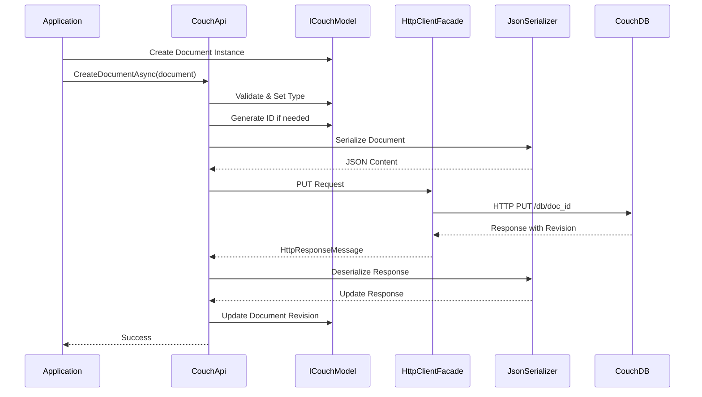
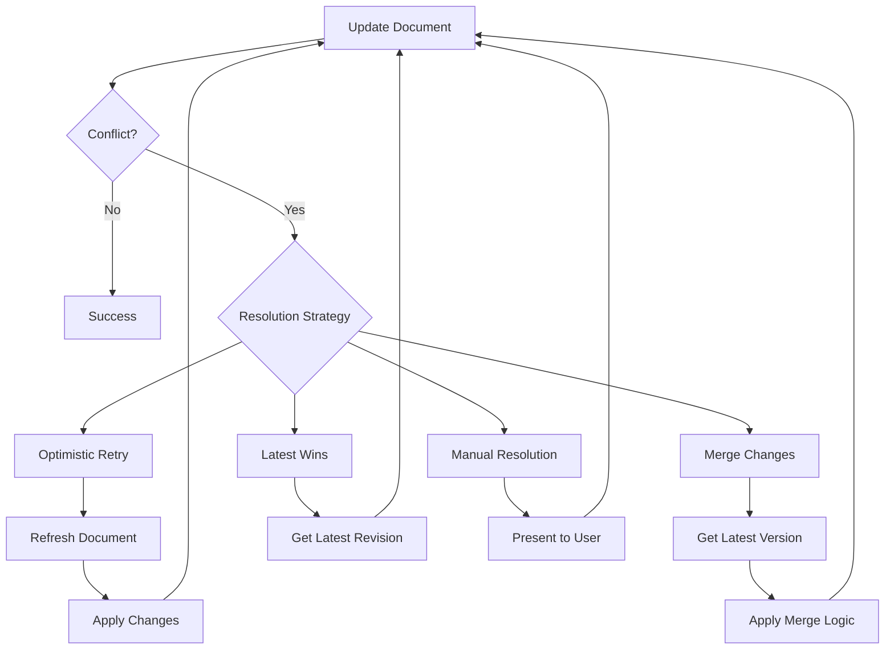

# Document Operations Overview

**Navigation**: [Documentation Index](../../DocumentationIndex.md) | [General Functionality](../general-functionality.md)

## Document Operations Architecture

Document operations form the core functionality of Edge10.CouchDb.Client, providing comprehensive CRUD (Create, Read, Update, Delete) operations for CouchDB documents with full type safety and automatic revision management.

## Operation Categories

### 1. Create Operations
- New document creation with automatic ID generation
- Document creation with specific IDs
- Type-safe document creation with generic constraints

### 2. Read Operations
- Single document retrieval by ID
- Bulk document retrieval by ID collection
- Document existence checking
- Revision-specific document retrieval

### 3. Update Operations
- Individual document updates with automatic revision handling
- Bulk document updates for performance optimization
- Conflict detection and handling

### 4. Delete Operations
- Soft deletion using CouchDB's `_deleted` flag
- Integration with bulk operations for efficient processing

## Document Operation Flow



## Core Interface Methods

### Document Lifecycle Methods

```csharp
public interface ICouchApi
{
    // Create Operations
    Task CreateDocumentAsync(string documentId);
    Task CreateDocumentAsync<TDocument>(TDocument document) where TDocument : ICouchModel;
    
    // Read Operations
    Task<TDocument> GetDocumentAsync<TDocument>(string documentId);
    Task<TDocument> GetDocumentAsync<TDocument>(string documentId, string revision);
    Task<TDocument> TryGetDocumentAsync<TDocument>(string documentId);
    Task<IEnumerable<TDocument>> GetDocumentsAsync<TDocument>(IEnumerable<string> documentIds);
    Task<bool> DocumentExistsAsync(string documentId);
    
    // Update Operations
    Task UpdateDocumentAsync<TDocument>(TDocument document) where TDocument : ICouchModel;
    Task BulkUpdateAsync<TDocument>(IEnumerable<TDocument> documents) where TDocument : ICouchModel;
    
    // Revision Management
    Task<ChangeRevision> GetLatestDocumentRevision(string documentId);
    Task<IDictionary<string, ChangeRevision>> GetLatestDocumentRevisions(IEnumerable<string> documentIds);
}
```

## Document State Management

### Document States

```mermaid
stateDiagram-v2
    [*] --> New : Create Instance
    New --> Created : CreateDocumentAsync()
    Created --> Retrieved : GetDocumentAsync()
    Retrieved --> Updated : UpdateDocumentAsync()
    Updated --> Updated : UpdateDocumentAsync()
    Updated --> Deleted : Set Deleted=true
    Deleted --> Removed : BulkUpdateAsync()
    Removed --> [*]
    
    Created --> Conflicted : Concurrent Update
    Updated --> Conflicted : Concurrent Update
    Conflicted --> Updated : Resolve Conflict
    
    state New {
        IsNew --> true
        Rev --> null
        Id --> null_or_set
    }
    
    state Created {
        IsNew --> false
        Rev --> "1-hash"
        Id --> assigned
    }
    
    state Updated {
        IsNew --> false
        Rev --> "n-hash"
        Id --> unchanged
    }
```

### State Validation

```csharp
public abstract class CouchModelBase : ICouchModel
{
    [JsonIgnore]
    public bool IsNew => string.IsNullOrWhiteSpace(Rev);
    
    // Validation methods
    public void ValidateForCreate()
    {
        if (!IsNew)
            throw new InvalidOperationException("Document already exists (has revision)");
    }
    
    public void ValidateForUpdate()
    {
        if (IsNew)
            throw new InvalidOperationException("Cannot update new document (no revision)");
        if (string.IsNullOrWhiteSpace(Id))
            throw new InvalidOperationException("Document ID is required for updates");
    }
}
```

## Implementation Patterns

### Create Document Implementation

```csharp
public Task CreateDocumentAsync<TDocument>(TDocument document)
    where TDocument : ICouchModel
{
    document.ThrowIfNull(nameof(document));

    // Generate ID if not provided
    document.Id = string.IsNullOrWhiteSpace(document.Id) ? Guid.NewGuid().ToString() : document.Id;

    using (_eventLog.LogDocumentEvent(document.Id, "create"))
        return UpdateOrCreateDocumentAsync(document, true);
}

private async Task UpdateOrCreateDocumentAsync<TDocument>(TDocument document, bool isNew)
    where TDocument : ICouchModel
{
    document.ThrowIfNull(nameof(document));
    var documentUri = GetDocumentUrl(document.Id);
    
    if (!isNew && string.IsNullOrWhiteSpace(document.Rev))
    {
        var revision = await GetDocumentRevision(documentUri);
        document.Rev = revision;
    }

    document.Type = typeof(TDocument).Name;

    var content = SerializeDocument(document);
    var response = await _client.PutAsync(documentUri, content);

    if (response.StatusCode == HttpStatusCode.Conflict)
        throw new ConflictException();

    await response.ThrowErrorIfNotSuccess();
    await UpdateDocumentRevision(document, response);
}
```

### Read Document Implementation

```csharp
public async Task<TDocument> GetDocumentAsync<TDocument>(string documentId)
{
    documentId.ThrowIfNullOrEmpty(nameof(documentId));
    var url = GetDocumentUrl(documentId);

    using (_eventLog.LogDocumentEvent(documentId, "get"))
    using (var result = await _client.GetAsync(url))
        return await GetSerializedResultContent<TDocument>(result);
}

public async Task<TDocument> TryGetDocumentAsync<TDocument>(string documentId)
{
    documentId.ThrowIfNullOrEmpty(nameof(documentId));

    var url = GetDocumentUrl(documentId);
    using (_eventLog.LogDocumentEvent(documentId, "get"))
    using (var result = await _client.GetAsync(url))
    {
        if (!result.IsSuccessStatusCode)
            return default(TDocument);

        return await GetSerializedResultContent<TDocument>(result);
    }
}
```

### Bulk Operations Implementation

```csharp
public async Task BulkUpdateAsync<TDocument>(IEnumerable<TDocument> documents) 
    where TDocument : ICouchModel
{
    documents.ThrowIfNull(nameof(documents));

    var docsArray = documents.ToArray();
    foreach (TDocument document in docsArray)
        document.Type = typeof(TDocument).Name;

    using (_eventLog.LogDocumentEvent(string.Join(", ", docsArray.Select(x => x.Id.ToString())), "bulk"))
    {
        var url = $"{_url}/{_databaseName}/_bulk_docs";
        var content = SerializeDocument(new { Docs = docsArray });
        var response = await _client.PostAsync(url, content);

        await response.ThrowErrorIfNotSuccess();

        var responseContent = await response.Content.ReadAsStringAsync();
        var updateResults = JsonConvert.DeserializeObject<CouchBulkUpdateResponseItem[]>(responseContent);

        var conflictIds = updateResults.Where(x => x.Error == "conflict").Select(x => x.Id.ToString()).ToArray();
        if (conflictIds.Any())
            throw new ConflictException(string.Join(", ", conflictIds));

        var errorResults = updateResults.Where(x => !x.Ok && !string.IsNullOrWhiteSpace(x.Error)).ToArray();
        if (errorResults.Any())
        {
            var messages = errorResults.Select(x => $"id: {x.Id}, error: {x.Error}, reason: {x.Reason}");
            throw new HttpRequestException(string.Join("; ", messages));
        }

        var revisionsById = updateResults.ToDictionary(x => x.Id, x => x.Rev);
        foreach (var document in docsArray)
            document.Rev = revisionsById[document.Id];
    }
}
```

## Error Handling Strategies

### Conflict Resolution Patterns



### Exception Handling Implementation

```csharp
public async Task<bool> TryUpdateDocumentWithRetry<TDocument>(
    TDocument document, 
    int maxRetries = 3,
    Func<TDocument, TDocument, TDocument> conflictResolver = null)
    where TDocument : ICouchModel
{
    for (int attempt = 0; attempt < maxRetries; attempt++)
    {
        try
        {
            await UpdateDocumentAsync(document);
            return true;
        }
        catch (ConflictException)
        {
            if (attempt == maxRetries - 1)
                return false;
            
            var latest = await GetDocumentAsync<TDocument>(document.Id);
            
            if (conflictResolver != null)
            {
                document = conflictResolver(document, latest);
            }
            else
            {
                // Default: use latest revision, keep local changes
                document.Rev = latest.Rev;
            }
        }
    }
    
    return false;
}
```

## Performance Optimization

### Batch Size Management

```csharp
public int MaxDocumentsPerRequest { get; set; } = 500;

private IEnumerable<IEnumerable<T>> SplitToBlocks<T>(IEnumerable<T> sequence, int size)
{
    var partition = new List<T>(size);
    foreach (var item in sequence)
    {
        partition.Add(item);
        if (partition.Count == size)
        {
            yield return partition;
            partition = new List<T>(size);
        }
    }
    
    if (partition.Count > 0)
        yield return partition;
}

public async Task<IEnumerable<TDocument>> GetDocumentsAsync<TDocument>(IEnumerable<string> documentIds)
{
    var documentIdsArray = documentIds as string[] ?? documentIds.ToArray();
    if (!documentIdsArray.Any()) return Enumerable.Empty<TDocument>();

    if (documentIdsArray.Length <= MaxDocumentsPerRequest)
    {
        return await GetDocumentsBatch<TDocument>(documentIdsArray);
    }

    var idBlocks = SplitToBlocks(documentIdsArray, MaxDocumentsPerRequest);
    var results = new List<TDocument>();

    foreach (var idBlock in idBlocks)
        results.AddRange(await GetDocumentsAsync<TDocument>(idBlock));

    return results;
}
```

### Memory Management

```csharp
private async Task<TData> GetSerializedResultContent<TData>(HttpResponseMessage result)
{
    await result.ThrowErrorIfNotSuccess();

    var content = await result.Content.ReadAsStreamAsync();
    return GetSerializedContent<TData>(content);
}

private TData GetSerializedContent<TData>(Stream content)
{
    using (var sr = _serializationStrategy?.ReaderFactory(content) ?? new StreamReader(content))
    using (var jsonTextReader = new JsonTextReader(sr))
    {
        var serializer = CreateSerializer();
        return serializer.Deserialize<TData>(jsonTextReader);
    }
}
```

## Usage Examples

### Basic Document Operations

```csharp
// Create new document
var customer = new CustomerDocument
{
    Name = "John Doe",
    Email = "john@example.com",
    CreatedDate = DateTime.UtcNow
};

await couchApi.CreateDocumentAsync(customer);
Console.WriteLine($"Created customer with ID: {customer.Id}");

// Retrieve document
var retrieved = await couchApi.GetDocumentAsync<CustomerDocument>(customer.Id);
Console.WriteLine($"Retrieved: {retrieved.Name} ({retrieved.Email})");

// Update document
retrieved.Email = "newemail@example.com";
await couchApi.UpdateDocumentAsync(retrieved);

// Check if document exists
bool exists = await couchApi.DocumentExistsAsync(customer.Id);
```

### Bulk Operations

```csharp
// Create multiple documents
var customers = new List<CustomerDocument>
{
    new CustomerDocument { Name = "Alice", Email = "alice@example.com" },
    new CustomerDocument { Name = "Bob", Email = "bob@example.com" },
    new CustomerDocument { Name = "Charlie", Email = "charlie@example.com" }
};

await couchApi.BulkUpdateAsync(customers);

// Retrieve multiple documents
var customerIds = customers.Select(c => c.Id).ToArray();
var retrievedCustomers = await couchApi.GetDocumentsAsync<CustomerDocument>(customerIds);
```

### Error Handling

```csharp
try
{
    await couchApi.UpdateDocumentAsync(document);
}
catch (ConflictException)
{
    logger.LogWarning("Document conflict occurred for {DocumentId}", document.Id);
    
    // Resolve conflict by getting latest version
    var latest = await couchApi.GetDocumentAsync<DocumentType>(document.Id);
    
    // Apply business logic to merge changes
    MergeBusinessData(document, latest);
    document.Rev = latest.Rev;
    
    // Retry the update
    await couchApi.UpdateDocumentAsync(document);
}
catch (HttpRequestException ex) when (ex.Message.Contains("404"))
{
    logger.LogError("Document not found: {DocumentId}", document.Id);
    // Handle missing document scenario
}
```

## Testing Patterns

### Unit Testing with Mocks

```csharp
[Test]
public async Task CreateDocumentAsync_Should_SetIdAndRevision()
{
    // Arrange
    var mockHttpClient = new Mock<IHttpClientFacade>();
    var mockEventLog = new Mock<ICouchEventLog>();
    var document = new TestDocument { Name = "Test" };
    
    mockHttpClient.Setup(x => x.PutAsync(It.IsAny<string>(), It.IsAny<HttpContent>()))
              .ReturnsAsync(new HttpResponseMessage(HttpStatusCode.Created)
              {
                  Content = new StringContent("{\"ok\":true,\"id\":\"123\",\"rev\":\"1-abc\"}")
              });

    var couchApi = new CouchApi(connectionString, mockHttpClient.Object, mockEventLog.Object, null);

    // Act
    await couchApi.CreateDocumentAsync(document);

    // Assert
    Assert.That(document.Id, Is.Not.Null);
    Assert.That(document.Rev, Is.Not.Null);
    Assert.That(document.IsNew, Is.False);
}
```

---

*This document operations overview provides comprehensive coverage of the CRUD functionality within Edge10.CouchDb.Client. For detailed information about specific operation types, refer to the individual operation documentation files.*