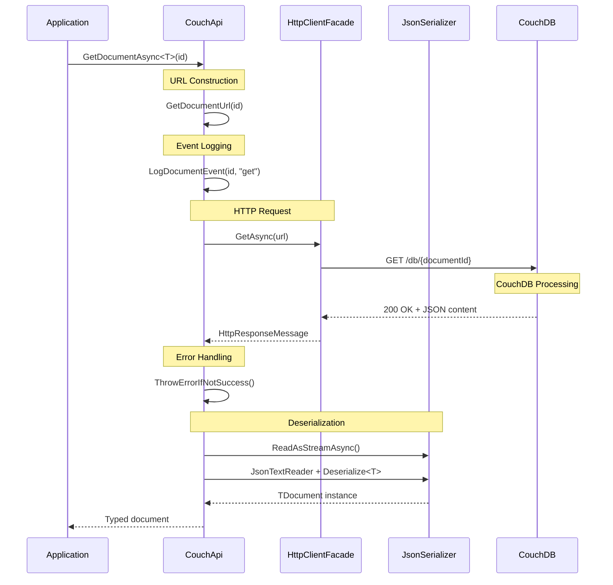

# Document Read Operations

**Navigation**: [Documentation Index](../../DocumentationIndex.md) | [Document Operations Overview](document-operations-overview.md)

## Document Retrieval Overview

The Edge10.CouchDb.Client provides comprehensive document retrieval functionality with support for single documents, bulk operations, specific revisions, and existence checking. All read operations maintain type safety and handle errors gracefully.

## Read Methods

### 1. Get Single Document

Retrieves a document by ID and deserializes it to the specified type:

```csharp
Task<TDocument> GetDocumentAsync<TDocument>(string documentId)
```

**Implementation Details:**
- Throws exception if document doesn't exist (404)
- Full type-safe deserialization
- Includes all document metadata and attachments
- Uses camel case property name conversion

### 2. Get Document with Specific Revision

Retrieves a specific revision of a document:

```csharp
Task<TDocument> GetDocumentAsync<TDocument>(string documentId, string revision)
```

**Use Cases:**
- Retrieving historical versions
- Conflict resolution
- Audit trail reconstruction
- Version comparison

### 3. Try Get Document (Safe Retrieval)

Attempts to retrieve a document, returning null if not found:

```csharp
Task<TDocument> TryGetDocumentAsync<TDocument>(string documentId)
```

**Benefits:**
- No exceptions for missing documents
- Cleaner code flow for optional documents
- Better performance for existence checks

### 4. Bulk Document Retrieval

Retrieves multiple documents in a single operation:

```csharp
Task<IEnumerable<TDocument>> GetDocumentsAsync<TDocument>(IEnumerable<string> documentIds)
```

**Features:**
- Automatic batching for large ID collections
- Configurable batch size (`MaxDocumentsPerRequest`)
- Sequential processing to avoid memory issues
- Efficient CouchDB `_all_docs` endpoint usage

### 5. Document Existence Check

Checks if a document exists without retrieving content:

```csharp
Task<bool> DocumentExistsAsync(string documentId)
```

**Performance Benefits:**
- Minimal network overhead
- No content transfer
- Fast existence verification

## Document Retrieval Flow



## Core Implementation

### Single Document Retrieval

```csharp
public async Task<TDocument> GetDocumentAsync<TDocument>(string documentId)
{
    documentId.ThrowIfNullOrEmpty(nameof(documentId));
    var url = GetDocumentUrl(documentId);

    using (_eventLog.LogDocumentEvent(documentId, "get"))
    using (var result = await _client.GetAsync(url))
        return await GetSerializedResultContent<TDocument>(result);
}
```

### Safe Document Retrieval

```csharp
public async Task<TDocument> TryGetDocumentAsync<TDocument>(string documentId)
{
    documentId.ThrowIfNullOrEmpty(nameof(documentId));

    var url = GetDocumentUrl(documentId);
    using (_eventLog.LogDocumentEvent(documentId, "get"))
    using (var result = await _client.GetAsync(url))
    {
        if (!result.IsSuccessStatusCode)
            return default(TDocument);

        return await GetSerializedResultContent<TDocument>(result);
    }
}
```

### Bulk Document Retrieval

```csharp
public async Task<IEnumerable<TDocument>> GetDocumentsAsync<TDocument>(IEnumerable<string> documentIds)
{
    documentIds.ThrowIfNull(nameof(documentIds));

    var documentIdsArray = documentIds as string[] ?? documentIds.ToArray();
    if (!documentIdsArray.Any()) return Enumerable.Empty<TDocument>();

    var url = $"{_url}/{_databaseName}/_all_docs?include_docs=true";

    if (documentIdsArray.Length <= MaxDocumentsPerRequest)
    {
        var parameters = new { keys = documentIdsArray };

        using (var keysContent = new ObjectContent<dynamic>(parameters, new JsonMediaTypeFormatter()))
        using (var response = await _client.PostAsync(url, keysContent))
        {
            await response.ThrowErrorIfNotSuccess();
            var result = await GetSerializedResultContent<ViewResult<TDocument, object>>(response);
            return result.Rows.Select(r => r.Document).ToList();
        }
    }

    // Handle large collections with batching
    var idBlocks = SplitToBlocks(documentIdsArray, MaxDocumentsPerRequest);
    var results = new List<TDocument>();

    foreach (var idBlock in idBlocks)
        results.AddRange(await GetDocumentsAsync<TDocument>(idBlock));

    return results;
}
```

### Document Existence Check

```csharp
public async Task<bool> DocumentExistsAsync(string documentId)
{
    documentId.ThrowIfNullOrEmpty(nameof(documentId));

    using (_eventLog.LogDocumentEvent(documentId, "get"))
    {
        var httpResponse = await _client.GetAsync(GetDocumentUrl(documentId));
        if (httpResponse == null) return false;
        return httpResponse.IsSuccessStatusCode;
    }
}
```

## Deserialization Process

### Stream-Based Deserialization

The client uses stream-based deserialization for memory efficiency:

```csharp
private async Task<TData> GetSerializedResultContent<TData>(HttpResponseMessage result)
{
    await result.ThrowErrorIfNotSuccess();
    var content = await result.Content.ReadAsStreamAsync();
    return GetSerializedContent<TData>(content);
}

private TData GetSerializedContent<TData>(Stream content)
{
    using (var sr = _serializationStrategy?.ReaderFactory(content) ?? new StreamReader(content))
    using (var jsonTextReader = new JsonTextReader(sr))
    {
        var serializer = CreateSerializer();
        return serializer.Deserialize<TData>(jsonTextReader);
    }
}
```

### Custom Serialization Strategy

Support for custom serialization strategies:

```csharp
public class SerializationStrategy
{
    public Func<Stream, StreamReader> ReaderFactory { get; }
    public Func<StringBuilder, StringWriter> WriterFactory { get; }
}

// Usage example
var strategy = new SerializationStrategy(
    stream => new StreamReader(stream, Encoding.UTF8),
    builder => new StringWriter(builder)
);

var couchApi = new CouchApi(connectionString, eventLog, strategy);
```

## Performance Optimization

### Batch Size Management

```csharp
public int MaxDocumentsPerRequest { get; set; } = 500;

private IEnumerable<IEnumerable<T>> SplitToBlocks<T>(IEnumerable<T> sequence, int size)
{
    var partition = new List<T>(size);
    foreach (var item in sequence)
    {
        partition.Add(item);
        if (partition.Count == size)
        {
            yield return partition;
            partition = new List<T>(size);
        }
    }
    
    if (partition.Count > 0)
        yield return partition;
}
```

### Memory Management

- Stream-based processing for large documents
- Disposable pattern implementation
- Sequential batch processing to avoid memory pressure
- Configurable serialization strategies

## Usage Examples

### Basic Document Retrieval

```csharp
// Single document retrieval
try
{
    var customer = await couchApi.GetDocumentAsync<CustomerDocument>("customer-123");
    Console.WriteLine($"Retrieved: {customer.Name} ({customer.Email})");
    Console.WriteLine($"Document revision: {customer.Rev}");
}
catch (HttpRequestException ex) when (ex.Message.Contains("404"))
{
    Console.WriteLine("Customer not found");
}
```

### Safe Document Retrieval

```csharp
// Safe retrieval (no exceptions for missing documents)
var customer = await couchApi.TryGetDocumentAsync<CustomerDocument>("customer-123");
if (customer != null)
{
    Console.WriteLine($"Found customer: {customer.Name}");
}
else
{
    Console.WriteLine("Customer not found");
}
```

### Revision-Specific Retrieval

```csharp
// Get specific revision
var oldRevision = "1-abc123def456";
var historicalCustomer = await couchApi.GetDocumentAsync<CustomerDocument>("customer-123", oldRevision);
Console.WriteLine($"Historical data: {historicalCustomer.Name} as of revision {oldRevision}");
```

### Bulk Document Retrieval

```csharp
// Retrieve multiple documents efficiently
var customerIds = new[] { "customer-1", "customer-2", "customer-3", "customer-4" };
var customers = await couchApi.GetDocumentsAsync<CustomerDocument>(customerIds);

foreach (var customer in customers)
{
    Console.WriteLine($"Customer: {customer.Name} - {customer.Email}");
}

Console.WriteLine($"Retrieved {customers.Count()} customers");
```

### Existence Checking

```csharp
// Check existence before expensive operations
if (await couchApi.DocumentExistsAsync("customer-123"))
{
    var customer = await couchApi.GetDocumentAsync<CustomerDocument>("customer-123");
    // Process customer...
}
else
{
    Console.WriteLine("Customer does not exist");
}
```

### Large Collection Handling

```csharp
// Handle large collections with automatic batching
var allCustomerIds = await GetAllCustomerIds(); // Assume this returns 10,000 IDs

// The client automatically batches this into multiple requests
var allCustomers = await couchApi.GetDocumentsAsync<CustomerDocument>(allCustomerIds);

Console.WriteLine($"Retrieved {allCustomers.Count()} customers in batches");
```

## Error Handling

### Common Read Errors

1. **HttpRequestException (404)**: Document not found
2. **HttpRequestException (401)**: Authentication failure
3. **JsonException**: Deserialization failures
4. **ArgumentException**: Invalid document ID format
5. **TimeoutException**: Request timeout

### Comprehensive Error Handling

```csharp
public async Task<CustomerDocument> GetCustomerSafely(string customerId)
{
    try
    {
        return await couchApi.GetDocumentAsync<CustomerDocument>(customerId);
    }
    catch (HttpRequestException ex) when (ex.Message.Contains("404"))
    {
        logger.LogWarning("Customer not found: {CustomerId}", customerId);
        return null;
    }
    catch (JsonException ex)
    {
        logger.LogError(ex, "Failed to deserialize customer: {CustomerId}", customerId);
        throw new InvalidOperationException($"Customer data is corrupted: {customerId}", ex);
    }
    catch (HttpRequestException ex)
    {
        logger.LogError(ex, "Network error retrieving customer: {CustomerId}", customerId);
        throw;
    }
}
```

## Advanced Patterns

### Retry Pattern for Transient Failures

```csharp
public async Task<T> GetDocumentWithRetry<T>(string documentId, int maxRetries = 3)
{
    for (int attempt = 1; attempt <= maxRetries; attempt++)
    {
        try
        {
            return await couchApi.GetDocumentAsync<T>(documentId);
        }
        catch (HttpRequestException ex) when (attempt < maxRetries && IsTransientError(ex))
        {
            var delay = TimeSpan.FromSeconds(Math.Pow(2, attempt)); // Exponential backoff
            await Task.Delay(delay);
            logger.LogWarning("Retry attempt {Attempt}/{MaxRetries} for document {DocumentId}", 
                            attempt, maxRetries, documentId);
        }
    }
    
    throw new InvalidOperationException($"Failed to retrieve document after {maxRetries} attempts");
}

private bool IsTransientError(HttpRequestException ex)
{
    return ex.Message.Contains("timeout") || 
           ex.Message.Contains("502") || 
           ex.Message.Contains("503");
}
```

### Caching Pattern

```csharp
private readonly ConcurrentDictionary<string, (DateTime Timestamp, object Document)> _cache = new();
private readonly TimeSpan _cacheExpiry = TimeSpan.FromMinutes(5);

public async Task<T> GetDocumentCached<T>(string documentId)
{
    var cacheKey = $"{typeof(T).Name}:{documentId}";
    
    if (_cache.TryGetValue(cacheKey, out var cached) && 
        DateTime.UtcNow - cached.Timestamp < _cacheExpiry)
    {
        return (T)cached.Document;
    }
    
    var document = await couchApi.GetDocumentAsync<T>(documentId);
    _cache[cacheKey] = (DateTime.UtcNow, document);
    return document;
}
```

## Testing Patterns

### Unit Testing Read Operations

```csharp
[Test]
public async Task GetDocumentAsync_Should_ReturnTypedDocument()
{
    // Arrange
    var mockHttpClient = new Mock<IHttpClientFacade>();
    var documentId = "test-doc";
    var expectedJson = "{\"_id\":\"test-doc\",\"_rev\":\"1-abc\",\"name\":\"Test\",\"type\":\"TestDocument\"}";
    
    mockHttpClient.Setup(x => x.GetAsync(It.IsAny<string>()))
              .ReturnsAsync(new HttpResponseMessage(HttpStatusCode.OK)
              {
                  Content = new StringContent(expectedJson)
              });

    var couchApi = new CouchApi(connectionString, mockHttpClient.Object, mockEventLog.Object, null);

    // Act
    var result = await couchApi.GetDocumentAsync<TestDocument>(documentId);

    // Assert
    Assert.That(result.Id, Is.EqualTo("test-doc"));
    Assert.That(result.Rev, Is.EqualTo("1-abc"));
    Assert.That(result.Name, Is.EqualTo("Test"));
}

[Test]
public async Task TryGetDocumentAsync_Should_ReturnNull_WhenDocumentNotFound()
{
    // Arrange
    var mockHttpClient = new Mock<IHttpClientFacade>();
    mockHttpClient.Setup(x => x.GetAsync(It.IsAny<string>()))
              .ReturnsAsync(new HttpResponseMessage(HttpStatusCode.NotFound));

    var couchApi = new CouchApi(connectionString, mockHttpClient.Object, mockEventLog.Object, null);

    // Act
    var result = await couchApi.TryGetDocumentAsync<TestDocument>("non-existent");

    // Assert
    Assert.That(result, Is.Null);
}
```

### Performance Testing

```csharp
[Test]
public async Task GetDocumentsAsync_Should_HandleLargeCollections_Efficiently()
{
    // Arrange
    var documentIds = Enumerable.Range(1, 2000).Select(i => $"doc-{i}").ToArray();
    
    var stopwatch = Stopwatch.StartNew();
    
    // Act
    var documents = await couchApi.GetDocumentsAsync<TestDocument>(documentIds);
    
    stopwatch.Stop();
    
    // Assert
    Assert.That(documents.Count(), Is.EqualTo(2000));
    Assert.That(stopwatch.ElapsedMilliseconds, Is.LessThan(10000)); // Should complete within 10 seconds
    
    // Verify batching occurred
    mockHttpClient.Verify(x => x.PostAsync(It.IsAny<string>(), It.IsAny<HttpContent>()), 
                         Times.AtLeast(4)); // 2000 docs / 500 batch size = 4 requests
}
```

## Best Practices

1. **Use TryGet for optional documents**: Avoid exceptions for missing documents
2. **Batch bulk operations**: Use `GetDocumentsAsync` for multiple documents
3. **Handle deserialization errors**: Catch `JsonException` for data integrity issues
4. **Configure appropriate timeouts**: Set reasonable HTTP client timeout values
5. **Implement retry logic**: Handle transient network failures gracefully
6. **Cache frequently accessed documents**: Reduce database load with appropriate caching
7. **Monitor performance**: Track batch sizes and response times
8. **Use specific revisions sparingly**: Only when necessary for version control
9. **Validate document IDs**: Ensure proper format before API calls
10. **Log read operations**: Maintain audit trails for data access

---

*For more information about document read operations, see [Document Operations Overview](document-operations-overview.md) and related operation documentation.*