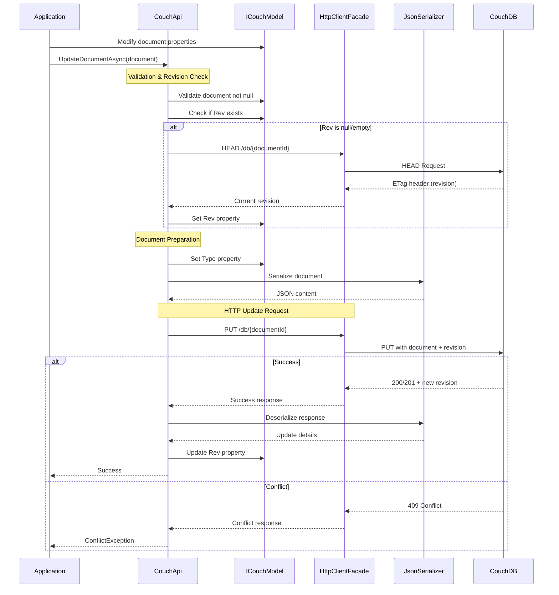

# Document Update Operations

**Navigation**: [Documentation Index](../../DocumentationIndex.md) | [Document Operations Overview](document-operations-overview.md)

## Document Update Overview

The Edge10.CouchDb.Client provides comprehensive document update functionality with automatic revision management, conflict detection, and optimistic concurrency control. All update operations ensure data integrity through CouchDB's MVCC (Multi-Version Concurrency Control) system.

## Update Methods

### 1. Single Document Update

Updates an existing document with automatic revision handling:

```csharp
Task UpdateDocumentAsync<TDocument>(TDocument document) where TDocument : ICouchModel
```

**Key Features:**
- Automatic revision retrieval if not provided
- Conflict detection and exception handling
- Type information preservation
- Full document replacement

### 2. Revision Management

The client automatically manages document revisions:

```csharp
// If document.Rev is null/empty, retrieves current revision before update
if (!isNew && string.IsNullOrWhiteSpace(document.Rev))
{
    var revision = await GetDocumentRevision(documentUri);
    document.Rev = revision;
}
```

## Document Update Flow



## Core Implementation

### Update Document Logic

```csharp
public Task UpdateDocumentAsync<TDocument>(TDocument document)
    where TDocument : ICouchModel
{
    document.ThrowIfNull(nameof(document));

    using (_eventLog.LogDocumentEvent(document.Id, "update"))
        return UpdateOrCreateDocumentAsync(document, false);
}
```

### Unified Update/Create Implementation

```csharp
private async Task UpdateOrCreateDocumentAsync<TDocument>(TDocument document, bool isNew)
    where TDocument : ICouchModel
{
    document.ThrowIfNull(nameof(document));
    var documentUri = GetDocumentUrl(document.Id);
    
    // Retrieve current revision if not provided (for updates)
    if (!isNew && string.IsNullOrWhiteSpace(document.Rev))
    {
        var revision = await GetDocumentRevision(documentUri);
        document.Rev = revision;
    }

    // Set document type for polymorphic serialization
    document.Type = typeof(TDocument).Name;

    var content = SerializeDocument(document);
    var response = await _client.PutAsync(documentUri, content);

    // Handle revision conflicts
    if (response.StatusCode == HttpStatusCode.Conflict)
        throw new ConflictException();

    await response.ThrowErrorIfNotSuccess();
    await UpdateDocumentRevision(document, response);
}
```

### Revision Retrieval

```csharp
private async Task<string> GetDocumentRevision(string documentUri)
{
    // Use HEAD request to get revision without document content
    var httpResponseSendAsync = await _client.SendAsync(new HttpRequestMessage(HttpMethod.Head, documentUri));
    await httpResponseSendAsync.ThrowErrorIfNotSuccess();

    return httpResponseSendAsync.Headers.ETag.Tag.Replace('\"', ' ').Trim();
}
```

### Response Processing

```csharp
private static async Task UpdateDocumentRevision<TDocument>(TDocument document, HttpResponseMessage response) 
    where TDocument : ICouchModel
{
    var responseContent = await response.Content.ReadAsStringAsync();
    var updateDetails = JsonConvert.DeserializeObject<CouchUpdateResponse>(responseContent);
    document.Rev = updateDetails.Rev;
}
```

## Conflict Handling

### Understanding CouchDB Conflicts

CouchDB uses optimistic concurrency control:
- Each document has a revision (`_rev`) field
- Updates must provide the current revision
- If another client updates the document first, a conflict occurs
- HTTP 409 Conflict is returned for revision mismatches

### Conflict Resolution Strategies

#### 1. Optimistic Retry Pattern

```csharp
public async Task<bool> TryUpdateDocumentWithRetry<TDocument>(
    TDocument document, 
    int maxRetries = 3,
    Func<TDocument, TDocument, TDocument> conflictResolver = null)
    where TDocument : ICouchModel
{
    for (int attempt = 0; attempt < maxRetries; attempt++)
    {
        try
        {
            await couchApi.UpdateDocumentAsync(document);
            return true;
        }
        catch (ConflictException)
        {
            if (attempt == maxRetries - 1)
                return false;
            
            // Get the latest version
            var latest = await couchApi.GetDocumentAsync<TDocument>(document.Id);
            
            if (conflictResolver != null)
            {
                document = conflictResolver(document, latest);
            }
            else
            {
                // Default: use latest revision, keep local changes
                document.Rev = latest.Rev;
            }
        }
    }
    
    return false;
}
```

#### 2. Latest Wins Strategy

```csharp
public async Task UpdateDocumentLatestWins<TDocument>(TDocument document)
    where TDocument : ICouchModel
{
    while (true)
    {
        try
        {
            await couchApi.UpdateDocumentAsync(document);
            return;
        }
        catch (ConflictException)
        {
            // Get latest revision and retry
            var latest = await couchApi.GetDocumentAsync<TDocument>(document.Id);
            document.Rev = latest.Rev;
        }
    }
}
```

#### 3. Custom Merge Strategy

```csharp
public async Task UpdateDocumentWithMerge<TDocument>(TDocument localDocument)
    where TDocument : ICouchModel, IMergeable<TDocument>
{
    try
    {
        await couchApi.UpdateDocumentAsync(localDocument);
    }
    catch (ConflictException)
    {
        var serverDocument = await couchApi.GetDocumentAsync<TDocument>(localDocument.Id);
        var mergedDocument = localDocument.MergeWith(serverDocument);
        
        await couchApi.UpdateDocumentAsync(mergedDocument);
    }
}

public interface IMergeable<T>
{
    T MergeWith(T other);
}
```

## Usage Examples

### Basic Document Update

```csharp
// Retrieve document
var customer = await couchApi.GetDocumentAsync<CustomerDocument>("customer-123");

// Modify properties
customer.Email = "newemail@example.com";
customer.LastModified = DateTime.UtcNow;

// Update document
try
{
    await couchApi.UpdateDocumentAsync(customer);
    Console.WriteLine($"Updated customer. New revision: {customer.Rev}");
}
catch (ConflictException)
{
    Console.WriteLine("Document was modified by another process");
}
```

### Update with Conflict Resolution

```csharp
public async Task UpdateCustomerWithRetry(CustomerDocument customer)
{
    const int maxRetries = 3;
    
    for (int attempt = 1; attempt <= maxRetries; attempt++)
    {
        try
        {
            await couchApi.UpdateDocumentAsync(customer);
            logger.LogInformation("Customer updated successfully on attempt {Attempt}", attempt);
            return;
        }
        catch (ConflictException)
        {
            if (attempt == maxRetries)
            {
                logger.LogError("Failed to update customer after {MaxRetries} attempts", maxRetries);
                throw;
            }
            
            logger.LogWarning("Conflict detected on attempt {Attempt}, retrying...", attempt);
            
            // Get latest version and merge changes
            var latestCustomer = await couchApi.GetDocumentAsync<CustomerDocument>(customer.Id);
            
            // Apply business logic for merging
            customer.Rev = latestCustomer.Rev;
            // Preserve our changes, but use latest timestamp if newer
            if (latestCustomer.LastModified > customer.LastModified)
            {
                customer.LastModified = latestCustomer.LastModified;
            }
        }
    }
}
```

### Partial Update Pattern

```csharp
public async Task UpdateCustomerEmail(string customerId, string newEmail)
{
    var customer = await couchApi.GetDocumentAsync<CustomerDocument>(customerId);
    
    // Only update specific field
    customer.Email = newEmail;
    customer.LastModified = DateTime.UtcNow;
    
    await couchApi.UpdateDocumentAsync(customer);
}
```

### Conditional Update

```csharp
public async Task<bool> UpdateCustomerIfNotModified(CustomerDocument customer, DateTime lastKnownModification)
{
    // Re-fetch to check for modifications
    var current = await couchApi.GetDocumentAsync<CustomerDocument>(customer.Id);
    
    if (current.LastModified > lastKnownModification)
    {
        // Document was modified by another process
        return false;
    }
    
    // Safe to update
    customer.Rev = current.Rev;
    await couchApi.UpdateDocumentAsync(customer);
    return true;
}
```

### Atomic Field Update

```csharp
public async Task IncrementCustomerScore(string customerId, int increment)
{
    while (true)
    {
        try
        {
            var customer = await couchApi.GetDocumentAsync<CustomerDocument>(customerId);
            customer.Score += increment;
            customer.LastModified = DateTime.UtcNow;
            
            await couchApi.UpdateDocumentAsync(customer);
            return;
        }
        catch (ConflictException)
        {
            // Retry with fresh data
            await Task.Delay(TimeSpan.FromMilliseconds(100 + Random.Shared.Next(100)));
        }
    }
}
```

## Advanced Patterns

### Update with Validation

```csharp
public class ValidatedCustomerDocument : CouchModelBase
{
    public string Name { get; set; }
    public string Email { get; set; }
    public DateTime LastModified { get; set; }
    
    public void ValidateForUpdate()
    {
        if (IsNew)
            throw new InvalidOperationException("Cannot update a new document");
            
        if (string.IsNullOrWhiteSpace(Id))
            throw new InvalidOperationException("Document ID is required for updates");
            
        if (string.IsNullOrWhiteSpace(Rev))
            throw new InvalidOperationException("Document revision is required for updates");
            
        if (string.IsNullOrWhiteSpace(Name))
            throw new ArgumentException("Name is required");
            
        if (!IsValidEmail(Email))
            throw new ArgumentException("Invalid email format");
    }
    
    private bool IsValidEmail(string email) => 
        !string.IsNullOrWhiteSpace(email) && email.Contains("@");
}

// Usage
customer.ValidateForUpdate();
await couchApi.UpdateDocumentAsync(customer);
```

### Transactional Update Pattern

```csharp
public async Task<T> UpdateDocumentTransactionally<T>(string documentId, Func<T, T> updater)
    where T : ICouchModel
{
    while (true)
    {
        try
        {
            // Get current state
            var document = await couchApi.GetDocumentAsync<T>(documentId);
            
            // Apply transformation
            var updatedDocument = updater(document);
            
            // Ensure revision is preserved
            updatedDocument.Rev = document.Rev;
            
            // Attempt update
            await couchApi.UpdateDocumentAsync(updatedDocument);
            
            return updatedDocument;
        }
        catch (ConflictException)
        {
            // Retry with fresh data
            await Task.Delay(TimeSpan.FromMilliseconds(50));
        }
    }
}

// Usage
var updatedCustomer = await UpdateDocumentTransactionally<CustomerDocument>(
    "customer-123",
    customer => 
    {
        customer.Score += 10;
        customer.LastModified = DateTime.UtcNow;
        return customer;
    }
);
```

## Performance Considerations

### Batch Updates

For multiple documents, use bulk operations instead:

```csharp
// Instead of multiple UpdateDocumentAsync calls
var customers = await couchApi.GetDocumentsAsync<CustomerDocument>(customerIds);

foreach (var customer in customers)
{
    customer.Status = "Updated";
    customer.LastModified = DateTime.UtcNow;
}

// Single bulk operation
await couchApi.BulkUpdateAsync(customers);
```

### Revision Caching

Cache revisions to avoid HEAD requests:

```csharp
private readonly ConcurrentDictionary<string, string> _revisionCache = new();

public async Task UpdateDocumentWithCachedRevision<T>(T document) where T : ICouchModel
{
    if (string.IsNullOrWhiteSpace(document.Rev))
    {
        if (_revisionCache.TryGetValue(document.Id, out var cachedRev))
        {
            document.Rev = cachedRev;
        }
    }
    
    try
    {
        await couchApi.UpdateDocumentAsync(document);
        _revisionCache[document.Id] = document.Rev;
    }
    catch (ConflictException)
    {
        // Remove stale revision from cache
        _revisionCache.TryRemove(document.Id, out _);
        throw;
    }
}
```

## Error Handling

### Comprehensive Update Error Handling

```csharp
public async Task<UpdateResult> SafeUpdateDocument<T>(T document) where T : ICouchModel
{
    try
    {
        await couchApi.UpdateDocumentAsync(document);
        return UpdateResult.Success(document.Rev);
    }
    catch (ConflictException)
    {
        return UpdateResult.Conflict("Document was modified by another process");
    }
    catch (HttpRequestException ex) when (ex.Message.Contains("404"))
    {
        return UpdateResult.NotFound("Document no longer exists");
    }
    catch (JsonException ex)
    {
        return UpdateResult.SerializationError($"Failed to serialize document: {ex.Message}");
    }
    catch (Exception ex)
    {
        logger.LogError(ex, "Unexpected error updating document {DocumentId}", document.Id);
        return UpdateResult.UnknownError(ex.Message);
    }
}

public class UpdateResult
{
    public bool IsSuccess { get; private set; }
    public string ErrorMessage { get; private set; }
    public string NewRevision { get; private set; }
    public UpdateErrorType ErrorType { get; private set; }
    
    public static UpdateResult Success(string revision) => 
        new UpdateResult { IsSuccess = true, NewRevision = revision };
        
    public static UpdateResult Conflict(string message) => 
        new UpdateResult { ErrorType = UpdateErrorType.Conflict, ErrorMessage = message };
        
    // Additional factory methods...
}
```

## Testing Patterns

### Unit Testing Updates

```csharp
[Test]
public async Task UpdateDocumentAsync_Should_UpdateRevision()
{
    // Arrange
    var mockHttpClient = new Mock<IHttpClientFacade>();
    var document = new TestDocument { Id = "test", Rev = "1-abc", Name = "Updated" };
    
    mockHttpClient.Setup(x => x.PutAsync(It.IsAny<string>(), It.IsAny<HttpContent>()))
              .ReturnsAsync(new HttpResponseMessage(HttpStatusCode.OK)
              {
                  Content = new StringContent("{\"ok\":true,\"id\":\"test\",\"rev\":\"2-def\"}")
              });

    var couchApi = new CouchApi(connectionString, mockHttpClient.Object, mockEventLog.Object, null);

    // Act
    await couchApi.UpdateDocumentAsync(document);

    // Assert
    Assert.That(document.Rev, Is.EqualTo("2-def"));
}

[Test]
public async Task UpdateDocumentAsync_Should_ThrowConflictException_OnConflict()
{
    // Arrange
    var mockHttpClient = new Mock<IHttpClientFacade>();
    var document = new TestDocument { Id = "test", Rev = "1-old", Name = "Updated" };
    
    mockHttpClient.Setup(x => x.PutAsync(It.IsAny<string>(), It.IsAny<HttpContent>()))
              .ReturnsAsync(new HttpResponseMessage(HttpStatusCode.Conflict));

    var couchApi = new CouchApi(connectionString, mockHttpClient.Object, mockEventLog.Object, null);

    // Act & Assert
    Assert.ThrowsAsync<ConflictException>(() => couchApi.UpdateDocumentAsync(document));
}
```

## Best Practices

1. **Always handle conflicts**: Use try-catch for ConflictException
2. **Implement retry logic**: Handle transient conflicts gracefully
3. **Validate before updates**: Check document state and business rules
4. **Use bulk operations**: For multiple documents, prefer BulkUpdateAsync
5. **Cache revisions carefully**: Be aware of stale revision issues
6. **Log update operations**: Maintain audit trails for changes
7. **Test conflict scenarios**: Ensure robust conflict handling
8. **Consider update frequency**: High-frequency updates may need special handling
9. **Preserve important fields**: Merge strategies should protect critical data
10. **Monitor conflict rates**: High conflict rates may indicate design issues

---

*For more information about document update operations, see [Document Operations Overview](document-operations-overview.md) and [Bulk Operations](bulk-operations.md).*