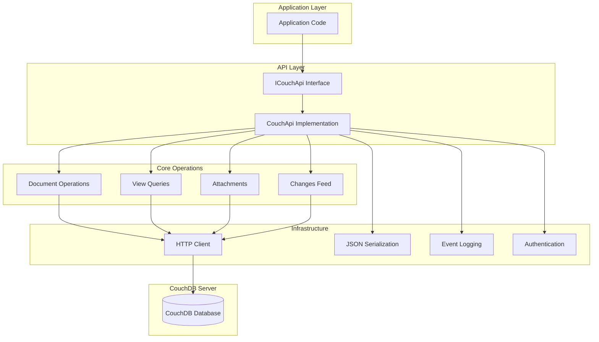

# General Functionality

**Navigation**: [Documentation Index](../DocumentationIndex.md) | [Main Documentation](../Edge10.CouchDb.Client.md)

## Overview

Edge10.CouchDb.Client provides comprehensive functionality for interacting with CouchDB databases through a clean, type-safe .NET API. The library covers all major CouchDB operations while providing .NET-specific conveniences and patterns.

## Core Functionality Areas

### 1. Document Operations
Complete CRUD (Create, Read, Update, Delete) operations for CouchDB documents with full type safety and automatic revision management.

**Key Features:**
- Generic document retrieval with type safety
- Automatic ID generation for new documents
- Revision conflict detection and handling
- Bulk operations for performance optimization
- Document existence checking

### 2. View Queries
Comprehensive support for CouchDB views including map/reduce operations, custom key queries, and result pagination.

**Key Features:**
- Parameterized view queries with full CouchDB parameter support
- Key-based filtering and range queries
- Paged result processing
- Both document and value extraction from view results
- List function support

### 3. Attachment Management
Complete file attachment lifecycle management with stream-based operations for efficient handling of large files.

**Key Features:**
- Stream-based attachment upload and download
- Attachment existence verification
- Metadata extraction and management
- Content-type preservation
- Automatic revision handling for attachment operations

### 4. Changes Feed Integration
Real-time change monitoring through CouchDB's changes feed with configurable filtering and since parameters.

**Key Features:**
- Real-time change notifications
- Configurable change filters
- Since parameter for resumable monitoring
- Both typed and untyped change result support
- Additional parameter support for custom filters

### 5. Connection Management
Robust connection handling with authentication, timeout management, and proper resource disposal.

**Key Features:**
- HTTP Basic authentication
- Configurable timeout settings
- Connection string builder for configuration
- Proper resource disposal patterns
- Thread-safe operations

**Important Considerations:**
- **Concurrent Operations**: Concurrent operations are unadvised due to CouchDB's MVCC nature and potential for increased revision conflicts

## Functional Architecture Overview



## Usage Patterns

### Basic Document Operations

```csharp
// Initialize client
var connectionString = new CouchDbConnectionStringBuilder
{
    Server = "localhost",
    Port = 5984,
    DatabaseName = "mydb",
    User = "admin",
    Password = "password"
};

using var couchApi = new CouchApi(connectionString);

// Create document
var customer = new CustomerDocument 
{ 
    Name = "John Doe", 
    Email = "john@example.com" 
};
await couchApi.CreateDocumentAsync(customer);

// Retrieve document
var retrieved = await couchApi.GetDocumentAsync<CustomerDocument>(customer.Id);

// Update document
retrieved.Email = "newemail@example.com";
await couchApi.UpdateDocumentAsync(retrieved);

// Delete document
retrieved.Deleted = true;
await couchApi.BulkUpdateAsync(new[] { retrieved });
```

### View Query Operations

```csharp
// Simple view query
var viewParams = new ViewParameters("by_name", "customers")
{
    IncludeDocs = true,
    Limit = 10,
    Descending = true
};

var customers = await couchApi.GetViewDocumentsAsync<CustomerDocument>(viewParams);

// Key-based query
var keyParams = new ViewParameters("by_status", "orders")
{
    Key = new KeyParameter("pending"),
    IncludeDocs = true
};

var pendingOrders = await couchApi.GetViewDocumentsAsync<OrderDocument>(keyParams);

// Paged query
var pagedParams = new ViewParameters("all_customers", "customers")
{
    Limit = 25,
    Skip = 0
};

var pagedResult = await couchApi.GetPagedViewDocumentsAsync<CustomerDocument>(pagedParams);
Console.WriteLine($"Page contains {pagedResult.Results.Count} of {pagedResult.TotalResults} total");
```

### Attachment Operations

```csharp
// Upload attachment
var imageBytes = File.ReadAllBytes("profile.jpg");
var imageContent = new ByteArrayContent(imageBytes);
imageContent.Headers.ContentType = new MediaTypeHeaderValue("image/jpeg");

await couchApi.PutAsync(customer.Id, "profile.jpg", imageContent);

// Check attachment existence
bool hasProfile = await couchApi.AttachmentExistsAsync(customer.Id, "profile.jpg");

// Download attachment
using var attachmentStream = await couchApi.GetAttachmentStreamAsync(customer.Id, "profile.jpg");
using var fileStream = File.Create("downloaded_profile.jpg");
await attachmentStream.CopyToAsync(fileStream);

// Delete attachment
await couchApi.DeleteAttachmentAsync(customer.Id, "profile.jpg");
```

### Changes Feed Monitoring

```csharp
// Monitor all changes
var changesParams = new ChangesParameters
{
    IncludeDocs = true,
    Limit = 100
};

var changes = await couchApi.GetChangesAsync<CustomerDocument>(changesParams);
foreach (var change in changes.Results)
{
    Console.WriteLine($"Document {change.Id} changed: {change.Document?.Name}");
}

// Monitor with filters
var filteredParams = new ChangesParameters
{
    ChangesFilter = "customer/active_only",
    IncludeDocs = true,
    ChangesSince = lastSequence
};

filteredParams.AdditionalParameters.Add("status", "active");
var filteredChanges = await couchApi.GetChangesAsync<CustomerDocument>(filteredParams);
```

## Error Handling Patterns

### Conflict Resolution

```csharp
try
{
    await couchApi.UpdateDocumentAsync(document);
}
catch (ConflictException)
{
    // Handle revision conflicts
    var latest = await couchApi.GetDocumentAsync<DocumentType>(document.Id);
    
    // Apply business logic for conflict resolution
    MergeChanges(document, latest);
    document.Rev = latest.Rev;
    
    // Retry update
    await couchApi.UpdateDocumentAsync(document);
}
```

### Timeout Handling

```csharp
try
{
    var result = await couchApi.GetViewDocumentsAsync<DocumentType>(viewParams);
}
catch (CouchTimeoutException)
{
    // Handle timeout scenarios
    logger.LogWarning("View query timed out, retrying with smaller limit");
    
    viewParams.Limit = Math.Min(viewParams.Limit ?? 100, 50);
    var result = await couchApi.GetViewDocumentsAsync<DocumentType>(viewParams);
}
```

## Performance Considerations

### Bulk Operations

```csharp
// Efficient bulk processing
var documents = GetDocumentsToUpdate();
var batches = documents.Batch(couchApi.MaxDocumentsPerRequest);

foreach (var batch in batches)
{
    try
    {
        await couchApi.BulkUpdateAsync(batch);
    }
    catch (ConflictException ex)
    {
        // Handle conflicts in batch
        await HandleBulkConflicts(batch, ex);
    }
}
```

### Stream-Based Operations

```csharp
// Efficient large file handling
using var fileStream = File.OpenRead("large_document.pdf");
var streamContent = new StreamContent(fileStream);
streamContent.Headers.ContentType = new MediaTypeHeaderValue("application/pdf");

await couchApi.PutAsync(documentId, "document.pdf", streamContent);
```

### Paging Strategies

```csharp
// Efficient result paging
int pageSize = 25;
int skip = 0;
IPagedResult<DocumentType> page;

do
{
    var viewParams = new ViewParameters("all_docs", "documents")
    {
        Limit = pageSize,
        Skip = skip,
        IncludeDocs = true
    };
    
    page = await couchApi.GetPagedViewDocumentsAsync<DocumentType>(viewParams);
    
    // Process page results
    ProcessDocuments(page.Results);
    
    skip += pageSize;
} 
while (page.Results.Count == pageSize);
```

## Integration Patterns

### Dependency Injection

**Note**: While basic DI patterns are shown below, more comprehensive dependency injection integration guidance would be beneficial for modern .NET applications.

```csharp
// Service registration
services.AddSingleton<ICouchDbConnectionStringBuilder>(provider =>
    new CouchDbConnectionStringBuilder
    {
        Server = configuration["CouchDB:Server"],
        Port = configuration.GetValue<int>("CouchDB:Port"),
        DatabaseName = configuration["CouchDB:Database"],
        User = configuration["CouchDB:User"],
        Password = configuration["CouchDB:Password"]
    });

services.AddScoped<ICouchApi, CouchApi>();

// Usage in service
public class CustomerService
{
    private readonly ICouchApi _couchApi;
    
    public CustomerService(ICouchApi couchApi)
    {
        _couchApi = couchApi;
    }
    
    public async Task<CustomerDocument> GetCustomerAsync(string id)
    {
        return await _couchApi.GetDocumentAsync<CustomerDocument>(id);
    }
}
```

### Event Logging Integration

```csharp
// Custom event logging
public class CustomCouchEventLog : ICouchEventLog
{
    private readonly ILogger<CustomCouchEventLog> _logger;
    
    public CustomCouchEventLog(ILogger<CustomCouchEventLog> logger)
    {
        _logger = logger;
    }
    
    public IDisposable LogDocumentEvent(string documentId, string operation)
    {
        var stopwatch = Stopwatch.StartNew();
        
        return new DisposableWrapper<string>(documentId, id =>
        {
            stopwatch.Stop();
            _logger.LogInformation("CouchDB {Operation} for document {DocumentId} took {ElapsedMs}ms",
                operation, id, stopwatch.ElapsedMilliseconds);
        });
    }
    
    public IDisposable LogViewEvent(IViewParameters viewParameters)
    {
        var stopwatch = Stopwatch.StartNew();
        
        return new DisposableWrapper<IViewParameters>(viewParameters, vp =>
        {
            stopwatch.Stop();
            _logger.LogInformation("CouchDB view {DesignDocument}/{ViewName} took {ElapsedMs}ms",
                vp.DesignDocument, vp.ViewName, stopwatch.ElapsedMilliseconds);
        });
    }
}

// Registration with custom event logging
var couchApi = new CouchApi(connectionString, new CustomCouchEventLog(logger));
```

## Monitoring and Diagnostics

### Connection Health Checking

```csharp
public async Task<bool> CheckDatabaseHealthAsync()
{
    try
    {
        await couchApi.CheckConnection();
        return true;
    }
    catch (Exception ex)
    {
        logger.LogError(ex, "CouchDB connection health check failed");
        return false;
    }
}
```

### Performance Metrics

```csharp
// Track operation performance
public class MetricsCouchApi : ICouchApi
{
    private readonly ICouchApi _inner;
    private readonly IMetrics _metrics;
    
    public async Task<T> GetDocumentAsync<T>(string documentId)
    {
        using var timer = _metrics.Measure.Timer.Time("couchdb.document.get");
        
        try
        {
            var result = await _inner.GetDocumentAsync<T>(documentId);
            _metrics.Measure.Counter.Increment("couchdb.document.get.success");
            return result;
        }
        catch (Exception)
        {
            _metrics.Measure.Counter.Increment("couchdb.document.get.error");
            throw;
        }
    }
    
    // Implement other methods with similar metrics
}
```

---

*This general functionality overview provides a comprehensive understanding of the library's capabilities and common usage patterns. For detailed information about specific feature areas, refer to the dedicated functionality documentation sections.*