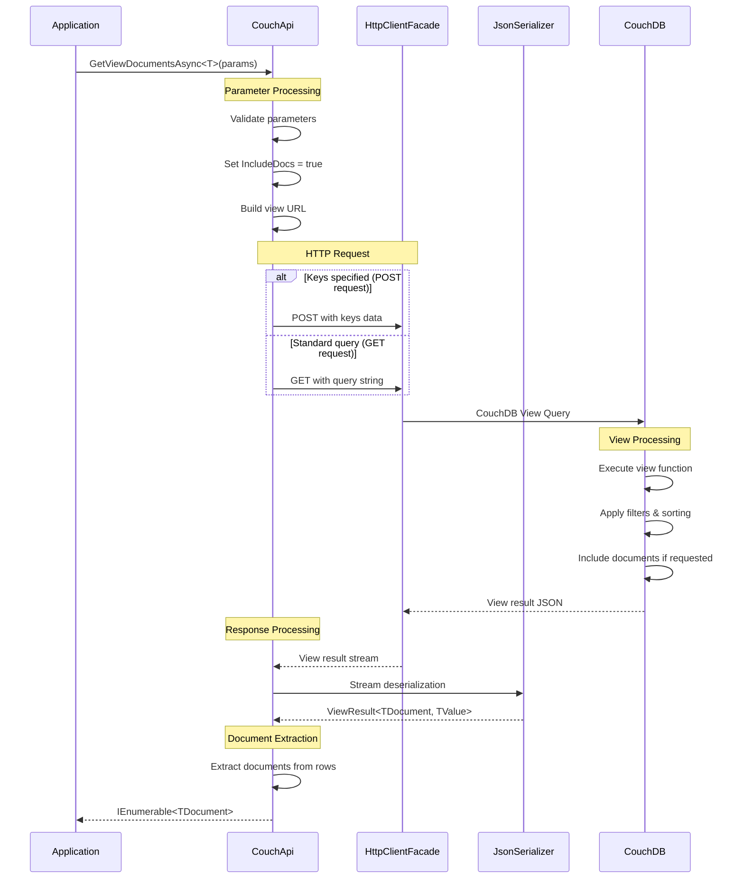

# View Result Processing

**Navigation**: [Documentation Index](../../DocumentationIndex.md) | [View Queries Overview](view-queries-overview.md)

## Result Processing Overview

The Edge10.CouchDb.Client provides comprehensive view result processing with multiple specialized methods for different use cases. The client handles deserialization, pagination, and type conversion automatically while providing access to both document data and view-specific information.

## View Result Methods

### 1. Document Retrieval Methods

#### GetViewDocumentsAsync<TDocument>
Retrieves full documents returned by a view (requires `IncludeDocs = true`):

```csharp
Task<IEnumerable<TDocument>> GetViewDocumentsAsync<TDocument>(IViewParameters viewParameters)
```

#### GetPagedViewDocumentsAsync<TDocument>
Retrieves documents with pagination information:

```csharp
Task<IPagedResult<TDocument>> GetPagedViewDocumentsAsync<TDocument>(IViewParameters viewParameters)
```

### 2. Value Retrieval Methods

#### GetViewRowsAsync<TRow>
Retrieves view values (from the view's emit value) without documents:

```csharp
Task<IEnumerable<TRow>> GetViewRowsAsync<TRow>(IViewParameters viewParameters)
```

#### GetViewDocumentIdsAsync
Retrieves only the document IDs from a view:

```csharp
Task<IEnumerable<string>> GetViewDocumentIdsAsync(IViewParameters viewParameters)
```

### 3. Generic Result Processing

#### GetListResult<TResult>
Provides access to the complete view result structure:

```csharp
Task<TResult> GetListResult<TResult>(IViewParameters viewParameters)
```

## View Result Structure

### ViewResult<TDocument, TValue> Structure

```csharp
public class ViewResult<TDocument, TValue>
{
    [JsonProperty("total_rows")]
    public int TotalRows { get; set; }

    [JsonProperty("offset")]
    public int Offset { get; set; }

    [JsonProperty("rows")]
    public List<ViewResultRow<TDocument, TValue>> Rows { get; set; }
}

public class ViewResultRow<TDocument, TValue>
{
    [JsonProperty("id")]
    public string Id { get; set; }

    [JsonProperty("key")]
    public object Key { get; set; }

    [JsonProperty("value")]
    public TValue Value { get; set; }

    [JsonProperty("doc")]
    public TDocument Document { get; set; }
}
```

### PagedResult<T> Implementation

```csharp
public class PagedResult<T> : IPagedResult<T>
{
    public PagedResult(IEnumerable<T> data, long totalCount)
    {
        Data = data;
        TotalCount = totalCount;
    }

    public IEnumerable<T> Data { get; }
    public long TotalCount { get; }
}

public interface IPagedResult<T>
{
    IEnumerable<T> Data { get; }
    long TotalCount { get; }
}
```

## Result Processing Flow



## Core Implementation

### Document Retrieval Implementation

```csharp
public async Task<IEnumerable<TDocument>> GetViewDocumentsAsync<TDocument>(IViewParameters viewParameters)
{
    var viewResult = await GetListResult<ViewResult<TDocument, object>>(viewParameters);
    return viewResult.Rows.Select(r => r.Document);
}
```

### Value Retrieval Implementation

```csharp
public async Task<IEnumerable<TRow>> GetViewRowsAsync<TRow>(IViewParameters viewParameters)
{
    viewParameters.ThrowIfNull(nameof(viewParameters));

    // Force IncludeDocs to false since we only want values
    viewParameters.IncludeDocs = false;

    var viewResult = await GetListResult<ViewResult<object, TRow>>(viewParameters);
    return viewResult.Rows.Select(r => r.Value);
}
```

### Paged Results Implementation

```csharp
public async Task<IPagedResult<TDocument>> GetPagedViewDocumentsAsync<TDocument>(IViewParameters viewParameters)
{
    // Get documents with reduce disabled
    viewParameters.Reduce = false;
    var viewResult = await GetListResult<ViewResult<TDocument, object>>(viewParameters);
    
    // Get total count with reduce enabled
    viewParameters.Reduce = true;
    viewParameters.Skip = null;
    viewParameters.Limit = null;
    viewParameters.IncludeDocs = false;
    var countResult = await GetListResult<ViewResult<object, long>>(viewParameters);
    var count = countResult.Rows.FirstOrDefault()?.Value ?? 0;
    
    return new PagedResult<TDocument>(viewResult.Rows.Select(r => r.Document).ToArray(), count);
}
```

### Generic Result Processing

```csharp
public async Task<TResult> GetListResult<TResult>(IViewParameters viewParameters)
{
    viewParameters.ThrowIfNull(nameof(viewParameters));

    using (_eventLog.LogViewEvent(viewParameters))
    {
        var result = await GetViewHttpResponse(viewParameters);
        return GetSerializedContent<TResult>(result);
    }
}

private async Task<Stream> GetViewHttpResponse(IViewParameters viewParameters)
{
    var url = GetViewUrl(viewParameters);

    if (viewParameters.Keys != null)
    {
        // POST request for key-based queries
        var keyData = new { keys = viewParameters.Keys };

        using (var keysContent = new ObjectContent<dynamic>(keyData, new JsonMediaTypeFormatter()))
        using (var request = new HttpRequestMessage(HttpMethod.Post, url))
        {
            request.Content = keysContent;
            var response = await _client.SendAsync(request, HttpCompletionOption.ResponseHeadersRead);
            await response.ThrowErrorIfNotSuccess(CouchExceptionFactory);
            return await response.Content.ReadAsStreamAsync();
        }
    }

    return await _client.GetStreamAsync(url);
}
```

## Processing Different Result Types

### Standard Document Results

```csharp
public async Task<List<CustomerDocument>> GetCustomersByCity(string city)
{
    var parameters = new ViewParameters("customers-by-city", "customers")
    {
        Key = new KeyParameter(city),
        IncludeDocs = true
    };

    var customers = await couchApi.GetViewDocumentsAsync<CustomerDocument>(parameters);
    return customers.ToList();
}
```

### View Value Processing

```csharp
public async Task<List<string>> GetUniqueCustomerEmails()
{
    var parameters = new ViewParameters("unique-customer-emails", "customers")
    {
        IncludeDocs = false // Only need the emitted values
    };

    var emails = await couchApi.GetViewRowsAsync<string>(parameters);
    return emails.ToList();
}
```

### Complex Value Objects

```csharp
public class CustomerSummary
{
    public string Name { get; set; }
    public string Email { get; set; }
    public int OrderCount { get; set; }
    public decimal TotalSpent { get; set; }
}

public async Task<List<CustomerSummary>> GetCustomerSummaries()
{
    var parameters = new ViewParameters("customer-summaries", "customers")
    {
        IncludeDocs = false
    };

    var summaries = await couchApi.GetViewRowsAsync<CustomerSummary>(parameters);
    return summaries.ToList();
}
```

### Reduce Function Results

```csharp
public async Task<Dictionary<string, int>> GetOrderCountsByCity()
{
    var parameters = new ViewParameters("order-counts-by-city", "orders")
    {
        Reduce = true,
        Group = true,
        IncludeDocs = false
    };

    // Get the complete view result to access both keys and values
    var viewResult = await couchApi.GetListResult<ViewResult<object, int>>(parameters);
    
    var results = new Dictionary<string, int>();
    foreach (var row in viewResult.Rows)
    {
        var city = row.Key?.ToString();
        if (!string.IsNullOrEmpty(city))
        {
            results[city] = row.Value;
        }
    }
    
    return results;
}
```

## Advanced Result Processing

### Multi-Level Grouping Results

```csharp
public class RegionalSalesData
{
    public string Region { get; set; }
    public string Month { get; set; }
    public decimal TotalSales { get; set; }
}

public async Task<List<RegionalSalesData>> GetRegionalSalesData(string region)
{
    var parameters = new ViewParameters("sales-by-region-and-month", "sales")
    {
        Reduce = true,
        GroupLevel = 2,
        StartKey = new object[] { region },
        EndKey = new object[] { region, new object() }, // End with high value
        IncludeDocs = false
    };

    var viewResult = await couchApi.GetListResult<ViewResult<object, decimal>>(parameters);
    
    return viewResult.Rows.Select(row =>
    {
        var keyArray = (object[])row.Key;
        return new RegionalSalesData
        {
            Region = keyArray[0]?.ToString(),
            Month = keyArray[1]?.ToString(),
            TotalSales = row.Value
        };
    }).ToList();
}
```

### Paged Result Processing

```csharp
public async Task<PagedCustomerResult> GetCustomersPagedWithMetadata(int page, int pageSize)
{
    var parameters = new ViewParameters("customers-by-name", "customers")
    {
        Limit = pageSize,
        Skip = page * pageSize,
        IncludeDocs = true
    };

    var pagedResult = await couchApi.GetPagedViewDocumentsAsync<CustomerDocument>(parameters);
    
    return new PagedCustomerResult
    {
        Customers = pagedResult.Data.ToList(),
        TotalCount = pagedResult.TotalCount,
        Page = page,
        PageSize = pageSize,
        TotalPages = (int)Math.Ceiling((double)pagedResult.TotalCount / pageSize)
    };
}

public class PagedCustomerResult
{
    public List<CustomerDocument> Customers { get; set; }
    public long TotalCount { get; set; }
    public int Page { get; set; }
    public int PageSize { get; set; }
    public int TotalPages { get; set; }
}
```

### Document ID Collection Processing

```csharp
public async Task<List<string>> GetActiveCustomerIds()
{
    var parameters = new ViewParameters("active-customers", "customers")
    {
        IncludeDocs = false // Only need IDs, not full documents
    };

    var customerIds = await couchApi.GetViewDocumentIdsAsync(parameters);
    return customerIds.ToList();
}

// Use the IDs to fetch documents in batches
public async Task<List<CustomerDocument>> GetActiveCustomersInBatches(int batchSize = 100)
{
    var customerIds = await GetActiveCustomerIds();
    var customers = new List<CustomerDocument>();
    
    for (int i = 0; i < customerIds.Count; i += batchSize)
    {
        var batch = customerIds.Skip(i).Take(batchSize);
        var batchCustomers = await couchApi.GetDocumentsAsync<CustomerDocument>(batch);
        customers.AddRange(batchCustomers);
    }
    
    return customers;
}
```

## Error Handling in Result Processing

### View-Specific Error Handling

```csharp
public async Task<ViewResultWrapper<T>> SafeGetViewDocuments<T>(IViewParameters parameters)
{
    try
    {
        var documents = await couchApi.GetViewDocumentsAsync<T>(parameters);
        return ViewResultWrapper<T>.Success(documents);
    }
    catch (HttpRequestException ex) when (ex.Message.Contains("404"))
    {
        return ViewResultWrapper<T>.ViewNotFound();
    }
    catch (CouchTimeoutException)
    {
        return ViewResultWrapper<T>.Timeout();
    }
    catch (JsonException ex)
    {
        return ViewResultWrapper<T>.SerializationError(ex.Message);
    }
    catch (Exception ex)
    {
        return ViewResultWrapper<T>.UnknownError(ex.Message);
    }
}

public class ViewResultWrapper<T>
{
    public bool IsSuccess { get; private set; }
    public IEnumerable<T> Data { get; private set; }
    public ViewErrorType ErrorType { get; private set; }
    public string ErrorMessage { get; private set; }

    public static ViewResultWrapper<T> Success(IEnumerable<T> data) =>
        new ViewResultWrapper<T> { IsSuccess = true, Data = data };

    public static ViewResultWrapper<T> ViewNotFound() =>
        new ViewResultWrapper<T> { ErrorType = ViewErrorType.ViewNotFound };

    public static ViewResultWrapper<T> Timeout() =>
        new ViewResultWrapper<T> { ErrorType = ViewErrorType.Timeout };

    public static ViewResultWrapper<T> SerializationError(string message) =>
        new ViewResultWrapper<T> { ErrorType = ViewErrorType.SerializationError, ErrorMessage = message };

    public static ViewResultWrapper<T> UnknownError(string message) =>
        new ViewResultWrapper<T> { ErrorType = ViewErrorType.UnknownError, ErrorMessage = message };
}

public enum ViewErrorType
{
    None,
    ViewNotFound,
    Timeout,
    SerializationError,
    UnknownError
}
```

## Performance Optimization

### Stream Processing for Large Results

```csharp
public async Task ProcessLargeViewResults<T>(IViewParameters parameters, Func<T, Task> processor)
{
    parameters.IncludeDocs = true;
    
    // Process in batches to avoid memory issues
    const int batchSize = 1000;
    int skip = 0;
    
    while (true)
    {
        parameters.Skip = skip;
        parameters.Limit = batchSize;
        
        var batch = await couchApi.GetViewDocumentsAsync<T>(parameters);
        var batchList = batch.ToList();
        
        if (!batchList.Any())
            break;
            
        // Process each document
        foreach (var document in batchList)
        {
            await processor(document);
        }
        
        if (batchList.Count < batchSize)
            break; // Last batch
            
        skip += batchSize;
    }
}
```

### Efficient Key-Based Processing

```csharp
public async Task<Dictionary<string, List<T>>> GroupDocumentsByKey<T>(
    IViewParameters parameters,
    Func<ViewResultRow<T, object>, string> keyExtractor)
{
    var viewResult = await couchApi.GetListResult<ViewResult<T, object>>(parameters);
    
    return viewResult.Rows
        .GroupBy(row => keyExtractor(row))
        .ToDictionary(g => g.Key, g => g.Select(row => row.Document).ToList());
}
```

## Result Transformation and Mapping

### Result Transformation Patterns

```csharp
public class ResultTransformer
{
    public static IEnumerable<TTarget> TransformResults<TSource, TTarget>(
        IEnumerable<TSource> source,
        Func<TSource, TTarget> mapper)
    {
        return source.Select(mapper);
    }
    
    public static async Task<IEnumerable<TTarget>> TransformResultsAsync<TSource, TTarget>(
        IEnumerable<TSource> source,
        Func<TSource, Task<TTarget>> asyncMapper)
    {
        var tasks = source.Select(asyncMapper);
        return await Task.WhenAll(tasks);
    }
}

// Usage example
var customers = await couchApi.GetViewDocumentsAsync<CustomerDocument>(parameters);
var customerDTOs = ResultTransformer.TransformResults(customers, customer => new CustomerDTO
{
    Id = customer.Id,
    Name = customer.Name,
    Email = customer.Email,
    IsActive = !customer.Deleted
});
```

### Aggregation and Summary Processing

```csharp
public class ViewAggregator
{
    public static async Task<TSummary> AggregateViewResults<TDocument, TSummary>(
        IViewParameters parameters,
        ICouchApi couchApi,
        Func<IEnumerable<TDocument>, TSummary> aggregator)
    {
        var documents = await couchApi.GetViewDocumentsAsync<TDocument>(parameters);
        return aggregator(documents);
    }
}

// Usage example
var salesSummary = await ViewAggregator.AggregateViewResults<SalesDocument, SalesSummary>(
    parameters,
    couchApi,
    sales => new SalesSummary
    {
        TotalSales = sales.Sum(s => s.Amount),
        AverageSale = sales.Average(s => s.Amount),
        SalesCount = sales.Count(),
        TopCustomer = sales.GroupBy(s => s.CustomerId)
                          .OrderByDescending(g => g.Sum(s => s.Amount))
                          .First().Key
    });
```

## Testing View Result Processing

### Unit Testing View Results

```csharp
[Test]
public async Task GetViewDocumentsAsync_Should_ReturnTypedDocuments()
{
    // Arrange
    var mockViewResult = new ViewResult<TestDocument, object>
    {
        TotalRows = 2,
        Offset = 0,
        Rows = new List<ViewResultRow<TestDocument, object>>
        {
            new ViewResultRow<TestDocument, object>
            {
                Id = "doc1",
                Key = "key1",
                Document = new TestDocument { Id = "doc1", Name = "Test 1" }
            },
            new ViewResultRow<TestDocument, object>
            {
                Id = "doc2", 
                Key = "key2",
                Document = new TestDocument { Id = "doc2", Name = "Test 2" }
            }
        }
    };

    var mockHttpClient = new Mock<IHttpClientFacade>();
    mockHttpClient.Setup(x => x.GetStreamAsync(It.IsAny<string>()))
              .ReturnsAsync(CreateStreamFromObject(mockViewResult));

    var couchApi = new CouchApi(connectionString, mockHttpClient.Object, mockEventLog.Object, null);
    var parameters = new ViewParameters("test-view", "test-design");

    // Act
    var results = await couchApi.GetViewDocumentsAsync<TestDocument>(parameters);

    // Assert
    var resultsList = results.ToList();
    Assert.That(resultsList, Has.Count.EqualTo(2));
    Assert.That(resultsList[0].Name, Is.EqualTo("Test 1"));
    Assert.That(resultsList[1].Name, Is.EqualTo("Test 2"));
}
```

### Integration Testing

```csharp
[Test]
public async Task ViewResultProcessing_Integration_Should_HandleComplexQueries()
{
    using var couchApi = new CouchApi(GetTestConnectionString());
    
    // Create test documents
    var testDocs = new[]
    {
        new CustomerDocument { Name = "Alice", City = "Chicago", Status = "Active" },
        new CustomerDocument { Name = "Bob", City = "Chicago", Status = "Inactive" },
        new CustomerDocument { Name = "Charlie", City = "New York", Status = "Active" }
    };
    
    await couchApi.BulkUpdateAsync(testDocs);
    
    // Test view query
    var parameters = new ViewParameters("customers-by-city-and-status", "test-design")
    {
        StartKey = new object[] { "Chicago" },
        EndKey = new object[] { "Chicago", new object() },
        IncludeDocs = true
    };
    
    var results = await couchApi.GetViewDocumentsAsync<CustomerDocument>(parameters);
    var resultsList = results.ToList();
    
    Assert.That(resultsList, Has.Count.EqualTo(2));
    Assert.That(resultsList.All(c => c.City == "Chicago"), Is.True);
}
```

## Best Practices

1. **Choose the right method**: Use `GetViewDocumentsAsync` for documents, `GetViewRowsAsync` for values
2. **Handle large result sets**: Implement batching and pagination for large datasets
3. **Process results efficiently**: Use appropriate data structures and algorithms
4. **Cache expensive view results**: Consider caching for frequently accessed views
5. **Handle view errors gracefully**: Implement proper error handling for view failures
6. **Monitor view performance**: Track query times and result sizes
7. **Use typed result processing**: Leverage strong typing for better code maintainability
8. **Validate view result structure**: Ensure view design matches expected result format
9. **Test with realistic data**: Use production-like data volumes for testing
10. **Document result expectations**: Clearly specify expected result formats and structures

---

*For more information about view result processing, see [View Queries Overview](view-queries-overview.md) and [View Parameters](view-parameters.md).*