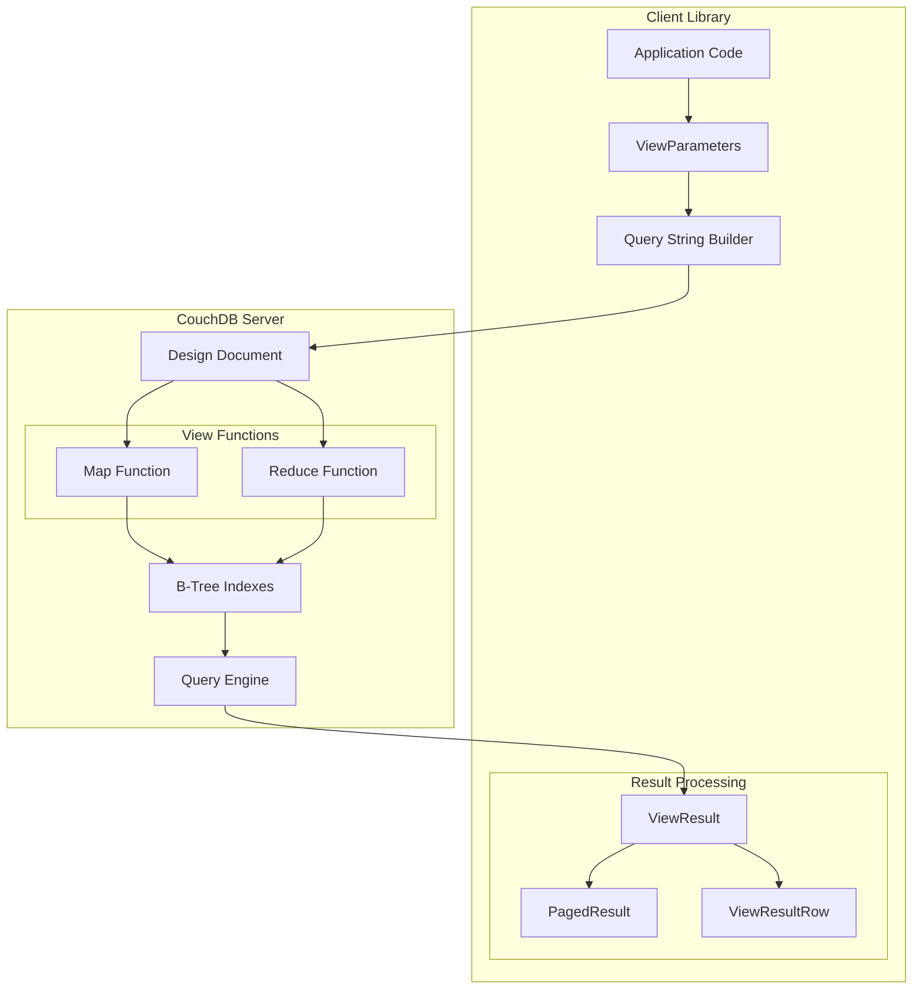
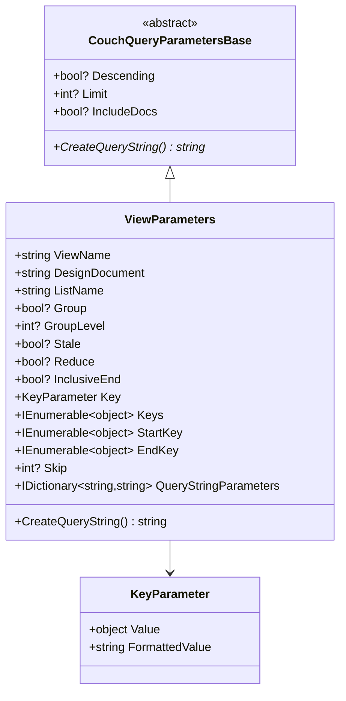
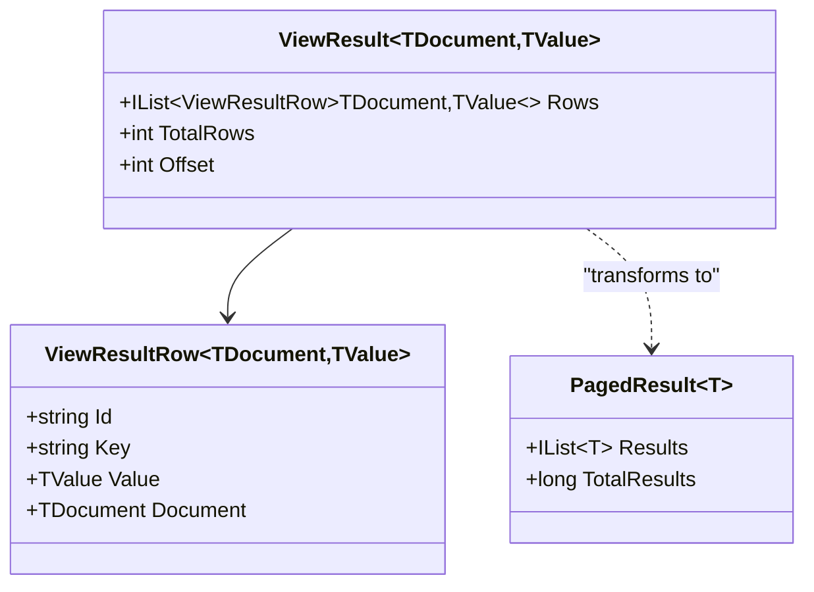
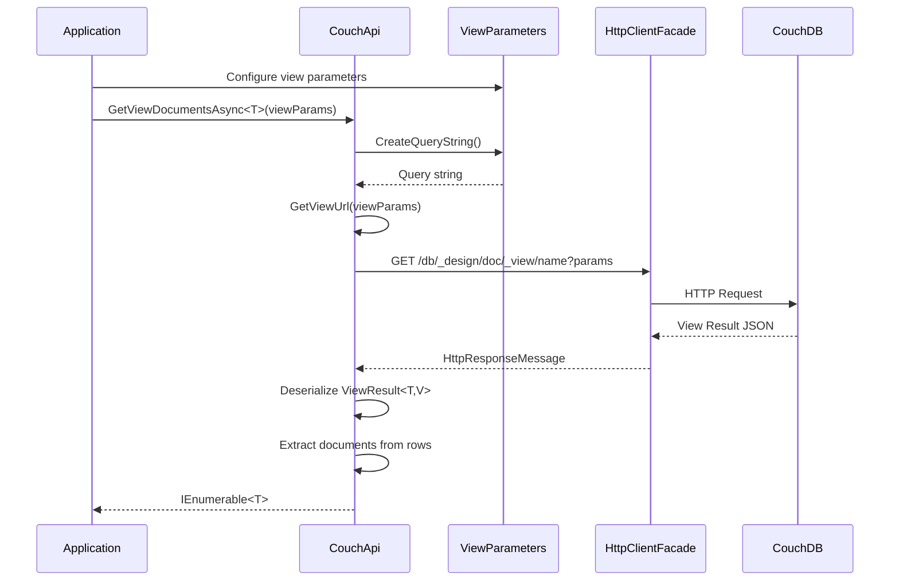
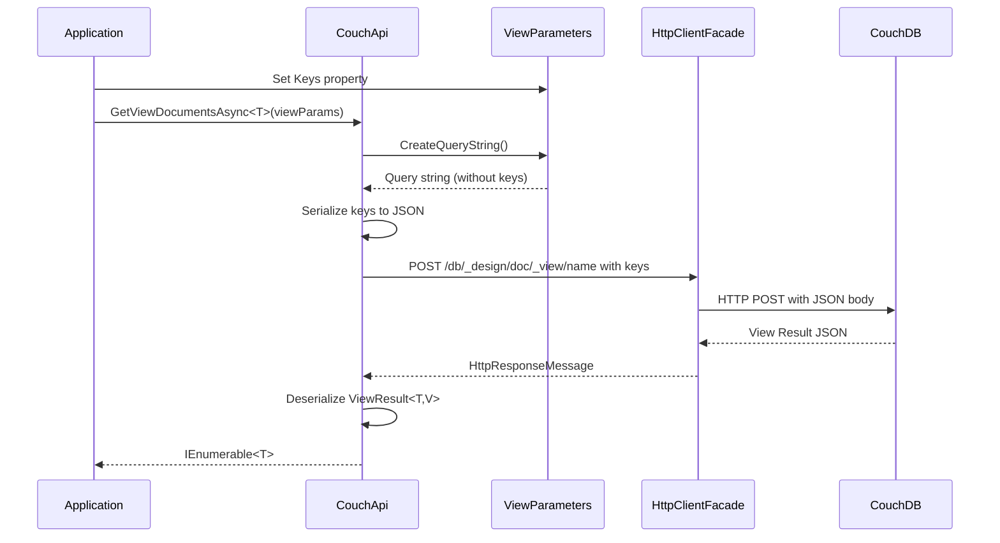

# View Queries Overview

**Navigation**: [Documentation Index](../../DocumentationIndex.md) | [General Functionality](../general-functionality.md)

## CouchDB View Queries Architecture

Edge10.CouchDb.Client provides comprehensive support for CouchDB's view query system, enabling powerful map/reduce operations, complex filtering, pagination, and both document and value extraction from view results.

## View Query Concepts

### CouchDB View System
CouchDB views are JavaScript functions stored in design documents that create indexes for efficient querying. Views consist of:
- **Map Function**: Transforms documents and emits key-value pairs
- **Reduce Function**: Optional aggregation function for grouping operations
- **Indexes**: Pre-computed indexes for fast query execution

### Client Library Integration
The client library provides:
- Type-safe view parameter construction
- Flexible result processing (documents, values, or both)
- Pagination support with total count calculation
- Key-based filtering and range queries
- List function support for custom result formatting

## View Query Architecture



## Core View Query Interface

```csharp
public interface ICouchApi
{
    // View row extraction (values only)
    Task<IEnumerable<TRow>> GetViewRowsAsync<TRow>(IViewParameters viewParameters);
    
    // Document extraction from views
    Task<IEnumerable<TDocument>> GetViewDocumentsAsync<TDocument>(IViewParameters viewParameters);
    
    // Paged document results with total count
    Task<IPagedResult<TDocument>> GetPagedViewDocumentsAsync<TDocument>(IViewParameters viewParameters);
    
    // Document ID extraction only
    Task<IEnumerable<string>> GetViewDocumentIdsAsync(IViewParameters viewParameters);
    
    // Generic result processing
    Task<TResult> GetListResult<TResult>(IViewParameters viewParameters);
}
```

## ViewParameters Architecture

### Parameter Hierarchy



### ViewParameters Implementation

```csharp
public class ViewParameters : CouchQueryParametersBase, IViewParameters
{
    public ViewParameters(string viewName, string designDocument)
    {
        viewName.ThrowIfNullOrEmpty(nameof(viewName));
        designDocument.ThrowIfNullOrEmpty(nameof(designDocument));

        ViewName = viewName;
        DesignDocument = designDocument;
        IncludeDocs = true;
    }

    // Core view identification
    public string ViewName { get; set; }
    public string DesignDocument { get; set; }
    public string ListName { get; set; }

    // Query parameters
    public bool? Group { get; set; }
    public int? GroupLevel { get; set; }
    public bool? Stale { get; set; }
    public bool? Reduce { get; set; }
    public bool? InclusiveEnd { get; set; }

    // Key-based filtering
    public KeyParameter Key { get; set; }
    public IEnumerable<object> Keys { get; set; }
    public IEnumerable<object> StartKey { get; set; }
    public IEnumerable<object> EndKey { get; set; }

    // Pagination
    public int? Skip { get; set; }

    // Additional parameters
    public IDictionary<string, string> QueryStringParameters { get; } = new Dictionary<string, string>();
}
```

## Query String Generation

### URL Construction

```csharp
private string GetViewUrl(IViewParameters viewParameters)
{
    var viewName = string.IsNullOrEmpty(viewParameters.ListName) 
        ? $"_view/{viewParameters.ViewName}" 
        : $"_list/{viewParameters.ListName}/{viewParameters.ViewName}";

    var viewUrl = $"{_url}/{_databaseName}/_design/{viewParameters.DesignDocument}/{viewName}{viewParameters.CreateQueryString()}";

    return viewUrl;
}
```

### Parameter Serialization

```csharp
public override string CreateQueryString()
{
    var parameters = new Dictionary<string, string>();
    
    // Base parameters
    if (Descending.HasValue)
        parameters.Add("descending", Descending.Value.ToString().ToLower());
    if (Limit.HasValue)
        parameters.Add("limit", Limit.Value.ToString());
    if (IncludeDocs.HasValue)
        parameters.Add("include_docs", IncludeDocs.Value.ToString().ToLower());
    
    // View-specific parameters
    if (Group.HasValue)
        parameters.Add("group", Group.Value.ToString().ToLower());
    if (GroupLevel.HasValue)
        parameters.Add("group_level", GroupLevel.Value.ToString());
    if (Stale.GetValueOrDefault())
        parameters.Add("stale", "ok");
    if (Reduce.HasValue)
        parameters.Add("reduce", Reduce.Value.ToString().ToLower());
    if (InclusiveEnd.HasValue)
        parameters.Add("inclusive_end", InclusiveEnd.Value.ToString().ToLower());
    if (Skip.HasValue)
        parameters.Add("skip", Skip.Value.ToString());
    
    // Key parameters
    if (Key != null)
        parameters.Add("key", Key.FormattedValue);
    if (StartKey != null && StartKey.Any())
        parameters.Add("startkey", PrepareArrayValue(StartKey));
    if (EndKey != null && EndKey.Any())
        parameters.Add("endkey", PrepareArrayValue(EndKey));

    // Build query string
    var builder = new StringBuilder();
    foreach (var param in parameters)
    {
        builder.Append(builder.Length == 0 ? "?" : "&");
        builder.Append(param.Key);
        builder.Append("=");
        builder.Append(param.Value);
    }

    return builder.ToString();
}

private string PrepareArrayValue(IEnumerable<object> values)
{
    var valuesArray = values as object[] ?? values.ToArray();
    var value = JsonConvert.SerializeObject(valuesArray, Formatting.None, new IsoDateTimeConverter());
    return WebUtility.UrlEncode(value);
}
```

## Result Processing Architecture

### ViewResult Structure



### Result Processing Implementation

```csharp
// Extract view values only
public async Task<IEnumerable<TRow>> GetViewRowsAsync<TRow>(IViewParameters viewParameters)
{
    viewParameters.ThrowIfNull(nameof(viewParameters));

    // Don't fetch documents for value-only queries
    viewParameters.IncludeDocs = false;

    var viewResult = await GetListResult<ViewResult<object, TRow>>(viewParameters);
    return viewResult.Rows.Select(r => r.Value);
}

// Extract documents from view results
public async Task<IEnumerable<TDocument>> GetViewDocumentsAsync<TDocument>(IViewParameters viewParameters)
{
    var viewResult = await GetListResult<ViewResult<TDocument, object>>(viewParameters);
    return viewResult.Rows.Select(r => r.Document);
}

// Paged results with total count
public async Task<IPagedResult<TDocument>> GetPagedViewDocumentsAsync<TDocument>(IViewParameters viewParameters)
{
    // Get documents with reduce disabled
    viewParameters.Reduce = false;
    var viewResult = await GetListResult<ViewResult<TDocument, object>>(viewParameters);
    
    // Get total count with reduce enabled
    viewParameters.Reduce = true;
    viewParameters.Skip = null;
    viewParameters.Limit = null;
    viewParameters.IncludeDocs = false;
    var countResult = await GetListResult<ViewResult<object, long>>(viewParameters);
    var count = countResult.Rows.FirstOrDefault()?.Value ?? 0;
    
    return new PagedResult<TDocument>(viewResult.Rows.Select(r => r.Document).ToArray(), count);
}
```

## Query Execution Flow

### Simple View Query



### Key-Based Query (POST)



## Query Patterns and Examples

### Basic View Query

```csharp
// Simple view query
var viewParams = new ViewParameters("by_name", "customers")
{
    IncludeDocs = true,
    Limit = 10,
    Descending = false
};

var customers = await couchApi.GetViewDocumentsAsync<CustomerDocument>(viewParams);
```

### Key-Based Filtering

```csharp
// Single key query
var keyParams = new ViewParameters("by_status", "orders")
{
    Key = new KeyParameter("pending"),
    IncludeDocs = true
};

var pendingOrders = await couchApi.GetViewDocumentsAsync<OrderDocument>(keyParams);

// Multiple keys query (uses POST)
var multiKeyParams = new ViewParameters("by_status", "orders")
{
    Keys = new[] { "pending", "processing", "shipped" },
    IncludeDocs = true
};

var activeOrders = await couchApi.GetViewDocumentsAsync<OrderDocument>(multiKeyParams);
```

### Range Queries

```csharp
// Date range query
var rangeParams = new ViewParameters("by_date", "orders")
{
    StartKey = new object[] { "2023-01-01" },
    EndKey = new object[] { "2023-12-31" },
    IncludeDocs = true
};

var ordersThisYear = await couchApi.GetViewDocumentsAsync<OrderDocument>(rangeParams);

// Complex key range
var complexRangeParams = new ViewParameters("by_customer_and_date", "orders")
{
    StartKey = new object[] { "customer123", "2023-01-01" },
    EndKey = new object[] { "customer123", "2023-12-31" },
    IncludeDocs = true
};

var customerOrdersThisYear = await couchApi.GetViewDocumentsAsync<OrderDocument>(complexRangeParams);
```

### Aggregation Queries

```csharp
// Count documents by status
var countParams = new ViewParameters("by_status", "orders")
{
    Group = true,
    Reduce = true,
    IncludeDocs = false
};

var statusCounts = await couchApi.GetViewRowsAsync<long>(countParams);

// Group level aggregation
var groupLevelParams = new ViewParameters("by_year_month_day", "events")
{
    GroupLevel = 2, // Group by year and month only
    Reduce = true
};

var monthlyAggregates = await couchApi.GetViewRowsAsync<decimal>(groupLevelParams);
```

### Pagination

```csharp
// Simple pagination
var pagedParams = new ViewParameters("all_customers", "customers")
{
    Limit = 25,
    Skip = 0,
    IncludeDocs = true
};

var pagedResult = await couchApi.GetPagedViewDocumentsAsync<CustomerDocument>(pagedParams);

Console.WriteLine($"Page 1: {pagedResult.Results.Count} of {pagedResult.TotalResults} total");

// Next page
pagedParams.Skip = 25;
var nextPage = await couchApi.GetPagedViewDocumentsAsync<CustomerDocument>(pagedParams);
```

### List Functions

```csharp
// Use list function for custom formatting
var listParams = new ViewParameters("by_name", "customers")
{
    ListName = "customer_summary", // Custom list function
    Limit = 10
};

var customFormattedResult = await couchApi.GetListResult<string>(listParams);
```

## Performance Optimization

### Query Optimization Strategies

```csharp
// Use stale=ok for better performance when acceptable
var staleParams = new ViewParameters("expensive_view", "analytics")
{
    Stale = true, // Allow stale results
    Limit = 100
};

// Minimize data transfer with IncludeDocs=false when only values needed
var valueOnlyParams = new ViewParameters("aggregated_data", "analytics")
{
    IncludeDocs = false,
    Reduce = true
};

var aggregatedValues = await couchApi.GetViewRowsAsync<decimal>(valueOnlyParams);
```

### Batch Processing

```csharp
// Process large result sets in batches
public async Task<IEnumerable<TDocument>> GetAllViewDocuments<TDocument>(
    string viewName, 
    string designDocument,
    int batchSize = 1000)
{
    var allResults = new List<TDocument>();
    int skip = 0;
    
    IEnumerable<TDocument> batch;
    do
    {
        var viewParams = new ViewParameters(viewName, designDocument)
        {
            Limit = batchSize,
            Skip = skip,
            IncludeDocs = true
        };
        
        batch = await couchApi.GetViewDocumentsAsync<TDocument>(viewParams);
        allResults.AddRange(batch);
        skip += batchSize;
        
    } while (batch.Count() == batchSize);
    
    return allResults;
}
```

## Error Handling

### View-Specific Errors

```csharp
try
{
    var results = await couchApi.GetViewDocumentsAsync<DocumentType>(viewParams);
}
catch (HttpRequestException ex) when (ex.Message.Contains("404"))
{
    logger.LogError("View not found: {DesignDocument}/{ViewName}", 
        viewParams.DesignDocument, viewParams.ViewName);
    // Handle missing view
}
catch (CouchTimeoutException)
{
    logger.LogWarning("View query timed out, trying with smaller limit");
    
    // Reduce query scope and retry
    viewParams.Limit = Math.Min(viewParams.Limit ?? 1000, 100);
    var results = await couchApi.GetViewDocumentsAsync<DocumentType>(viewParams);
}
```

## Testing Patterns

### View Query Testing

```csharp
[Test]
public async Task GetViewDocumentsAsync_Should_ReturnTypedDocuments()
{
    // Arrange
    var viewParams = new ViewParameters("test_view", "test_design");
    var expectedJson = @"{
        ""rows"": [
            {""id"": ""doc1"", ""key"": ""key1"", ""value"": null, ""doc"": {""_id"": ""doc1"", ""name"": ""Test""}}
        ],
        ""total_rows"": 1,
        ""offset"": 0
    }";
    
    mockHttpClient.Setup(x => x.GetStreamAsync(It.IsAny<string>()))
               .ReturnsAsync(new MemoryStream(Encoding.UTF8.GetBytes(expectedJson)));

    // Act
    var results = await couchApi.GetViewDocumentsAsync<TestDocument>(viewParams);

    // Assert
    Assert.That(results.Count(), Is.EqualTo(1));
    Assert.That(results.First().Name, Is.EqualTo("Test"));
}
```

---

*This view queries overview provides comprehensive coverage of CouchDB view integration within Edge10.CouchDb.Client. The system provides powerful querying capabilities with type safety and performance optimization features.*