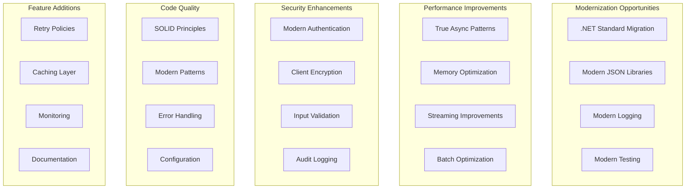

# Improvements Overview

**Navigation**: [Documentation Index](../DocumentationIndex.md) | [Main Documentation](../Edge10.CouchDb.Client.md)

## Technical Debt and Enhancement Opportunities

Edge10.CouchDb.Client, while functional and stable, represents legacy .NET patterns and has several opportunities for modernization, performance improvements, and enhanced functionality. This document provides a comprehensive analysis of technical debt and improvement opportunities.

## Current State Assessment

### Legacy Technology Stack
- **.NET Framework 4.5.2**: Outdated framework version
- **Newtonsoft.Json 9.0.1**: Older JSON serialization library
- **log4net 2.0.17**: Legacy logging framework (replaced by Application Insights)
- **NUnit Framework**: Modern testing framework already in use
- **Visual Studio 2015 Project Format**: Legacy project file format

### Architecture Debt
- **Synchronous Operations**: Some blocking operations despite async interface
- **Tight Coupling**: Direct dependencies on concrete implementations
- **Limited Extensibility**: Fixed authentication and serialization strategies
- **Legacy Patterns**: Old-style .NET patterns throughout

## Improvement Categories



## High Priority Improvements

### 1. .NET Standard Migration

**Current State:** .NET Framework 4.5.2
**Target:** .NET Standard 2.0 or .NET 6+

```csharp
// Current project file (legacy format)
<Project ToolsVersion="14.0" DefaultTargets="Build" xmlns="http://schemas.microsoft.com/developer/msbuild/2003">
  <PropertyGroup>
    <TargetFrameworkVersion>v4.5.2</TargetFrameworkVersion>
  </PropertyGroup>
</Project>

// Proposed modern project file
<Project Sdk="Microsoft.NET.Sdk">
  <PropertyGroup>
    <TargetFramework>netstandard2.0</TargetFramework>
    <LangVersion>latest</LangVersion>
    <Nullable>enable</Nullable>
  </PropertyGroup>
</Project>
```

**Benefits:**
- Cross-platform compatibility
- Modern C# language features
- Better performance characteristics
- Improved tooling support
- Future-proof architecture

**Effort:** High (requires dependency updates and testing)
**Impact:** High (enables modern deployment scenarios)

### 2. Modern JSON Serialization

**Current State:** Newtonsoft.Json 9.0.1
**Target:** System.Text.Json or latest Newtonsoft.Json

```csharp
// Current serialization
private JsonSerializer CreateSerializer()
{
    var settings = new JsonSerializerSettings
    {
        TypeNameHandling = TypeNameHandling.Objects,  // Required for polymorphic serialization
        ContractResolver = new CamelCasePropertyNamesContractResolver()
    };
    return JsonSerializer.Create(settings);
}

// Proposed System.Text.Json approach
private JsonSerializerOptions CreateSerializerOptions()
{
    return new JsonSerializerOptions
    {
        PropertyNamingPolicy = JsonNamingPolicy.CamelCase,
        DefaultIgnoreCondition = JsonIgnoreCondition.WhenWritingNull,
        Converters = { new AttachmentsJsonConverter() }
    };
}
```

**Benefits:**
- Better performance
- Lower memory allocation
- Modern security defaults
- Better async support
- Native .NET integration

**Effort:** Medium (requires converter migration)
**Impact:** High (performance and security improvements)

### 3. Modern Async Patterns

**Current Issues:**
- Mix of async and potentially blocking operations
- Inconsistent ConfigureAwait usage
- Potential deadlock scenarios

```csharp
// Current pattern with potential issues
public async Task<TDocument> GetDocumentAsync<TDocument>(string documentId)
{
    using (var result = await _client.GetAsync(url))  // Missing ConfigureAwait
        return await GetSerializedResultContent<TDocument>(result);  // Missing ConfigureAwait
}

// Improved async pattern
public async Task<TDocument> GetDocumentAsync<TDocument>(string documentId, CancellationToken cancellationToken = default)
{
    using (var result = await _client.GetAsync(url, cancellationToken).ConfigureAwait(false))
        return await GetSerializedResultContent<TDocument>(result, cancellationToken).ConfigureAwait(false);
}
```

**Benefits:**
- Prevents deadlocks
- Better cancellation support
- Improved performance
- Consistent async patterns

**Effort:** Medium (systematic review and updates)
**Impact:** High (reliability improvements)

### 4. Dependency Injection Integration

**Current State:** Constructor-based dependency resolution
**Target:** Full DI container integration

```csharp
// Current approach
var couchApi = new CouchApi(connectionString, eventLog, serializationStrategy, httpHandler);

// Proposed DI integration
services.AddCouchDb(options =>
{
    options.ConnectionString = connectionString;
    options.EventLogging = true;
    options.RetryPolicy = retryPolicy;
});

// Usage
public class CustomerService
{
    private readonly ICouchApi _couchApi;
    
    public CustomerService(ICouchApi couchApi)
    {
        _couchApi = couchApi;
    }
}
```

**Benefits:**
- Better testability
- Configuration management
- Lifecycle management
- Modern .NET patterns

**Effort:** Medium (new registration patterns)
**Impact:** Medium (developer experience)

## Medium Priority Improvements

### 5. Enhanced Error Handling

**Current Issues:**
- Generic HttpRequestException for most errors
- Limited retry capabilities
- No circuit breaker pattern

```csharp
// Current error handling
if (response.StatusCode == HttpStatusCode.Conflict)
    throw new ConflictException();

await response.ThrowErrorIfNotSuccess();

// Proposed enhanced error handling
public class CouchDbException : Exception
{
    public int StatusCode { get; }
    public string CouchDbError { get; }
    public string CouchDbReason { get; }
    
    public CouchDbException(HttpStatusCode statusCode, string error, string reason)
        : base($"CouchDB error: {error} - {reason}")
    {
        StatusCode = (int)statusCode;
        CouchDbError = error;
        CouchDbReason = reason;
    }
}

// With retry policy
public async Task<T> ExecuteWithRetry<T>(Func<Task<T>> operation)
{
    return await _retryPolicy.ExecuteAsync(operation);
}
```

### 6. Configuration Management

**Current State:** Simple connection string builder
**Target:** Modern configuration patterns

```csharp
// Current configuration
var connectionString = new CouchDbConnectionStringBuilder
{
    Server = "localhost",
    Port = 5984,
    DatabaseName = "mydb",
    User = "admin",
    Password = "password"
};

// Proposed configuration
public class CouchDbOptions
{
    public string ConnectionString { get; set; }
    public TimeSpan Timeout { get; set; } = TimeSpan.FromMinutes(5);
    public int MaxRetries { get; set; } = 3;
    public bool EnableLogging { get; set; } = true;
    public SerializationOptions Serialization { get; set; } = new();
    public SecurityOptions Security { get; set; } = new();
}

// Configuration binding
services.Configure<CouchDbOptions>(configuration.GetSection("CouchDb"));
```

### 7. Performance Optimizations

**Memory Management:**
```csharp
// Current stream handling
private TData GetSerializedContent<TData>(Stream content)
{
    using (var sr = new StreamReader(content))
    using (var jsonTextReader = new JsonTextReader(sr))
    {
        var serializer = CreateSerializer();
        return serializer.Deserialize<TData>(jsonTextReader);
    }
}

// Proposed with memory optimization
private async ValueTask<TData> GetSerializedContentAsync<TData>(Stream content, CancellationToken cancellationToken = default)
{
    using var document = await JsonDocument.ParseAsync(content, cancellationToken: cancellationToken);
    return JsonSerializer.Deserialize<TData>(document.RootElement, _serializerOptions);
}
```

**Connection Pooling:**
```csharp
// Proposed connection management
public class CouchDbConnectionPool
{
    private readonly ConcurrentQueue<HttpClient> _availableClients = new();
    private readonly SemaphoreSlim _semaphore;
    
    public async Task<HttpClient> GetClientAsync(CancellationToken cancellationToken = default)
    {
        await _semaphore.WaitAsync(cancellationToken);
        
        if (_availableClients.TryDequeue(out var client))
            return client;
        
        return CreateNewClient();
    }
}
```

## Security Improvements

### 8. Modern Authentication

**Current:** HTTP Basic Authentication only
**Proposed:** Multiple authentication strategies

```csharp
public interface IAuthenticationProvider
{
    Task<AuthenticationHeaderValue> GetAuthenticationHeaderAsync(CancellationToken cancellationToken = default);
    Task RefreshAsync(CancellationToken cancellationToken = default);
}

public class BasicAuthenticationProvider : IAuthenticationProvider
{
    // Current implementation
}

public class BearerTokenAuthenticationProvider : IAuthenticationProvider
{
    // OAuth2/JWT token authentication
}

public class CertificateAuthenticationProvider : IAuthenticationProvider
{
    // Client certificate authentication
}
```

### 9. Input Validation and Sanitization

```csharp
public static class CouchDbValidator
{
    public static void ValidateDocumentId(string documentId)
    {
        if (string.IsNullOrWhiteSpace(documentId))
            throw new ArgumentException("Document ID cannot be null or empty");
        
        if (documentId.Length > 255)
            throw new ArgumentException("Document ID cannot exceed 255 characters");
        
        if (!IsValidDocumentId(documentId))
            throw new ArgumentException("Document ID contains invalid characters");
    }
    
    private static bool IsValidDocumentId(string documentId)
    {
        // CouchDB document ID validation rules
        return Regex.IsMatch(documentId, @"^[a-zA-Z0-9\-_\.]+$");
    }
}
```

## Feature Additions

### 10. Caching Layer

```csharp
public interface ICouchDbCache
{
    Task<T> GetAsync<T>(string key, CancellationToken cancellationToken = default);
    Task SetAsync<T>(string key, T value, TimeSpan expiration, CancellationToken cancellationToken = default);
    Task RemoveAsync(string key, CancellationToken cancellationToken = default);
}

public class CachedCouchApi : ICouchApi
{
    private readonly ICouchApi _inner;
    private readonly ICouchDbCache _cache;
    
    public async Task<TDocument> GetDocumentAsync<TDocument>(string documentId, CancellationToken cancellationToken = default)
    {
        var cacheKey = $"doc:{documentId}";
        
        var cached = await _cache.GetAsync<TDocument>(cacheKey, cancellationToken);
        if (cached != null)
            return cached;
        
        var document = await _inner.GetDocumentAsync<TDocument>(documentId, cancellationToken);
        await _cache.SetAsync(cacheKey, document, TimeSpan.FromMinutes(5), cancellationToken);
        
        return document;
    }
}
```

### 11. Health Checks

```csharp
public class CouchDbHealthCheck : IHealthCheck
{
    private readonly ICouchApi _couchApi;
    
    public CouchDbHealthCheck(ICouchApi couchApi)
    {
        _couchApi = couchApi;
    }
    
    public async Task<HealthCheckResult> CheckHealthAsync(HealthCheckContext context, CancellationToken cancellationToken = default)
    {
        try
        {
            await _couchApi.CheckConnection();
            return HealthCheckResult.Healthy("CouchDB connection is healthy");
        }
        catch (Exception ex)
        {
            return HealthCheckResult.Unhealthy("CouchDB connection failed", ex);
        }
    }
}
```

### 12. Metrics and Monitoring

```csharp
public class MetricsCouchApi : ICouchApi
{
    private readonly ICouchApi _inner;
    private readonly IMetrics _metrics;
    
    public async Task<TDocument> GetDocumentAsync<TDocument>(string documentId, CancellationToken cancellationToken = default)
    {
        using var timer = _metrics.Measure.Timer.Time("couchdb.document.get.duration");
        
        try
        {
            var result = await _inner.GetDocumentAsync<TDocument>(documentId, cancellationToken);
            _metrics.Measure.Counter.Increment("couchdb.document.get.success");
            return result;
        }
        catch (Exception)
        {
            _metrics.Measure.Counter.Increment("couchdb.document.get.error");
            throw;
        }
    }
}
```

## Implementation Roadmap

### Phase 1: Foundation (High Priority)
1. **Migrate to .NET Standard 2.0**
2. **Update to modern project format**
3. **Implement proper async patterns**
4. **Add cancellation token support**

**Timeline:** 2-3 months
**Risk:** Medium (breaking changes)
**Impact:** High (enables modernization)

### Phase 2: Performance and Security (Medium Priority)
1. **Modernize JSON serialization**
2. **Enhance error handling**
3. **Implement input validation**
4. **Add authentication strategies**

**Timeline:** 1-2 months
**Risk:** Low (mostly additive)
**Impact:** High (performance and security)

### Phase 3: Features and Quality (Low Priority)
1. **Add caching layer**
2. **Implement health checks**
3. **Add metrics and monitoring**
4. **Comprehensive documentation**

**Timeline:** 1-2 months
**Risk:** Low (optional features)
**Impact:** Medium (developer experience)

## Migration Strategy

### Backward Compatibility
```csharp
#if NETFRAMEWORK
// Legacy implementations for .NET Framework
#else
// Modern implementations for .NET Standard/.NET Core
#endif
```

### Gradual Migration
1. **Dual-target** (.NET Framework 4.5.2 and .NET Standard 2.0)
2. **Feature flags** for new functionality
3. **Deprecation warnings** for legacy patterns
4. **Migration guide** for consumers

## Cost-Benefit Analysis

| Improvement | Effort | Impact | Priority | Risk |
|-------------|--------|--------|----------|------|
| .NET Standard Migration | High | High | 1 | Medium |
| Modern Async Patterns | Medium | High | 2 | Low |
| JSON Serialization | Medium | High | 3 | Low |
| DI Integration | Medium | Medium | 4 | Low |
| Error Handling | Low | Medium | 5 | Low |
| Authentication | Medium | Medium | 6 | Medium |
| Caching | Low | Low | 7 | Low |
| Health Checks | Low | Low | 8 | Low |

---

*This improvements overview provides a comprehensive roadmap for modernizing Edge10.CouchDb.Client while maintaining backward compatibility and minimizing risk to existing consumers.*