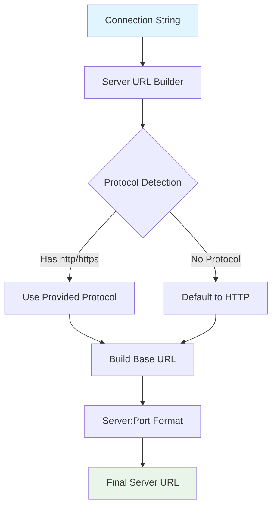
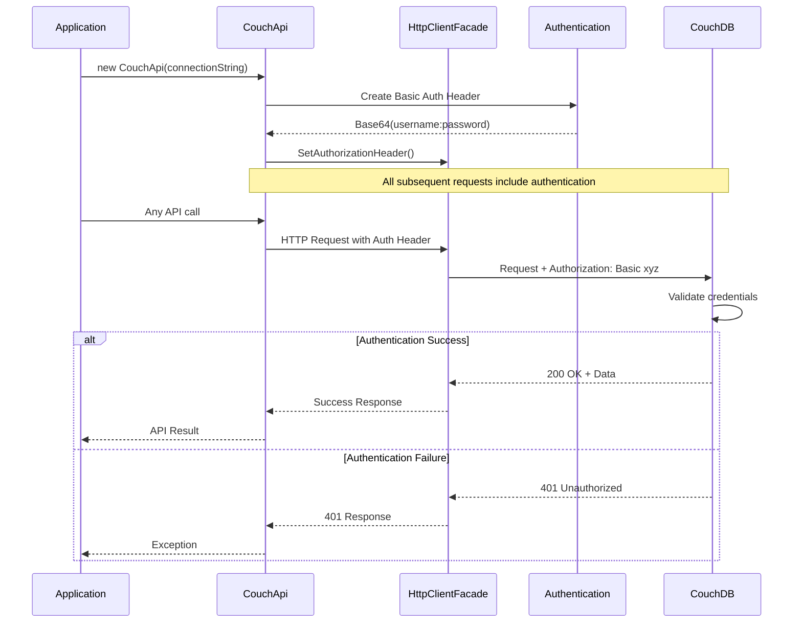

# CouchDB Server Integration

**Navigation**: [Documentation Index](../DocumentationIndex.md) | [Integrations Overview](integrations-overview.md)

## CouchDB Integration Overview

The Edge10.CouchDb.Client provides comprehensive integration with CouchDB servers through standardized HTTP REST API communication. The integration supports all major CouchDB features including document operations, view queries, attachment handling, changes feed monitoring, and replication task management.

## Connection Architecture

### Connection String Management

The client uses a connection string-based approach for server configuration:

```csharp
public class CouchDbConnectionStringBuilder : DbConnectionStringBuilder, ICouchDbConnectionStringBuilder
{
    public string Server { get; set; }           // CouchDB server hostname/IP
    public int? Port { get; set; }               // Server port (default: 5984)
    public string User { get; set; }             // Authentication username
    public string Password { get; set; }         // Authentication password
    public string DatabaseName { get; set; }    // Target database name
}
```

### Connection String Examples

```csharp
// Basic connection
var connectionString = new CouchDbConnectionStringBuilder
{
    Server = "localhost",
    Port = 5984,
    DatabaseName = "myapp"
};

// Authenticated connection
var secureConnection = new CouchDbConnectionStringBuilder
{
    Server = "couchdb.mycompany.com",
    Port = 6984,
    User = "app_user",
    Password = "secure_password",
    DatabaseName = "production_db"
};

// Connection string format
var fromString = new CouchDbConnectionStringBuilder
{
    ConnectionString = "Server=localhost;Port=5984;User=admin;Password=admin;DatabaseName=testdb"
};
```

## Server URL Construction



### URL Construction Implementation

```csharp
private static string GetServerUrl(ICouchDbConnectionStringBuilder connectionString)
{
    var protocol = (connectionString.Server.StartsWith("http://") || 
                   connectionString.Server.StartsWith("https://")) ? 
                   string.Empty : "http://";
    
    return $"{protocol}{connectionString.Server}:{connectionString.Port}";
}

// Examples of constructed URLs:
// Input: Server="localhost", Port=5984 → "http://localhost:5984"
// Input: Server="https://secure.couchdb.com", Port=443 → "https://secure.couchdb.com:443"
// Input: Server="192.168.1.100", Port=5984 → "http://192.168.1.100:5984"
```

## HTTP Authentication Integration

### Basic Authentication Setup

```csharp
public CouchApi(ICouchDbConnectionStringBuilder connectionString, ...)
{
    // Create Basic Authentication header
    var authHeader = new AuthenticationHeaderValue("Basic", 
        Convert.ToBase64String(Encoding.UTF8.GetBytes($"{connectionString.User}:{connectionString.Password}")));
    
    _client.SetAuthorizationHeader(authHeader);
}
```

### Authentication Flow



## Database URL Patterns

### Core URL Construction Methods

```csharp
// Document URLs
private string GetDocumentUrl(string documentId)
{
    return $"{_url}/{_databaseName}/{documentId}";
}

private string GetDocumentUrl(string documentId, string revision)
{
    return $"{_url}/{_databaseName}/{documentId}?rev={revision}";
}

// Attachment URLs
private string GetAttachmentUrl(string documentId, string attachmentName)
{
    return $"{_url}/{_databaseName}/{documentId}/{attachmentName}";
}

// View URLs  
private string GetViewUrl(IViewParameters viewParameters)
{
    var viewName = string.IsNullOrEmpty(viewParameters.ListName) 
        ? $"_view/{viewParameters.ViewName}" 
        : $"_list/{viewParameters.ListName}/{viewParameters.ViewName}";

    return $"{_url}/{_databaseName}/_design/{viewParameters.DesignDocument}/{viewName}{viewParameters.CreateQueryString()}";
}
```

### URL Pattern Examples

```csharp
// Given: _url = "http://localhost:5984", _databaseName = "myapp"

// Document operations:
// GetDocumentUrl("customer-123") → "http://localhost:5984/myapp/customer-123"
// GetDocumentUrl("customer-123", "2-abc") → "http://localhost:5984/myapp/customer-123?rev=2-abc"

// Attachment operations:
// GetAttachmentUrl("doc-1", "photo.jpg") → "http://localhost:5984/myapp/doc-1/photo.jpg"

// View operations:
// ViewParameters("customers-by-city", "app") → "http://localhost:5984/myapp/_design/app/_view/customers-by-city"

// Special endpoints:
// Changes feed → "http://localhost:5984/myapp/_changes"
// Bulk docs → "http://localhost:5984/myapp/_bulk_docs"
// All docs → "http://localhost:5984/myapp/_all_docs"
```

## CouchDB API Endpoint Integration

### Core Database Operations

```csharp
// Database connectivity check
public async Task CheckConnection()
{
    var result = await _client.GetAsync($"{_url}/{_databaseName}");
    await result.ThrowErrorIfNotSuccess();
}

// Database information retrieval
// GET /{db} returns database info including document count, update sequence, etc.
```

### Document API Integration

```csharp
// Single document operations use standard CouchDB REST patterns:
// GET /{db}/{docid} - Retrieve document
// PUT /{db}/{docid} - Create/update document  
// DELETE /{db}/{docid}?rev={rev} - Delete document
// HEAD /{db}/{docid} - Get document metadata (revision)

// Bulk operations use CouchDB's bulk API:
// POST /{db}/_bulk_docs - Bulk create/update/delete
// POST /{db}/_all_docs - Bulk retrieve with keys
```

### View API Integration

```csharp
// View queries follow CouchDB view patterns:
// GET /{db}/_design/{ddoc}/_view/{view} - Query view
// POST /{db}/_design/{ddoc}/_view/{view} - Query view with keys
// GET /{db}/_design/{ddoc}/_list/{list}/{view} - List function processing

// List functions (when ListName is specified):
private string GetViewUrl(IViewParameters viewParameters)
{
    var viewName = string.IsNullOrEmpty(viewParameters.ListName) 
        ? $"_view/{viewParameters.ViewName}" 
        : $"_list/{viewParameters.ListName}/{viewParameters.ViewName}";
    
    return $"{_url}/{_databaseName}/_design/{viewParameters.DesignDocument}/{viewName}";
}
```

### Changes Feed Integration

```csharp
// Changes feed uses CouchDB's _changes endpoint:
// GET /{db}/_changes - Get changes feed
// Supports all CouchDB changes parameters: since, limit, include_docs, filter, etc.

private async Task<HttpResponseMessage> GetChangesResponse(IChangesParameters parameters)
{
    var url = $"{_url}/{_databaseName}/_changes{parameters.CreateQueryString()}";
    var response = await _client.GetAsync(url);
    await response.ThrowErrorIfNotSuccess();
    return response;
}
```

### Attachment API Integration

```csharp
// Attachment operations use CouchDB's attachment API:
// GET /{db}/{docid}/{attname} - Retrieve attachment
// PUT /{db}/{docid}/{attname}?rev={rev} - Upload attachment
// DELETE /{db}/{docid}/{attname}?rev={rev} - Delete attachment

// Automatic revision handling for attachment operations:
private async Task<string> GetAttachmentUrlWithRevision(string documentId, string attachmentName)
{
    var documentUri = GetDocumentUrl(documentId);
    var revision = await GetDocumentRevision(documentUri);
    return $"{documentUri}/{attachmentName}?rev={revision}";
}
```

## Advanced CouchDB Integration Features

### Replication Task Monitoring

```csharp
public async Task<IEnumerable<ReplicationTask>> GetActiveReplicationTasks()
{
    return await GetActiveTasks<ReplicationTask>(ReplicationTask.TaskType);
}

private async Task<IEnumerable<TTask>> GetActiveTasks<TTask>(string taskType)
{
    var url = $"{_url}/_active_tasks";  // Server-level endpoint

    var tasks = new List<TTask>();
    using (var response = await _client.GetAsync(url))
    {
        var allTasks = await GetSerializedResultContent<JArray>(response);
        foreach (var task in allTasks)
        {
            var type = task["type"];
            if (type != null && type.Value<string>() == taskType)
                tasks.Add(task.ToObject<TTask>());
        }
    }

    return tasks;
}
```

### Custom CouchDB Exception Handling

```csharp
private static Exception CouchExceptionFactory(HttpResponseMessage message, string content)
{
    if (content?.ToLowerInvariant().IndexOf("timeout") != -1)
        return new CouchTimeoutException();

    return new HttpRequestException($"{(int)message.StatusCode} {message.ReasonPhrase} {content}");
}

// Usage in view queries:
var response = await _client.SendAsync(request, HttpCompletionOption.ResponseHeadersRead);
await response.ThrowErrorIfNotSuccess(CouchExceptionFactory);
```

### Revision Management Integration

```csharp
// CouchDB revision handling patterns:

// 1. Automatic revision retrieval for updates
private async Task<string> GetDocumentRevision(string documentUri)
{
    // Use HEAD request to get ETag (revision) without document content
    var httpResponse = await _client.SendAsync(new HttpRequestMessage(HttpMethod.Head, documentUri));
    await httpResponse.ThrowErrorIfNotSuccess();
    
    return httpResponse.Headers.ETag.Tag.Replace('\"', ' ').Trim();
}

// 2. Revision extraction from update responses
private static async Task UpdateDocumentRevision<TDocument>(TDocument document, HttpResponseMessage response) 
    where TDocument : ICouchModel
{
    var responseContent = await response.Content.ReadAsStringAsync();
    var updateDetails = JsonConvert.DeserializeObject<CouchUpdateResponse>(responseContent);
    document.Rev = updateDetails.Rev;
}
```

## CouchDB Version Compatibility

### Target CouchDB Version

The Edge10.CouchDb.Client is **specifically designed for CouchDB 1.7 compatibility**. This version choice ensures:
- Compatibility with existing Edge10 CouchDB infrastructure
- Stable, well-established HTTP API endpoints
- Proven reliability for production workloads

### Supported CouchDB Features

The client is designed to work with CouchDB 1.7's HTTP API and supports:

#### CouchDB 1.x Features
- Document CRUD operations
- View queries with parameters
- Attachment operations
- Changes feed (basic)
- Bulk operations
- Basic authentication

#### CouchDB 2.x+ Features  
- Enhanced changes feed
- Improved view performance
- Better conflict resolution
- Enhanced replication
- Clustered deployments

#### Universal Features
```csharp
// These operations work across all CouchDB versions:
// - Document operations (GET, PUT, DELETE)
// - View queries (_view, _all_docs)  
// - Attachment operations
// - Changes feed (_changes)
// - Bulk operations (_bulk_docs)
// - Database info queries
```

## Performance Optimization for CouchDB Integration

### Connection Pooling and Reuse

```csharp
// The HttpClientFacade uses a single HttpClient instance for connection reuse:
public sealed class HttpClientFacade : IHttpClientFacade
{
    private HttpClient _client;

    public HttpClientFacade(HttpClientHandler clientHandler)
    {
        _client = new HttpClient(clientHandler, false);  // Don't dispose handler
    }

    // All operations use the same client instance for connection pooling
}
```

### Timeout Configuration

```csharp
public CouchApi(ICouchDbConnectionStringBuilder connectionString, ...)
{
    // Set appropriate timeout for CouchDB operations
    _client.Timeout = TimeSpan.FromMinutes(20);  // Long timeout for large operations
}
```

### Batch Size Optimization

```csharp
// Configurable batch size for bulk operations
public int MaxDocumentsPerRequest { get; set; } = 500;

// Automatic batching for large collections
private IEnumerable<IEnumerable<T>> SplitToBlocks<T>(IEnumerable<T> sequence, int size)
{
    // Implementation that splits large collections into manageable batches
}
```

## Integration Configuration Patterns

### Development Configuration

```csharp
public static ICouchApi CreateDevelopmentApi()
{
    var connectionString = new CouchDbConnectionStringBuilder
    {
        Server = "localhost",
        Port = 5984,
        DatabaseName = "myapp_dev",
        User = "admin",
        Password = "admin"
    };
    
    var handler = new HttpClientHandler()
    {
        // Disable SSL validation for local development
        ServerCertificateCustomValidationCallback = (message, cert, chain, errors) => true
    };
    
    return new CouchApi(connectionString, eventLog: new ConsoleEventLog(), httpClientHandler: handler);
}
```

### Production Configuration

```csharp
public static ICouchApi CreateProductionApi(IConfiguration config)
{
    var connectionString = new CouchDbConnectionStringBuilder
    {
        Server = config["CouchDB:Server"],
        Port = config.GetValue<int>("CouchDB:Port"),
        DatabaseName = config["CouchDB:Database"], 
        User = config["CouchDB:Username"],
        Password = config["CouchDB:Password"]
    };
    
    var handler = new HttpClientHandler()
    {
        // Enable SSL certificate validation
        ServerCertificateCustomValidationCallback = null,
        UseCookies = false  // Don't use cookies for REST API
    };
    
    return new CouchApi(
        connectionString, 
        eventLog: new ApplicationEventLog(loggerFactory),
        httpClientHandler: handler);
}
```

### Load-Balanced Configuration

```csharp
public class LoadBalancedCouchApiFactory
{
    private readonly string[] _servers;
    private int _currentServerIndex = 0;
    
    public LoadBalancedCouchApiFactory(string[] servers)
    {
        _servers = servers;
    }
    
    public ICouchApi CreateApi(string database, string username, string password)
    {
        var server = GetNextServer();
        
        var connectionString = new CouchDbConnectionStringBuilder
        {
            Server = server,
            Port = 5984,
            DatabaseName = database,
            User = username,
            Password = password
        };
        
        return new CouchApi(connectionString);
    }
    
    private string GetNextServer()
    {
        var server = _servers[_currentServerIndex];
        _currentServerIndex = (_currentServerIndex + 1) % _servers.Length;
        return server;
    }
}
```

## Error Handling and Resilience

### CouchDB-Specific Error Handling

```csharp
public async Task<T> ExecuteWithCouchDbErrorHandling<T>(Func<Task<T>> operation)
{
    try
    {
        return await operation();
    }
    catch (HttpRequestException ex) when (ex.Message.Contains("404"))
    {
        throw new CouchDbDocumentNotFoundException("Document or database not found", ex);
    }
    catch (HttpRequestException ex) when (ex.Message.Contains("409"))
    {
        throw new ConflictException("Document revision conflict", ex);
    }
    catch (HttpRequestException ex) when (ex.Message.Contains("401"))
    {
        throw new CouchDbAuthenticationException("Invalid credentials", ex);
    }
    catch (HttpRequestException ex) when (ex.Message.Contains("403"))
    {
        throw new CouchDbAuthorizationException("Access denied", ex);
    }
    catch (CouchTimeoutException)
    {
        // CouchTimeoutException is already CouchDB-specific
        throw;
    }
    catch (Exception ex)
    {
        throw new CouchDbIntegrationException("Unexpected CouchDB integration error", ex);
    }
}
```

### Retry Patterns with Exponential Backoff

```csharp
public async Task<T> ExecuteWithRetry<T>(
    Func<Task<T>> operation,
    int maxRetries = 3,
    TimeSpan baseDelay = default)
{
    baseDelay = baseDelay == default ? TimeSpan.FromSeconds(1) : baseDelay;
    
    for (int attempt = 1; attempt <= maxRetries; attempt++)
    {
        try
        {
            return await operation();
        }
        catch (Exception ex) when (attempt < maxRetries && IsRetriableError(ex))
        {
            var delay = TimeSpan.FromMilliseconds(baseDelay.TotalMilliseconds * Math.Pow(2, attempt - 1));
            await Task.Delay(delay);
        }
    }
    
    return await operation(); // Final attempt without retry
}

private bool IsRetriableError(Exception ex)
{
    return ex is HttpRequestException ||
           ex is TaskCanceledException ||
           ex is CouchTimeoutException;
}
```

## Testing CouchDB Integration

### Integration Testing with Test Containers

```csharp
[Test]
public async Task CouchDbIntegration_Should_WorkWithRealServer()
{
    // Using TestContainers for integration testing
    using var couchDbContainer = new CouchDbTestContainer();
    await couchDbContainer.StartAsync();
    
    var connectionString = new CouchDbConnectionStringBuilder
    {
        Server = couchDbContainer.GetConnectionString(),
        DatabaseName = "test_db",
        User = "admin", 
        Password = "admin"
    };
    
    using var couchApi = new CouchApi(connectionString);
    
    // Test connection
    await couchApi.CheckConnection();
    
    // Test document operations
    var testDoc = new TestDocument { Name = "Integration Test" };
    await couchApi.CreateDocumentAsync(testDoc);
    
    var retrieved = await couchApi.GetDocumentAsync<TestDocument>(testDoc.Id);
    Assert.That(retrieved.Name, Is.EqualTo("Integration Test"));
}
```

### Mock Testing for CouchDB Interactions

```csharp
[Test]
public async Task CouchDbIntegration_Should_HandleHttpErrors()
{
    // Arrange
    var mockHttpClient = new Mock<IHttpClientFacade>();
    mockHttpClient.Setup(x => x.GetAsync(It.IsAny<string>()))
              .ThrowsAsync(new HttpRequestException("404 Not Found"));
    
    var connectionString = new CouchDbConnectionStringBuilder
    {
        Server = "localhost",
        DatabaseName = "test_db"
    };
    
    var couchApi = new CouchApi(connectionString, mockHttpClient.Object, new NullCouchEventLog(), null);
    
    // Act & Assert
    Assert.ThrowsAsync<HttpRequestException>(() => couchApi.CheckConnection());
}
```

## Best Practices for CouchDB Integration

1. **Use connection pooling**: Reuse HttpClient instances for better performance
2. **Implement proper authentication**: Always use secure credentials and HTTPS in production
3. **Handle CouchDB-specific errors**: Convert HTTP errors to meaningful exceptions
4. **Configure appropriate timeouts**: Balance between responsiveness and reliability
5. **Use batch operations**: Leverage CouchDB's bulk APIs for multiple operations
6. **Monitor server health**: Implement health checks and monitoring
7. **Plan for offline scenarios**: Handle network failures and server unavailability
8. **Optimize view queries**: Use proper indexing and query parameters
9. **Implement retry logic**: Handle transient failures with exponential backoff
10. **Test with real CouchDB instances**: Use integration tests with actual servers

---

*For more information about CouchDB integration, see [Integrations Overview](integrations-overview.md), [HTTP Client Integration](http-client-integration.md), and [JSON Serialization](json-serialization.md).*