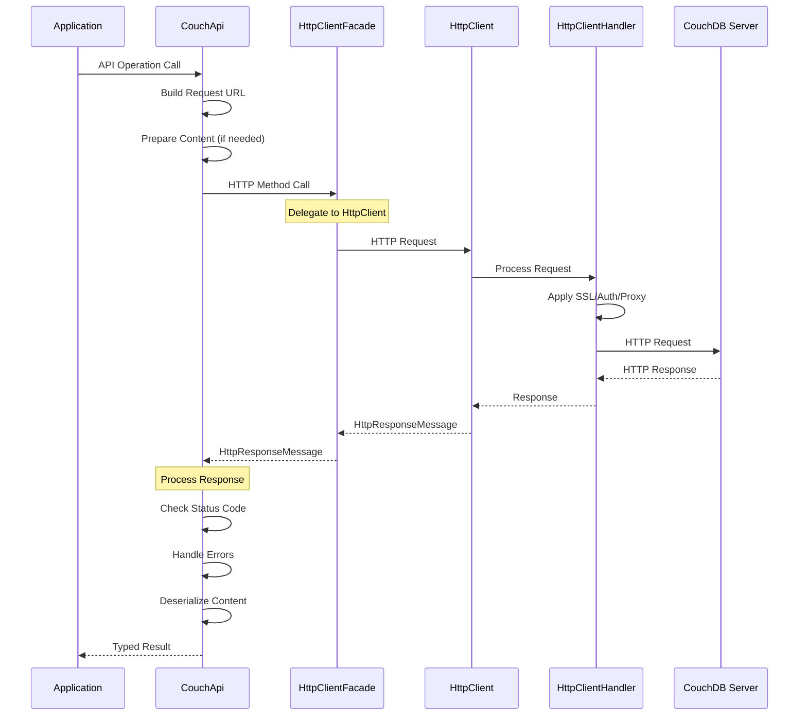

# HTTP Client Integration

**Navigation**: [Documentation Index](../DocumentationIndex.md) | [Integrations Overview](integrations-overview.md)

## HTTP Client Integration Overview

The Edge10.CouchDb.Client uses a sophisticated HTTP client abstraction layer built around .NET's HttpClient. The integration provides connection pooling, authentication handling, timeout management, and comprehensive error handling while maintaining flexibility for testing and customization.

## HTTP Client Architecture

### HttpClientFacade Implementation

```csharp
internal sealed class HttpClientFacade : IHttpClientFacade
{
    private HttpClient _client;

    public HttpClientFacade(HttpClientHandler clientHandler)
    {
        _client = new HttpClient(clientHandler, false);
    }

    // Delegates all HttpClient functionality
    public Task<HttpResponseMessage> GetAsync(string requestUri) => _client.GetAsync(requestUri);
    public Task<HttpResponseMessage> PostAsync(string requestUri, HttpContent content) => _client.PostAsync(requestUri, content);
    public Task<HttpResponseMessage> PutAsync(string requestUri, HttpContent content) => _client.PutAsync(requestUri, content);
    public Task<HttpResponseMessage> DeleteAsync(string requestUri) => _client.DeleteAsync(requestUri);
    
    // Stream operations for large content
    public Task<Stream> GetStreamAsync(string requestUri) => _client.GetStreamAsync(requestUri);
    public Task<byte[]> GetByteArrayAsync(string requestUri) => _client.GetByteArrayAsync(requestUri);
    
    // Configuration properties
    public TimeSpan Timeout { get; set; } => _client.Timeout;
    public HttpRequestHeaders DefaultRequestHeaders => _client.DefaultRequestHeaders;
    
    public void Dispose() => _client?.Dispose();
}
```

### IHttpClientFacade Interface

```csharp
public interface IHttpClientFacade : IDisposable
{
    // Core HTTP methods
    Task<HttpResponseMessage> GetAsync(string requestUri);
    Task<HttpResponseMessage> PostAsync(string requestUri, HttpContent content);
    Task<HttpResponseMessage> PutAsync(string requestUri, HttpContent content);
    Task<HttpResponseMessage> DeleteAsync(string requestUri);
    Task<HttpResponseMessage> SendAsync(HttpRequestMessage request);
    
    // Stream operations
    Task<Stream> GetStreamAsync(string requestUri);
    Task<byte[]> GetByteArrayAsync(string requestUri);
    
    // Authentication and configuration
    void SetAuthorizationHeader(AuthenticationHeaderValue header);
    TimeSpan Timeout { get; set; }
    HttpRequestHeaders DefaultRequestHeaders { get; }
}
```

## HTTP Client Configuration

### Client Initialization in CouchApi

```csharp
public CouchApi(ICouchDbConnectionStringBuilder connectionString, 
               ICouchEventLog eventLog = null, 
               SerializationStrategy serializationStrategy = null, 
               HttpClientHandler httpClientHandler = null) 
    : this(connectionString, 
          new HttpClientFacade(httpClientHandler ?? new HttpClientHandler()), 
          eventLog ?? NullCouchEventLog.Instance, 
          serializationStrategy)
{
}

internal CouchApi(ICouchDbConnectionStringBuilder connectionString, 
                 IHttpClientFacade httpClient, 
                 ICouchEventLog eventLog, 
                 SerializationStrategy serializationStrategy)
{
    _client = httpClient;
    _client.Timeout = TimeSpan.FromMinutes(20);  // Long timeout for CouchDB operations
    
    // Set up Basic Authentication
    _client.SetAuthorizationHeader(new AuthenticationHeaderValue("Basic", 
        Convert.ToBase64String(Encoding.UTF8.GetBytes($"{connectionString.User}:{connectionString.Password}"))));
}
```

### Custom HttpClientHandler Configuration

```csharp
// SSL/TLS Configuration
var handler = new HttpClientHandler()
{
    // Custom certificate validation
    ServerCertificateCustomValidationCallback = (message, cert, chain, sslPolicyErrors) =>
    {
        // Implement custom certificate validation logic
        return ValidateServerCertificate(cert, chain, sslPolicyErrors);
    },
    
    // Cookie handling (disabled for REST APIs)
    UseCookies = false,
    
    // Compression support
    AutomaticDecompression = DecompressionMethods.GZip | DecompressionMethods.Deflate,
    
    // Proxy configuration
    UseProxy = true,
    Proxy = new WebProxy("http://proxy.company.com:8080")
};

var couchApi = new CouchApi(connectionString, eventLog, serializationStrategy, handler);
```

## HTTP Request/Response Flow



## Authentication Integration

### Basic Authentication Setup

```csharp
public void SetAuthorizationHeader(AuthenticationHeaderValue header)
{
    DefaultRequestHeaders.Authorization = header;
}

// Usage in CouchApi constructor:
var credentials = Convert.ToBase64String(
    Encoding.UTF8.GetBytes($"{connectionString.User}:{connectionString.Password}"));
_client.SetAuthorizationHeader(new AuthenticationHeaderValue("Basic", credentials));
```

### Custom Authentication Schemes

```csharp
public class CustomAuthenticationHandler : DelegatingHandler
{
    private readonly ITokenProvider _tokenProvider;
    
    public CustomAuthenticationHandler(ITokenProvider tokenProvider, HttpMessageHandler innerHandler = null)
        : base(innerHandler ?? new HttpClientHandler())
    {
        _tokenProvider = tokenProvider;
    }
    
    protected override async Task<HttpResponseMessage> SendAsync(HttpRequestMessage request, CancellationToken cancellationToken)
    {
        // Add custom authentication token
        var token = await _tokenProvider.GetTokenAsync();
        request.Headers.Authorization = new AuthenticationHeaderValue("Bearer", token);
        
        return await base.SendAsync(request, cancellationToken);
    }
}

// Usage:
var customHandler = new CustomAuthenticationHandler(tokenProvider);
var couchApi = new CouchApi(connectionString, eventLog, serializationStrategy, customHandler);
```

## HTTP Error Handling

### Response Status Code Processing

```csharp
// Extension method for error handling
public static async Task ThrowErrorIfNotSuccess(this HttpResponseMessage response, 
                                              Func<HttpResponseMessage, string, Exception> exceptionFactory = null)
{
    if (response.IsSuccessStatusCode)
        return;
        
    var content = await response.Content.ReadAsStringAsync();
    
    if (exceptionFactory != null)
    {
        throw exceptionFactory(response, content);
    }
    
    throw new HttpRequestException($"{(int)response.StatusCode} {response.ReasonPhrase} {content}");
}

// CouchDB-specific error factory
private static Exception CouchExceptionFactory(HttpResponseMessage message, string content)
{
    if (content?.ToLowerInvariant().IndexOf("timeout") != -1)
        return new CouchTimeoutException();

    return new HttpRequestException($"{(int)message.StatusCode} {message.ReasonPhrase} {content}");
}
```

### Retry Logic Integration

```csharp
public class RetryHandler : DelegatingHandler
{
    private readonly int _maxRetries;
    private readonly TimeSpan _baseDelay;
    
    public RetryHandler(int maxRetries = 3, TimeSpan? baseDelay = null, HttpMessageHandler innerHandler = null)
        : base(innerHandler ?? new HttpClientHandler())
    {
        _maxRetries = maxRetries;
        _baseDelay = baseDelay ?? TimeSpan.FromSeconds(1);
    }
    
    protected override async Task<HttpResponseMessage> SendAsync(HttpRequestMessage request, CancellationToken cancellationToken)
    {
        for (int attempt = 1; attempt <= _maxRetries; attempt++)
        {
            try
            {
                var response = await base.SendAsync(request, cancellationToken);
                
                if (response.IsSuccessStatusCode || !IsRetriableStatusCode(response.StatusCode))
                    return response;
                    
                if (attempt < _maxRetries)
                {
                    var delay = TimeSpan.FromMilliseconds(_baseDelay.TotalMilliseconds * Math.Pow(2, attempt - 1));
                    await Task.Delay(delay, cancellationToken);
                }
                
                response.Dispose();
            }
            catch (Exception ex) when (attempt < _maxRetries && IsRetriableException(ex))
            {
                var delay = TimeSpan.FromMilliseconds(_baseDelay.TotalMilliseconds * Math.Pow(2, attempt - 1));
                await Task.Delay(delay, cancellationToken);
            }
        }
        
        return await base.SendAsync(request, cancellationToken); // Final attempt
    }
    
    private bool IsRetriableStatusCode(HttpStatusCode statusCode)
    {
        return statusCode == HttpStatusCode.InternalServerError ||
               statusCode == HttpStatusCode.BadGateway ||
               statusCode == HttpStatusCode.ServiceUnavailable ||
               statusCode == HttpStatusCode.GatewayTimeout;
    }
    
    private bool IsRetriableException(Exception ex)
    {
        return ex is HttpRequestException ||
               ex is TaskCanceledException ||
               ex is SocketException;
    }
}
```

## Content Handling

### Stream-Based Content Processing

```csharp
// Efficient stream handling for large attachments
public async Task<Stream> GetAttachmentStreamAsync(string documentId, string attachmentName)
{
    var content = await GetAttachment(documentId, attachmentName, throwOnError: true);
    return await content.ReadAsStreamAsync();
}

// Memory-efficient serialization
private async Task<TData> GetSerializedResultContent<TData>(HttpResponseMessage result)
{
    await result.ThrowErrorIfNotSuccess();
    var content = await result.Content.ReadAsStreamAsync();
    return GetSerializedContent<TData>(content);
}

private TData GetSerializedContent<TData>(Stream content)
{
    using (var sr = _serializationStrategy?.ReaderFactory(content) ?? new StreamReader(content))
    using (var jsonTextReader = new JsonTextReader(sr))
    {
        var serializer = CreateSerializer();
        return serializer.Deserialize<TData>(jsonTextReader);
    }
}
```

### Custom Content Types

```csharp
// Attachment upload with proper content types
public async Task UploadAttachment(string documentId, string attachmentName, 
                                 byte[] content, string contentType)
{
    using var httpContent = new ByteArrayContent(content);
    httpContent.Headers.ContentType = new MediaTypeHeaderValue(contentType);
    
    await _client.PutAsync(GetAttachmentUrlWithRevision(documentId, attachmentName), httpContent);
}

// JSON content with proper encoding
private HttpContent SerializeDocument<TDocument>(TDocument document)
{
    var serializer = CreateSerializer();
    var builder = new StringBuilder();

    using (var sw = _serializationStrategy?.WriterFactory(builder) ?? new StringWriter(builder))
    using (var writer = new JsonTextWriter(sw))
        serializer.Serialize(writer, document);

    return new StringContent(builder.ToString(), Encoding.UTF8, "application/json");
}
```

## Performance Optimization

### Connection Pooling

```csharp
// HttpClientFacade maintains a single HttpClient instance for connection reuse
public sealed class HttpClientFacade : IHttpClientFacade
{
    private HttpClient _client;

    public HttpClientFacade(HttpClientHandler clientHandler)
    {
        // Single client instance for connection pooling
        _client = new HttpClient(clientHandler, false);
    }
    
    // All requests use the same client instance
}
```

### Request/Response Compression

```csharp
// Enable compression in HttpClientHandler
var handler = new HttpClientHandler()
{
    AutomaticDecompression = DecompressionMethods.GZip | DecompressionMethods.Deflate
};

// CouchDB will automatically compress responses when client supports it
```

### Streaming for Large Responses

```csharp
// Use streaming for large view results
private async Task<Stream> GetViewHttpResponse(IViewParameters viewParameters)
{
    var url = GetViewUrl(viewParameters);

    if (viewParameters.Keys != null)
    {
        // POST request for key-based queries
        var keyData = new { keys = viewParameters.Keys };
        using (var keysContent = new ObjectContent<dynamic>(keyData, new JsonMediaTypeFormatter()))
        using (var request = new HttpRequestMessage(HttpMethod.Post, url))
        {
            request.Content = keysContent;
            var response = await _client.SendAsync(request, HttpCompletionOption.ResponseHeadersRead);
            await response.ThrowErrorIfNotSuccess(CouchExceptionFactory);
            return await response.Content.ReadAsStreamAsync();
        }
    }

    return await _client.GetStreamAsync(url);
}
```

## Testing HTTP Client Integration

### Mock HTTP Client for Unit Testing

```csharp
public class MockHttpClientFacade : IHttpClientFacade
{
    private readonly Dictionary<string, HttpResponseMessage> _responses = new();
    private readonly List<HttpRequestMessage> _requests = new();
    
    public void SetupResponse(string url, HttpResponseMessage response)
    {
        _responses[url] = response;
    }
    
    public async Task<HttpResponseMessage> GetAsync(string requestUri)
    {
        _requests.Add(new HttpRequestMessage(HttpMethod.Get, requestUri));
        
        if (_responses.ContainsKey(requestUri))
            return _responses[requestUri];
            
        return new HttpResponseMessage(HttpStatusCode.NotFound);
    }
    
    public List<HttpRequestMessage> GetRequests() => _requests;
    
    // Implement other interface methods...
}

// Usage in tests:
[Test]
public async Task GetDocumentAsync_Should_MakeCorrectHttpRequest()
{
    // Arrange
    var mockClient = new MockHttpClientFacade();
    var expectedUrl = "http://localhost:5984/testdb/doc123";
    var expectedResponse = new HttpResponseMessage(HttpStatusCode.OK)
    {
        Content = new StringContent("{\"_id\":\"doc123\",\"name\":\"test\"}")
    };
    
    mockClient.SetupResponse(expectedUrl, expectedResponse);
    
    var couchApi = new CouchApi(connectionString, mockClient, eventLog, null);
    
    // Act
    var result = await couchApi.GetDocumentAsync<TestDocument>("doc123");
    
    // Assert
    var requests = mockClient.GetRequests();
    Assert.That(requests.Count, Is.EqualTo(1));
    Assert.That(requests[0].RequestUri.ToString(), Is.EqualTo(expectedUrl));
}
```

### Integration Testing with Real HTTP

```csharp
[Test]
public async Task HttpClientIntegration_Should_HandleRealRequests()
{
    // Use real HttpClient for integration testing
    var handler = new HttpClientHandler();
    var couchApi = new CouchApi(GetTestConnectionString(), eventLog, null, handler);
    
    // Test actual HTTP communication
    await couchApi.CheckConnection();
    
    var testDoc = new TestDocument { Name = "HTTP Integration Test" };
    await couchApi.CreateDocumentAsync(testDoc);
    
    var retrieved = await couchApi.GetDocumentAsync<TestDocument>(testDoc.Id);
    Assert.That(retrieved.Name, Is.EqualTo("HTTP Integration Test"));
}
```

## Advanced HTTP Client Patterns

### Request/Response Logging

```csharp
public class LoggingHandler : DelegatingHandler
{
    private readonly ILogger _logger;
    
    public LoggingHandler(ILogger logger, HttpMessageHandler innerHandler = null)
        : base(innerHandler ?? new HttpClientHandler())
    {
        _logger = logger;
    }
    
    protected override async Task<HttpResponseMessage> SendAsync(HttpRequestMessage request, CancellationToken cancellationToken)
    {
        // Log request
        _logger.LogDebug("HTTP {Method} {Uri}", request.Method, request.RequestUri);
        
        if (request.Content != null)
        {
            var content = await request.Content.ReadAsStringAsync();
            _logger.LogTrace("Request content: {Content}", content);
        }
        
        var stopwatch = Stopwatch.StartNew();
        var response = await base.SendAsync(request, cancellationToken);
        stopwatch.Stop();
        
        // Log response
        _logger.LogDebug("HTTP {StatusCode} {ReasonPhrase} in {ElapsedMs}ms", 
                        (int)response.StatusCode, response.ReasonPhrase, stopwatch.ElapsedMilliseconds);
        
        return response;
    }
}
```

### Circuit Breaker Pattern

```csharp
public class CircuitBreakerHandler : DelegatingHandler
{
    private readonly int _failureThreshold;
    private readonly TimeSpan _timeout;
    private int _failureCount;
    private DateTime _lastFailureTime;
    private CircuitState _state = CircuitState.Closed;
    
    public CircuitBreakerHandler(int failureThreshold = 5, TimeSpan? timeout = null, HttpMessageHandler innerHandler = null)
        : base(innerHandler ?? new HttpClientHandler())
    {
        _failureThreshold = failureThreshold;
        _timeout = timeout ?? TimeSpan.FromMinutes(1);
    }
    
    protected override async Task<HttpResponseMessage> SendAsync(HttpRequestMessage request, CancellationToken cancellationToken)
    {
        if (_state == CircuitState.Open)
        {
            if (DateTime.UtcNow - _lastFailureTime > _timeout)
            {
                _state = CircuitState.HalfOpen;
            }
            else
            {
                throw new CircuitBreakerOpenException("Circuit breaker is open");
            }
        }
        
        try
        {
            var response = await base.SendAsync(request, cancellationToken);
            
            if (response.IsSuccessStatusCode)
            {
                _failureCount = 0;
                _state = CircuitState.Closed;
            }
            else if (IsServerError(response.StatusCode))
            {
                RecordFailure();
            }
            
            return response;
        }
        catch (Exception ex) when (IsTransientException(ex))
        {
            RecordFailure();
            throw;
        }
    }
    
    private void RecordFailure()
    {
        _failureCount++;
        _lastFailureTime = DateTime.UtcNow;
        
        if (_failureCount >= _failureThreshold)
        {
            _state = CircuitState.Open;
        }
    }
    
    private bool IsServerError(HttpStatusCode statusCode)
    {
        return (int)statusCode >= 500;
    }
    
    private bool IsTransientException(Exception ex)
    {
        return ex is HttpRequestException || ex is TaskCanceledException;
    }
}

public enum CircuitState
{
    Closed,
    Open,
    HalfOpen
}

public class CircuitBreakerOpenException : Exception
{
    public CircuitBreakerOpenException(string message) : base(message) { }
}
```

## Configuration Best Practices

### Production Configuration

```csharp
public static class HttpClientConfiguration
{
    public static HttpClientHandler CreateProductionHandler()
    {
        return new HttpClientHandler()
        {
            // Enable compression
            AutomaticDecompression = DecompressionMethods.GZip | DecompressionMethods.Deflate,
            
            // Disable cookies for REST API
            UseCookies = false,
            
            // Connection limits
            MaxConnectionsPerServer = 10,
            
            // SSL configuration
            SslProtocols = SslProtocols.Tls12 | SslProtocols.Tls13,
            
            // Proper certificate validation
            ServerCertificateCustomValidationCallback = null // Use default validation
        };
    }
    
    public static void ConfigureHttpClient(IHttpClientFacade client)
    {
        // Reasonable timeout for database operations
        client.Timeout = TimeSpan.FromMinutes(10);
        
        // Set user agent
        client.DefaultRequestHeaders.UserAgent.ParseAdd("Edge10.CouchDb.Client/1.0");
        
        // Accept compression
        client.DefaultRequestHeaders.AcceptEncoding.ParseAdd("gzip, deflate");
    }
}
```

### Development Configuration

```csharp
public static HttpClientHandler CreateDevelopmentHandler()
{
    return new HttpClientHandler()
    {
        // Allow self-signed certificates in development
        ServerCertificateCustomValidationCallback = (message, cert, chain, errors) => true,
        
        // Enable detailed logging
        UseCookies = false,
        AutomaticDecompression = DecompressionMethods.GZip | DecompressionMethods.Deflate
    };
}
```

## Best Practices

1. **Reuse HttpClient instances**: Use dependency injection or singleton pattern
2. **Configure proper timeouts**: Balance between responsiveness and reliability
3. **Handle transient failures**: Implement retry policies with exponential backoff
4. **Use streaming for large content**: Avoid loading everything into memory
5. **Implement proper SSL validation**: Don't disable certificate validation in production
6. **Log HTTP traffic**: Monitor requests and responses for debugging
7. **Use compression**: Enable gzip/deflate for better performance
8. **Handle authentication properly**: Secure credential management
9. **Monitor connection health**: Implement circuit breaker patterns
10. **Test with mocks and real clients**: Comprehensive testing strategy

---

*For more information about HTTP client integration, see [Integrations Overview](integrations-overview.md), [CouchDB Integration](couchdb-integration.md), and [JSON Serialization](json-serialization.md).*