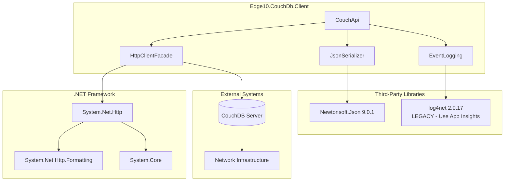
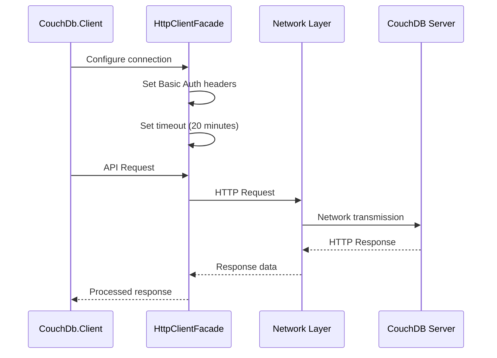
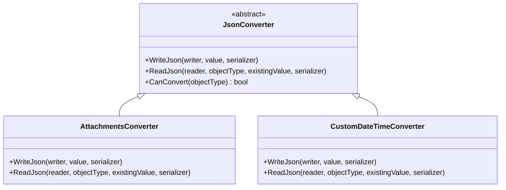

# Integrations Overview

**Navigation**: [Documentation Index](../DocumentationIndex.md) | [Main Documentation](../Edge10.CouchDb.Client.md)

## External Integrations Architecture

Edge10.CouchDb.Client integrates with several external systems and libraries to provide comprehensive CouchDB functionality. This document outlines all external dependencies and integration patterns.

## Integration Architecture



## Core Dependencies

### .NET Framework Dependencies

#### System.Net.Http
- **Version**: .NET Framework 4.5.2 built-in
- **Framework Requirement**: **.NET Framework 4.5.2 is mandatory** for older Edge10 applications - no migration to newer frameworks planned
- **Purpose**: HTTP client operations
- **Legacy Support**: Maintains compatibility with existing Edge10 infrastructure
- **Integration**: Direct usage through HttpClient and HttpClientHandler

```csharp
public class HttpClientFacade : IHttpClientFacade
{
    private HttpClient _client;
    
    public HttpClientFacade(HttpClientHandler clientHandler)
    {
        _client = new HttpClient(clientHandler, false);
    }
    
    // Direct delegation to HttpClient methods
    public Task<HttpResponseMessage> GetAsync(string requestUri)
    {
        return _client.GetAsync(requestUri);
    }
}
```

#### System.Net.Http.Formatting
- **Version**: 5.2.3.0 (via NuGet package)
- **Purpose**: JSON media type formatting for HTTP requests
- **Integration**: Used for key-based view queries

```csharp
// Usage in view queries with keys
var parameters = new { keys = viewParameters.Keys };
using (var keysContent = new ObjectContent<dynamic>(parameters, new JsonMediaTypeFormatter()))
using (var request = new HttpRequestMessage(HttpMethod.Post, url))
{
    request.Content = keysContent;
    var response = await _client.SendAsync(request);
}
```

### Third-Party Library Dependencies

#### Newtonsoft.Json
- **Version**: 9.0.1
- **Purpose**: JSON serialization and deserialization
- **Integration**: Core serialization engine with custom settings

```csharp
private JsonSerializer CreateSerializer()
{
    var settings = new JsonSerializerSettings
    {
        TypeNameHandling = TypeNameHandling.Objects,
        ContractResolver = new CamelCasePropertyNamesContractResolver()
    };
    
    foreach (var converter in Converters)
        settings.Converters.Add(converter);
    
    _settingsChanges?.Invoke(settings);
    
    return JsonSerializer.Create(settings);
}
```

**Key Features Used:**
- Custom JsonConverter implementations
- Camel case property name resolution
- Type name handling for polymorphic scenarios
- Custom serialization settings

#### log4net (LEGACY - Replaced by Application Insights)
- **Version**: 2.0.17
- **Status**: **LEGACY** - This dependency is deprecated and replaced by Application Insights in current Edge10 applications
- **Purpose**: Legacy logging framework integration for older applications
- **Current Recommendation**: Use Application Insights for new implementations
- **Integration**: Optional logging through ICouchEventLog implementations (legacy support only)

```csharp
public class CouchTimelineEventLog : ICouchEventLog
{
    private static readonly ILog _log = LogManager.GetLogger(typeof(CouchTimelineEventLog));
    
    public IDisposable LogDocumentEvent(string documentId, string operation)
    {
        var stopwatch = Stopwatch.StartNew();
        
        return new DisposableWrapper<string>(documentId, id =>
        {
            stopwatch.Stop();
            _log.InfoFormat("CouchDB {0} operation for document {1} completed in {2}ms",
                operation, id, stopwatch.ElapsedMilliseconds);
        });
    }
}
```

## CouchDB Server Integration

### Connection Architecture



### Authentication Integration

```csharp
public CouchApi(ICouchDbConnectionStringBuilder connectionString, ...)
{
    // Basic authentication setup
    _client.SetAuthorizationHeader(
        new AuthenticationHeaderValue("Basic", 
            Convert.ToBase64String(
                Encoding.UTF8.GetBytes($"{connectionString.User}:{connectionString.Password}")
            )
        )
    );
}
```

### CouchDB API Endpoints

| Operation | HTTP Method | CouchDB Endpoint | Purpose |
|-----------|-------------|------------------|---------|
| **Database Info** | GET | `/{database}` | Connection verification |
| **Document CRUD** | GET/PUT/DELETE | `/{database}/{docid}` | Document operations |
| **Document Head** | HEAD | `/{database}/{docid}` | Revision retrieval |
| **Bulk Operations** | POST | `/{database}/_bulk_docs` | Bulk document processing |
| **View Queries** | GET/POST | `/{database}/_design/{ddoc}/_view/{view}` | View execution |
| **Changes Feed** | GET | `/{database}/_changes` | Change monitoring |
| **Attachments** | GET/PUT/DELETE | `/{database}/{docid}/{attachment}` | File operations |
| **All Docs** | GET/POST | `/{database}/_all_docs` | Document listing |
| **Active Tasks** | GET | `/_active_tasks` | Replication monitoring |

## Configuration Integration

### Connection String Management

```csharp
public interface ICouchDbConnectionStringBuilder
{
    string Server { get; set; }
    int Port { get; set; }
    string DatabaseName { get; set; }
    string User { get; set; }
    string Password { get; set; }
}

public class CouchDbConnectionStringBuilder : ICouchDbConnectionStringBuilder
{
    public string Server { get; set; } = "localhost";
    public int Port { get; set; } = 5984;
    public string DatabaseName { get; set; }
    public string User { get; set; }
    public string Password { get; set; }
}
```

### Application Configuration Integration

```csharp
// app.config / web.config integration
<configuration>
  <appSettings>
    <add key="CouchDB.Server" value="localhost" />
    <add key="CouchDB.Port" value="5984" />
    <add key="CouchDB.Database" value="myapp" />
    <add key="CouchDB.User" value="admin" />
    <add key="CouchDB.Password" value="password" />
  </appSettings>
</configuration>

// Usage
var connectionString = new CouchDbConnectionStringBuilder
{
    Server = ConfigurationManager.AppSettings["CouchDB.Server"],
    Port = int.Parse(ConfigurationManager.AppSettings["CouchDB.Port"]),
    DatabaseName = ConfigurationManager.AppSettings["CouchDB.Database"],
    User = ConfigurationManager.AppSettings["CouchDB.User"],
    Password = ConfigurationManager.AppSettings["CouchDB.Password"]
};
```

## JSON Serialization Integration

### Custom Converter Architecture



### Serialization Strategy Integration

```csharp
public class SerializationStrategy
{
    public Func<Stream, StreamReader> ReaderFactory { get; set; }
    public Func<StringBuilder, StringWriter> WriterFactory { get; set; }
}

// Usage with custom encoding or compression
var strategy = new SerializationStrategy
{
    ReaderFactory = stream => new StreamReader(stream, Encoding.UTF8),
    WriterFactory = builder => new StringWriter(builder)
};

var couchApi = new CouchApi(connectionString, eventLog, strategy);
```

## Logging Integration Patterns

### Event Logging Interface

```csharp
// Event logging interface for DEBUGGING PURPOSES ONLY
// Separate auditing framework exists for compliance and security auditing
public interface ICouchEventLog
{
    // Log document operations for debugging and performance monitoring
    IDisposable LogDocumentEvent(string documentId, string operation);
    
    // Log view operations for debugging query performance
    IDisposable LogViewEvent(IViewParameters viewParameters);
}
```

**Event Logging Purpose:**
- **Debugging Only**: Event logging is intended for debugging and development purposes
- **Performance Monitoring**: Track operation timings and identify performance bottlenecks
- **Not for Auditing**: This is NOT an auditing or compliance logging system
- **Separate Auditing**: Edge10 applications use a separate, dedicated auditing framework for compliance and security audit trails

### Integration Implementations

#### Null Object Pattern
```csharp
public class NullCouchEventLog : ICouchEventLog
{
    public static readonly ICouchEventLog Instance = new NullCouchEventLog();
    
    public IDisposable LogDocumentEvent(string documentId, string operation)
    {
        return new DisposableWrapper<string>(string.Empty, _ => { });
    }
    
    public IDisposable LogViewEvent(IViewParameters viewParameters)
    {
        return new DisposableWrapper<IViewParameters>(null, _ => { });
    }
}
```

#### Timeline Event Logging (LEGACY)
```csharp
// LEGACY IMPLEMENTATION - Use Application Insights for new applications
public class CouchTimelineEventLog : ICouchEventLog
{
    // DEPRECATED: log4net dependency - replace with Application Insights telemetry
    private static readonly ILog _log = LogManager.GetLogger(typeof(CouchTimelineEventLog));
    
    public IDisposable LogDocumentEvent(string documentId, string operation)
    {
        var stopwatch = Stopwatch.StartNew();
        _log.DebugFormat("Starting CouchDB {0} operation for document {1}", operation, documentId);
        
        return new DisposableWrapper<string>(documentId, id =>
        {
            stopwatch.Stop();
            _log.InfoFormat("CouchDB {0} operation for document {1} completed in {2}ms",
                operation, id, stopwatch.ElapsedMilliseconds);
        });
    }
}

// RECOMMENDED: Modern Application Insights implementation
public class ApplicationInsightsCouchEventLog : ICouchEventLog
{
    private readonly TelemetryClient _telemetryClient;
    
    public ApplicationInsightsCouchEventLog(TelemetryClient telemetryClient)
    {
        _telemetryClient = telemetryClient;
    }
    
    public IDisposable LogDocumentEvent(string documentId, string operation)
    {
        var stopwatch = Stopwatch.StartNew();
        
        return new DisposableWrapper<string>(documentId, id =>
        {
            stopwatch.Stop();
            _telemetryClient.TrackDependency("CouchDB", operation, documentId, 
                DateTime.UtcNow.Subtract(TimeSpan.FromMilliseconds(stopwatch.ElapsedMilliseconds)), 
                TimeSpan.FromMilliseconds(stopwatch.ElapsedMilliseconds), true);
        });
    }
}
```

## Network Integration Considerations

### Timeout Configuration

```csharp
public CouchApi(ICouchDbConnectionStringBuilder connectionString, ...)
{
    // Configure generous timeout for CouchDB operations
    _client.Timeout = TimeSpan.FromMinutes(20);
}
```

### Connection Management

```csharp
// Single HttpClient instance for connection pooling
private IHttpClientFacade _client;

public void Dispose()
{
    _client?.Dispose();
    _client = null;
}
```

### Error Handling Integration

```csharp
public static async Task ThrowErrorIfNotSuccess(
    this HttpResponseMessage response,
    Func<HttpResponseMessage, string, Exception> exceptionFactory = null)
{
    if (response.IsSuccessStatusCode) return;
    
    var content = await response.Content.ReadAsStringAsync();
    
    if (exceptionFactory != null)
        throw exceptionFactory(response, content);
    
    throw new HttpRequestException($"{(int)response.StatusCode} {response.ReasonPhrase} {content}");
}
```

## Testing Integration

### Mock-Friendly Architecture

```csharp
// Interface-based design enables testing
public interface IHttpClientFacade : IDisposable
{
    Task<HttpResponseMessage> GetAsync(string requestUri);
    Task<HttpResponseMessage> PostAsync(string requestUri, HttpContent content);
    // ... other HTTP methods
}

// Testing with mocks
[Test]
public async Task CreateDocumentAsync_Should_CallHttpClient()
{
    // Arrange
    var mockHttpClient = new Mock<IHttpClientFacade>();
    mockHttpClient.Setup(x => x.PutAsync(It.IsAny<string>(), It.IsAny<HttpContent>()))
                  .ReturnsAsync(new HttpResponseMessage(HttpStatusCode.Created));
    
    var couchApi = new CouchApi(connectionString, mockHttpClient.Object, mockEventLog.Object, null);
    
    // Act & Assert
    await couchApi.CreateDocumentAsync(new TestDocument());
    mockHttpClient.Verify(x => x.PutAsync(It.IsAny<string>(), It.IsAny<HttpContent>()), Times.Once);
}
```

## Deployment Integration

### Package Dependencies

```xml
<!-- packages.config -->
<packages>
  <package id="log4net" version="2.0.17" targetFramework="net452" />
  <package id="Newtonsoft.Json" version="9.0.1" targetFramework="net452" />
  <package id="System.Net.Http.Formatting.Extension" version="5.2.3.0" targetFramework="net452" />
</packages>
```

### Assembly Dependencies

```csharp
// AssemblyInfo.cs references
[assembly: AssemblyVersion("1.0.0.0")]
[assembly: AssemblyFileVersion("1.0.0.0")]

// Required assembly references in consuming applications
// - System.Net.Http
// - System.Net.Http.Formatting
// - Newtonsoft.Json
// - log4net (if using CouchTimelineEventLog)
```

## Integration Best Practices

### 1. Connection Management
- Use single CouchApi instance per database
- Implement proper disposal patterns
- Configure appropriate timeouts

### 2. Serialization Customization
- Use custom JsonConverters for complex types
- Apply consistent naming conventions
- Handle versioning through serialization settings

### 3. Logging Integration
- Implement custom ICouchEventLog for application-specific logging
- Use NullCouchEventLog for production when logging not needed
- Monitor performance through event logging

### 4. Error Handling
- Implement custom exception factories for application-specific errors
- Handle network-related exceptions appropriately
- Use retry patterns for transient failures

### 5. Testing Strategy
- Mock IHttpClientFacade for unit testing
- Use in-memory CouchDB for integration testing
- Test serialization scenarios independently

---

*This integrations overview documents all external dependencies and integration patterns used by Edge10.CouchDb.Client, providing guidance for successful deployment and customization.*