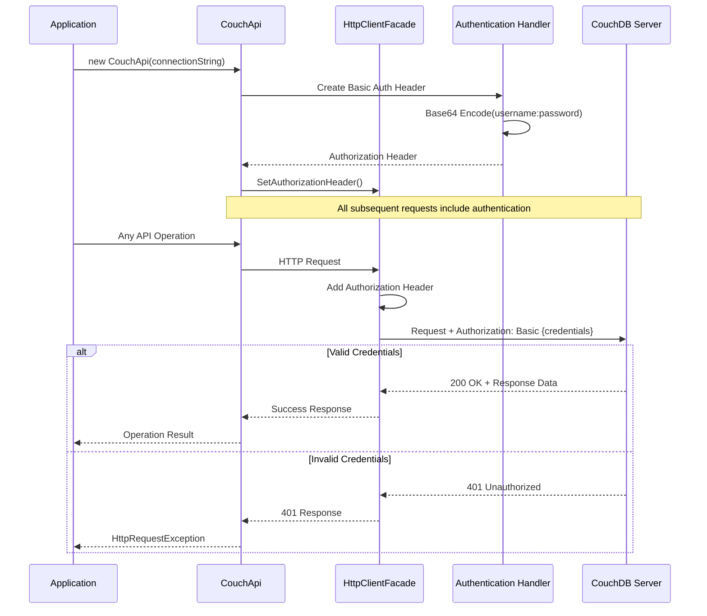

# Authentication Implementation

**Navigation**: [Documentation Index](../DocumentationIndex.md) | [Security Overview](security-overview.md)

## Authentication Overview

The Edge10.CouchDb.Client implements HTTP Basic Authentication as its primary authentication mechanism for connecting to CouchDB servers. The authentication system is built into the HTTP client layer and automatically handles credential encoding and header management.

## HTTP Basic Authentication

### Authentication Flow



### Basic Authentication Implementation

```csharp
public CouchApi(ICouchDbConnectionStringBuilder connectionString, ...)
{
    // Create Basic Authentication header from connection string credentials
    var credentials = Convert.ToBase64String(
        Encoding.UTF8.GetBytes($"{connectionString.User}:{connectionString.Password}"));
    
    var authHeader = new AuthenticationHeaderValue("Basic", credentials);
    _client.SetAuthorizationHeader(authHeader);
}
```

### HttpClientFacade Authentication Support

```csharp
public void SetAuthorizationHeader(AuthenticationHeaderValue header)
{
    DefaultRequestHeaders.Authorization = header;
}

// The authorization header is automatically included in all HTTP requests
public Task<HttpResponseMessage> GetAsync(string requestUri)
{
    return _client.GetAsync(requestUri); // Includes Authorization header
}
```

## Connection String Authentication

### ICouchDbConnectionStringBuilder Interface

```csharp
public interface ICouchDbConnectionStringBuilder
{
    string Server { get; set; }
    int? Port { get; set; }
    string User { get; set; }        // Authentication username
    string Password { get; set; }    // Authentication password  
    string DatabaseName { get; set; }
}
```

### CouchDbConnectionStringBuilder Implementation

```csharp
public class CouchDbConnectionStringBuilder : DbConnectionStringBuilder, ICouchDbConnectionStringBuilder
{
    public string User
    {
        get { return ContainsKey("User") ? (string)base["User"] : null; }
        set { base["User"] = value; }
    }

    public string Password
    {
        get { return ContainsKey("Password") ? (string)base["Password"] : null; }
        set { base["Password"] = value; }
    }
    
    // Other connection properties...
}
```

### Authentication Configuration Examples

```csharp
// Direct property assignment
var connectionString = new CouchDbConnectionStringBuilder
{
    Server = "couchdb.example.com",
    Port = 5984,
    User = "myapp_user",
    Password = "secure_password123",
    DatabaseName = "production_db"
};

// Connection string format
var connectionString = new CouchDbConnectionStringBuilder
{
    ConnectionString = "Server=localhost;Port=5984;User=admin;Password=admin;DatabaseName=testdb"
};

// Environment-based configuration
var connectionString = new CouchDbConnectionStringBuilder
{  
    Server = Environment.GetEnvironmentVariable("COUCHDB_SERVER"),
    Port = int.Parse(Environment.GetEnvironmentVariable("COUCHDB_PORT") ?? "5984"),
    User = Environment.GetEnvironmentVariable("COUCHDB_USER"),
    Password = Environment.GetEnvironmentVariable("COUCHDB_PASSWORD"),
    DatabaseName = Environment.GetEnvironmentVariable("COUCHDB_DATABASE")
};
```

## Credential Management

### Secure Credential Storage

```csharp
public class SecureCredentialProvider
{
    private readonly IConfiguration _configuration;
    private readonly ISecretManager _secretManager;
    
    public SecureCredentialProvider(IConfiguration configuration, ISecretManager secretManager)
    {
        _configuration = configuration;
        _secretManager = secretManager;
    }
    
    public async Task<ICouchDbConnectionStringBuilder> GetConnectionStringAsync()
    {
        // Retrieve credentials from secure storage
        var username = await _secretManager.GetSecretAsync("CouchDB:Username");
        var password = await _secretManager.GetSecretAsync("CouchDB:Password");
        
        return new CouchDbConnectionStringBuilder
        {
            Server = _configuration["CouchDB:Server"],
            Port = _configuration.GetValue<int>("CouchDB:Port"),
            User = username,
            Password = password,
            DatabaseName = _configuration["CouchDB:Database"]
        };
    }
}

// Azure Key Vault example
public class AzureKeyVaultSecretManager : ISecretManager
{
    private readonly SecretClient _secretClient;
    
    public AzureKeyVaultSecretManager(string keyVaultUrl)
    {
        _secretClient = new SecretClient(new Uri(keyVaultUrl), new DefaultAzureCredential());
    }
    
    public async Task<string> GetSecretAsync(string secretName)
    {
        var secret = await _secretClient.GetSecretAsync(secretName);
        return secret.Value.Value;
    }
}
```

### Environment Variable Configuration

```csharp
public static class AuthenticationConfiguration
{
    public static ICouchDbConnectionStringBuilder FromEnvironment()
    {
        var server = Environment.GetEnvironmentVariable("COUCHDB_SERVER") 
                    ?? throw new InvalidOperationException("COUCHDB_SERVER environment variable not set");
        
        var username = Environment.GetEnvironmentVariable("COUCHDB_USERNAME")
                      ?? throw new InvalidOperationException("COUCHDB_USERNAME environment variable not set");
        
        var password = Environment.GetEnvironmentVariable("COUCHDB_PASSWORD")
                      ?? throw new InvalidOperationException("COUCHDB_PASSWORD environment variable not set");
        
        return new CouchDbConnectionStringBuilder
        {
            Server = server,
            Port = int.Parse(Environment.GetEnvironmentVariable("COUCHDB_PORT") ?? "5984"),
            User = username,
            Password = password,
            DatabaseName = Environment.GetEnvironmentVariable("COUCHDB_DATABASE")
        };
    }
}
```

## Authentication Error Handling

### Authentication-Specific Error Detection

```csharp
public static class AuthenticationErrorHandler
{
    public static async Task<T> ExecuteWithAuthenticationErrorHandling<T>(Func<Task<T>> operation)
    {
        try
        {
            return await operation();
        }
        catch (HttpRequestException ex) when (IsAuthenticationError(ex))
        {
            throw new CouchDbAuthenticationException(
                "Authentication failed. Please check your username and password.", ex);
        }
        catch (HttpRequestException ex) when (IsAuthorizationError(ex))
        {
            throw new CouchDbAuthorizationException(
                "Access denied. User does not have sufficient permissions.", ex);
        }
    }
    
    private static bool IsAuthenticationError(HttpRequestException ex)
    {
        return ex.Message.Contains("401") || ex.Message.ToLowerInvariant().Contains("unauthorized");
    }
    
    private static bool IsAuthorizationError(HttpRequestException ex)
    {
        return ex.Message.Contains("403") || ex.Message.ToLowerInvariant().Contains("forbidden");
    }
}

public class CouchDbAuthenticationException : Exception
{
    public CouchDbAuthenticationException(string message) : base(message) { }
    public CouchDbAuthenticationException(string message, Exception innerException) : base(message, innerException) { }
}

public class CouchDbAuthorizationException : Exception
{
    public CouchDbAuthorizationException(string message) : base(message) { }
    public CouchDbAuthorizationException(string message, Exception innerException) : base(message, innerException) { }
}
```

### Connection Validation

```csharp
public async Task<bool> ValidateAuthenticationAsync()
{
    try
    {
        await CheckConnection();
        return true;
    }
    catch (HttpRequestException ex) when (ex.Message.Contains("401"))
    {
        return false; // Authentication failed
    }
    catch (HttpRequestException ex) when (ex.Message.Contains("403"))
    {
        return false; // Authorization failed
    }
}

public async Task<AuthenticationResult> TestAuthentication()
{
    try
    {
        await CheckConnection();
        return AuthenticationResult.Success();
    }
    catch (HttpRequestException ex) when (ex.Message.Contains("401"))
    {
        return AuthenticationResult.Failed("Invalid username or password");
    }
    catch (HttpRequestException ex) when (ex.Message.Contains("403"))
    {
        return AuthenticationResult.Failed("User does not have access to this database");
    }
    catch (Exception ex)
    {
        return AuthenticationResult.Error($"Connection error: {ex.Message}");
    }
}

public class AuthenticationResult
{
    public bool IsSuccess { get; private set; }
    public string ErrorMessage { get; private set; }
    public AuthenticationResultType ResultType { get; private set; }
    
    public static AuthenticationResult Success() => 
        new AuthenticationResult { IsSuccess = true, ResultType = AuthenticationResultType.Success };
    
    public static AuthenticationResult Failed(string message) => 
        new AuthenticationResult { ResultType = AuthenticationResultType.AuthenticationFailed, ErrorMessage = message };
    
    public static AuthenticationResult Error(string message) => 
        new AuthenticationResult { ResultType = AuthenticationResultType.ConnectionError, ErrorMessage = message };
}

public enum AuthenticationResultType
{
    Success,
    AuthenticationFailed,
    AuthorizationFailed,
    ConnectionError
}
```

## Advanced Authentication Patterns

### Token-Based Authentication Extension

```csharp
public class TokenAuthenticationHandler : DelegatingHandler
{
    private readonly ITokenProvider _tokenProvider;
    private string _cachedToken;
    private DateTime _tokenExpiry;
    
    public TokenAuthenticationHandler(ITokenProvider tokenProvider, HttpMessageHandler innerHandler = null)
        : base(innerHandler ?? new HttpClientHandler())
    {
        _tokenProvider = tokenProvider;
    }
    
    protected override async Task<HttpResponseMessage> SendAsync(HttpRequestMessage request, CancellationToken cancellationToken)
    {
        await EnsureValidTokenAsync();
        request.Headers.Authorization = new AuthenticationHeaderValue("Bearer", _cachedToken);
        
        var response = await base.SendAsync(request, cancellationToken);
        
        if (response.StatusCode == HttpStatusCode.Unauthorized)
        {
            // Token might be expired, refresh and retry
            _cachedToken = null;
            await EnsureValidTokenAsync();
            request.Headers.Authorization = new AuthenticationHeaderValue("Bearer", _cachedToken);
            response = await base.SendAsync(request, cancellationToken);
        }
        
        return response;
    }
    
    private async Task EnsureValidTokenAsync()
    {
        if (string.IsNullOrEmpty(_cachedToken) || DateTime.UtcNow >= _tokenExpiry)
        {
            var tokenResponse = await _tokenProvider.GetTokenAsync();
            _cachedToken = tokenResponse.Token;
            _tokenExpiry = tokenResponse.ExpiresAt;
        }
    }
}

public interface ITokenProvider
{
    Task<TokenResponse> GetTokenAsync();
}

public class TokenResponse
{
    public string Token { get; set; }
    public DateTime ExpiresAt { get; set; }
}
```

### Multi-User Authentication

```csharp
public class MultiUserCouchApiFactory
{
    private readonly Dictionary<string, ICouchApi> _userConnections = new();
    private readonly string _server;
    private readonly int _port;
    private readonly string _database;
    
    public MultiUserCouchApiFactory(string server, int port, string database)
    {
        _server = server;
        _port = port;
        _database = database;
    }
    
    public ICouchApi GetApiForUser(string username, string password)
    {
        var key = $"{username}:{GetPasswordHash(password)}";
        
        if (!_userConnections.ContainsKey(key))
        {
            var connectionString = new CouchDbConnectionStringBuilder
            {
                Server = _server,
                Port = _port,
                User = username,
                Password = password,
                DatabaseName = _database
            };
            
            _userConnections[key] = new CouchApi(connectionString);
        }
        
        return _userConnections[key];
    }
    
    private string GetPasswordHash(string password)
    {
        using var sha256 = SHA256.Create();
        var hashBytes = sha256.ComputeHash(Encoding.UTF8.GetBytes(password));
        return Convert.ToBase64String(hashBytes);
    }
    
    public void Dispose()
    {
        foreach (var connection in _userConnections.Values)
        {
            connection.Dispose();
        }
        _userConnections.Clear();
    }
}
```

### Authentication Middleware

```csharp
public class AuthenticationMiddleware
{
    private readonly RequestDelegate _next;
    private readonly ICouchApiFactory _couchApiFactory;
    
    public AuthenticationMiddleware(RequestDelegate next, ICouchApiFactory couchApiFactory)
    {
        _next = next;
        _couchApiFactory = couchApiFactory;
    }
    
    public async Task InvokeAsync(HttpContext context)
    {
        var authHeader = context.Request.Headers["Authorization"].FirstOrDefault();
        
        if (authHeader != null && authHeader.StartsWith("Basic "))
        {
            var credentials = ExtractCredentials(authHeader);
            
            try
            {
                var couchApi = _couchApiFactory.CreateApi(credentials.Username, credentials.Password);
                await couchApi.CheckConnection(); // Validate credentials
                
                context.Items["CouchApi"] = couchApi;
                context.Items["Username"] = credentials.Username;
            }
            catch (HttpRequestException ex) when (ex.Message.Contains("401"))
            {
                context.Response.StatusCode = 401;
                return;
            }
        }
        
        await _next(context);
    }
    
    private (string Username, string Password) ExtractCredentials(string authHeader)
    {
        var encodedCredentials = authHeader.Substring("Basic ".Length).Trim();
        var credentials = Encoding.UTF8.GetString(Convert.FromBase64String(encodedCredentials));
        var parts = credentials.Split(':', 2);
        return (parts[0], parts[1]);
    }
}
```

## Security Best Practices

### Credential Security Guidelines

```csharp
public static class AuthenticationSecurityGuidelines
{
    public static void ValidateCredentials(string username, string password)
    {
        if (string.IsNullOrWhiteSpace(username))
            throw new ArgumentException("Username cannot be null or empty", nameof(username));
            
        if (string.IsNullOrWhiteSpace(password))
            throw new ArgumentException("Password cannot be null or empty", nameof(password));
            
        if (password.Length < 8)
            throw new ArgumentException("Password must be at least 8 characters long", nameof(password));
            
        // Additional password complexity checks
        if (!HasMinimumComplexity(password))
            throw new ArgumentException("Password does not meet complexity requirements", nameof(password));
    }
    
    private static bool HasMinimumComplexity(string password)
    {
        var hasUpper = password.Any(char.IsUpper);
        var hasLower = password.Any(char.IsLower);
        var hasDigit = password.Any(char.IsDigit);
        var hasSpecial = password.Any(c => !char.IsLetterOrDigit(c));
        
        return hasUpper && hasLower && hasDigit && hasSpecial;
    }
    
    public static string SecurePasswordHash(string password, string salt)
    {
        using var pbkdf2 = new Rfc2898DeriveBytes(password, Encoding.UTF8.GetBytes(salt), 10000);
        var hash = pbkdf2.GetBytes(32);
        return Convert.ToBase64String(hash);
    }
}
```

### Connection String Sanitization

```csharp
public static class ConnectionStringSanitizer
{
    public static string SanitizeForLogging(string connectionString)
    {
        if (string.IsNullOrEmpty(connectionString))
            return connectionString;
            
        // Remove password from connection string for logging
        var regex = new Regex(@"Password=([^;]+)", RegexOptions.IgnoreCase);
        return regex.Replace(connectionString, "Password=***");
    }
    
    public static ICouchDbConnectionStringBuilder SanitizeCopy(ICouchDbConnectionStringBuilder original)
    {
        return new CouchDbConnectionStringBuilder
        {
            Server = original.Server,
            Port = original.Port,
            User = original.User,
            Password = "***", // Sanitized
            DatabaseName = original.DatabaseName
        };
    }
}
```

## Testing Authentication

### Authentication Unit Tests

```csharp
[Test]
public void BasicAuthentication_Should_CreateCorrectHeader()
{
    // Arrange
    var username = "testuser";
    var password = "testpassword";
    var expectedCredentials = Convert.ToBase64String(Encoding.UTF8.GetBytes($"{username}:{password}"));
    
    var connectionString = new CouchDbConnectionStringBuilder
    {
        Server = "localhost",
        User = username,
        Password = password,
        DatabaseName = "testdb"
    };
    
    var mockHttpClient = new Mock<IHttpClientFacade>();
    
    // Act
    var couchApi = new CouchApi(connectionString, mockHttpClient.Object, new NullCouchEventLog(), null);
    
    // Assert
    mockHttpClient.Verify(x => x.SetAuthorizationHeader(
        It.Is<AuthenticationHeaderValue>(h => 
            h.Scheme == "Basic" && h.Parameter == expectedCredentials)), Times.Once);
}

[Test]
public async Task Authentication_Should_ThrowOnInvalidCredentials()
{
    // Arrange
    var mockHttpClient = new Mock<IHttpClientFacade>();
    mockHttpClient.Setup(x => x.GetAsync(It.IsAny<string>()))
              .ThrowsAsync(new HttpRequestException("401 Unauthorized"));
    
    var connectionString = new CouchDbConnectionStringBuilder
    {
        Server = "localhost",
        User = "invalid",
        Password = "credentials",
        DatabaseName = "testdb"
    };
    
    var couchApi = new CouchApi(connectionString, mockHttpClient.Object, new NullCouchEventLog(), null);
    
    // Act & Assert
    Assert.ThrowsAsync<HttpRequestException>(() => couchApi.CheckConnection());
}
```

### Integration Testing with Authentication

```csharp
[Test]
public async Task Authentication_Integration_Should_ConnectWithValidCredentials()
{
    // Arrange - using test container with known credentials
    using var couchContainer = new CouchDbTestContainer();
    await couchContainer.StartAsync();
    
    var connectionString = new CouchDbConnectionStringBuilder
    {
        Server = couchContainer.GetConnectionString(),
        User = "admin",
        Password = "admin",
        DatabaseName = "test_auth_db"
    };
    
    using var couchApi = new CouchApi(connectionString);
    
    // Act & Assert
    Assert.DoesNotThrowAsync(() => couchApi.CheckConnection());
}

[Test]
public async Task Authentication_Integration_Should_FailWithInvalidCredentials()
{
    // Arrange
    var connectionString = new CouchDbConnectionStringBuilder
    {
        Server = "localhost",
        Port = 5984,
        User = "invalid_user",
        Password = "wrong_password",
        DatabaseName = "test_db"
    };
    
    using var couchApi = new CouchApi(connectionString);
    
    // Act & Assert
    Assert.ThrowsAsync<HttpRequestException>(() => couchApi.CheckConnection());
}
```

## Best Practices

1. **Never hardcode credentials**: Use configuration files, environment variables, or secure vaults
2. **Use HTTPS in production**: Encrypt authentication headers in transit
3. **Implement credential validation**: Validate username and password complexity
4. **Handle authentication errors gracefully**: Provide meaningful error messages
5. **Test authentication scenarios**: Include both valid and invalid credential tests
6. **Sanitize connection strings**: Remove passwords from logs and error messages
7. **Use secure credential storage**: Leverage Azure Key Vault, AWS Secrets Manager, etc.
8. **Implement connection validation**: Test credentials before using them
9. **Monitor authentication failures**: Log and alert on repeated authentication failures
10. **Rotate credentials regularly**: Implement credential rotation policies

---

*For more information about authentication, see [Security Overview](security-overview.md), [Connection Security](connection-security.md), and [Data Protection](data-protection.md).*