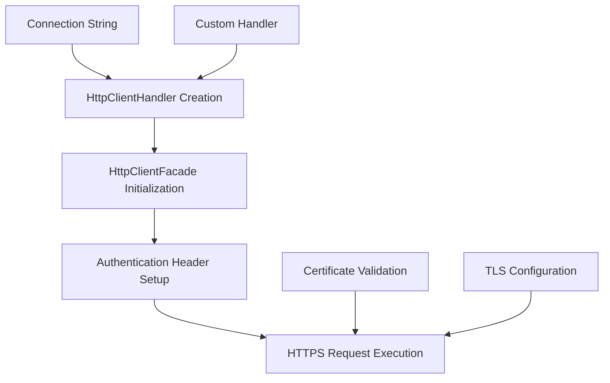

# Connection Security

This document analyzes the secure connection management and HTTPS handling patterns implemented in Edge10.CouchDb.Client.

## Navigation
- [Back to Security Overview](security-overview.md)
- [Back to Documentation Index](../DocumentationIndex.md)
- [Authentication](authentication.md)
- [Data Protection](data-protection.md)

## Overview

Edge10.CouchDb.Client implements connection security through HTTP client configuration and basic authentication, but relies primarily on the underlying .NET HttpClient infrastructure for transport security.

## HTTPS Support Analysis

### Current Implementation

The library supports HTTPS connections through URL configuration:

```csharp
// CouchApi.cs - URL construction
private static string GetServerUrl(ICouchDbConnectionStringBuilder connectionString)
{
    var port = connectionString.Port ?? 5984;
    return $"http://{connectionString.Server}:{port}";
}
```

**Security Concern**: The current implementation defaults to HTTP and does not automatically enforce HTTPS connections.

### Connection String Configuration

The `CouchDbConnectionStringBuilder` accepts server URLs but does not validate or enforce security protocols:

```csharp
public class CouchDbConnectionStringBuilder : DbConnectionStringBuilder
{
    public string Server { get; set; }
    public int? Port { get; set; }
    // No explicit SSL/TLS configuration properties
}
```

## HTTP Client Handler Configuration

### Current Architecture

The library allows injection of custom `HttpClientHandler` instances:

```csharp
public CouchApi(ICouchDbConnectionStringBuilder connectionString, 
               ICouchEventLog eventLog = null, 
               SerializationStrategy serializationStrategy = null, 
               HttpClientHandler httpClientHandler = null)
{
    // Uses provided handler or creates default
    new HttpClientFacade(httpClientHandler ?? new HttpClientHandler())
}
```

### Security Benefits
- **Customizable**: Allows consumers to configure SSL/TLS settings
- **Certificate Validation**: Can implement custom certificate validation
- **Proxy Support**: Enables corporate proxy configurations

### Security Limitations
- **No Default Hardening**: Default handler uses system defaults
- **No Certificate Pinning**: No built-in certificate validation
- **No Protocol Enforcement**: Doesn't enforce minimum TLS versions

## Connection Security Patterns

### Secure Connection Configuration

To establish secure connections, consumers must:

1. **Use HTTPS URLs**:
```csharp
var connectionString = new CouchDbConnectionStringBuilder
{
    Server = "secure-couchdb.example.com",
    Port = 6984, // HTTPS port
    DatabaseName = "mydb",
    User = "username",
    Password = "password"
};
```

2. **Configure Custom Handler** (for advanced scenarios):
```csharp
var handler = new HttpClientHandler
{
    ServerCertificateCustomValidationCallback = (message, cert, chain, errors) =>
    {
        // Custom certificate validation logic
        return ValidateCertificate(cert, chain, errors);
    }
};

var couchApi = new CouchApi(connectionString, eventLog: null, 
                           serializationStrategy: null, 
                           httpClientHandler: handler);
```

## Security Architecture Patterns

### Connection Lifecycle Security



### Transport Security Flow

1. **Connection Establishment**
   - HttpClientHandler configuration
   - SSL/TLS negotiation (if HTTPS)
   - Certificate validation

2. **Authentication**
   - Basic authentication header creation
   - Credentials encoding (Base64)

3. **Request Security**
   - Transport encryption (HTTPS)
   - Request/response integrity

## Security Recommendations

### Immediate Improvements

1. **Enforce HTTPS by Default**:
```csharp
// Recommended enhancement
private static string GetSecureServerUrl(ICouchDbConnectionStringBuilder connectionString)
{
    var port = connectionString.Port ?? 6984; // Default HTTPS port
    var protocol = connectionString.UseHttps ? "https" : "http";
    return $"{protocol}://{connectionString.Server}:{port}";
}
```

2. **Add SSL Configuration Properties**:
```csharp
public interface ICouchDbConnectionStringBuilder
{
    bool UseHttps { get; set; }
    bool ValidateCertificates { get; set; }
    string[] AcceptedCertificateThumbprints { get; set; }
}
```

3. **Implement Connection Security Validation**:
```csharp
public async Task ValidateConnectionSecurity()
{
    if (!_url.StartsWith("https://"))
    {
        _eventLog?.LogWarning("Insecure HTTP connection detected");
    }
    
    // Additional security checks
}
```

### Advanced Security Features

1. **Certificate Pinning**:
```csharp
public class CertificatePinningHandler : HttpClientHandler
{
    private readonly string[] _pinnedThumbprints;
    
    protected override async Task<HttpResponseMessage> SendAsync(
        HttpRequestMessage request, CancellationToken cancellationToken)
    {
        // Certificate validation logic
    }
}
```

2. **TLS Configuration**:
```csharp
var handler = new HttpClientHandler
{
    SslProtocols = SslProtocols.Tls12 | SslProtocols.Tls13,
    CheckCertificateRevocationList = true
};
```

## Connection Timeout Security

### Current Implementation

The library sets a default timeout:

```csharp
_client.Timeout = TimeSpan.FromMinutes(20);
```

### Security Considerations

- **DoS Protection**: Long timeouts can lead to resource exhaustion
- **Hanging Connections**: Extended timeouts may mask network issues
- **Resource Management**: Proper timeout configuration prevents connection leaks

### Recommended Timeout Strategy

```csharp
public class SecurityAwareTimeoutConfiguration
{
    public TimeSpan DefaultTimeout { get; set; } = TimeSpan.FromMinutes(5);
    public TimeSpan BulkOperationTimeout { get; set; } = TimeSpan.FromMinutes(10);
    public TimeSpan AttachmentTimeout { get; set; } = TimeSpan.FromMinutes(15);
}
```

## Network Security Considerations

### Proxy Support

The HttpClientHandler supports proxy configuration:

```csharp
var handler = new HttpClientHandler
{
    Proxy = new WebProxy("http://proxy.company.com:8080"),
    UseProxy = true
};
```

### Network Isolation

For enhanced security in enterprise environments:

1. **VPN Requirements**: Ensure CouchDB servers are accessible only via VPN
2. **Firewall Rules**: Restrict access to CouchDB ports
3. **Network Segmentation**: Isolate database networks

## Security Monitoring

### Connection Security Logging

The library supports event logging for security monitoring:

```csharp
public class SecurityAwareCouchEventLog : ICouchEventLog
{
    public void LogSecurityEvent(string eventType, string details)
    {
        // Log security-related connection events
        // - Certificate validation failures
        // - Connection timeouts
        // - Authentication failures
    }
}
```

### Recommended Security Metrics

1. **Connection Success/Failure Rates**
2. **Certificate Validation Events**
3. **Timeout Occurrences**
4. **Authentication Failures**

## Conclusion

While Edge10.CouchDb.Client provides a foundation for secure connections through HttpClientHandler injection, it lacks built-in security enforcement and configuration options. The library would benefit from:

1. **Default HTTPS enforcement**
2. **Built-in certificate validation options**
3. **Comprehensive SSL/TLS configuration**
4. **Security-focused connection monitoring**

These enhancements would significantly improve the security posture of applications using this CouchDB client library.

---

**Related Documentation:**
- [Authentication](authentication.md) - HTTP Basic authentication implementation
- [Data Protection](data-protection.md) - Data handling security considerations
- [Security Overview](security-overview.md) - Comprehensive security analysis