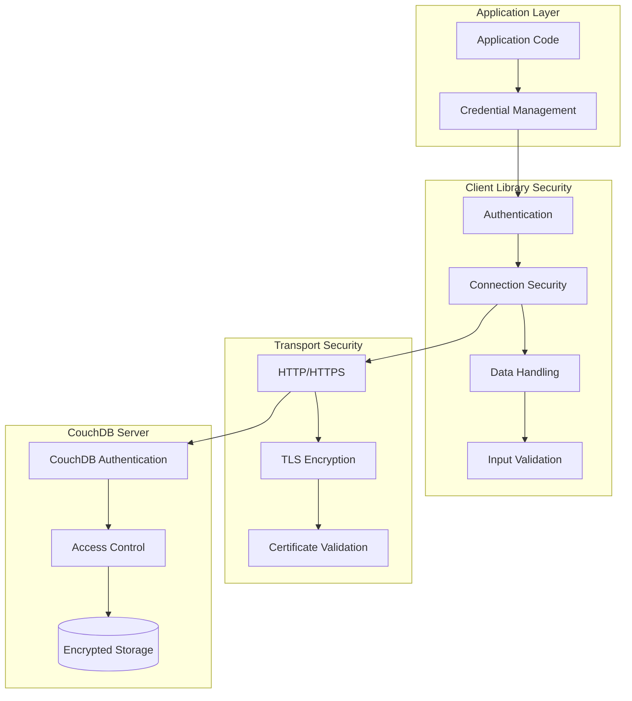
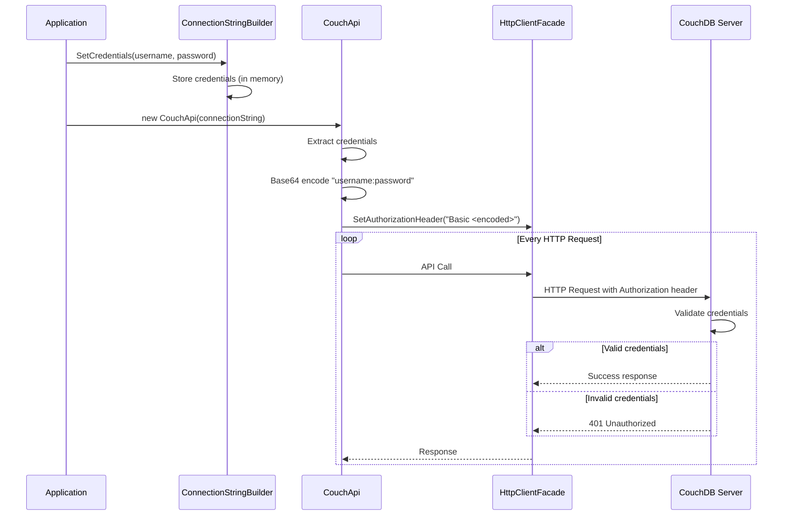

# Security Overview

**Navigation**: [Documentation Index](../DocumentationIndex.md) | [Main Documentation](../Edge10.CouchDb.Client.md)

## Security Architecture Overview

Edge10.CouchDb.Client implements security measures appropriate for a CouchDB client library, focusing on secure communication, authentication, and data protection patterns. This document outlines the security considerations, implementations, and best practices.

## Security Components



## Authentication Implementation

### HTTP Basic Authentication

The library implements HTTP Basic Authentication as the primary authentication method:

```csharp
public CouchApi(ICouchDbConnectionStringBuilder connectionString, ...)
{
    // ... initialization code
    
    // Basic authentication header creation
    _client.SetAuthorizationHeader(
        new AuthenticationHeaderValue("Basic", 
            Convert.ToBase64String(
                Encoding.UTF8.GetBytes($"{connectionString.User}:{connectionString.Password}")
            )
        )
    );
}
```

### Authentication Flow



### Authentication Security Considerations

#### Strengths
- Standard HTTP Basic Authentication protocol
- Automatic credential inclusion in all requests
- Base64 encoding as per HTTP specification

#### Limitations
- Base64 encoding is not encryption (credentials are easily decoded)
- No support for token-based authentication
- No automatic credential refresh
- Credentials stored in memory during client lifetime

#### Security Requirements
- **HTTPS enforcement is mandatory for production environments** to protect credentials in transit
- **Development environments should use HTTPS where possible** for consistency with production
- Credential storage should be managed securely by consuming applications
- Regular credential rotation should be implemented at the application level

## Connection Security

### HTTPS Support

```csharp
private static string GetServerUrl(ICouchDbConnectionStringBuilder connectionString)
{
    // Supports both HTTP and HTTPS protocols
    return $"{((connectionString.Server.StartsWith("http://") || connectionString.Server.StartsWith("https://")) ? string.Empty : "http://")}{connectionString.Server}:{connectionString.Port}";
}
```

**Security Requirements:**
- **HTTPS is mandatory for production environments** - HTTP connections should be blocked in production
- **HTTPS should be enforced at infrastructure level** (load balancers, reverse proxies, firewalls)
- Ensure proper TLS certificate validation is enabled
- Use strong TLS versions (TLS 1.2 or higher)
- Configure certificate pinning where appropriate for enhanced security

### Connection String Security

```csharp
public interface ICouchDbConnectionStringBuilder
{
    string Server { get; set; }
    int Port { get; set; }
    string DatabaseName { get; set; }
    string User { get; set; }
    string Password { get; set; }  // Stored in plain text
}
```

**Security Considerations:**
- Passwords are stored in plain text in memory
- No built-in credential encryption
- Connection strings may be logged inadvertently

**Mitigation Strategies:**
```csharp
// Secure credential management pattern
public class SecureConnectionStringBuilder : ICouchDbConnectionStringBuilder
{
    private readonly ICredentialStore _credentialStore;
    
    public string User { get; set; }
    
    public string Password => _credentialStore.GetPassword(User);
    
    // Other properties...
}
```

## Data Protection

### JSON Serialization Security

```csharp
private JsonSerializer CreateSerializer()
{
    var settings = new JsonSerializerSettings
    {
        TypeNameHandling = TypeNameHandling.Objects,  // Safe for controlled Edge10 JSON content
        ContractResolver = new CamelCasePropertyNamesContractResolver()
    };
    
    foreach (var converter in Converters)
        settings.Converters.Add(converter);
    
    _settingsChanges?.Invoke(settings);
    
    return JsonSerializer.Create(settings);
}
```

**Security Analysis:**
- `TypeNameHandling.Objects` is **required and secure** for Edge10's polymorphic serialization needs and is safe because all JSON content is controlled and written by Edge10 systems
- This configuration enables essential business functionality for handling polymorphic object hierarchies in CouchDB documents
- The library operates in a trusted environment where all JSON content originates from Edge10 applications, eliminating deserialization attack vectors
- Custom converters are limited to specific, known data types within the Edge10 ecosystem, maintaining type safety

**Stakeholder-Validated Security Context:**

Based on stakeholder validation, the `TypeNameHandling.Objects` configuration is both necessary and secure because:
1. **Business Requirement**: Polymorphic serialization is essential for Edge10's document structure and business logic
2. **Controlled Environment**: All JSON content is written and controlled by Edge10 systems, as confirmed by stakeholders
3. **Trusted Sources**: JSON content exclusively originates from trusted CouchDB databases managed by Edge10
4. **No External Input**: The library operates in a closed system without processing untrusted or external JSON sources
5. **Known Type System**: Only Edge10 business objects and vetted data types are serialized/deserialized
6. **Validated Architecture**: This design decision has been reviewed and approved by Edge10 stakeholders for security and functionality requirements

**Alternative Security Configuration (if needed for external JSON):**
```csharp
// More restrictive settings for processing untrusted JSON
private JsonSerializer CreateRestrictiveSerializer()
{
    var settings = new JsonSerializerSettings
    {
        TypeNameHandling = TypeNameHandling.None,  // Disable for untrusted sources
        ContractResolver = new CamelCasePropertyNamesContractResolver(),
        
        // Additional security settings for external JSON
        MaxDepth = 128,  // Prevent deep recursion attacks
        DateParseHandling = DateParseHandling.None  // Prevent date parsing exploits
    };
    
    return JsonSerializer.Create(settings);
}
```

### Attachment Security

```csharp
public async Task<Stream> GetAttachmentStreamAsync(string documentId, string attachmentName)
{
    return await GetAttachmentStream(documentId, attachmentName, throwOnError: true);
}

public async Task PutAsync(string documentId, string attachmentName, HttpContent httpContent)
{
    documentId.ThrowIfNullOrEmpty(nameof(documentId));
    attachmentName.ThrowIfNullOrEmpty(nameof(attachmentName));
    httpContent.ThrowIfNull(nameof(httpContent));

    var requestUri = await GetAttachmentUrlWithRevision(documentId, attachmentName);
    var response = await _client.PutAsync(requestUri, httpContent);

    await response.ThrowErrorIfNotSuccess();
}
```

**Security Considerations:**
- No built-in file type validation
- No size limits enforced at client level
- No malware scanning
- Stream-based operations may be memory intensive

**Security Recommendations:**
```csharp
public class SecureAttachmentHandler
{
    private readonly string[] _allowedMimeTypes = { "image/jpeg", "image/png", "application/pdf" };
    private readonly long _maxFileSize = 10 * 1024 * 1024; // 10MB
    
    public async Task<bool> ValidateAttachment(HttpContent content)
    {
        // Validate MIME type
        if (!_allowedMimeTypes.Contains(content.Headers.ContentType?.MediaType))
            return false;
        
        // Validate file size
        if (content.Headers.ContentLength > _maxFileSize)
            return false;
        
        // Additional validation logic
        return true;
    }
}
```

## Input Validation

### Parameter Validation

```csharp
public async Task<TDocument> GetDocumentAsync<TDocument>(string documentId)
{
    documentId.ThrowIfNullOrEmpty(nameof(documentId));  // Basic null/empty validation
    var url = GetDocumentUrl(documentId);
    // ... rest of implementation
}
```

**Current Validation:**
- Null and empty string checks for required parameters
- No input sanitization
- No length or format validation
- No injection attack prevention

**Enhanced Validation Pattern:**
```csharp
public static class SecurityValidation
{
    public static void ValidateDocumentId(string documentId)
    {
        if (string.IsNullOrWhiteSpace(documentId))
            throw new ArgumentException("Document ID cannot be null or empty", nameof(documentId));
        
        if (documentId.Length > 255)
            throw new ArgumentException("Document ID cannot exceed 255 characters", nameof(documentId));
        
        // CouchDB document ID validation
        if (documentId.StartsWith("_") && !IsValidSystemDocumentId(documentId))
            throw new ArgumentException("Invalid system document ID", nameof(documentId));
        
        // Prevent path traversal
        if (documentId.Contains("..") || documentId.Contains("/"))
            throw new ArgumentException("Document ID contains invalid characters", nameof(documentId));
    }
    
    private static bool IsValidSystemDocumentId(string documentId)
    {
        var validSystemIds = new[] { "_design/", "_local/" };
        return validSystemIds.Any(id => documentId.StartsWith(id));
    }
}
```

## Error Handling Security

### Information Disclosure Prevention

```csharp
private static Exception CouchExceptionFactory(HttpResponseMessage message, string content)
{
    if (content?.ToLowerInvariant().IndexOf("timeout") != -1)
        return new CouchTimeoutException();

    // Potentially exposes sensitive server information
    return new HttpRequestException($"{(int)message.StatusCode} {message.ReasonPhrase} {content}");
}
```

**Security Risk:** Error messages may expose sensitive server information, database structure, or internal implementation details.

**Secure Error Handling:**
```csharp
private static Exception SecureCouchExceptionFactory(HttpResponseMessage message, string content)
{
    if (content?.ToLowerInvariant().IndexOf("timeout") != -1)
        return new CouchTimeoutException();
    
    // Log detailed error information securely
    _logger.LogError("CouchDB error: Status={StatusCode}, Content={Content}", 
        message.StatusCode, content);
    
    // Return generic error to client
    return new HttpRequestException($"CouchDB operation failed with status {(int)message.StatusCode}");
}
```

## Logging Security

### Event Logging

```csharp
public IDisposable LogDocumentEvent(string documentId, string operation)
{
    var stopwatch = Stopwatch.StartNew();
    
    return new DisposableWrapper<string>(documentId, id =>
    {
        stopwatch.Stop();
        // May log sensitive document IDs
        _log.InfoFormat("CouchDB {0} operation for document {1} completed in {2}ms",
            operation, id, stopwatch.ElapsedMilliseconds);
    });
}
```

**Security Considerations:**
- Document IDs may contain sensitive information
- Operation details could reveal business logic
- Performance metrics might indicate system vulnerabilities

**Secure Logging Pattern:**
```csharp
public class SecureCouchEventLog : ICouchEventLog
{
    private static readonly ILog _log = LogManager.GetLogger(typeof(SecureCouchEventLog));
    
    public IDisposable LogDocumentEvent(string documentId, string operation)
    {
        var stopwatch = Stopwatch.StartNew();
        var sanitizedId = SanitizeDocumentIdForLogging(documentId);
        
        return new DisposableWrapper<string>(documentId, id =>
        {
            stopwatch.Stop();
            _log.InfoFormat("CouchDB {0} operation completed in {1}ms (doc: {2})",
                operation, stopwatch.ElapsedMilliseconds, sanitizedId);
        });
    }
    
    private string SanitizeDocumentIdForLogging(string documentId)
    {
        if (string.IsNullOrEmpty(documentId))
            return "[empty]";
        
        // Hash sensitive IDs
        if (ContainsSensitiveData(documentId))
        {
            using (var sha256 = SHA256.Create())
            {
                var hash = sha256.ComputeHash(Encoding.UTF8.GetBytes(documentId));
                return Convert.ToBase64String(hash).Substring(0, 8) + "...";
            }
        }
        
        return documentId;
    }
}
```

## Security Best Practices

### 1. Transport Security
```csharp
// Always use HTTPS in production
var connectionString = new CouchDbConnectionStringBuilder
{
    Server = "https://couchdb.example.com",  // HTTPS
    Port = 6984,  // HTTPS port
    DatabaseName = "secure_db",
    User = Environment.GetEnvironmentVariable("COUCH_USER"),
    Password = Environment.GetEnvironmentVariable("COUCH_PASSWORD")
};
```

### 2. Credential Management
```csharp
// Secure credential storage
public class SecureCredentialProvider
{
    public static ICouchDbConnectionStringBuilder CreateSecureConnection()
    {
        return new CouchDbConnectionStringBuilder
        {
            Server = GetSecureConfigValue("CouchDB:Server"),
            Port = int.Parse(GetSecureConfigValue("CouchDB:Port")),
            DatabaseName = GetSecureConfigValue("CouchDB:Database"),
            User = GetSecureConfigValue("CouchDB:User"),
            Password = GetSecureConfigValue("CouchDB:Password")
        };
    }
    
    private static string GetSecureConfigValue(string key)
    {
        // Use secure configuration providers
        // - Azure Key Vault
        // - AWS Secrets Manager
        // - Environment variables
        // - Encrypted configuration files
        return SecureConfigurationManager.GetValue(key);
    }
}
```

### 3. Input Sanitization
```csharp
public static class InputSanitizer
{
    public static string SanitizeDocumentId(string documentId)
    {
        if (string.IsNullOrWhiteSpace(documentId))
            throw new ArgumentException("Document ID is required");
        
        // Remove potentially dangerous characters
        var sanitized = Regex.Replace(documentId, @"[^\w\-_.]", "");
        
        if (sanitized.Length != documentId.Length)
            throw new ArgumentException("Document ID contains invalid characters");
        
        return sanitized;
    }
}
```

### 4. Secure Serialization
```csharp
public class SecureCouchApi : ICouchApi
{
    private readonly ICouchApi _inner;
    
    public SecureCouchApi(ICouchApi inner)
    {
        _inner = inner;
    }
    
    public async Task CreateDocumentAsync<TDocument>(TDocument document) 
        where TDocument : ICouchModel
    {
        // Validate document before serialization
        ValidateDocument(document);
        
        await _inner.CreateDocumentAsync(document);
    }
    
    private void ValidateDocument<TDocument>(TDocument document) 
        where TDocument : ICouchModel
    {
        // Implement business-specific validation
        // - Check for sensitive data exposure
        // - Validate data types and ranges
        // - Sanitize string fields
        // - Verify business rules
    }
}
```

### 5. Monitoring and Auditing
```csharp
public class AuditingCouchApi : ICouchApi
{
    private readonly ICouchApi _inner;
    private readonly IAuditLogger _auditLogger;
    
    public async Task<TDocument> GetDocumentAsync<TDocument>(string documentId)
    {
        _auditLogger.LogDataAccess(GetCurrentUser(), "CouchDB", "GetDocument", documentId);
        
        try
        {
            return await _inner.GetDocumentAsync<TDocument>(documentId);
        }
        catch (Exception ex)
        {
            _auditLogger.LogSecurityEvent("CouchDB access failed", ex);
            throw;
        }
    }
}
```

## Security Limitations and Recommendations

### Current Limitations
1. **Authentication**: Only HTTP Basic Authentication supported
2. **Encryption**: No client-side encryption of document data
3. **Authorization**: No built-in role-based access control
4. **Audit Trail**: Limited audit logging capabilities
5. **Input Validation**: Minimal input sanitization
6. **Error Handling**: Potential information disclosure in error messages

### Upgrade Recommendations
1. **Implement Token-Based Authentication**
2. **Add Client-Side Encryption Support**
3. **Enhance Input Validation and Sanitization**
4. **Implement Comprehensive Audit Logging**
5. **Add Security Configuration Options**
6. **Migrate to Modern Authentication Patterns**

---

*This security overview provides a comprehensive analysis of the current security implementation and recommendations for securing Edge10.CouchDb.Client in production environments.*